::: {.panel-tabset}

## never in · 223

**never bought** — `a57e922fe549…`. **1,069** fills before the cutoff, **223** after it, so this one can be checked against its own outcome.

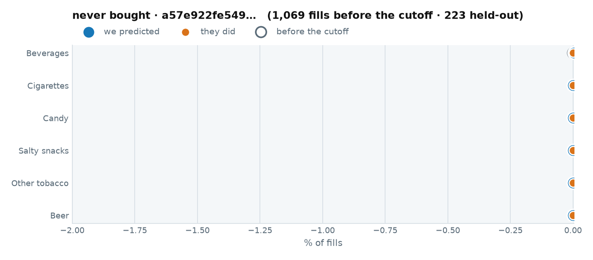

::: {.callout-note collapse="true" title="1 · The raw data we trained on"}

Every fuel visit before 2026-04-01. This is all the model was allowed to see.

::: {.scroll-table}
| when | daypart | grade | store | fuel $ | went in | categories |
|---|---|---|---|---|---|---|
| 2026-03-30 10:45 | midday | REGULAR | 14292 | 37.99 | no | — |
| 2026-03-30 10:10 | midday | REGULAR | 14292 | 38.01 | no | — |
| 2026-03-30 09:47 | morning | REGULAR | 14292 | 38.00 | no | — |
| 2026-03-30 09:11 | morning | REGULAR | 14292 | 44.24 | no | — |
| 2026-03-30 08:06 | morning | REGULAR | 14292 | 38.21 | no | — |
| 2026-03-27 14:45 | midday | REGULAR | 14292 | 19.27 | no | — |
| 2026-03-26 15:58 | evening | REGULAR | 14292 | 19.45 | no | — |
| 2026-03-26 15:35 | evening | REGULAR | 14292 | 20.13 | no | — |
| 2026-03-26 14:01 | midday | REGULAR | 14292 | 19.69 | no | — |
| 2026-03-24 12:56 | midday | REGULAR | 14292 | 20.16 | no | — |
| 2026-03-24 11:07 | midday | REGULAR | 14292 | 19.76 | no | — |
| 2026-03-24 09:49 | morning | REGULAR | 14292 | 20.25 | no | — |
| 2026-03-23 16:49 | evening | REGULAR | 14292 | 43.36 | no | — |
| 2026-03-23 08:12 | morning | REGULAR | 14292 | 19.59 | no | — |
| 2026-03-17 11:54 | midday | DIESEL | 14292 | 33.91 | no | — |
| 2026-03-17 10:17 | midday | REGULAR | 14292 | 20.07 | no | — |
| 2026-03-16 12:16 | midday | REGULAR | 14292 | 19.85 | no | — |
| 2026-03-13 13:39 | midday | REGULAR | 14292 | 17.92 | no | — |
| 2026-03-13 11:52 | midday | REGULAR | 14292 | 18.54 | no | — |
| 2026-03-13 09:53 | morning | DIESEL | 14292 | 24.96 | no | — |
| 2026-03-12 16:27 | evening | REGULAR | 14292 | 18.58 | no | — |
| 2026-03-12 15:09 | evening | DIESEL | 14292 | 43.71 | no | — |
| 2026-03-12 14:10 | midday | REGULAR | 14292 | 18.90 | no | — |
| 2026-03-12 12:53 | midday | DIESEL | 14292 | 28.22 | no | — |
| 2026-03-12 11:26 | midday | REGULAR | 14292 | 17.98 | no | — |
| 2026-03-12 10:01 | midday | DIESEL | 14292 | 25.95 | no | — |
| 2026-03-11 15:31 | evening | REGULAR | 14292 | 18.66 | no | — |
| 2026-03-11 15:01 | evening | REGULAR | 14292 | 18.08 | no | — |
| 2026-03-11 13:53 | midday | REGULAR | 14292 | 18.12 | no | — |
| 2026-03-11 12:33 | midday | REGULAR | 14292 | 18.11 | no | — |
| 2026-03-11 11:14 | midday | REGULAR | 14292 | 17.91 | no | — |
| 2026-03-11 09:19 | morning | REGULAR | 14292 | 17.88 | no | — |
| 2026-03-10 13:38 | midday | REGULAR | 14292 | 16.61 | no | — |
| 2026-03-09 16:31 | evening | DIESEL | 14292 | 27.13 | no | — |
| 2026-03-09 15:00 | evening | REGULAR | 14292 | 16.57 | no | — |
| 2026-03-09 13:11 | midday | REGULAR | 14292 | 16.53 | no | — |
| 2026-03-09 11:47 | midday | REGULAR | 14292 | 16.56 | no | — |
| 2026-03-09 11:21 | midday | DIESEL | 14292 | 95.58 | no | — |
| 2026-03-09 10:27 | midday | REGULAR | 14292 | 36.35 | no | — |
| 2026-03-05 16:40 | evening | REGULAR | 14292 | 15.01 | no | — |
| 2026-03-05 14:48 | midday | DIESEL | 14292 | 26.00 | no | — |
| 2026-03-05 13:16 | midday | REGULAR | 14292 | 14.74 | no | — |
| 2026-03-05 11:29 | midday | DIESEL | 14292 | 23.41 | no | — |
| 2026-03-04 15:20 | evening | REGULAR | 14292 | 15.44 | no | — |
| 2026-03-04 13:36 | midday | REGULAR | 14292 | 15.61 | no | — |
| 2026-03-04 11:44 | midday | DIESEL | 14292 | 21.53 | no | — |
| 2026-03-04 10:16 | midday | REGULAR | 14292 | 14.92 | no | — |
| 2026-03-03 16:01 | evening | DIESEL | 14292 | 22.90 | no | — |
| 2026-03-03 15:00 | evening | REGULAR | 14292 | 15.03 | no | — |
| 2026-03-03 13:22 | midday | REGULAR | 14292 | 15.17 | no | — |
| 2026-03-03 11:38 | midday | REGULAR | 14292 | 15.10 | no | — |
| 2026-03-03 10:18 | midday | REGULAR | 14292 | 14.70 | no | — |
| 2026-03-03 08:20 | morning | REGULAR | 14292 | 14.90 | no | — |
| 2026-03-03 07:56 | morning | REGULAR | 14292 | 29.02 | no | — |
| 2026-03-02 15:21 | evening | REGULAR | 14292 | 15.02 | no | — |
| 2026-02-27 15:00 | evening | REGULAR | 14292 | 14.06 | no | — |
| 2026-02-27 13:45 | midday | DIESEL | 14292 | 19.18 | no | — |
| 2026-02-27 12:24 | midday | REGULAR | 14292 | 13.95 | no | — |
| 2026-02-27 11:07 | midday | DIESEL | 14292 | 19.12 | no | — |
| 2026-02-27 08:51 | morning | REGULAR | 14292 | 27.15 | no | — |
| 2026-02-27 08:32 | morning | REGULAR | 14292 | 13.68 | no | — |
| 2026-02-26 16:57 | evening | DIESEL | 14292 | 71.16 | no | — |
| 2026-02-25 13:55 | midday | REGULAR | 14292 | 14.85 | no | — |
| 2026-02-25 12:15 | midday | REGULAR | 14292 | 15.24 | no | — |
| 2026-02-25 10:54 | midday | REGULAR | 14292 | 14.62 | no | — |
| 2026-02-25 09:40 | morning | REGULAR | 14292 | 14.78 | no | — |
| 2026-02-24 15:42 | evening | REGULAR | 14292 | 14.81 | no | — |
| 2026-02-24 15:11 | evening | REGULAR | 14292 | 55.92 | no | — |
| 2026-02-24 11:47 | midday | REGULAR | 14292 | 14.69 | no | — |
| 2026-02-24 10:10 | midday | REGULAR | 14292 | 14.41 | no | — |
| 2026-02-24 07:52 | morning | REGULAR | 14292 | 14.58 | no | — |
| 2026-02-23 15:38 | evening | REGULAR | 14292 | 12.81 | no | — |
| 2026-02-23 12:07 | midday | DIESEL | 14292 | 19.36 | no | — |
| 2026-02-23 09:51 | morning | REGULAR | 14292 | 12.86 | no | — |
| 2026-02-23 09:22 | morning | REGULAR | 14292 | 12.70 | no | — |
| 2026-02-17 09:24 | morning | DIESEL | 14292 | 33.10 | no | — |
| 2026-02-16 16:04 | evening | DIESEL | 14292 | 18.37 | no | — |
| 2026-02-16 15:47 | evening | REGULAR | 14292 | 13.10 | no | — |
| 2026-02-11 15:17 | evening | DIESEL | 14292 | 17.20 | no | — |
| 2026-02-11 14:50 | midday | REGULAR | 14292 | 13.67 | no | — |
| 2026-02-10 15:42 | evening | DIESEL | 14292 | 33.14 | no | — |
| 2026-02-10 10:55 | midday | DIESEL | 14292 | 16.55 | no | — |
| 2026-02-09 11:47 | midday | REGULAR | 14292 | 12.44 | no | — |
| 2026-02-09 09:37 | morning | REGULAR | 14292 | 12.01 | no | — |
| 2026-02-09 08:27 | morning | REGULAR | 14292 | 12.35 | no | — |
| 2026-02-06 12:03 | midday | REGULAR | 14292 | 27.00 | no | — |
| 2026-02-06 09:34 | morning | REGULAR | 14292 | 25.83 | no | — |
| 2026-02-05 17:08 | evening | REGULAR | 14292 | 12.00 | no | — |
| 2026-02-05 17:03 | evening | REGULAR | 14292 | 12.41 | no | — |
| 2026-02-05 17:03 | evening | REGULAR | 14292 | 12.01 | no | — |
| 2026-02-05 16:48 | evening | REGULAR | 14292 | 12.01 | no | — |
| 2026-02-05 16:44 | evening | REGULAR | 14292 | 12.00 | no | — |
| 2026-02-05 16:43 | evening | REGULAR | 14292 | 13.68 | no | — |
| 2026-02-04 11:49 | midday | REGULAR | 14292 | 12.54 | no | — |
| 2026-02-04 10:57 | midday | REGULAR | 14292 | 12.29 | no | — |
| 2026-02-04 09:31 | morning | REGULAR | 14292 | 12.27 | no | — |
| 2026-02-04 08:00 | morning | REGULAR | 14292 | 12.31 | no | — |
| 2026-02-03 15:15 | evening | REGULAR | 14292 | 24.10 | no | — |
| 2026-02-03 12:09 | midday | DIESEL | 14292 | 19.30 | no | — |
| 2026-02-02 16:25 | evening | REGULAR | 14292 | 26.19 | no | — |
| 2026-02-02 15:14 | evening | REGULAR | 14292 | 40.32 | no | — |
| 2026-01-29 12:36 | midday | REGULAR | 14292 | 12.57 | no | — |
| 2026-01-29 11:35 | midday | REGULAR | 14292 | 12.58 | no | — |
| 2026-01-29 10:49 | midday | REGULAR | 14292 | 12.60 | no | — |
| 2026-01-29 10:07 | midday | REGULAR | 14292 | 12.60 | no | — |
| 2026-01-28 16:32 | evening | REGULAR | 14292 | 12.75 | no | — |
| 2026-01-28 15:45 | evening | REGULAR | 14292 | 13.19 | no | — |
| 2026-01-28 15:23 | evening | REGULAR | 14292 | 12.74 | no | — |
| 2026-01-27 15:41 | evening | REGULAR | 14292 | 27.69 | no | — |
| 2026-01-27 11:04 | midday | REGULAR | 14292 | 26.01 | no | — |
| 2026-01-23 16:03 | evening | REGULAR | 14292 | 28.02 | no | — |
| 2026-01-23 16:02 | evening | REGULAR | 14292 | 28.62 | no | — |
| 2026-01-23 14:29 | midday | REGULAR | 14292 | 25.44 | no | — |
| 2026-01-23 08:37 | morning | DIESEL | 14292 | 17.32 | no | — |
| 2026-01-22 10:58 | midday | REGULAR | 14292 | 13.19 | no | — |
| 2026-01-22 10:42 | midday | DIESEL | 14292 | 17.20 | no | — |
| 2026-01-21 15:37 | evening | REGULAR | 14292 | 12.50 | no | — |
| 2026-01-21 09:15 | morning | DIESEL | 14292 | 16.33 | no | — |
| 2026-01-20 16:14 | evening | REGULAR | 14292 | 12.41 | no | — |
| 2026-01-20 14:35 | midday | DIESEL | 14292 | 19.60 | no | — |
| 2026-01-20 11:31 | midday | DIESEL | 14292 | 19.42 | no | — |
| 2026-01-20 10:21 | midday | REGULAR | 14292 | 12.39 | no | — |
| 2026-01-20 10:04 | midday | REGULAR | 14292 | 12.39 | no | — |
| 2026-01-19 14:38 | midday | REGULAR | 14292 | 15.10 | no | — |
| 2026-01-19 13:20 | midday | REGULAR | 14292 | 12.69 | no | — |
| 2026-01-19 11:49 | midday | REGULAR | 14292 | 12.68 | no | — |
| 2026-01-19 10:45 | midday | REGULAR | 14292 | 12.66 | no | — |
| 2026-01-19 07:45 | morning | DIESEL | 14292 | 17.42 | no | — |
| 2026-01-16 14:02 | midday | REGULAR | 14292 | 26.01 | no | — |
| 2026-01-16 14:00 | midday | REGULAR | 14292 | 10.03 | no | — |
| 2026-01-16 10:26 | midday | REGULAR | 14292 | 13.03 | no | — |
| 2026-01-16 09:05 | morning | REGULAR | 14292 | 12.67 | no | — |
| 2026-01-16 08:47 | morning | REGULAR | 14292 | 12.66 | no | — |
| 2026-01-15 14:31 | midday | DIESEL | 14292 | 17.26 | no | — |
| 2026-01-15 10:37 | midday | DIESEL | 14292 | 18.90 | no | — |
| 2026-01-15 10:08 | midday | DIESEL | 14292 | 33.10 | no | — |
| 2026-01-15 10:03 | midday | REGULAR | 14292 | 56.23 | no | — |
| 2026-01-15 08:10 | morning | REGULAR | 14292 | 54.44 | no | — |
| 2026-01-14 17:15 | evening | REGULAR | 14292 | 30.71 | no | — |
| 2026-01-14 15:34 | evening | DIESEL | 14292 | 20.73 | no | — |
| 2026-01-14 15:15 | evening | DIESEL | 14292 | 20.56 | no | — |
| 2026-01-13 08:36 | morning | REGULAR | 14292 | 13.00 | no | — |
| 2026-01-12 15:26 | evening | REGULAR | 14292 | 13.03 | no | — |
| 2026-01-12 13:57 | midday | REGULAR | 14292 | 14.52 | no | — |
| 2026-01-12 13:36 | midday | REGULAR | 14292 | 13.32 | no | — |
| 2026-01-09 11:57 | midday | REGULAR | 14292 | 18.06 | no | — |
| 2026-01-09 09:53 | morning | REGULAR | 14292 | 20.00 | no | — |
| 2026-01-08 16:58 | evening | DIESEL | 14292 | 20.56 | no | — |
| 2026-01-08 15:34 | evening | DIESEL | 14292 | 21.45 | no | — |
| 2026-01-08 14:00 | midday | REGULAR | 14292 | 13.66 | no | — |
| 2026-01-08 12:00 | midday | REGULAR | 14292 | 13.76 | no | — |
| 2026-01-08 10:55 | midday | REGULAR | 14292 | 13.71 | no | — |
| 2026-01-08 09:49 | morning | REGULAR | 14292 | 13.70 | no | — |
| 2026-01-08 08:43 | morning | REGULAR | 14292 | 13.67 | no | — |
| 2026-01-07 15:20 | evening | REGULAR | 14292 | 14.06 | no | — |
| 2026-01-07 13:56 | midday | REGULAR | 14292 | 13.78 | no | — |
| 2026-01-07 12:48 | midday | REGULAR | 14292 | 13.67 | no | — |
| 2026-01-07 11:18 | midday | REGULAR | 14292 | 13.92 | no | — |
| 2026-01-07 10:27 | midday | REGULAR | 14292 | 13.85 | no | — |
| 2026-01-07 10:11 | midday | DIESEL | 14292 | 17.50 | no | — |
| 2026-01-07 08:23 | morning | REGULAR | 14292 | 32.73 | no | — |
| 2026-01-06 15:54 | evening | DIESEL | 14292 | 18.01 | no | — |
| 2026-01-06 13:38 | midday | REGULAR | 14292 | 14.18 | no | — |
| 2026-01-06 13:06 | midday | REGULAR | 14292 | 59.08 | no | — |
| 2026-01-06 08:14 | morning | REGULAR | 14292 | 20.64 | no | — |
| 2026-01-05 16:33 | evening | REGULAR | 14292 | 31.63 | no | — |
| 2026-01-02 16:20 | evening | DIESEL | 14292 | 24.70 | no | — |
| 2025-12-31 11:12 | midday | REGULAR | 14292 | 61.92 | no | — |
| 2025-12-31 09:20 | morning | DIESEL | 14292 | 21.14 | no | — |
| 2025-12-30 14:03 | midday | DIESEL | 14292 | 19.28 | no | — |
| 2025-12-30 13:50 | midday | REGULAR | 14292 | 12.19 | no | — |
| 2025-12-29 16:46 | evening | REGULAR | 14292 | 20.01 | no | — |
| 2025-12-29 09:01 | morning | DIESEL | 14292 | 90.02 | no | — |
| 2025-12-24 10:24 | midday | DIESEL | 14292 | 20.11 | no | — |
| 2025-12-22 10:03 | midday | DIESEL | 14292 | 20.06 | no | — |
| 2025-12-19 13:48 | midday | REGULAR | 14292 | 12.50 | no | — |
| 2025-12-19 13:02 | midday | REGULAR | 14292 | 12.54 | no | — |
| 2025-12-19 10:54 | midday | REGULAR | 14292 | 12.51 | no | — |
| 2025-12-19 10:33 | midday | DIESEL | 14292 | 20.76 | no | — |
| 2025-12-19 10:19 | midday | REGULAR | 14292 | 12.54 | no | — |
| 2025-12-19 09:01 | morning | REGULAR | 14292 | 12.65 | no | — |
| 2025-12-19 08:21 | morning | REGULAR | 14292 | 12.50 | no | — |
| 2025-12-18 15:52 | evening | DIESEL | 14292 | 113.34 | no | — |
| 2025-12-18 15:34 | evening | DIESEL | 14292 | 20.07 | no | — |
| 2025-12-18 15:14 | evening | REGULAR | 14292 | 34.67 | no | — |
| 2025-12-18 10:41 | midday | DIESEL | 14292 | 16.62 | no | — |
| 2025-12-18 09:45 | morning | DIESEL | 14292 | 16.57 | no | — |
| 2025-12-18 08:34 | morning | REGULAR | 14292 | 13.01 | no | — |
| 2025-12-17 14:26 | midday | REGULAR | 14292 | 13.07 | no | — |
| 2025-12-17 14:07 | midday | REGULAR | 14292 | 10.62 | no | — |
| 2025-12-17 11:57 | midday | DIESEL | 14292 | 16.52 | no | — |
| 2025-12-17 11:41 | midday | REGULAR | 14292 | 13.01 | no | — |
| 2025-12-17 10:18 | midday | REGULAR | 14292 | 13.00 | no | — |
| 2025-12-17 08:51 | morning | REGULAR | 14292 | 13.00 | no | — |
| 2025-12-17 08:50 | morning | REGULAR | 14292 | 13.09 | no | — |
| 2025-12-15 08:46 | morning | DIESEL | 14292 | 33.07 | no | — |
| 2025-12-05 13:55 | midday | REGULAR | 14292 | 12.95 | no | — |
| 2025-12-02 09:18 | morning | REGULAR | 14292 | 25.10 | no | — |
| 2025-12-01 16:09 | evening | REGULAR | 14292 | 26.74 | no | — |
| 2025-12-01 12:24 | midday | REGULAR | 14292 | 28.92 | no | — |
| 2025-11-19 11:02 | midday | REGULAR | 14292 | 12.53 | no | — |
| 2025-11-18 08:55 | morning | REGULAR | 14292 | 27.56 | no | — |
| 2025-11-17 13:55 | midday | REGULAR | 14292 | 17.78 | no | — |
| 2025-11-17 08:02 | morning | REGULAR | 14292 | 12.51 | no | — |
| 2025-11-17 08:02 | morning | REGULAR | 14292 | 12.56 | no | — |
| 2025-11-14 10:55 | midday | REGULAR | 14292 | 13.25 | no | — |
| 2025-11-14 09:25 | morning | REGULAR | 14292 | 31.71 | no | — |
| 2025-11-14 08:46 | morning | REGULAR | 14292 | 29.18 | no | — |
| 2025-11-12 14:27 | midday | REGULAR | 14292 | 35.50 | no | — |
| 2025-10-29 15:56 | evening | DIESEL | 14292 | 19.82 | no | — |
| 2025-10-29 15:36 | evening | REGULAR | 14292 | 13.17 | no | — |
| 2025-10-29 13:36 | midday | REGULAR | 14292 | 13.36 | no | — |
| 2025-10-29 11:28 | midday | REGULAR | 14292 | 13.25 | no | — |
| 2025-10-28 14:34 | midday | REGULAR | 14292 | 13.20 | no | — |
| 2025-10-28 14:07 | midday | REGULAR | 14292 | 13.68 | no | — |
| 2025-10-24 16:25 | evening | REGULAR | 14292 | 13.73 | no | — |
| 2025-10-24 12:39 | midday | REGULAR | 14292 | 14.09 | no | — |
| 2025-10-24 10:15 | midday | DIESEL | 14292 | 0.1600 | no | — |
| 2025-10-24 10:12 | midday | DIESEL | 14292 | 0.1700 | no | — |
| 2025-10-23 13:58 | midday | REGULAR | 14292 | 13.51 | no | — |
| 2025-10-23 09:20 | morning | DIESEL | 14292 | 20.46 | no | — |
| 2025-10-23 09:00 | morning | DIESEL | 14292 | 17.37 | no | — |
| 2025-10-23 08:59 | morning | REGULAR | 14292 | 13.50 | no | — |
| 2025-10-22 16:29 | evening | REGULAR | 14292 | 13.70 | no | — |
| 2025-10-22 14:54 | midday | REGULAR | 14292 | 41.86 | no | — |
| 2025-10-22 14:53 | midday | REGULAR | 14292 | 13.37 | no | — |
| 2025-10-22 13:51 | midday | REGULAR | 14292 | 13.10 | no | — |
| 2025-10-22 10:37 | midday | DIESEL | 14292 | 17.52 | no | — |
| 2025-10-22 09:18 | morning | REGULAR | 14292 | 13.10 | no | — |
| 2025-10-21 15:59 | evening | DIESEL | 14292 | 28.26 | no | — |
| 2025-10-21 14:26 | midday | REGULAR | 14292 | 13.06 | no | — |
| 2025-10-21 13:11 | midday | REGULAR | 14292 | 13.14 | no | — |
| 2025-10-21 08:43 | morning | REGULAR | 14292 | 33.46 | no | — |
| 2025-10-20 15:23 | evening | REGULAR | 14292 | 13.11 | no | — |
| 2025-10-20 12:57 | midday | REGULAR | 14292 | 13.20 | no | — |
| 2025-10-20 10:44 | midday | DIESEL | 14292 | 17.78 | no | — |
| 2025-10-20 09:38 | morning | REGULAR | 14292 | 8.98 | no | — |
| 2025-10-20 09:34 | morning | REGULAR | 14292 | 5.68 | no | — |
| 2025-10-20 08:46 | morning | DIESEL | 14292 | 17.60 | no | — |
| 2025-10-17 17:10 | evening | DIESEL | 14292 | 120.03 | no | — |
| 2025-10-17 11:02 | midday | REGULAR | 14292 | 13.82 | no | — |
| 2025-10-16 14:58 | midday | REGULAR | 14292 | 13.70 | no | — |
| 2025-10-15 15:19 | evening | REGULAR | 14292 | 13.52 | no | — |
| 2025-10-15 14:27 | midday | REGULAR | 14292 | 13.82 | no | — |
| 2025-10-15 13:08 | midday | REGULAR | 14292 | 13.60 | no | — |
| 2025-10-15 09:57 | morning | REGULAR | 14292 | 13.66 | no | — |
| 2025-10-14 16:28 | evening | REGULAR | 14292 | 13.55 | no | — |
| 2025-10-14 10:27 | midday | REGULAR | 14292 | 13.63 | no | — |
| 2025-10-13 14:26 | midday | REGULAR | 14292 | 14.16 | no | — |
| 2025-10-13 13:15 | midday | REGULAR | 14292 | 13.92 | no | — |
| 2025-10-13 11:34 | midday | REGULAR | 14292 | 13.56 | no | — |
| 2025-10-13 08:31 | morning | REGULAR | 14292 | 13.63 | no | — |
| 2025-10-10 15:32 | evening | DIESEL | 14292 | 120.21 | no | — |
| 2025-10-10 12:36 | midday | REGULAR | 14292 | 57.55 | no | — |
| 2025-10-09 16:20 | evening | REGULAR | 14292 | 13.58 | no | — |
| 2025-10-09 14:41 | midday | DIESEL | 14292 | 18.61 | no | — |
| 2025-10-09 10:37 | midday | REGULAR | 14292 | 13.75 | no | — |
| 2025-10-09 10:06 | midday | DIESEL | 14292 | 21.82 | no | — |
| 2025-10-08 16:06 | evening | REGULAR | 14292 | 13.92 | no | — |
| 2025-10-08 14:44 | midday | REGULAR | 14292 | 13.69 | no | — |
| 2025-10-08 14:24 | midday | REGULAR | 14292 | 13.69 | no | — |
| 2025-10-08 12:27 | midday | REGULAR | 14292 | 13.66 | no | — |
| 2025-10-08 10:29 | midday | REGULAR | 14292 | 14.10 | no | — |
| 2025-10-08 10:09 | midday | REGULAR | 14292 | 13.65 | no | — |
| 2025-10-07 14:51 | midday | REGULAR | 14292 | 27.06 | no | — |
| 2025-10-07 13:33 | midday | REGULAR | 14292 | 14.23 | no | — |
| 2025-10-07 11:49 | midday | DIESEL | 14292 | 18.16 | no | — |
| 2025-10-07 11:46 | midday | REGULAR | 14292 | 67.13 | no | — |
| 2025-10-07 11:06 | midday | REGULAR | 14292 | 13.66 | no | — |
| 2025-10-07 10:48 | midday | REGULAR | 14292 | 13.69 | no | — |
| 2025-10-07 09:46 | morning | REGULAR | 14292 | 27.45 | no | — |
| 2025-10-07 09:45 | morning | REGULAR | 14292 | 13.92 | no | — |
| 2025-10-06 16:10 | evening | REGULAR | 14292 | 14.29 | no | — |
| 2025-10-06 14:45 | midday | DIESEL | 14292 | 21.62 | no | — |
| 2025-10-06 13:26 | midday | DIESEL | 14292 | 21.75 | no | — |
| 2025-10-06 11:23 | midday | DIESEL | 14292 | 25.21 | no | — |
| 2025-10-06 10:47 | midday | DIESEL | 14292 | 119.80 | no | — |
| 2025-10-06 10:21 | midday | DIESEL | 14292 | 25.53 | no | — |
| 2025-10-06 09:03 | morning | REGULAR | 14292 | 14.08 | no | — |
| 2025-10-03 15:22 | evening | REGULAR | 14292 | 14.13 | no | — |
| 2025-10-03 15:06 | evening | REGULAR | 14292 | 14.12 | no | — |
| 2025-10-03 14:12 | midday | REGULAR | 14292 | 14.19 | no | — |
| 2025-10-03 13:55 | midday | REGULAR | 14292 | 14.21 | no | — |
| 2025-10-03 12:17 | midday | REGULAR | 14292 | 14.26 | no | — |
| 2025-10-03 11:54 | midday | REGULAR | 14292 | 14.12 | no | — |
| 2025-10-02 16:38 | evening | DIESEL | 14292 | 47.43 | no | — |
| 2025-10-02 16:05 | evening | REGULAR | 14292 | 14.37 | no | — |
| 2025-10-02 15:29 | evening | REGULAR | 14292 | 2.58 | no | — |
| 2025-10-02 15:26 | evening | REGULAR | 14292 | 14.18 | no | — |
| 2025-10-02 14:15 | midday | REGULAR | 14292 | 14.73 | no | — |
| 2025-10-02 13:53 | midday | REGULAR | 14292 | 14.63 | no | — |
| 2025-10-02 12:17 | midday | DIESEL | 14292 | 18.43 | no | — |
| 2025-10-02 10:57 | midday | REGULAR | 14292 | 14.82 | no | — |
| 2025-10-02 10:36 | midday | REGULAR | 14292 | 33.13 | no | — |
| 2025-10-02 10:24 | midday | REGULAR | 14292 | 34.14 | no | — |
| 2025-10-02 09:59 | morning | REGULAR | 14292 | 14.70 | no | — |
| 2025-10-02 09:39 | morning | REGULAR | 14292 | 29.04 | no | — |
| 2025-10-02 08:06 | morning | REGULAR | 14292 | 13.60 | no | — |
| 2025-10-01 16:41 | evening | REGULAR | 14292 | 30.07 | no | — |
| 2025-10-01 16:08 | evening | REGULAR | 14292 | 33.07 | no | — |
| 2025-10-01 15:38 | evening | REGULAR | 14292 | 31.05 | no | — |
| 2025-10-01 15:02 | evening | REGULAR | 14292 | 95.78 | no | — |
| 2025-10-01 14:26 | midday | REGULAR | 14292 | 31.04 | no | — |
| 2025-10-01 12:01 | midday | DIESEL | 14292 | 112.66 | no | — |
| 2025-10-01 09:59 | morning | REGULAR | 14292 | 32.02 | no | — |
| 2025-09-30 16:23 | evening | REGULAR | 14292 | 31.82 | no | — |
| 2025-09-30 15:48 | evening | REGULAR | 14292 | 29.22 | no | — |
| 2025-09-30 15:15 | evening | DIESEL | 14292 | 17.94 | no | — |
| 2025-09-30 14:38 | midday | REGULAR | 14292 | 40.36 | no | — |
| 2025-09-30 14:22 | midday | REGULAR | 14292 | 31.00 | no | — |
| 2025-09-30 13:07 | midday | DIESEL | 14292 | 18.71 | no | — |
| 2025-09-30 12:49 | midday | REGULAR | 14292 | 13.56 | no | — |
| 2025-09-30 09:38 | morning | REGULAR | 14292 | 43.64 | no | — |
| 2025-09-30 09:18 | morning | REGULAR | 14292 | 62.24 | no | — |
| 2025-09-29 16:30 | evening | REGULAR | 14292 | 13.60 | no | — |
| 2025-09-29 15:50 | evening | REGULAR | 14292 | 13.76 | no | — |
| 2025-09-29 15:32 | evening | DIESEL | 14292 | 110.89 | no | — |
| 2025-09-29 15:13 | evening | DIESEL | 14292 | 17.07 | no | — |
| 2025-09-29 13:59 | midday | REGULAR | 14292 | 13.64 | no | — |
| 2025-09-29 11:33 | midday | DIESEL | 14292 | 34.31 | no | — |
| 2025-09-29 10:18 | midday | REGULAR | 14292 | 13.66 | no | — |
| 2025-09-29 10:01 | midday | REGULAR | 14292 | 31.64 | no | — |
| 2025-09-29 08:27 | morning | REGULAR | 14292 | 13.54 | no | — |
| 2025-09-29 07:29 | morning | REGULAR | 14292 | 14.08 | no | — |
| 2025-09-26 16:00 | evening | DIESEL | 14292 | 71.36 | no | — |
| 2025-09-26 15:40 | evening | REGULAR | 14292 | 48.67 | no | — |
| 2025-09-26 14:42 | midday | DIESEL | 14292 | 17.17 | no | — |
| 2025-09-26 13:12 | midday | REGULAR | 14292 | 13.62 | no | — |
| 2025-09-26 11:51 | midday | REGULAR | 14292 | 13.68 | no | — |
| 2025-09-26 10:23 | midday | REGULAR | 14292 | 13.54 | no | — |
| 2025-09-25 16:34 | evening | REGULAR | 14292 | 28.40 | no | — |
| 2025-09-25 15:48 | evening | REGULAR | 14292 | 13.65 | no | — |
| 2025-09-25 15:25 | evening | REGULAR | 14292 | 13.66 | no | — |
| 2025-09-25 14:28 | midday | REGULAR | 14292 | 13.70 | no | — |
| 2025-09-25 14:03 | midday | REGULAR | 14292 | 13.57 | no | — |
| 2025-09-25 11:53 | midday | REGULAR | 14292 | 13.58 | no | — |
| 2025-09-25 11:35 | midday | REGULAR | 14292 | 32.66 | no | — |
| 2025-09-25 10:45 | midday | REGULAR | 14292 | 43.46 | no | — |
| 2025-09-25 10:12 | midday | REGULAR | 14292 | 13.55 | no | — |
| 2025-09-25 09:11 | morning | REGULAR | 14292 | 13.51 | no | — |
| 2025-09-24 16:46 | evening | REGULAR | 14292 | 43.00 | no | — |
| 2025-09-24 16:45 | evening | REGULAR | 14292 | 32.00 | no | — |
| 2025-09-24 15:37 | evening | REGULAR | 14292 | 13.63 | no | — |
| 2025-09-24 15:12 | evening | REGULAR | 14292 | 43.91 | no | — |
| 2025-09-24 13:45 | midday | REGULAR | 14292 | 13.61 | no | — |
| 2025-09-24 12:42 | midday | REGULAR | 14292 | 13.57 | no | — |
| 2025-09-24 10:54 | midday | REGULAR | 14292 | 13.63 | no | — |
| 2025-09-23 16:26 | evening | REGULAR | 14292 | 13.58 | no | — |
| 2025-09-23 16:09 | evening | REGULAR | 14292 | 13.59 | no | — |
| 2025-09-23 15:15 | evening | REGULAR | 14292 | 13.60 | no | — |
| 2025-09-23 14:58 | midday | REGULAR | 14292 | 14.86 | no | — |
| 2025-09-23 14:17 | midday | REGULAR | 14292 | 13.62 | no | — |
| 2025-09-23 12:58 | midday | REGULAR | 14292 | 13.60 | no | — |
| 2025-09-23 12:41 | midday | REGULAR | 14292 | 29.87 | no | — |
| 2025-09-23 08:20 | morning | REGULAR | 14292 | 13.60 | no | — |
| 2025-09-22 15:45 | evening | REGULAR | 14292 | 34.39 | no | — |
| 2025-09-22 11:32 | midday | REGULAR | 14292 | 56.75 | no | — |
| 2025-09-22 09:54 | morning | REGULAR | 14292 | 21.86 | no | — |
| 2025-09-19 16:40 | evening | REGULAR | 14292 | 14.71 | no | — |
| 2025-09-19 14:53 | midday | REGULAR | 14292 | 14.82 | no | — |
| 2025-09-19 14:20 | midday | REGULAR | 14292 | 14.63 | no | — |
| 2025-09-19 13:18 | midday | REGULAR | 14292 | 15.06 | no | — |
| 2025-09-19 11:54 | midday | REGULAR | 14292 | 14.75 | no | — |
| 2025-09-19 10:59 | midday | REGULAR | 14292 | 47.02 | no | — |
| 2025-09-19 10:27 | midday | REGULAR | 14292 | 14.56 | no | — |
| 2025-09-19 09:17 | morning | REGULAR | 14292 | 30.29 | no | — |
| 2025-09-18 16:15 | evening | DIESEL | 14292 | 35.00 | no | — |
| 2025-09-18 15:40 | evening | DIESEL | 14292 | 17.66 | no | — |
| 2025-09-18 15:14 | evening | REGULAR | 14292 | 30.30 | no | — |
| 2025-09-18 13:58 | midday | REGULAR | 14292 | 31.83 | no | — |
| 2025-09-18 13:56 | midday | REGULAR | 14292 | 33.55 | no | — |
| 2025-09-18 13:15 | midday | REGULAR | 14292 | 14.54 | no | — |
| 2025-09-18 10:39 | midday | REGULAR | 14292 | 14.59 | no | — |
| 2025-09-18 09:01 | morning | DIESEL | 14292 | 17.88 | no | — |
| 2025-09-17 16:17 | evening | REGULAR | 14292 | 13.65 | no | — |
| 2025-09-17 15:23 | evening | REGULAR | 14292 | 13.62 | no | — |
| 2025-09-17 13:41 | midday | REGULAR | 14292 | 13.59 | no | — |
| 2025-09-17 12:04 | midday | REGULAR | 14292 | 67.81 | no | — |
| 2025-09-17 10:44 | midday | REGULAR | 14292 | 13.58 | no | — |
| 2025-09-17 07:35 | morning | REGULAR | 14292 | 13.62 | no | — |
| 2025-09-16 15:15 | evening | DIESEL | 14292 | 16.94 | no | — |
| 2025-09-16 13:35 | midday | REGULAR | 14292 | 13.50 | no | — |
| 2025-09-16 11:34 | midday | REGULAR | 14292 | 13.63 | no | — |
| 2025-09-16 09:31 | morning | REGULAR | 14292 | 13.51 | no | — |
| 2025-09-16 07:47 | morning | REGULAR | 14292 | 13.59 | no | — |
| 2025-09-15 16:52 | evening | DIESEL | 14292 | 80.62 | no | — |
| 2025-09-15 16:49 | evening | DIESEL | 14292 | 16.38 | no | — |
| 2025-09-15 14:54 | midday | DIESEL | 14292 | 33.33 | no | — |
| 2025-09-15 14:26 | midday | REGULAR | 14292 | 33.88 | no | — |
| 2025-09-15 13:55 | midday | DIESEL | 14292 | 16.70 | no | — |
| 2025-09-15 12:30 | midday | REGULAR | 14292 | 13.54 | no | — |
| 2025-09-15 10:53 | midday | DIESEL | 14292 | 16.61 | no | — |
| 2025-09-12 14:59 | midday | REGULAR | 14292 | 13.59 | no | — |
| 2025-09-12 13:52 | midday | REGULAR | 14292 | 13.64 | no | — |
| 2025-09-12 12:48 | midday | REGULAR | 14292 | 13.52 | no | — |
| 2025-09-12 11:01 | midday | DIESEL | 14292 | 35.44 | no | — |
| 2025-09-11 16:04 | evening | REGULAR | 14292 | 14.61 | no | — |
| 2025-09-11 15:24 | evening | DIESEL | 14292 | 35.01 | no | — |
| 2025-09-11 15:21 | evening | REGULAR | 14292 | 66.70 | no | — |
| 2025-09-11 14:51 | midday | REGULAR | 14292 | 14.52 | no | — |
| 2025-09-11 13:43 | midday | REGULAR | 14292 | 14.59 | no | — |
| 2025-09-11 12:48 | midday | REGULAR | 14292 | 31.03 | no | — |
| 2025-09-11 11:22 | midday | REGULAR | 14292 | 73.00 | no | — |
| 2025-09-11 08:18 | morning | REGULAR | 14292 | 14.56 | no | — |
| 2025-09-11 08:00 | morning | REGULAR | 14292 | 14.52 | no | — |
| 2025-09-10 11:40 | midday | DIESEL | 14292 | 117.54 | no | — |
| 2025-09-10 09:25 | morning | REGULAR | 14292 | 14.63 | no | — |
| 2025-09-09 16:02 | evening | REGULAR | 14292 | 14.72 | no | — |
| 2025-09-09 15:35 | evening | REGULAR | 14292 | 14.70 | no | — |
| 2025-09-09 15:16 | evening | REGULAR | 14292 | 14.63 | no | — |
| 2025-09-09 15:00 | evening | REGULAR | 14292 | 10.61 | no | — |
| 2025-09-09 13:56 | midday | REGULAR | 14292 | 14.67 | no | — |
| 2025-09-09 11:59 | midday | DIESEL | 14292 | 17.71 | no | — |
| 2025-09-08 15:54 | evening | REGULAR | 14292 | 14.64 | no | — |
| 2025-09-08 14:41 | midday | REGULAR | 14292 | 14.64 | no | — |
| 2025-09-08 12:23 | midday | REGULAR | 14292 | 56.64 | no | — |
| 2025-09-08 10:45 | midday | REGULAR | 14292 | 13.61 | no | — |
| 2025-09-06 12:35 | midday | PREMIUM | 14292 | 16.50 | no | — |
| 2025-09-06 12:33 | midday | PREMIUM | 14292 | 16.50 | no | — |
| 2025-09-05 16:40 | evening | REGULAR | 14292 | 33.06 | no | — |
| 2025-09-05 16:14 | evening | REGULAR | 14292 | 49.55 | no | — |
| 2025-09-05 13:53 | midday | REGULAR | 14292 | 39.04 | no | — |
| 2025-09-04 13:31 | midday | REGULAR | 14292 | 14.13 | no | — |
| 2025-09-04 13:15 | midday | REGULAR | 14292 | 14.13 | no | — |
| 2025-09-04 11:40 | midday | REGULAR | 14292 | 14.22 | no | — |
| 2025-09-04 09:50 | morning | REGULAR | 14292 | 14.13 | no | — |
| 2025-09-03 17:10 | evening | REGULAR | 14292 | 51.23 | no | — |
| 2025-09-03 16:09 | evening | REGULAR | 14292 | 14.07 | no | — |
| 2025-09-03 15:46 | evening | REGULAR | 14292 | 14.17 | no | — |
| 2025-09-03 14:52 | midday | REGULAR | 14292 | 14.09 | no | — |
| 2025-09-03 13:55 | midday | REGULAR | 14292 | 14.18 | no | — |
| 2025-09-03 12:57 | midday | REGULAR | 14292 | 14.06 | no | — |
| 2025-09-03 10:41 | midday | PREMIUM | 14292 | 17.01 | no | — |
| 2025-09-03 10:11 | midday | REGULAR | 14292 | 14.06 | no | — |
| 2025-09-03 08:23 | morning | PREMIUM | 14292 | 17.06 | no | — |
| 2025-09-02 15:57 | evening | REGULAR | 14292 | 14.65 | no | — |
| 2025-09-02 15:28 | evening | REGULAR | 14292 | 55.25 | no | — |
| 2025-09-02 11:57 | midday | REGULAR | 14292 | 33.91 | no | — |
| 2025-09-02 11:56 | midday | REGULAR | 14292 | 30.76 | no | — |
| 2025-09-02 09:16 | morning | PREMIUM | 14292 | 17.02 | no | — |
| 2025-08-29 16:26 | evening | DIESEL | 14292 | 17.69 | no | — |
| 2025-08-29 16:06 | evening | REGULAR | 14292 | 14.61 | no | — |
| 2025-08-29 13:30 | midday | DIESEL | 14292 | 17.63 | no | — |
| 2025-08-29 12:42 | midday | REGULAR | 14292 | 24.53 | no | — |
| 2025-08-29 12:07 | midday | REGULAR | 14292 | 15.03 | no | — |
| 2025-08-29 11:03 | midday | REGULAR | 14292 | 35.17 | no | — |
| 2025-08-28 16:20 | evening | PREMIUM | 14292 | 18.00 | no | — |
| 2025-08-28 15:49 | evening | REGULAR | 14292 | 15.16 | no | — |
| 2025-08-28 14:40 | midday | REGULAR | 14292 | 15.26 | no | — |
| 2025-08-28 11:35 | midday | REGULAR | 14292 | 15.12 | no | — |
| 2025-08-27 16:14 | evening | REGULAR | 14292 | 15.11 | no | — |
| 2025-08-27 12:30 | midday | REGULAR | 14292 | 15.32 | no | — |
| 2025-08-27 12:08 | midday | DIESEL | 14292 | 17.59 | no | — |
| 2025-08-26 16:16 | evening | REGULAR | 14292 | 15.16 | no | — |
| 2025-08-26 14:40 | midday | REGULAR | 14292 | 15.12 | no | — |
| 2025-08-26 12:54 | midday | REGULAR | 14292 | 15.11 | no | — |
| 2025-08-26 10:44 | midday | DIESEL | 14292 | 17.57 | no | — |
| 2025-08-25 17:14 | evening | PREMIUM | 14292 | 18.10 | no | — |
| 2025-08-25 16:36 | evening | REGULAR | 14292 | 44.65 | no | — |
| 2025-08-25 16:35 | evening | REGULAR | 14292 | 15.12 | no | — |
| 2025-08-25 15:45 | evening | DIESEL | 14292 | 17.59 | no | — |
| 2025-08-25 14:33 | midday | DIESEL | 14292 | 17.52 | no | — |
| 2025-08-25 14:12 | midday | REGULAR | 14292 | 25.00 | no | — |
| 2025-08-25 10:57 | midday | REGULAR | 14292 | 55.29 | no | — |
| 2025-08-25 08:39 | morning | REGULAR | 14292 | 13.11 | no | — |
| 2025-08-25 08:02 | morning | PREMIUM | 14292 | 16.08 | no | — |
| 2025-08-22 15:53 | evening | REGULAR | 14292 | 44.88 | no | — |
| 2025-08-22 15:07 | evening | REGULAR | 14292 | 14.17 | no | — |
| 2025-08-22 13:55 | midday | REGULAR | 14292 | 34.91 | no | — |
| 2025-08-22 12:48 | midday | REGULAR | 14292 | 14.11 | no | — |
| 2025-08-22 11:31 | midday | REGULAR | 14292 | 14.08 | no | — |
| 2025-08-22 09:54 | morning | REGULAR | 14292 | 14.12 | no | — |
| 2025-08-22 08:33 | morning | REGULAR | 14292 | 42.01 | no | — |
| 2025-08-21 15:04 | evening | DIESEL | 14292 | 35.19 | no | — |
| 2025-08-21 14:40 | midday | PREMIUM | 14292 | 85.38 | no | — |
| 2025-08-21 13:38 | midday | DIESEL | 14292 | 17.70 | no | — |
| 2025-08-21 12:00 | midday | REGULAR | 14292 | 14.11 | no | — |
| 2025-08-21 11:34 | midday | PREMIUM | 14292 | 17.11 | no | — |
| 2025-08-21 09:45 | morning | REGULAR | 14292 | 14.06 | no | — |
| 2025-08-21 08:06 | morning | REGULAR | 14292 | 14.14 | no | — |
| 2025-08-20 15:10 | evening | REGULAR | 14292 | 14.17 | no | — |
| 2025-08-20 13:43 | midday | REGULAR | 14292 | 14.09 | no | — |
| 2025-08-20 12:31 | midday | REGULAR | 14292 | 14.10 | no | — |
| 2025-08-20 11:40 | midday | PREMIUM | 14292 | 17.09 | no | — |
| 2025-08-20 11:16 | midday | REGULAR | 14292 | 14.07 | no | — |
| 2025-08-20 09:59 | morning | REGULAR | 14292 | 14.19 | no | — |
| 2025-08-19 15:39 | evening | DIESEL | 14292 | 17.64 | no | — |
| 2025-08-19 15:12 | evening | PREMIUM | 14292 | 17.43 | no | — |
| 2025-08-19 13:48 | midday | REGULAR | 14292 | 13.12 | no | — |
| 2025-08-19 12:16 | midday | REGULAR | 14292 | 13.12 | no | — |
| 2025-08-19 09:57 | morning | DIESEL | 14292 | 17.57 | no | — |
| 2025-08-18 14:52 | midday | DIESEL | 14292 | 17.57 | no | — |
| 2025-08-18 13:49 | midday | MID/PLUS | 14292 | 0.4100 | no | — |
| 2025-08-18 13:46 | midday | REGULAR | 14292 | 0.2900 | no | — |
| 2025-08-18 11:20 | midday | DIESEL | 14292 | 17.59 | no | — |
| 2025-08-18 09:07 | morning | DIESEL | 14292 | 17.54 | no | — |
| 2025-08-15 16:34 | evening | REGULAR | 14292 | 30.10 | no | — |
| 2025-08-15 16:11 | evening | REGULAR | 14292 | 30.73 | no | — |
| 2025-08-15 16:10 | evening | REGULAR | 14292 | 31.28 | no | — |
| 2025-08-15 15:46 | evening | REGULAR | 14292 | 28.86 | no | — |
| 2025-08-15 15:45 | evening | REGULAR | 14292 | 29.79 | no | — |
| 2025-08-15 12:43 | midday | PREMIUM | 14292 | 67.46 | no | — |
| 2025-08-15 12:18 | midday | REGULAR | 14292 | 44.96 | no | — |
| 2025-08-15 11:06 | midday | REGULAR | 14292 | 13.04 | no | — |
| 2025-08-15 11:04 | midday | REGULAR | 14292 | 48.75 | no | — |
| 2025-08-15 10:09 | midday | REGULAR | 14292 | 30.02 | no | — |
| 2025-08-14 15:36 | evening | REGULAR | 14292 | 31.50 | no | — |
| 2025-08-14 13:58 | midday | REGULAR | 14292 | 13.50 | no | — |
| 2025-08-14 12:53 | midday | DIESEL | 14292 | 17.64 | no | — |
| 2025-08-14 09:43 | morning | REGULAR | 14292 | 13.52 | no | — |
| 2025-08-14 09:01 | morning | REGULAR | 14292 | 30.69 | no | — |
| 2025-08-14 07:40 | morning | REGULAR | 14292 | 13.69 | no | — |
| 2025-08-13 15:19 | evening | PREMIUM | 14292 | 16.55 | no | — |
| 2025-08-13 14:14 | midday | DIESEL | 14292 | 17.54 | no | — |
| 2025-08-13 12:51 | midday | DIESEL | 14292 | 17.69 | no | — |
| 2025-08-13 11:08 | midday | REGULAR | 14292 | 13.68 | no | — |
| 2025-08-13 09:16 | morning | REGULAR | 14292 | 13.54 | no | — |
| 2025-08-12 16:17 | evening | REGULAR | 14292 | 13.56 | no | — |
| 2025-08-12 15:48 | evening | REGULAR | 14292 | 14.00 | no | — |
| 2025-08-12 14:25 | midday | REGULAR | 14292 | 13.58 | no | — |
| 2025-08-12 13:21 | midday | REGULAR | 14292 | 13.61 | no | — |
| 2025-08-12 12:18 | midday | REGULAR | 14292 | 13.62 | no | — |
| 2025-08-12 11:08 | midday | DIESEL | 14292 | 117.72 | no | — |
| 2025-08-11 14:19 | midday | REGULAR | 14292 | 13.62 | no | — |
| 2025-08-11 09:39 | morning | REGULAR | 14292 | 43.23 | no | — |
| 2025-08-09 11:12 | midday | DIESEL | 14292 | 53.35 | no | — |
| 2025-08-08 16:02 | evening | REGULAR | 14292 | 33.87 | no | — |
| 2025-08-08 16:02 | evening | DIESEL | 14292 | 17.67 | no | — |
| 2025-08-08 13:47 | midday | PREMIUM | 14292 | 17.00 | no | — |
| 2025-08-08 11:17 | midday | REGULAR | 14292 | 14.03 | no | — |
| 2025-08-08 08:28 | morning | REGULAR | 14292 | 14.00 | no | — |
| 2025-08-08 07:40 | morning | REGULAR | 14292 | 34.29 | no | — |
| 2025-08-08 07:27 | morning | REGULAR | 14292 | 52.45 | no | — |
| 2025-08-07 15:07 | evening | PREMIUM | 14292 | 17.07 | no | — |
| 2025-08-07 12:50 | midday | DIESEL | 14292 | 17.64 | no | — |
| 2025-08-06 16:10 | evening | DIESEL | 14292 | 15.73 | no | — |
| 2025-08-06 15:34 | evening | REGULAR | 14292 | 29.03 | no | — |
| 2025-08-06 14:55 | midday | REGULAR | 14292 | 14.63 | no | — |
| 2025-08-06 13:30 | midday | REGULAR | 14292 | 33.75 | no | — |
| 2025-08-06 11:27 | midday | REGULAR | 14292 | 14.61 | no | — |
| 2025-08-06 11:04 | midday | PREMIUM | 14292 | 17.59 | no | — |
| 2025-08-06 09:55 | morning | REGULAR | 14292 | 14.59 | no | — |
| 2025-08-06 08:10 | morning | DIESEL | 14292 | 17.69 | no | — |
| 2025-08-05 15:49 | evening | REGULAR | 14292 | 14.59 | no | — |
| 2025-08-05 14:50 | midday | REGULAR | 14292 | 14.85 | no | — |
| 2025-08-05 14:49 | midday | PREMIUM | 14292 | 17.57 | no | — |
| 2025-08-05 14:24 | midday | REGULAR | 14292 | 53.32 | no | — |
| 2025-08-04 15:35 | evening | REGULAR | 14292 | 13.03 | no | — |
| 2025-08-04 14:16 | midday | DIESEL | 14292 | 17.64 | no | — |
| 2025-08-04 11:38 | midday | DIESEL | 14292 | 35.00 | no | — |
| 2025-08-04 10:30 | midday | PREMIUM | 14292 | 16.03 | no | — |
| 2025-08-04 09:38 | morning | REGULAR | 14292 | 29.23 | no | — |
| 2025-08-01 16:14 | evening | DIESEL | 14292 | 17.51 | no | — |
| 2025-08-01 14:54 | midday | REGULAR | 14292 | 13.10 | no | — |
| 2025-08-01 14:27 | midday | DIESEL | 14292 | 17.63 | no | — |
| 2025-08-01 14:09 | midday | DIESEL | 14292 | 17.57 | no | — |
| 2025-08-01 11:27 | midday | DIESEL | 14292 | 17.64 | no | — |
| 2025-08-01 09:41 | morning | PREMIUM | 14292 | 16.09 | no | — |
| 2025-08-01 08:43 | morning | REGULAR | 14292 | 13.19 | no | — |
| 2025-07-31 16:35 | evening | DIESEL | 14292 | 17.50 | no | — |
| 2025-07-31 14:57 | midday | REGULAR | 14292 | 13.13 | no | — |
| 2025-07-31 12:59 | midday | DIESEL | 14292 | 18.10 | no | — |
| 2025-07-31 11:25 | midday | PREMIUM | 14292 | 16.01 | no | — |
| 2025-07-30 15:39 | evening | DIESEL | 14292 | 17.78 | no | — |
| 2025-07-30 15:18 | evening | REGULAR | 14292 | 13.31 | no | — |
| 2025-07-30 14:58 | midday | DIESEL | 14292 | 17.95 | no | — |
| 2025-07-30 11:28 | midday | DIESEL | 14292 | 17.59 | no | — |
| 2025-07-30 11:02 | midday | DIESEL | 14292 | 17.46 | no | — |
| 2025-07-29 16:00 | evening | PREMIUM | 14292 | 16.28 | no | — |
| 2025-07-29 15:17 | evening | DIESEL | 14292 | 17.65 | no | — |
| 2025-07-29 13:18 | midday | DIESEL | 14292 | 17.61 | no | — |
| 2025-07-29 11:18 | midday | DIESEL | 14292 | 17.66 | no | — |
| 2025-07-29 10:43 | midday | PREMIUM | 14292 | 16.25 | no | — |
| 2025-07-29 09:04 | morning | PREMIUM | 14292 | 16.29 | no | — |
| 2025-07-29 08:40 | morning | DIESEL | 14292 | 17.58 | no | — |
| 2025-07-28 15:52 | evening | DIESEL | 14292 | 19.17 | no | — |
| 2025-07-28 15:32 | evening | DIESEL | 14292 | 116.06 | no | — |
| 2025-07-26 10:29 | midday | PREMIUM | 14292 | 16.25 | no | — |
| 2025-07-26 08:39 | morning | PREMIUM | 14292 | 16.33 | no | — |
| 2025-07-25 16:47 | evening | DIESEL | 14292 | 22.07 | no | — |
| 2025-07-25 15:54 | evening | DIESEL | 14292 | 17.46 | no | — |
| 2025-07-25 15:09 | evening | REGULAR | 14292 | 13.39 | no | — |
| 2025-07-25 13:57 | midday | REGULAR | 14292 | 13.37 | no | — |
| 2025-07-25 12:33 | midday | DIESEL | 14292 | 17.64 | no | — |
| 2025-07-25 10:42 | midday | REGULAR | 14292 | 15.41 | no | — |
| 2025-07-25 09:17 | morning | DIESEL | 14292 | 69.40 | no | — |
| 2025-07-25 09:12 | morning | DIESEL | 14292 | 17.53 | no | — |
| 2025-07-24 16:40 | evening | DIESEL | 14292 | 17.53 | no | — |
| 2025-07-24 16:00 | evening | REGULAR | 14292 | 15.21 | no | — |
| 2025-07-24 15:36 | evening | DIESEL | 14292 | 17.67 | no | — |
| 2025-07-24 15:21 | evening | DIESEL | 14292 | 17.73 | no | — |
| 2025-07-24 11:08 | midday | DIESEL | 14292 | 17.65 | no | — |
| 2025-07-24 10:45 | midday | REGULAR | 14292 | 18.14 | no | — |
| 2025-07-24 09:06 | morning | PREMIUM | 14292 | 18.08 | no | — |
| 2025-07-24 08:23 | morning | REGULAR | 14292 | 15.21 | no | — |
| 2025-07-24 07:59 | morning | REGULAR | 14292 | 15.21 | no | — |
| 2025-07-23 15:35 | evening | DIESEL | 14292 | 17.63 | no | — |
| 2025-07-23 13:55 | midday | DIESEL | 14292 | 17.54 | no | — |
| 2025-07-23 11:02 | midday | REGULAR | 14292 | 13.71 | no | — |
| 2025-07-23 09:40 | morning | DIESEL | 14292 | 17.64 | no | — |
| 2025-07-22 15:53 | evening | REGULAR | 14292 | 10.00 | no | — |
| 2025-07-22 15:15 | evening | REGULAR | 14292 | 13.61 | no | — |
| 2025-07-22 14:46 | midday | REGULAR | 14292 | 19.82 | no | — |
| 2025-07-22 13:00 | midday | REGULAR | 14292 | 13.59 | no | — |
| 2025-07-22 11:43 | midday | DIESEL | 14292 | 17.56 | no | — |
| 2025-07-22 10:11 | midday | REGULAR | 14292 | 13.68 | no | — |
| 2025-07-22 08:59 | morning | PREMIUM | 14292 | 16.54 | no | — |
| 2025-07-21 15:13 | evening | REGULAR | 14292 | 13.54 | no | — |
| 2025-07-21 12:52 | midday | DIESEL | 14292 | 17.56 | no | — |
| 2025-07-18 14:36 | midday | REGULAR | 14292 | 43.60 | no | — |
| 2025-07-18 11:56 | midday | REGULAR | 14292 | 13.52 | no | — |
| 2025-07-18 08:24 | morning | PREMIUM | 14292 | 6.72 | no | — |
| 2025-07-17 15:34 | evening | REGULAR | 14292 | 14.14 | no | — |
| 2025-07-17 14:40 | midday | REGULAR | 14292 | 14.21 | no | — |
| 2025-07-17 13:52 | midday | REGULAR | 14292 | 14.09 | no | — |
| 2025-07-17 13:36 | midday | REGULAR | 14292 | 14.15 | no | — |
| 2025-07-17 10:54 | midday | REGULAR | 14292 | 14.21 | no | — |
| 2025-07-17 10:39 | midday | REGULAR | 14292 | 4.18 | no | — |
| 2025-07-16 15:51 | evening | REGULAR | 14292 | 51.28 | no | — |
| 2025-07-16 15:06 | evening | REGULAR | 14292 | 14.18 | no | — |
| 2025-07-16 14:49 | midday | REGULAR | 14292 | 14.11 | no | — |
| 2025-07-16 12:10 | midday | REGULAR | 14292 | 14.19 | no | — |
| 2025-07-16 11:41 | midday | REGULAR | 14292 | 14.09 | no | — |
| 2025-07-16 11:17 | midday | REGULAR | 14292 | 14.08 | no | — |
| 2025-07-15 15:53 | evening | REGULAR | 14292 | 14.36 | no | — |
| 2025-07-15 15:37 | evening | REGULAR | 14292 | 14.15 | no | — |
| 2025-07-15 14:46 | midday | REGULAR | 14292 | 14.11 | no | — |
| 2025-07-11 16:41 | evening | REGULAR | 14292 | 64.43 | no | — |
| 2025-07-11 14:44 | midday | DIESEL | 14292 | 63.31 | no | — |
| 2025-07-10 12:42 | midday | DIESEL | 14292 | 17.62 | no | — |
| 2025-07-10 12:27 | midday | REGULAR | 14292 | 14.09 | no | — |
| 2025-07-10 10:36 | midday | REGULAR | 14292 | 8.42 | no | — |
| 2025-07-08 16:19 | evening | REGULAR | 14292 | 45.02 | no | — |
| 2025-07-08 14:43 | midday | REGULAR | 14292 | 14.12 | no | — |
| 2025-07-08 11:18 | midday | REGULAR | 14292 | 13.23 | no | — |
| 2025-07-08 11:01 | midday | REGULAR | 14292 | 13.23 | no | — |
| 2025-07-07 14:30 | midday | DIESEL | 14292 | 18.16 | no | — |
| 2025-07-07 14:10 | midday | PREMIUM | 14292 | 16.09 | no | — |
| 2025-07-07 10:47 | midday | DIESEL | 14292 | 18.00 | no | — |
| 2025-07-04 11:40 | midday | PREMIUM | 14292 | 16.01 | no | — |
| 2025-07-04 10:57 | midday | REGULAR | 14292 | 61.39 | no | — |
| 2025-07-03 15:34 | evening | DIESEL | 14292 | 18.11 | no | — |
| 2025-07-03 09:21 | morning | REGULAR | 14292 | 59.55 | no | — |
| 2025-07-02 15:47 | evening | DIESEL | 14292 | 16.30 | no | — |
| 2025-07-02 11:46 | midday | DIESEL | 14292 | 18.38 | no | — |
| 2025-07-02 11:27 | midday | DIESEL | 14292 | 18.15 | no | — |
| 2025-07-02 11:07 | midday | REGULAR | 14292 | 13.26 | no | — |
| 2025-07-01 16:33 | evening | REGULAR | 14292 | 13.13 | no | — |
| 2025-07-01 15:52 | evening | REGULAR | 14292 | 13.27 | no | — |
| 2025-07-01 14:57 | midday | REGULAR | 14292 | 13.09 | no | — |
| 2025-06-30 17:03 | evening | REGULAR | 14292 | 15.29 | no | — |
| 2025-06-30 16:40 | evening | DIESEL | 14292 | 36.24 | no | — |
| 2025-06-30 15:15 | evening | REGULAR | 14292 | 13.11 | no | — |
| 2025-06-30 11:49 | midday | REGULAR | 14292 | 26.16 | no | — |
| 2025-06-30 11:23 | midday | REGULAR | 14292 | 29.23 | no | — |
| 2025-06-30 09:29 | morning | DIESEL | 14292 | 36.22 | no | — |
| 2025-06-25 18:15 | evening | REGULAR | 14292 | 35.00 | no | — |
| 2025-06-25 08:26 | morning | REGULAR | 14292 | 13.91 | no | — |
| 2025-06-24 15:38 | evening | REGULAR | 14292 | 15.67 | no | — |
| 2025-06-24 15:22 | evening | REGULAR | 14292 | 15.74 | no | — |
| 2025-06-24 11:29 | midday | REGULAR | 14292 | 15.68 | no | — |
| 2025-06-23 16:07 | evening | REGULAR | 14292 | 14.13 | no | — |
| 2025-06-23 15:36 | evening | REGULAR | 14292 | 14.13 | no | — |
| 2025-06-23 15:11 | evening | REGULAR | 14292 | 14.16 | no | — |
| 2025-06-23 10:23 | midday | REGULAR | 14292 | 14.02 | no | — |
| 2025-06-23 10:21 | midday | MID/PLUS | 14292 | 0.1500 | no | — |
| 2025-06-20 16:29 | evening | REGULAR | 14292 | 15.17 | no | — |
| 2025-06-20 14:22 | midday | REGULAR | 14292 | 15.20 | no | — |
| 2025-06-20 12:09 | midday | REGULAR | 14292 | 15.17 | no | — |
| 2025-06-20 10:18 | midday | REGULAR | 14292 | 15.14 | no | — |
| 2025-06-20 10:04 | midday | DIESEL | 14292 | 59.43 | no | — |
| 2025-06-20 09:10 | morning | PREMIUM | 14292 | 18.01 | no | — |
| 2025-06-19 16:30 | evening | REGULAR | 14292 | 16.00 | no | — |
| 2025-06-19 16:04 | evening | REGULAR | 14292 | 15.03 | no | — |
| 2025-06-19 15:19 | evening | REGULAR | 14292 | 35.43 | no | — |
| 2025-06-19 09:27 | morning | DIESEL | 14292 | 34.00 | no | — |
| 2025-06-18 15:12 | evening | REGULAR | 14292 | 14.15 | no | — |
| 2025-06-18 12:12 | midday | REGULAR | 14292 | 14.13 | no | — |
| 2025-06-18 09:08 | morning | REGULAR | 14292 | 14.34 | no | — |
| 2025-06-17 16:28 | evening | REGULAR | 14292 | 14.36 | no | — |
| 2025-06-17 16:02 | evening | REGULAR | 14292 | 14.36 | no | — |
| 2025-06-17 15:08 | evening | DIESEL | 14292 | 31.59 | no | — |
| 2025-06-17 11:55 | midday | REGULAR | 14292 | 14.43 | no | — |
| 2025-06-17 10:36 | midday | DIESEL | 14292 | 16.10 | no | — |
| 2025-06-17 10:12 | midday | PREMIUM | 14292 | 17.28 | no | — |
| 2025-06-16 17:12 | evening | PREMIUM | 14292 | 17.36 | no | — |
| 2025-06-16 16:04 | evening | PREMIUM | 14292 | 17.26 | no | — |
| 2025-06-16 15:13 | evening | REGULAR | 14292 | 47.36 | no | — |
| 2025-06-16 14:25 | midday | PREMIUM | 14292 | 17.27 | no | — |
| 2025-06-16 11:42 | midday | PREMIUM | 14292 | 17.35 | no | — |
| 2025-06-16 10:57 | midday | REGULAR | 14292 | 35.72 | no | — |
| 2025-06-16 09:33 | morning | PREMIUM | 14292 | 17.25 | no | — |
| 2025-06-13 15:05 | evening | DIESEL | 14292 | 16.23 | no | — |
| 2025-06-13 14:44 | midday | REGULAR | 14292 | 14.60 | no | — |
| 2025-06-13 14:26 | midday | REGULAR | 14292 | 14.65 | no | — |
| 2025-06-13 10:56 | midday | REGULAR | 14292 | 33.17 | no | — |
| 2025-06-13 09:13 | morning | REGULAR | 14292 | 14.64 | no | — |
| 2025-06-13 08:52 | morning | REGULAR | 14292 | 14.65 | no | — |
| 2025-06-12 15:06 | evening | REGULAR | 14292 | 15.03 | no | — |
| 2025-06-12 14:24 | midday | REGULAR | 14292 | 14.64 | no | — |
| 2025-06-12 10:50 | midday | REGULAR | 14292 | 40.03 | no | — |
| 2025-06-12 07:46 | morning | DIESEL | 14292 | 14.72 | no | — |
| 2025-06-11 16:10 | evening | REGULAR | 14292 | 34.50 | no | — |
| 2025-06-11 16:03 | evening | DIESEL | 14292 | 32.09 | no | — |
| 2025-06-11 14:27 | midday | REGULAR | 14292 | 14.51 | no | — |
| 2025-06-11 12:35 | midday | REGULAR | 14292 | 15.04 | no | — |
| 2025-06-11 11:09 | midday | DIESEL | 14292 | 32.08 | no | — |
| 2025-06-11 11:06 | midday | REGULAR | 14292 | 62.03 | no | — |
| 2025-06-11 10:36 | midday | DIESEL | 14292 | 16.20 | no | — |
| 2025-06-11 08:36 | morning | DIESEL | 14292 | 15.94 | no | — |
| 2025-06-10 15:17 | evening | DIESEL | 14292 | 16.00 | no | — |
| 2025-06-10 11:34 | midday | DIESEL | 14292 | 72.14 | no | — |
| 2025-06-10 11:02 | midday | REGULAR | 14292 | 29.13 | no | — |
| 2025-06-10 08:54 | morning | REGULAR | 14292 | 36.19 | no | — |
| 2025-06-10 07:51 | morning | PREMIUM | 14292 | 17.57 | no | — |
| 2025-06-09 16:44 | evening | DIESEL | 14292 | 30.17 | no | — |
| 2025-06-09 16:19 | evening | REGULAR | 14292 | 35.52 | no | — |
| 2025-06-09 15:21 | evening | DIESEL | 14292 | 29.03 | no | — |
| 2025-06-09 12:51 | midday | REGULAR | 14292 | 27.09 | no | — |
| 2025-06-06 16:12 | evening | REGULAR | 14292 | 13.58 | no | — |
| 2025-06-06 15:58 | evening | PREMIUM | 14292 | 16.61 | no | — |
| 2025-06-06 14:16 | midday | PREMIUM | 14292 | 41.00 | no | — |
| 2025-06-04 11:57 | midday | DIESEL | 14292 | 16.56 | no | — |
| 2025-06-04 09:11 | morning | REGULAR | 14292 | 28.07 | no | — |
| 2025-06-03 09:45 | morning | REGULAR | 14292 | 45.38 | no | — |
| 2025-06-02 15:28 | evening | DIESEL | 14292 | 16.50 | no | — |
| 2025-06-02 15:26 | evening | REGULAR | 14292 | 14.15 | no | — |
| 2025-06-02 15:23 | evening | REGULAR | 14292 | 56.40 | no | — |
| 2025-06-02 14:12 | midday | REGULAR | 14292 | 41.46 | no | — |
| 2025-06-02 10:54 | midday | REGULAR | 14292 | 29.15 | no | — |
| 2025-06-02 10:32 | midday | REGULAR | 14292 | 34.55 | no | — |
| 2025-05-30 09:15 | morning | PREMIUM | 14292 | 17.02 | no | — |
| 2025-05-27 13:47 | midday | REGULAR | 14292 | 40.26 | no | — |
| 2025-05-27 11:42 | midday | REGULAR | 14292 | 29.01 | no | — |
| 2025-05-27 11:12 | midday | REGULAR | 14292 | 29.13 | no | — |
| 2025-05-23 09:11 | morning | DIESEL | 14292 | 33.09 | no | — |
| 2025-05-22 15:54 | evening | REGULAR | 14292 | 37.47 | no | — |
| 2025-05-22 13:32 | midday | REGULAR | 14292 | 44.15 | no | — |
| 2025-05-22 11:33 | midday | REGULAR | 14292 | 29.08 | no | — |
| 2025-05-21 10:31 | midday | REGULAR | 14292 | 30.04 | no | — |
| 2025-05-20 17:14 | evening | REGULAR | 14292 | 50.85 | no | — |
| 2025-05-16 16:13 | evening | REGULAR | 14292 | 30.00 | no | — |
| 2025-05-15 15:20 | evening | DIESEL | 14292 | 33.12 | no | — |
| 2025-05-14 14:21 | midday | REGULAR | 14292 | 24.02 | no | — |
| 2025-05-13 12:17 | midday | REGULAR | 14292 | 51.06 | no | — |
| 2025-05-13 11:49 | midday | REGULAR | 14292 | 27.01 | no | — |
| 2025-05-13 11:21 | midday | REGULAR | 14292 | 27.00 | no | — |
| 2025-05-12 17:41 | evening | REGULAR | 14292 | 44.78 | no | — |
| 2025-05-12 11:17 | midday | REGULAR | 14292 | 21.94 | no | — |
| 2025-05-12 10:13 | midday | REGULAR | 14292 | 30.70 | no | — |
| 2025-05-09 11:47 | midday | DIESEL | 14292 | 47.74 | no | — |
| 2025-05-09 07:41 | morning | REGULAR | 14292 | 29.01 | no | — |
| 2025-05-08 14:27 | midday | REGULAR | 14292 | 48.27 | no | — |
| 2025-05-08 13:04 | midday | REGULAR | 14292 | 29.66 | no | — |
| 2025-05-08 11:22 | midday | REGULAR | 14292 | 15.05 | no | — |
| 2025-05-08 08:52 | morning | MID/PLUS | 14292 | 36.01 | no | — |
| 2025-05-07 10:19 | midday | REGULAR | 14292 | 14.55 | no | — |
| 2025-05-06 15:05 | evening | REGULAR | 14292 | 62.66 | no | — |
| 2025-05-06 14:45 | midday | DIESEL | 14292 | 108.88 | no | — |
| 2025-05-06 14:14 | midday | REGULAR | 14292 | 73.95 | no | — |
| 2025-05-06 09:01 | morning | DIESEL | 14292 | 16.82 | no | — |
| 2025-05-06 08:59 | morning | REGULAR | 14292 | 29.00 | no | — |
| 2025-05-05 14:50 | midday | REGULAR | 14292 | 65.15 | no | — |
| 2025-05-05 13:58 | midday | REGULAR | 14292 | 42.00 | no | — |
| 2025-05-02 14:22 | midday | REGULAR | 14292 | 27.64 | no | — |
| 2025-05-02 12:10 | midday | REGULAR | 14292 | 30.00 | no | — |
| 2025-04-30 16:41 | evening | DIESEL | 14292 | 83.49 | no | — |
| 2025-04-30 12:54 | midday | REGULAR | 14292 | 40.38 | no | — |
| 2025-04-30 11:24 | midday | REGULAR | 14292 | 13.54 | no | — |
| 2025-04-28 09:53 | morning | DIESEL | 14292 | 17.20 | no | — |
| 2025-04-28 08:32 | morning | DIESEL | 14292 | 18.02 | no | — |
| 2025-04-28 08:29 | morning | REGULAR | 14292 | 29.01 | no | — |
| 2025-04-24 17:49 | evening | DIESEL | 14292 | 69.77 | no | — |
| 2025-04-23 14:45 | midday | DIESEL | 14292 | 68.44 | no | — |
| 2025-04-23 08:23 | morning | REGULAR | 14292 | 37.78 | no | — |
| 2025-04-22 10:04 | midday | REGULAR | 14292 | 15.00 | no | — |
| 2025-04-21 16:16 | evening | REGULAR | 14292 | 26.06 | no | — |
| 2025-04-21 09:25 | morning | DIESEL | 14292 | 17.74 | no | — |
| 2025-04-18 13:15 | midday | REGULAR | 14292 | 45.82 | no | — |
| 2025-04-18 10:00 | midday | DIESEL | 14292 | 18.03 | no | — |
| 2025-04-17 16:43 | evening | REGULAR | 14292 | 5.98 | no | — |
| 2025-04-17 09:46 | morning | DIESEL | 14292 | 32.01 | no | — |
| 2025-04-17 09:21 | morning | REGULAR | 14292 | 21.44 | no | — |
| 2025-04-16 14:16 | midday | DIESEL | 14292 | 13.86 | no | — |
| 2025-04-16 09:33 | morning | REGULAR | 14292 | 34.65 | no | — |
| 2025-04-16 09:04 | morning | REGULAR | 14292 | 46.59 | no | — |
| 2025-04-15 15:40 | evening | REGULAR | 14292 | 41.32 | no | — |
| 2025-04-14 12:14 | midday | REGULAR | 14292 | 48.22 | no | — |
| 2025-04-12 11:59 | midday | REGULAR | 14292 | 39.23 | no | — |
| 2025-04-11 07:41 | morning | REGULAR | 14292 | 30.60 | no | — |
| 2025-04-10 14:49 | midday | REGULAR | 14292 | 24.79 | no | — |
| 2025-04-10 08:45 | morning | DIESEL | 14292 | 18.03 | no | — |
| 2025-04-09 15:24 | evening | REGULAR | 14292 | 15.34 | no | — |
| 2025-04-08 08:54 | morning | REGULAR | 14292 | 15.53 | no | — |
| 2025-04-08 08:30 | morning | DIESEL | 14292 | 67.87 | no | — |
| 2025-04-07 17:35 | evening | REGULAR | 14292 | 46.87 | no | — |
| 2025-04-07 10:10 | midday | DIESEL | 14292 | 18.00 | no | — |
| 2025-04-07 10:08 | midday | REGULAR | 14292 | 56.47 | no | — |
| 2025-04-07 09:27 | morning | REGULAR | 14292 | 15.09 | no | — |
| 2025-04-05 11:40 | midday | REGULAR | 14292 | 40.16 | no | — |
| 2025-04-04 11:04 | midday | REGULAR | 14292 | 31.29 | no | — |
| 2025-04-04 09:58 | morning | REGULAR | 14292 | 31.10 | no | — |
| 2025-04-03 16:09 | evening | REGULAR | 14292 | 10.03 | no | — |
| 2025-04-03 15:46 | evening | REGULAR | 14292 | 31.89 | no | — |
| 2025-04-03 14:32 | midday | REGULAR | 14292 | 76.03 | no | — |
| 2025-04-03 12:19 | midday | PREMIUM | 14292 | 83.02 | no | — |
| 2025-04-03 12:14 | midday | REGULAR | 14292 | 0.0800 | no | — |
| 2025-04-02 15:37 | evening | REGULAR | 14292 | 30.99 | no | — |
| 2025-04-02 13:09 | midday | REGULAR | 14292 | 65.47 | no | — |
| 2025-04-01 11:33 | midday | DIESEL | 14292 | 18.10 | no | — |
| 2025-03-31 17:53 | evening | REGULAR | 14292 | 59.01 | no | — |
| 2025-03-31 12:53 | midday | REGULAR | 14292 | 22.29 | no | — |
| 2025-03-31 08:14 | morning | REGULAR | 14292 | 28.10 | no | — |
| 2025-03-27 12:52 | midday | REGULAR | 14292 | 30.54 | no | — |
| 2025-03-26 10:46 | midday | REGULAR | 14292 | 14.62 | no | — |
| 2025-03-25 13:51 | midday | REGULAR | 14292 | 32.07 | no | — |
| 2025-03-24 16:18 | evening | DIESEL | 14292 | 83.96 | no | — |
| 2025-03-24 14:34 | midday | DIESEL | 14292 | 18.02 | no | — |
| 2025-03-24 10:27 | midday | REGULAR | 14292 | 61.26 | no | — |
| 2025-03-22 12:06 | midday | REGULAR | 14292 | 70.64 | no | — |
| 2025-03-21 09:34 | morning | REGULAR | 14292 | 29.01 | no | — |
| 2025-03-20 07:55 | morning | REGULAR | 14292 | 29.89 | no | — |
| 2025-03-19 16:39 | evening | REGULAR | 14292 | 40.16 | no | — |
| 2025-03-19 10:50 | midday | REGULAR | 14292 | 29.91 | no | — |
| 2025-03-19 08:29 | morning | DIESEL | 14292 | 125.00 | no | — |
| 2025-03-19 08:01 | morning | DIESEL | 14292 | 127.85 | no | — |
| 2025-03-17 14:01 | midday | REGULAR | 14292 | 60.61 | no | — |
| 2025-03-17 11:55 | midday | REGULAR | 14292 | 28.72 | no | — |
| 2025-03-17 10:58 | midday | REGULAR | 14292 | 29.97 | no | — |
| 2025-03-17 09:49 | morning | REGULAR | 14292 | 47.29 | no | — |
| 2025-03-13 13:17 | midday | REGULAR | 14292 | 13.51 | no | — |
| 2025-03-13 12:36 | midday | REGULAR | 14292 | 13.57 | no | — |
| 2025-03-11 15:58 | evening | DIESEL | 14292 | 36.38 | no | — |
| 2025-03-07 16:53 | evening | DIESEL | 14292 | 35.72 | no | — |
| 2025-03-07 13:09 | midday | REGULAR | 14292 | 31.29 | no | — |
| 2025-03-06 15:58 | evening | DIESEL | 14292 | 37.03 | no | — |
| 2025-03-05 08:47 | morning | REGULAR | 14292 | 72.23 | no | — |
| 2025-03-04 15:45 | evening | REGULAR | 14292 | 14.00 | no | — |
| 2025-03-03 14:09 | midday | REGULAR | 14292 | 39.68 | no | — |
| 2025-03-03 13:03 | midday | REGULAR | 14292 | 34.62 | no | — |
| 2025-03-03 11:08 | midday | REGULAR | 14292 | 14.02 | no | — |
| 2025-02-27 14:16 | midday | REGULAR | 14292 | 14.50 | no | — |
| 2025-02-26 17:00 | evening | REGULAR | 14292 | 14.13 | no | — |
| 2025-02-26 14:08 | midday | REGULAR | 14292 | 41.32 | no | — |
| 2025-02-26 11:10 | midday | REGULAR | 14292 | 15.00 | no | — |
| 2025-02-26 10:54 | midday | REGULAR | 14292 | 15.00 | no | — |
| 2025-02-26 10:38 | midday | REGULAR | 14292 | 15.00 | no | — |
| 2025-02-25 13:59 | midday | REGULAR | 14292 | 45.98 | no | — |
| 2025-02-24 10:32 | midday | DIESEL | 14292 | 19.08 | no | — |
| 2025-02-24 10:31 | midday | REGULAR | 14292 | 99.25 | no | — |
| 2025-02-24 09:37 | morning | REGULAR | 14292 | 29.99 | no | — |
| 2025-02-21 16:41 | evening | REGULAR | 14292 | 31.01 | no | — |
| 2025-02-21 12:25 | midday | REGULAR | 14292 | 65.87 | no | — |
| 2025-02-19 13:51 | midday | REGULAR | 14292 | 38.27 | no | — |
| 2025-02-18 17:37 | evening | REGULAR | 14292 | 69.35 | no | — |
| 2025-02-18 16:30 | evening | DIESEL | 14292 | 74.45 | no | — |
| 2025-02-17 17:05 | evening | DIESEL | 14292 | 65.99 | no | — |
| 2025-02-17 10:47 | midday | REGULAR | 14292 | 81.92 | no | — |
| 2025-02-17 09:14 | morning | REGULAR | 14292 | 14.52 | no | — |
| 2025-02-17 08:30 | morning | REGULAR | 14292 | 14.67 | no | — |
| 2025-02-14 16:55 | evening | REGULAR | 14292 | 29.03 | no | — |
| 2025-02-14 16:34 | evening | DIESEL | 14292 | 18.53 | no | — |
| 2025-02-14 16:32 | evening | REGULAR | 14292 | 29.03 | no | — |
| 2025-02-14 15:35 | evening | MID/PLUS | 14292 | 42.99 | no | — |
| 2025-02-14 07:28 | morning | REGULAR | 14292 | 15.04 | no | — |
| 2025-02-13 13:36 | midday | REGULAR | 14292 | 15.04 | no | — |
| 2025-02-12 09:42 | morning | DIESEL | 14292 | 25.03 | no | — |
| 2025-02-10 14:10 | midday | REGULAR | 14292 | 33.33 | no | — |
| 2025-02-10 10:17 | midday | REGULAR | 14292 | 22.26 | no | — |
| 2025-02-07 14:26 | midday | REGULAR | 14292 | 63.96 | no | — |
| 2025-02-05 15:49 | evening | REGULAR | 14292 | 15.10 | no | — |
| 2025-02-05 15:15 | evening | REGULAR | 14292 | 15.00 | no | — |
| 2025-02-05 12:01 | midday | DIESEL | 14292 | 18.51 | no | — |
| 2025-02-05 11:59 | midday | PREMIUM | 14292 | 18.03 | no | — |
| 2025-02-05 08:12 | morning | DIESEL | 14292 | 37.00 | no | — |
| 2025-02-05 07:44 | morning | DIESEL | 14292 | 37.05 | no | — |
| 2025-02-04 15:09 | evening | REGULAR | 14292 | 29.99 | no | — |
| 2025-01-31 15:40 | evening | DIESEL | 14292 | 55.50 | no | — |
| 2025-01-31 15:20 | evening | REGULAR | 14292 | 30.19 | no | — |
| 2025-01-31 13:55 | midday | PREMIUM | 14292 | 23.35 | no | — |
| 2025-01-31 13:52 | midday | PREMIUM | 14292 | 37.05 | no | — |
| 2025-01-31 12:11 | midday | DIESEL | 14292 | 18.50 | no | — |
| 2025-01-31 12:09 | midday | REGULAR | 14292 | 68.74 | no | — |
| 2025-01-31 09:07 | morning | REGULAR | 14292 | 28.17 | no | — |
| 2025-01-30 15:51 | evening | REGULAR | 14292 | 48.42 | no | — |
| 2025-01-30 12:29 | midday | REGULAR | 14292 | 10.00 | no | — |
| 2025-01-30 12:19 | midday | REGULAR | 14292 | 10.00 | no | — |
| 2025-01-30 12:05 | midday | REGULAR | 14292 | 10.00 | no | — |
| 2025-01-30 10:05 | midday | REGULAR | 14292 | 33.76 | no | — |
| 2025-01-30 09:25 | morning | REGULAR | 14292 | 28.00 | no | — |
| 2025-01-30 08:30 | morning | REGULAR | 14292 | 75.88 | no | — |
| 2025-01-29 13:30 | midday | REGULAR | 14292 | 30.01 | no | — |
| 2025-01-28 16:32 | evening | REGULAR | 14292 | 14.14 | no | — |
| 2025-01-24 14:00 | midday | REGULAR | 14292 | 31.79 | no | — |
| 2025-01-24 10:27 | midday | DIESEL | 14292 | 75.16 | no | — |
| 2025-01-24 08:05 | morning | DIESEL | 14292 | 76.07 | no | — |
| 2025-01-24 07:31 | morning | DIESEL | 14292 | 77.05 | no | — |
| 2025-01-22 17:44 | evening | REGULAR | 14292 | 39.14 | no | — |
| 2025-01-22 14:37 | midday | REGULAR | 14292 | 15.14 | no | — |
| 2025-01-21 16:39 | evening | REGULAR | 14292 | 15.13 | no | — |
| 2025-01-21 09:02 | morning | REGULAR | 14292 | 30.06 | no | — |
| 2025-01-20 15:26 | evening | DIESEL | 14292 | 18.61 | no | — |
| 2025-01-17 16:35 | evening | REGULAR | 14292 | 37.54 | no | — |
| 2025-01-17 13:57 | midday | DIESEL | 14292 | 26.61 | no | — |
| 2025-01-16 11:37 | midday | REGULAR | 14292 | 15.62 | no | — |
| 2025-01-16 11:03 | midday | REGULAR | 14292 | 31.79 | no | — |
| 2025-01-16 08:35 | morning | REGULAR | 14292 | 55.40 | no | — |
| 2025-01-16 08:01 | morning | REGULAR | 14292 | 15.65 | no | — |
| 2025-01-16 07:29 | morning | REGULAR | 14292 | 15.53 | no | — |
| 2025-01-15 09:25 | morning | REGULAR | 14292 | 43.11 | no | — |
| 2025-01-14 16:51 | evening | REGULAR | 14292 | 48.76 | no | — |
| 2025-01-14 15:43 | evening | REGULAR | 14292 | 49.07 | no | — |
| 2025-01-14 14:40 | midday | REGULAR | 14292 | 38.13 | no | — |
| 2025-01-10 16:26 | evening | MID/PLUS | 14292 | 16.06 | no | — |
| 2025-01-10 14:25 | midday | DIESEL | 14292 | 34.17 | no | — |
| 2025-01-09 14:31 | midday | REGULAR | 14292 | 15.72 | no | — |
| 2025-01-09 09:25 | morning | REGULAR | 14292 | 20.57 | no | — |
| 2025-01-08 13:00 | midday | DIESEL | 14292 | 16.17 | no | — |
| 2025-01-07 12:21 | midday | DIESEL | 14292 | 95.58 | no | — |
| 2025-01-07 09:05 | morning | REGULAR | 14292 | 30.54 | no | — |
| 2025-01-07 08:26 | morning | REGULAR | 14292 | 47.34 | no | — |
| 2025-01-07 07:38 | morning | REGULAR | 14292 | 59.62 | no | — |
| 2025-01-04 08:54 | morning | DIESEL | 14292 | 17.46 | no | — |
| 2025-01-03 12:45 | midday | REGULAR | 14292 | 99.86 | no | — |
| 2025-01-03 12:20 | midday | DIESEL | 14292 | 16.93 | no | — |
| 2025-01-03 12:18 | midday | REGULAR | 14292 | 59.48 | no | — |
| 2025-01-02 14:12 | midday | REGULAR | 14292 | 37.53 | no | — |
| 2024-12-26 15:58 | evening | REGULAR | 14292 | 32.04 | no | — |
| 2024-12-26 14:39 | midday | REGULAR | 14292 | 49.32 | no | — |
| 2024-12-26 11:41 | midday | REGULAR | 14292 | 25.21 | no | — |
| 2024-12-26 11:25 | midday | MID/PLUS | 14292 | 42.02 | no | — |
| 2024-12-26 11:14 | midday | REGULAR | 14292 | 30.16 | no | — |
| 2024-12-26 10:03 | midday | DIESEL | 14292 | 31.95 | no | — |
| 2024-12-26 10:00 | midday | REGULAR | 14292 | 32.34 | no | — |
| 2024-12-26 09:11 | morning | REGULAR | 14292 | 13.80 | no | — |
| 2024-12-23 15:26 | evening | REGULAR | 14292 | 13.56 | no | — |
| 2024-12-23 14:29 | midday | REGULAR | 14292 | 36.96 | no | — |
| 2024-12-23 11:12 | midday | REGULAR | 14292 | 26.30 | no | — |
| 2024-12-23 10:36 | midday | REGULAR | 14292 | 31.15 | no | — |
| 2024-12-19 14:30 | midday | REGULAR | 14292 | 14.50 | no | — |
| 2024-12-19 12:35 | midday | REGULAR | 14292 | 33.81 | no | — |
| 2024-12-19 10:25 | midday | REGULAR | 14292 | 78.60 | no | — |
| 2024-12-19 07:35 | morning | DIESEL | 14292 | 73.19 | no | — |
| 2024-12-18 13:34 | midday | REGULAR | 14292 | 36.79 | no | — |
| 2024-12-18 10:56 | midday | REGULAR | 14292 | 26.09 | no | — |
| 2024-12-13 09:15 | morning | DIESEL | 14292 | 16.67 | no | — |
| 2024-12-12 15:36 | evening | REGULAR | 14292 | 17.00 | no | — |
| 2024-12-12 14:28 | midday | REGULAR | 14292 | 42.00 | no | — |
| 2024-12-11 16:13 | evening | REGULAR | 14292 | 30.58 | no | — |
| 2024-12-11 15:42 | evening | REGULAR | 14292 | 18.23 | no | — |
| 2024-12-10 11:00 | midday | REGULAR | 14292 | 13.29 | no | — |
| 2024-12-09 16:43 | evening | REGULAR | 14292 | 37.38 | no | — |
| 2024-12-09 15:52 | evening | REGULAR | 14292 | 15.56 | no | — |
| 2024-12-09 11:19 | midday | DIESEL | 14292 | 34.09 | no | — |
| 2024-12-07 11:23 | midday | REGULAR | 14292 | 33.03 | no | — |
| 2024-12-06 14:26 | midday | REGULAR | 14292 | 13.00 | no | — |
| 2024-12-06 09:42 | morning | REGULAR | 14292 | 51.50 | no | — |
| 2024-12-05 15:46 | evening | REGULAR | 14292 | 44.91 | no | — |
| 2024-12-05 11:45 | midday | DIESEL | 14292 | 69.17 | no | — |
| 2024-12-04 15:39 | evening | REGULAR | 14292 | 40.69 | no | — |
| 2024-12-04 13:43 | midday | REGULAR | 14292 | 20.01 | no | — |
| 2024-12-04 07:58 | morning | DIESEL | 14292 | 70.06 | no | — |
| 2024-12-04 07:26 | morning | REGULAR | 14292 | 49.35 | no | — |
| 2024-12-03 13:02 | midday | REGULAR | 14292 | 35.39 | no | — |
| 2024-12-02 08:16 | morning | REGULAR | 14292 | 33.76 | no | — |
| 2024-11-30 10:03 | midday | REGULAR | 14292 | 30.00 | no | — |
| 2024-11-29 15:44 | evening | REGULAR | 14292 | 28.93 | no | — |
| 2024-11-29 11:30 | midday | REGULAR | 14292 | 29.96 | no | — |
| 2024-11-27 08:01 | morning | REGULAR | 14292 | 29.00 | no | — |
| 2024-11-26 16:20 | evening | REGULAR | 14292 | 100.01 | no | — |
| 2024-11-25 14:46 | midday | REGULAR | 14292 | 29.56 | no | — |
| 2024-11-25 11:53 | midday | REGULAR | 14292 | 53.29 | no | — |
| 2024-11-22 08:46 | morning | DIESEL | 14292 | 17.00 | no | — |
| 2024-11-21 14:04 | midday | PREMIUM | 14292 | 78.17 | no | — |
| 2024-11-21 10:51 | midday | PREMIUM | 14292 | 84.31 | no | — |
| 2024-11-21 10:12 | midday | REGULAR | 14292 | 63.18 | no | — |
| 2024-11-20 11:59 | midday | REGULAR | 14292 | 32.91 | no | — |
| 2024-11-20 10:20 | midday | REGULAR | 14292 | 32.00 | no | — |
| 2024-11-18 09:18 | morning | DIESEL | 14292 | 28.92 | no | — |
| 2024-11-18 08:58 | morning | DIESEL | 14292 | 17.10 | no | — |
| 2024-11-16 11:47 | midday | REGULAR | 14292 | 28.56 | no | — |
| 2024-11-15 10:07 | midday | REGULAR | 14292 | 38.81 | no | — |
| 2024-11-15 08:05 | morning | REGULAR | 14292 | 11.07 | no | — |
| 2024-11-14 11:47 | midday | REGULAR | 14292 | 90.71 | no | — |
| 2024-11-14 11:16 | midday | REGULAR | 14292 | 18.80 | no | — |
| 2024-11-14 10:20 | midday | REGULAR | 14292 | 10.08 | no | — |
| 2024-11-13 16:34 | evening | DIESEL | 14292 | 110.86 | no | — |
| 2024-11-13 16:21 | evening | REGULAR | 14292 | 63.94 | no | — |
| 2024-11-13 14:50 | midday | PREMIUM | 14292 | 10.42 | no | — |
| 2024-11-13 14:31 | midday | DIESEL | 14292 | 4.60 | no | — |
| 2024-11-12 08:43 | morning | REGULAR | 14292 | 27.01 | no | — |
| 2024-11-08 13:25 | midday | REGULAR | 14292 | 29.74 | no | — |
| 2024-11-07 15:20 | evening | REGULAR | 14292 | 45.23 | no | — |
| 2024-11-07 08:06 | morning | DIESEL | 14292 | 17.00 | no | — |
| 2024-11-05 16:16 | evening | REGULAR | 14292 | 30.05 | no | — |
| 2024-11-05 14:42 | midday | REGULAR | 14292 | 30.02 | no | — |
| 2024-11-01 15:57 | evening | REGULAR | 14292 | 27.00 | no | — |
| 2024-11-01 15:21 | evening | DIESEL | 14292 | 34.01 | no | — |
| 2024-11-01 15:02 | evening | DIESEL | 14292 | 33.81 | no | — |
| 2024-11-01 14:58 | midday | DIESEL | 14292 | 34.02 | no | — |
| 2024-11-01 11:44 | midday | REGULAR | 14292 | 27.08 | no | — |
| 2024-11-01 11:14 | midday | DIESEL | 14292 | 17.02 | no | — |
| 2024-11-01 07:50 | morning | REGULAR | 14292 | 28.13 | no | — |
| 2024-10-31 16:48 | evening | REGULAR | 14292 | 14.05 | no | — |
| 2024-10-31 16:26 | evening | REGULAR | 14292 | 28.07 | no | — |
| 2024-10-31 12:22 | midday | DIESEL | 14292 | 34.03 | no | — |
| 2024-10-31 10:56 | midday | REGULAR | 14292 | 43.95 | no | — |
| 2024-10-30 14:43 | midday | REGULAR | 14292 | 71.17 | no | — |
| 2024-10-30 14:33 | midday | DIESEL | 14292 | 51.15 | no | — |
| 2024-10-29 10:28 | midday | REGULAR | 14292 | 45.43 | no | — |
| 2024-10-28 12:05 | midday | DIESEL | 14292 | 67.43 | no | — |
| 2024-10-26 11:30 | midday | REGULAR | 14292 | 38.08 | no | — |
| 2024-10-26 09:08 | morning | DIESEL | 14292 | 36.34 | no | — |
| 2024-10-26 08:40 | morning | REGULAR | 14292 | 24.36 | no | — |
| 2024-10-25 11:15 | midday | REGULAR | 14292 | 32.60 | no | — |
| 2024-10-25 09:31 | morning | REGULAR | 14292 | 31.34 | no | — |
| 2024-10-25 09:29 | morning | REGULAR | 14292 | 32.50 | no | — |
| 2024-10-24 15:52 | evening | REGULAR | 14292 | 15.04 | no | — |
| 2024-10-24 15:28 | evening | REGULAR | 14292 | 32.64 | no | — |
| 2024-10-24 15:27 | evening | REGULAR | 14292 | 32.19 | no | — |
| 2024-10-24 14:41 | midday | REGULAR | 14292 | 34.61 | no | — |
| 2024-10-24 11:15 | midday | REGULAR | 14292 | 60.34 | no | — |
| 2024-10-24 11:14 | midday | REGULAR | 14292 | 63.91 | no | — |
| 2024-10-24 10:52 | midday | REGULAR | 14292 | 36.17 | no | — |
| 2024-10-23 16:26 | evening | REGULAR | 14292 | 49.19 | no | — |
| 2024-10-23 12:21 | midday | REGULAR | 14292 | 30.96 | no | — |
| 2024-10-22 16:20 | evening | REGULAR | 14292 | 34.81 | no | — |
| 2024-10-22 14:45 | midday | DIESEL | 14292 | 34.01 | no | — |
| 2024-10-22 10:59 | midday | REGULAR | 14292 | 26.67 | no | — |
| 2024-10-22 10:46 | midday | REGULAR | 14292 | 36.65 | no | — |
| 2024-10-22 09:01 | morning | REGULAR | 14292 | 97.59 | no | — |
| 2024-10-22 08:21 | morning | REGULAR | 14292 | 93.09 | no | — |
| 2024-10-22 07:52 | morning | REGULAR | 14292 | 99.58 | no | — |
| 2024-10-21 16:12 | evening | REGULAR | 14292 | 29.99 | no | — |
| 2024-10-21 10:02 | midday | REGULAR | 14292 | 15.04 | no | — |
| 2024-10-18 14:20 | midday | PREMIUM | 14292 | 50.99 | no | — |
| 2024-10-18 12:29 | midday | DIESEL | 14292 | 74.63 | no | — |
| 2024-10-18 10:54 | midday | DIESEL | 14292 | 110.01 | no | — |
| 2024-10-18 08:34 | morning | DIESEL | 14292 | 34.17 | no | — |
| 2024-10-18 08:02 | morning | REGULAR | 14292 | 15.15 | no | — |
| 2024-10-18 07:47 | morning | REGULAR | 14292 | 15.19 | no | — |
| 2024-10-17 17:26 | evening | REGULAR | 14292 | 33.08 | no | — |
| 2024-10-17 10:46 | midday | REGULAR | 14292 | 15.03 | no | — |
| 2024-10-17 10:14 | midday | REGULAR | 14292 | 15.27 | no | — |
| 2024-10-15 09:51 | morning | PREMIUM | 14292 | 79.67 | no | — |
| 2024-10-15 08:57 | morning | REGULAR | 14292 | 10.00 | no | — |
| 2024-10-14 12:47 | midday | DIESEL | 14292 | 34.04 | no | — |
| 2024-10-14 11:44 | midday | REGULAR | 14292 | 22.71 | no | — |
| 2024-10-14 11:39 | midday | REGULAR | 14292 | 13.12 | no | — |
| 2024-10-10 17:11 | evening | REGULAR | 14292 | 34.96 | no | — |
| 2024-10-10 15:25 | evening | DIESEL | 14292 | 120.52 | no | — |
| 2024-10-08 10:28 | midday | REGULAR | 14292 | 35.15 | no | — |
| 2024-10-07 13:13 | midday | REGULAR | 14292 | 63.53 | no | — |
| 2024-10-07 11:17 | midday | REGULAR | 14292 | 62.40 | no | — |
| 2024-10-07 10:29 | midday | DIESEL | 14292 | 17.00 | no | — |
| 2024-10-05 10:58 | midday | REGULAR | 14292 | 35.93 | no | — |
| 2024-10-04 08:05 | morning | PREMIUM | 14292 | 75.81 | no | — |
| 2024-10-03 16:32 | evening | REGULAR | 14292 | 16.31 | no | — |
| 2024-10-03 14:16 | midday | REGULAR | 14292 | 36.81 | no | — |
| 2024-10-03 10:52 | midday | REGULAR | 14292 | 61.13 | no | — |
| 2024-10-03 08:54 | morning | PREMIUM | 14292 | 75.69 | no | — |
| 2024-10-02 14:37 | midday | REGULAR | 14292 | 72.66 | no | — |
| 2024-10-02 09:46 | morning | REGULAR | 14292 | 15.01 | no | — |
| 2024-10-02 09:03 | morning | REGULAR | 14292 | 30.62 | no | — |
| 2024-10-02 08:22 | morning | REGULAR | 14292 | 30.68 | no | — |
| 2024-10-01 15:06 | evening | DIESEL | 14292 | 116.72 | no | — |
| 2024-10-01 15:01 | evening | REGULAR | 14292 | 69.95 | no | — |
| 2024-10-01 14:23 | midday | DIESEL | 14292 | 75.59 | no | — |
| 2024-10-01 09:34 | morning | REGULAR | 14292 | 30.00 | no | — |
:::

[All 1,069 fills, newest first — scroll the box. Their category rates are the left-hand chart above.]{.muted style="font-size:0.8em"}

:::

::: {.callout-note collapse="true" title="2 · What we predicted"}

At one fixed moment — **2026-06-15 07:12, REGULAR** — so the only thing that varies across these tabs is who they are:

| category | P(buys on this fill) |
|---|---|
| Beverages | 0.0000 |
| Cigarettes | 0.0000 |
| Candy | 0.0000 |
| Salty snacks | 0.0000 |
| Other tobacco | 0.0000 |
| Beer | 0.0000 |

**Stage one picks Packaged Beverages (Non-Alcoholic).** Stage two offers **Red Bull** (EV $0.00000).

And the rows actually written to `customer_scores.parquet` for their held-out fills:

::: {.scroll-table}
| when | daypart | P(enters) | offer category | Beverages | Cigarettes | Candy | Salty snacks | Other tobacco | Beer |
|---|---|---|---|---|---|---|---|---|---|
| 04-01 14:40 | midday | 0.0001 | Packaged Beverages (Non-Alcoholic) | 0.0000 | 0.0000 | 0.0000 | 0.0000 | 0.0000 | 0.0000 |
| 04-01 16:06 | evening | 0.0001 | Packaged Beverages (Non-Alcoholic) | 0.0000 | 0.0000 | 0.0000 | 0.0000 | 0.0000 | 0.0000 |
| 04-02 08:34 | morning | 0.0001 | Packaged Beverages (Non-Alcoholic) | 0.0000 | 0.0000 | 0.0000 | 0.0000 | 0.0000 | 0.0000 |
| 04-02 09:51 | morning | 0.0001 | Packaged Beverages (Non-Alcoholic) | 0.0000 | 0.0000 | 0.0000 | 0.0000 | 0.0000 | 0.0000 |
| 04-02 10:52 | midday | 0.0001 | Packaged Beverages (Non-Alcoholic) | 0.0000 | 0.0000 | 0.0000 | 0.0000 | 0.0000 | 0.0000 |
| 04-02 12:19 | midday | 0.0001 | Packaged Beverages (Non-Alcoholic) | 0.0000 | 0.0000 | 0.0000 | 0.0000 | 0.0000 | 0.0000 |
| 04-02 13:42 | midday | 0.0001 | Packaged Beverages (Non-Alcoholic) | 0.0000 | 0.0000 | 0.0000 | 0.0000 | 0.0000 | 0.0000 |
| 04-03 08:36 | morning | 0.0001 | Packaged Beverages (Non-Alcoholic) | 0.0000 | 0.0000 | 0.0000 | 0.0000 | 0.0000 | 0.0000 |
| 04-03 09:46 | morning | 0.0001 | Packaged Beverages (Non-Alcoholic) | 0.0000 | 0.0000 | 0.0000 | 0.0000 | 0.0000 | 0.0000 |
| 04-03 11:04 | midday | 0.0001 | Packaged Beverages (Non-Alcoholic) | 0.0000 | 0.0000 | 0.0000 | 0.0000 | 0.0000 | 0.0000 |
| 04-03 12:22 | midday | 0.0001 | Packaged Beverages (Non-Alcoholic) | 0.0000 | 0.0000 | 0.0000 | 0.0000 | 0.0000 | 0.0000 |
| 04-03 13:15 | midday | 0.0001 | Packaged Beverages (Non-Alcoholic) | 0.0000 | 0.0000 | 0.0000 | 0.0000 | 0.0000 | 0.0000 |
| 04-07 15:55 | evening | 0.0001 | Packaged Beverages (Non-Alcoholic) | 0.0000 | 0.0000 | 0.0000 | 0.0000 | 0.0000 | 0.0000 |
| 04-08 15:30 | evening | 0.0001 | Packaged Beverages (Non-Alcoholic) | 0.0000 | 0.0000 | 0.0000 | 0.0000 | 0.0000 | 0.0000 |
| 04-08 16:22 | evening | 0.0001 | Packaged Beverages (Non-Alcoholic) | 0.0000 | 0.0000 | 0.0000 | 0.0000 | 0.0000 | 0.0000 |
| 04-09 09:28 | morning | 0.0001 | Packaged Beverages (Non-Alcoholic) | 0.0000 | 0.0000 | 0.0000 | 0.0000 | 0.0000 | 0.0000 |
| 04-09 10:29 | midday | 0.0001 | Packaged Beverages (Non-Alcoholic) | 0.0000 | 0.0000 | 0.0000 | 0.0000 | 0.0000 | 0.0000 |
| 04-09 11:59 | midday | 0.0001 | Packaged Beverages (Non-Alcoholic) | 0.0000 | 0.0000 | 0.0000 | 0.0000 | 0.0000 | 0.0000 |
| 04-09 13:47 | midday | 0.0001 | Packaged Beverages (Non-Alcoholic) | 0.0000 | 0.0000 | 0.0000 | 0.0000 | 0.0000 | 0.0000 |
| 04-09 15:15 | evening | 0.0001 | Packaged Beverages (Non-Alcoholic) | 0.0000 | 0.0000 | 0.0000 | 0.0000 | 0.0000 | 0.0000 |
| 04-09 16:33 | evening | 0.0001 | Packaged Beverages (Non-Alcoholic) | 0.0000 | 0.0000 | 0.0000 | 0.0000 | 0.0000 | 0.0000 |
| 04-10 09:28 | morning | 0.0001 | Packaged Beverages (Non-Alcoholic) | 0.0000 | 0.0000 | 0.0000 | 0.0000 | 0.0000 | 0.0000 |
| 04-10 13:25 | midday | 0.0001 | Packaged Beverages (Non-Alcoholic) | 0.0000 | 0.0000 | 0.0000 | 0.0000 | 0.0000 | 0.0000 |
| 04-10 16:25 | evening | 0.0001 | Packaged Beverages (Non-Alcoholic) | 0.0000 | 0.0000 | 0.0000 | 0.0000 | 0.0000 | 0.0000 |
| 04-13 07:59 | morning | 0.0001 | Packaged Beverages (Non-Alcoholic) | 0.0000 | 0.0000 | 0.0000 | 0.0000 | 0.0000 | 0.0000 |
| 04-13 10:07 | midday | 0.0001 | Packaged Beverages (Non-Alcoholic) | 0.0000 | 0.0000 | 0.0000 | 0.0000 | 0.0000 | 0.0000 |
| 04-13 11:30 | midday | 0.0001 | Packaged Beverages (Non-Alcoholic) | 0.0000 | 0.0000 | 0.0000 | 0.0000 | 0.0000 | 0.0000 |
| 04-13 14:54 | midday | 0.0001 | Packaged Beverages (Non-Alcoholic) | 0.0000 | 0.0000 | 0.0000 | 0.0000 | 0.0000 | 0.0000 |
| 04-14 09:31 | morning | 0.0001 | Packaged Beverages (Non-Alcoholic) | 0.0000 | 0.0000 | 0.0000 | 0.0000 | 0.0000 | 0.0000 |
| 04-15 08:39 | morning | 0.0001 | Packaged Beverages (Non-Alcoholic) | 0.0000 | 0.0000 | 0.0000 | 0.0000 | 0.0000 | 0.0000 |
| 04-15 09:47 | morning | 0.0001 | Packaged Beverages (Non-Alcoholic) | 0.0000 | 0.0000 | 0.0000 | 0.0000 | 0.0000 | 0.0000 |
| 04-15 11:12 | midday | 0.0001 | Packaged Beverages (Non-Alcoholic) | 0.0000 | 0.0000 | 0.0000 | 0.0000 | 0.0000 | 0.0000 |
| 04-15 12:40 | midday | 0.0001 | Packaged Beverages (Non-Alcoholic) | 0.0000 | 0.0000 | 0.0000 | 0.0000 | 0.0000 | 0.0000 |
| 04-15 13:40 | midday | 0.0001 | Packaged Beverages (Non-Alcoholic) | 0.0000 | 0.0000 | 0.0000 | 0.0000 | 0.0000 | 0.0000 |
| 04-16 10:56 | midday | 0.0001 | Packaged Beverages (Non-Alcoholic) | 0.0000 | 0.0000 | 0.0000 | 0.0000 | 0.0000 | 0.0000 |
| 04-20 08:54 | morning | 0.0001 | Packaged Beverages (Non-Alcoholic) | 0.0000 | 0.0000 | 0.0000 | 0.0000 | 0.0000 | 0.0000 |
| 04-20 15:01 | evening | 0.0001 | Packaged Beverages (Non-Alcoholic) | 0.0000 | 0.0000 | 0.0000 | 0.0000 | 0.0000 | 0.0000 |
| 04-21 08:48 | morning | 0.0001 | Packaged Beverages (Non-Alcoholic) | 0.0000 | 0.0000 | 0.0000 | 0.0000 | 0.0000 | 0.0000 |
| 04-21 14:01 | midday | 0.0001 | Packaged Beverages (Non-Alcoholic) | 0.0000 | 0.0000 | 0.0000 | 0.0000 | 0.0000 | 0.0000 |
| 04-21 15:20 | evening | 0.0001 | Packaged Beverages (Non-Alcoholic) | 0.0000 | 0.0000 | 0.0000 | 0.0000 | 0.0000 | 0.0000 |
| 04-21 16:31 | evening | 0.0001 | Packaged Beverages (Non-Alcoholic) | 0.0000 | 0.0000 | 0.0000 | 0.0000 | 0.0000 | 0.0000 |
| 04-22 09:33 | morning | 0.0001 | Packaged Beverages (Non-Alcoholic) | 0.0000 | 0.0000 | 0.0000 | 0.0000 | 0.0000 | 0.0000 |
| 04-23 10:04 | midday | 0.0001 | Packaged Beverages (Non-Alcoholic) | 0.0000 | 0.0000 | 0.0000 | 0.0000 | 0.0000 | 0.0000 |
| 04-23 11:14 | midday | 0.0001 | Packaged Beverages (Non-Alcoholic) | 0.0000 | 0.0000 | 0.0000 | 0.0000 | 0.0000 | 0.0000 |
| 04-23 12:04 | midday | 0.0001 | Packaged Beverages (Non-Alcoholic) | 0.0000 | 0.0000 | 0.0000 | 0.0000 | 0.0000 | 0.0000 |
| 04-23 13:28 | midday | 0.0001 | Packaged Beverages (Non-Alcoholic) | 0.0000 | 0.0000 | 0.0000 | 0.0000 | 0.0000 | 0.0000 |
| 04-23 17:00 | evening | 0.0001 | Packaged Beverages (Non-Alcoholic) | 0.0000 | 0.0000 | 0.0000 | 0.0000 | 0.0000 | 0.0000 |
| 04-24 10:36 | midday | 0.0001 | Packaged Beverages (Non-Alcoholic) | 0.0000 | 0.0000 | 0.0000 | 0.0000 | 0.0000 | 0.0000 |
| 04-24 11:45 | midday | 0.0001 | Packaged Beverages (Non-Alcoholic) | 0.0000 | 0.0000 | 0.0000 | 0.0000 | 0.0000 | 0.0000 |
| 04-24 12:27 | midday | 0.0001 | Packaged Beverages (Non-Alcoholic) | 0.0000 | 0.0000 | 0.0000 | 0.0000 | 0.0000 | 0.0000 |
| 04-24 14:35 | midday | 0.0001 | Packaged Beverages (Non-Alcoholic) | 0.0000 | 0.0000 | 0.0000 | 0.0000 | 0.0000 | 0.0000 |
| 04-24 15:55 | evening | 0.0001 | Packaged Beverages (Non-Alcoholic) | 0.0000 | 0.0000 | 0.0000 | 0.0000 | 0.0000 | 0.0000 |
| 04-27 07:55 | morning | 0.0001 | Packaged Beverages (Non-Alcoholic) | 0.0000 | 0.0000 | 0.0000 | 0.0000 | 0.0000 | 0.0000 |
| 04-28 08:03 | morning | 0.0001 | Packaged Beverages (Non-Alcoholic) | 0.0000 | 0.0000 | 0.0000 | 0.0000 | 0.0000 | 0.0000 |
| 04-28 09:33 | morning | 0.0001 | Packaged Beverages (Non-Alcoholic) | 0.0000 | 0.0000 | 0.0000 | 0.0000 | 0.0000 | 0.0000 |
| 04-28 11:07 | midday | 0.0001 | Packaged Beverages (Non-Alcoholic) | 0.0000 | 0.0000 | 0.0000 | 0.0000 | 0.0000 | 0.0000 |
| 04-28 14:58 | midday | 0.0001 | Packaged Beverages (Non-Alcoholic) | 0.0000 | 0.0000 | 0.0000 | 0.0000 | 0.0000 | 0.0000 |
| 04-28 15:38 | evening | 0.0001 | Packaged Beverages (Non-Alcoholic) | 0.0000 | 0.0000 | 0.0000 | 0.0000 | 0.0000 | 0.0000 |
| 04-29 08:21 | morning | 0.0001 | Packaged Beverages (Non-Alcoholic) | 0.0000 | 0.0000 | 0.0000 | 0.0000 | 0.0000 | 0.0000 |
| 04-29 09:21 | morning | 0.0001 | Packaged Beverages (Non-Alcoholic) | 0.0000 | 0.0000 | 0.0000 | 0.0000 | 0.0000 | 0.0000 |
| 04-29 13:03 | midday | 0.0001 | Packaged Beverages (Non-Alcoholic) | 0.0000 | 0.0000 | 0.0000 | 0.0000 | 0.0000 | 0.0000 |
| 04-29 14:04 | midday | 0.0001 | Packaged Beverages (Non-Alcoholic) | 0.0000 | 0.0000 | 0.0000 | 0.0000 | 0.0000 | 0.0000 |
| 04-29 14:56 | midday | 0.0001 | Packaged Beverages (Non-Alcoholic) | 0.0000 | 0.0000 | 0.0000 | 0.0000 | 0.0000 | 0.0000 |
| 04-29 15:41 | evening | 0.0001 | Packaged Beverages (Non-Alcoholic) | 0.0000 | 0.0000 | 0.0000 | 0.0000 | 0.0000 | 0.0000 |
| 04-30 08:55 | morning | 0.0001 | Packaged Beverages (Non-Alcoholic) | 0.0000 | 0.0000 | 0.0000 | 0.0000 | 0.0000 | 0.0000 |
| 04-30 09:19 | morning | 0.0001 | Packaged Beverages (Non-Alcoholic) | 0.0000 | 0.0000 | 0.0000 | 0.0000 | 0.0000 | 0.0000 |
| 04-30 14:53 | midday | 0.0001 | Packaged Beverages (Non-Alcoholic) | 0.0000 | 0.0000 | 0.0000 | 0.0000 | 0.0000 | 0.0000 |
| 05-04 10:34 | midday | 0.0001 | Packaged Beverages (Non-Alcoholic) | 0.0000 | 0.0000 | 0.0000 | 0.0000 | 0.0000 | 0.0000 |
| 05-04 14:41 | midday | 0.0001 | Packaged Beverages (Non-Alcoholic) | 0.0000 | 0.0000 | 0.0000 | 0.0000 | 0.0000 | 0.0000 |
| 05-04 15:42 | evening | 0.0001 | Packaged Beverages (Non-Alcoholic) | 0.0000 | 0.0000 | 0.0000 | 0.0000 | 0.0000 | 0.0000 |
| 05-05 08:15 | morning | 0.0001 | Packaged Beverages (Non-Alcoholic) | 0.0000 | 0.0000 | 0.0000 | 0.0000 | 0.0000 | 0.0000 |
| 05-05 09:44 | morning | 0.0001 | Packaged Beverages (Non-Alcoholic) | 0.0000 | 0.0000 | 0.0000 | 0.0000 | 0.0000 | 0.0000 |
| 05-05 11:13 | midday | 0.0001 | Packaged Beverages (Non-Alcoholic) | 0.0000 | 0.0000 | 0.0000 | 0.0000 | 0.0000 | 0.0000 |
| 05-06 08:01 | morning | 0.0001 | Packaged Beverages (Non-Alcoholic) | 0.0000 | 0.0000 | 0.0000 | 0.0000 | 0.0000 | 0.0000 |
| 05-07 09:13 | morning | 0.0001 | Packaged Beverages (Non-Alcoholic) | 0.0000 | 0.0000 | 0.0000 | 0.0000 | 0.0000 | 0.0000 |
| 05-07 10:25 | midday | 0.0001 | Packaged Beverages (Non-Alcoholic) | 0.0000 | 0.0000 | 0.0000 | 0.0000 | 0.0000 | 0.0000 |
| 05-07 15:52 | evening | 0.0001 | Packaged Beverages (Non-Alcoholic) | 0.0000 | 0.0000 | 0.0000 | 0.0000 | 0.0000 | 0.0000 |
| 05-08 08:00 | morning | 0.0001 | Packaged Beverages (Non-Alcoholic) | 0.0000 | 0.0000 | 0.0000 | 0.0000 | 0.0000 | 0.0000 |
| 05-08 09:21 | morning | 0.0001 | Packaged Beverages (Non-Alcoholic) | 0.0000 | 0.0000 | 0.0000 | 0.0000 | 0.0000 | 0.0000 |
| 05-08 11:24 | midday | 0.0001 | Packaged Beverages (Non-Alcoholic) | 0.0000 | 0.0000 | 0.0000 | 0.0000 | 0.0000 | 0.0000 |
| 05-11 15:40 | evening | 0.0001 | Packaged Beverages (Non-Alcoholic) | 0.0000 | 0.0000 | 0.0000 | 0.0000 | 0.0000 | 0.0000 |
| 05-13 07:53 | morning | 0.0001 | Packaged Beverages (Non-Alcoholic) | 0.0000 | 0.0000 | 0.0000 | 0.0000 | 0.0000 | 0.0000 |
| 05-13 09:38 | morning | 0.0001 | Packaged Beverages (Non-Alcoholic) | 0.0000 | 0.0000 | 0.0000 | 0.0000 | 0.0000 | 0.0000 |
| 05-13 10:55 | midday | 0.0001 | Packaged Beverages (Non-Alcoholic) | 0.0000 | 0.0000 | 0.0000 | 0.0000 | 0.0000 | 0.0000 |
| 05-13 13:06 | midday | 0.0001 | Packaged Beverages (Non-Alcoholic) | 0.0000 | 0.0000 | 0.0000 | 0.0000 | 0.0000 | 0.0000 |
| 05-13 15:39 | evening | 0.0001 | Packaged Beverages (Non-Alcoholic) | 0.0000 | 0.0000 | 0.0000 | 0.0000 | 0.0000 | 0.0000 |
| 05-14 09:23 | morning | 0.0001 | Packaged Beverages (Non-Alcoholic) | 0.0000 | 0.0000 | 0.0000 | 0.0000 | 0.0000 | 0.0000 |
| 05-14 10:02 | midday | 0.0001 | Packaged Beverages (Non-Alcoholic) | 0.0000 | 0.0000 | 0.0000 | 0.0000 | 0.0000 | 0.0000 |
| 05-14 10:37 | midday | 0.0001 | Packaged Beverages (Non-Alcoholic) | 0.0000 | 0.0000 | 0.0000 | 0.0000 | 0.0000 | 0.0000 |
| 05-14 11:28 | midday | 0.0001 | Packaged Beverages (Non-Alcoholic) | 0.0000 | 0.0000 | 0.0000 | 0.0000 | 0.0000 | 0.0000 |
| 05-14 12:16 | midday | 0.0001 | Packaged Beverages (Non-Alcoholic) | 0.0000 | 0.0000 | 0.0000 | 0.0000 | 0.0000 | 0.0000 |
| 05-14 12:56 | midday | 0.0001 | Packaged Beverages (Non-Alcoholic) | 0.0000 | 0.0000 | 0.0000 | 0.0000 | 0.0000 | 0.0000 |
| 05-14 13:40 | midday | 0.0001 | Packaged Beverages (Non-Alcoholic) | 0.0000 | 0.0000 | 0.0000 | 0.0000 | 0.0000 | 0.0000 |
| 05-15 08:08 | morning | 0.0001 | Packaged Beverages (Non-Alcoholic) | 0.0000 | 0.0000 | 0.0000 | 0.0000 | 0.0000 | 0.0000 |
| 05-15 09:27 | morning | 0.0001 | Packaged Beverages (Non-Alcoholic) | 0.0000 | 0.0000 | 0.0000 | 0.0000 | 0.0000 | 0.0000 |
| 05-19 07:53 | morning | 0.0001 | Packaged Beverages (Non-Alcoholic) | 0.0000 | 0.0000 | 0.0000 | 0.0000 | 0.0000 | 0.0000 |
| 05-19 09:11 | morning | 0.0001 | Packaged Beverages (Non-Alcoholic) | 0.0000 | 0.0000 | 0.0000 | 0.0000 | 0.0000 | 0.0000 |
| 05-19 12:33 | midday | 0.0001 | Packaged Beverages (Non-Alcoholic) | 0.0000 | 0.0000 | 0.0000 | 0.0000 | 0.0000 | 0.0000 |
| 05-19 13:43 | midday | 0.0001 | Packaged Beverages (Non-Alcoholic) | 0.0000 | 0.0000 | 0.0000 | 0.0000 | 0.0000 | 0.0000 |
| 05-19 14:45 | midday | 0.0001 | Packaged Beverages (Non-Alcoholic) | 0.0000 | 0.0000 | 0.0000 | 0.0000 | 0.0000 | 0.0000 |
| 05-20 12:33 | midday | 0.0001 | Packaged Beverages (Non-Alcoholic) | 0.0000 | 0.0000 | 0.0000 | 0.0000 | 0.0000 | 0.0000 |
| 05-20 13:54 | midday | 0.0001 | Packaged Beverages (Non-Alcoholic) | 0.0000 | 0.0000 | 0.0000 | 0.0000 | 0.0000 | 0.0000 |
| 05-20 15:03 | evening | 0.0001 | Packaged Beverages (Non-Alcoholic) | 0.0000 | 0.0000 | 0.0000 | 0.0000 | 0.0000 | 0.0000 |
| 05-20 16:06 | evening | 0.0001 | Packaged Beverages (Non-Alcoholic) | 0.0000 | 0.0000 | 0.0000 | 0.0000 | 0.0000 | 0.0000 |
| 05-21 09:21 | morning | 0.0001 | Packaged Beverages (Non-Alcoholic) | 0.0000 | 0.0000 | 0.0000 | 0.0000 | 0.0000 | 0.0000 |
| 05-21 10:10 | midday | 0.0001 | Packaged Beverages (Non-Alcoholic) | 0.0000 | 0.0000 | 0.0000 | 0.0000 | 0.0000 | 0.0000 |
| 05-21 11:08 | midday | 0.0001 | Packaged Beverages (Non-Alcoholic) | 0.0000 | 0.0000 | 0.0000 | 0.0000 | 0.0000 | 0.0000 |
| 05-22 08:00 | morning | 0.0001 | Packaged Beverages (Non-Alcoholic) | 0.0000 | 0.0000 | 0.0000 | 0.0000 | 0.0000 | 0.0000 |
| 05-22 09:00 | morning | 0.0001 | Packaged Beverages (Non-Alcoholic) | 0.0000 | 0.0000 | 0.0000 | 0.0000 | 0.0000 | 0.0000 |
| 05-22 10:31 | midday | 0.0001 | Packaged Beverages (Non-Alcoholic) | 0.0000 | 0.0000 | 0.0000 | 0.0000 | 0.0000 | 0.0000 |
| 05-26 12:04 | midday | 0.0001 | Packaged Beverages (Non-Alcoholic) | 0.0000 | 0.0000 | 0.0000 | 0.0000 | 0.0000 | 0.0000 |
| 05-26 13:31 | midday | 0.0001 | Packaged Beverages (Non-Alcoholic) | 0.0000 | 0.0000 | 0.0000 | 0.0000 | 0.0000 | 0.0000 |
| 05-26 15:42 | evening | 0.0001 | Packaged Beverages (Non-Alcoholic) | 0.0000 | 0.0000 | 0.0000 | 0.0000 | 0.0000 | 0.0000 |
| 05-26 16:24 | evening | 0.0001 | Packaged Beverages (Non-Alcoholic) | 0.0000 | 0.0000 | 0.0000 | 0.0000 | 0.0000 | 0.0000 |
| 05-27 09:28 | morning | 0.0001 | Packaged Beverages (Non-Alcoholic) | 0.0000 | 0.0000 | 0.0000 | 0.0000 | 0.0000 | 0.0000 |
| 05-27 10:48 | midday | 0.0001 | Packaged Beverages (Non-Alcoholic) | 0.0000 | 0.0000 | 0.0000 | 0.0000 | 0.0000 | 0.0000 |
| 05-27 11:39 | midday | 0.0001 | Packaged Beverages (Non-Alcoholic) | 0.0000 | 0.0000 | 0.0000 | 0.0000 | 0.0000 | 0.0000 |
| 05-27 13:01 | midday | 0.0001 | Packaged Beverages (Non-Alcoholic) | 0.0000 | 0.0000 | 0.0000 | 0.0000 | 0.0000 | 0.0000 |
| 05-28 12:01 | midday | 0.0001 | Packaged Beverages (Non-Alcoholic) | 0.0000 | 0.0000 | 0.0000 | 0.0000 | 0.0000 | 0.0000 |
| 05-29 12:23 | midday | 0.0001 | Packaged Beverages (Non-Alcoholic) | 0.0000 | 0.0000 | 0.0000 | 0.0000 | 0.0000 | 0.0000 |
| 05-29 14:45 | midday | 0.0001 | Packaged Beverages (Non-Alcoholic) | 0.0000 | 0.0000 | 0.0000 | 0.0000 | 0.0000 | 0.0000 |
| 05-29 16:18 | evening | 0.0001 | Packaged Beverages (Non-Alcoholic) | 0.0000 | 0.0000 | 0.0000 | 0.0000 | 0.0000 | 0.0000 |
| 06-01 09:18 | morning | 0.0001 | Packaged Beverages (Non-Alcoholic) | 0.0000 | 0.0000 | 0.0000 | 0.0000 | 0.0000 | 0.0000 |
| 06-01 09:40 | morning | 0.0001 | Packaged Beverages (Non-Alcoholic) | 0.0000 | 0.0000 | 0.0000 | 0.0000 | 0.0000 | 0.0000 |
| 06-01 12:06 | midday | 0.0001 | Packaged Beverages (Non-Alcoholic) | 0.0000 | 0.0000 | 0.0000 | 0.0000 | 0.0000 | 0.0000 |
| 06-01 14:22 | midday | 0.0001 | Packaged Beverages (Non-Alcoholic) | 0.0000 | 0.0000 | 0.0000 | 0.0000 | 0.0000 | 0.0000 |
| 06-01 15:39 | evening | 0.0001 | Packaged Beverages (Non-Alcoholic) | 0.0000 | 0.0000 | 0.0000 | 0.0000 | 0.0000 | 0.0000 |
| 06-02 08:12 | morning | 0.0001 | Packaged Beverages (Non-Alcoholic) | 0.0000 | 0.0000 | 0.0000 | 0.0000 | 0.0000 | 0.0000 |
| 06-02 10:26 | midday | 0.0001 | Packaged Beverages (Non-Alcoholic) | 0.0000 | 0.0000 | 0.0000 | 0.0000 | 0.0000 | 0.0000 |
| 06-02 12:31 | midday | 0.0004 | Packaged Beverages (Non-Alcoholic) | 0.0004 | 0.0000 | 0.0000 | 0.0000 | 0.0000 | 0.0000 |
| 06-02 13:38 | midday | 0.0001 | Packaged Beverages (Non-Alcoholic) | 0.0000 | 0.0000 | 0.0000 | 0.0000 | 0.0000 | 0.0000 |
| 06-03 10:15 | midday | 0.0001 | Packaged Beverages (Non-Alcoholic) | 0.0000 | 0.0000 | 0.0000 | 0.0000 | 0.0000 | 0.0000 |
| 06-03 10:57 | midday | 0.0001 | Packaged Beverages (Non-Alcoholic) | 0.0000 | 0.0000 | 0.0000 | 0.0000 | 0.0000 | 0.0000 |
| 06-03 11:46 | midday | 0.0001 | Packaged Beverages (Non-Alcoholic) | 0.0000 | 0.0000 | 0.0000 | 0.0000 | 0.0000 | 0.0000 |
| 06-03 14:19 | midday | 0.0001 | Packaged Beverages (Non-Alcoholic) | 0.0000 | 0.0000 | 0.0000 | 0.0000 | 0.0000 | 0.0000 |
| 06-03 15:09 | evening | 0.0001 | Packaged Beverages (Non-Alcoholic) | 0.0000 | 0.0000 | 0.0000 | 0.0000 | 0.0000 | 0.0000 |
| 06-03 16:16 | evening | 0.0001 | Packaged Beverages (Non-Alcoholic) | 0.0000 | 0.0000 | 0.0000 | 0.0000 | 0.0000 | 0.0000 |
| 06-08 09:17 | morning | 0.0001 | Packaged Beverages (Non-Alcoholic) | 0.0000 | 0.0000 | 0.0000 | 0.0000 | 0.0000 | 0.0000 |
| 06-08 12:39 | midday | 0.0001 | Packaged Beverages (Non-Alcoholic) | 0.0000 | 0.0000 | 0.0000 | 0.0000 | 0.0000 | 0.0000 |
| 06-08 14:58 | midday | 0.0001 | Packaged Beverages (Non-Alcoholic) | 0.0000 | 0.0000 | 0.0000 | 0.0000 | 0.0000 | 0.0000 |
| 06-08 18:52 | evening | 0.0001 | Packaged Beverages (Non-Alcoholic) | 0.0000 | 0.0000 | 0.0000 | 0.0000 | 0.0000 | 0.0000 |
| 06-09 08:18 | morning | 0.0040 | Packaged Beverages (Non-Alcoholic) | 0.0040 | 0.0000 | 0.0000 | 0.0000 | 0.0000 | 0.0000 |
| 06-09 10:14 | midday | 0.0001 | Packaged Beverages (Non-Alcoholic) | 0.0000 | 0.0000 | 0.0000 | 0.0000 | 0.0000 | 0.0000 |
| 06-09 11:10 | midday | 0.0001 | Packaged Beverages (Non-Alcoholic) | 0.0000 | 0.0000 | 0.0000 | 0.0000 | 0.0000 | 0.0000 |
| 06-09 16:10 | evening | 0.0001 | Packaged Beverages (Non-Alcoholic) | 0.0000 | 0.0000 | 0.0000 | 0.0000 | 0.0000 | 0.0000 |
| 06-10 09:09 | morning | 0.0001 | Packaged Beverages (Non-Alcoholic) | 0.0000 | 0.0000 | 0.0000 | 0.0000 | 0.0000 | 0.0000 |
| 06-10 13:03 | midday | 0.0001 | Packaged Beverages (Non-Alcoholic) | 0.0000 | 0.0000 | 0.0000 | 0.0000 | 0.0000 | 0.0000 |
| 06-10 15:13 | evening | 0.0001 | Packaged Beverages (Non-Alcoholic) | 0.0000 | 0.0000 | 0.0000 | 0.0000 | 0.0000 | 0.0000 |
| 06-11 08:18 | morning | 0.0001 | Packaged Beverages (Non-Alcoholic) | 0.0000 | 0.0000 | 0.0000 | 0.0000 | 0.0000 | 0.0000 |
| 06-11 13:34 | midday | 0.0001 | Packaged Beverages (Non-Alcoholic) | 0.0000 | 0.0000 | 0.0000 | 0.0000 | 0.0000 | 0.0000 |
| 06-11 16:29 | evening | 0.0001 | Packaged Beverages (Non-Alcoholic) | 0.0000 | 0.0000 | 0.0000 | 0.0000 | 0.0000 | 0.0000 |
| 06-15 07:10 | morning | 0.0001 | Packaged Beverages (Non-Alcoholic) | 0.0000 | 0.0000 | 0.0000 | 0.0000 | 0.0000 | 0.0000 |
| 06-15 07:31 | morning | 0.0001 | Packaged Beverages (Non-Alcoholic) | 0.0000 | 0.0000 | 0.0000 | 0.0000 | 0.0000 | 0.0000 |
| 06-15 08:48 | morning | 0.0001 | Packaged Beverages (Non-Alcoholic) | 0.0000 | 0.0000 | 0.0000 | 0.0000 | 0.0000 | 0.0000 |
| 06-15 11:21 | midday | 0.0001 | Packaged Beverages (Non-Alcoholic) | 0.0000 | 0.0000 | 0.0000 | 0.0000 | 0.0000 | 0.0000 |
| 06-15 11:41 | midday | 0.0001 | Packaged Beverages (Non-Alcoholic) | 0.0000 | 0.0000 | 0.0000 | 0.0000 | 0.0000 | 0.0000 |
| 06-15 16:11 | evening | 0.0004 | Packaged Beverages (Non-Alcoholic) | 0.0004 | 0.0000 | 0.0000 | 0.0000 | 0.0000 | 0.0000 |
| 06-16 14:52 | midday | 0.0001 | Packaged Beverages (Non-Alcoholic) | 0.0000 | 0.0000 | 0.0000 | 0.0000 | 0.0000 | 0.0000 |
| 06-18 14:46 | midday | 0.0001 | Packaged Beverages (Non-Alcoholic) | 0.0000 | 0.0000 | 0.0000 | 0.0000 | 0.0000 | 0.0000 |
| 06-19 09:24 | morning | 0.0001 | Packaged Beverages (Non-Alcoholic) | 0.0000 | 0.0000 | 0.0000 | 0.0000 | 0.0000 | 0.0000 |
| 06-19 14:23 | midday | 0.0001 | Packaged Beverages (Non-Alcoholic) | 0.0000 | 0.0000 | 0.0000 | 0.0000 | 0.0000 | 0.0000 |
| 06-22 09:33 | morning | 0.0001 | Packaged Beverages (Non-Alcoholic) | 0.0000 | 0.0000 | 0.0000 | 0.0000 | 0.0000 | 0.0000 |
| 06-23 11:49 | midday | 0.0001 | Packaged Beverages (Non-Alcoholic) | 0.0000 | 0.0000 | 0.0000 | 0.0000 | 0.0000 | 0.0000 |
| 06-23 15:22 | evening | 0.0001 | Packaged Beverages (Non-Alcoholic) | 0.0000 | 0.0000 | 0.0000 | 0.0000 | 0.0000 | 0.0000 |
| 06-23 17:01 | evening | 0.0004 | Packaged Beverages (Non-Alcoholic) | 0.0004 | 0.0000 | 0.0000 | 0.0000 | 0.0000 | 0.0000 |
| 06-24 06:47 | morning | 0.0001 | Packaged Beverages (Non-Alcoholic) | 0.0000 | 0.0000 | 0.0000 | 0.0000 | 0.0000 | 0.0000 |
| 06-24 13:45 | midday | 0.0001 | Packaged Beverages (Non-Alcoholic) | 0.0000 | 0.0000 | 0.0000 | 0.0000 | 0.0000 | 0.0000 |
| 06-25 11:18 | midday | 0.0001 | Packaged Beverages (Non-Alcoholic) | 0.0000 | 0.0000 | 0.0000 | 0.0000 | 0.0000 | 0.0000 |
| 06-26 08:48 | morning | 0.0001 | Packaged Beverages (Non-Alcoholic) | 0.0000 | 0.0000 | 0.0000 | 0.0000 | 0.0000 | 0.0000 |
| 06-26 08:51 | morning | 0.0001 | Packaged Beverages (Non-Alcoholic) | 0.0000 | 0.0000 | 0.0000 | 0.0000 | 0.0000 | 0.0000 |
| 06-26 09:17 | morning | 0.0001 | Packaged Beverages (Non-Alcoholic) | 0.0000 | 0.0000 | 0.0000 | 0.0000 | 0.0000 | 0.0000 |
| 06-29 10:55 | midday | 0.0001 | Packaged Beverages (Non-Alcoholic) | 0.0000 | 0.0000 | 0.0000 | 0.0000 | 0.0000 | 0.0000 |
| 06-29 14:42 | midday | 0.0001 | Packaged Beverages (Non-Alcoholic) | 0.0000 | 0.0000 | 0.0000 | 0.0000 | 0.0000 | 0.0000 |
| 07-02 09:50 | morning | 0.0001 | Packaged Beverages (Non-Alcoholic) | 0.0000 | 0.0000 | 0.0000 | 0.0000 | 0.0000 | 0.0000 |
| 07-06 10:10 | midday | 0.0001 | Packaged Beverages (Non-Alcoholic) | 0.0000 | 0.0000 | 0.0000 | 0.0000 | 0.0000 | 0.0000 |
| 07-07 09:46 | morning | 0.0001 | Packaged Beverages (Non-Alcoholic) | 0.0000 | 0.0000 | 0.0000 | 0.0000 | 0.0000 | 0.0000 |
| 07-08 11:56 | midday | 0.0001 | Packaged Beverages (Non-Alcoholic) | 0.0000 | 0.0000 | 0.0000 | 0.0000 | 0.0000 | 0.0000 |
| 07-08 12:23 | midday | 0.0001 | Packaged Beverages (Non-Alcoholic) | 0.0000 | 0.0000 | 0.0000 | 0.0000 | 0.0000 | 0.0000 |
| 07-09 10:51 | midday | 0.0001 | Packaged Beverages (Non-Alcoholic) | 0.0000 | 0.0000 | 0.0000 | 0.0000 | 0.0000 | 0.0000 |
| 07-14 15:15 | evening | 0.0001 | Packaged Beverages (Non-Alcoholic) | 0.0000 | 0.0000 | 0.0000 | 0.0000 | 0.0000 | 0.0000 |
| 07-15 13:56 | midday | 0.0001 | Packaged Beverages (Non-Alcoholic) | 0.0000 | 0.0000 | 0.0000 | 0.0000 | 0.0000 | 0.0000 |
| 07-16 10:28 | midday | 0.0001 | Packaged Beverages (Non-Alcoholic) | 0.0000 | 0.0000 | 0.0000 | 0.0000 | 0.0000 | 0.0000 |
| 07-16 14:49 | midday | 0.0001 | Packaged Beverages (Non-Alcoholic) | 0.0000 | 0.0000 | 0.0000 | 0.0000 | 0.0000 | 0.0000 |
| 07-17 15:31 | evening | 0.0001 | Packaged Beverages (Non-Alcoholic) | 0.0000 | 0.0000 | 0.0000 | 0.0000 | 0.0000 | 0.0000 |
| 07-20 07:49 | morning | 0.0001 | Packaged Beverages (Non-Alcoholic) | 0.0000 | 0.0000 | 0.0000 | 0.0000 | 0.0000 | 0.0000 |
| 07-20 10:04 | midday | 0.0001 | Packaged Beverages (Non-Alcoholic) | 0.0000 | 0.0000 | 0.0000 | 0.0000 | 0.0000 | 0.0000 |
| 07-20 14:01 | midday | 0.0001 | Packaged Beverages (Non-Alcoholic) | 0.0000 | 0.0000 | 0.0000 | 0.0000 | 0.0000 | 0.0000 |
| 07-20 14:59 | midday | 0.0001 | Packaged Beverages (Non-Alcoholic) | 0.0000 | 0.0000 | 0.0000 | 0.0000 | 0.0000 | 0.0000 |
| 07-20 16:09 | evening | 0.0001 | Packaged Beverages (Non-Alcoholic) | 0.0000 | 0.0000 | 0.0000 | 0.0000 | 0.0000 | 0.0000 |
| 07-21 07:45 | morning | 0.0001 | Packaged Beverages (Non-Alcoholic) | 0.0000 | 0.0000 | 0.0000 | 0.0000 | 0.0000 | 0.0000 |
| 07-23 07:46 | morning | 0.0001 | Packaged Beverages (Non-Alcoholic) | 0.0000 | 0.0000 | 0.0000 | 0.0000 | 0.0000 | 0.0000 |
| 07-24 10:37 | midday | 0.0004 | Packaged Beverages (Non-Alcoholic) | 0.0004 | 0.0000 | 0.0000 | 0.0000 | 0.0000 | 0.0000 |
| 07-27 08:17 | morning | 0.0001 | Packaged Beverages (Non-Alcoholic) | 0.0000 | 0.0000 | 0.0000 | 0.0000 | 0.0000 | 0.0000 |
| 07-27 10:31 | midday | 0.0001 | Packaged Beverages (Non-Alcoholic) | 0.0000 | 0.0000 | 0.0000 | 0.0000 | 0.0000 | 0.0000 |
| 07-28 07:23 | morning | 0.0001 | Packaged Beverages (Non-Alcoholic) | 0.0000 | 0.0000 | 0.0000 | 0.0000 | 0.0000 | 0.0000 |
| 07-28 08:19 | morning | 0.0001 | Packaged Beverages (Non-Alcoholic) | 0.0000 | 0.0000 | 0.0000 | 0.0000 | 0.0000 | 0.0000 |
| 07-28 08:37 | morning | 0.0001 | Packaged Beverages (Non-Alcoholic) | 0.0000 | 0.0000 | 0.0000 | 0.0000 | 0.0000 | 0.0000 |
| 07-28 09:47 | morning | 0.0001 | Packaged Beverages (Non-Alcoholic) | 0.0000 | 0.0000 | 0.0000 | 0.0000 | 0.0000 | 0.0000 |
| 07-29 15:39 | evening | 0.0001 | Packaged Beverages (Non-Alcoholic) | 0.0000 | 0.0000 | 0.0000 | 0.0000 | 0.0000 | 0.0000 |
| 07-30 14:06 | midday | 0.0001 | Packaged Beverages (Non-Alcoholic) | 0.0000 | 0.0000 | 0.0000 | 0.0000 | 0.0000 | 0.0000 |
| 07-30 17:02 | evening | 0.0001 | Packaged Beverages (Non-Alcoholic) | 0.0000 | 0.0000 | 0.0000 | 0.0000 | 0.0000 | 0.0000 |
| 07-30 17:06 | evening | 0.0001 | Packaged Beverages (Non-Alcoholic) | 0.0000 | 0.0000 | 0.0000 | 0.0000 | 0.0000 | 0.0000 |
| 07-31 09:41 | morning | 0.0001 | Packaged Beverages (Non-Alcoholic) | 0.0000 | 0.0000 | 0.0000 | 0.0000 | 0.0000 | 0.0000 |
| 07-31 10:28 | midday | 0.0001 | Packaged Beverages (Non-Alcoholic) | 0.0000 | 0.0000 | 0.0000 | 0.0000 | 0.0000 | 0.0000 |
| 07-31 12:35 | midday | 0.0001 | Packaged Beverages (Non-Alcoholic) | 0.0000 | 0.0000 | 0.0000 | 0.0000 | 0.0000 | 0.0000 |
| 07-31 17:28 | evening | 0.0001 | Packaged Beverages (Non-Alcoholic) | 0.0000 | 0.0000 | 0.0000 | 0.0000 | 0.0000 | 0.0000 |
| 08-03 07:52 | morning | 0.0004 | Packaged Beverages (Non-Alcoholic) | 0.0004 | 0.0000 | 0.0000 | 0.0000 | 0.0000 | 0.0000 |
| 08-03 14:24 | midday | 0.0001 | Packaged Beverages (Non-Alcoholic) | 0.0000 | 0.0000 | 0.0000 | 0.0000 | 0.0000 | 0.0000 |
| 08-04 09:36 | morning | 0.0001 | Packaged Beverages (Non-Alcoholic) | 0.0000 | 0.0000 | 0.0000 | 0.0000 | 0.0000 | 0.0000 |
| 08-05 11:38 | midday | 0.0001 | Packaged Beverages (Non-Alcoholic) | 0.0000 | 0.0000 | 0.0000 | 0.0000 | 0.0000 | 0.0000 |
| 08-05 16:50 | evening | 0.0001 | Packaged Beverages (Non-Alcoholic) | 0.0000 | 0.0000 | 0.0000 | 0.0000 | 0.0000 | 0.0000 |
| 08-08 11:18 | midday | 0.0001 | Packaged Beverages (Non-Alcoholic) | 0.0000 | 0.0000 | 0.0000 | 0.0000 | 0.0000 | 0.0000 |
| 08-10 11:59 | midday | 0.0001 | Packaged Beverages (Non-Alcoholic) | 0.0000 | 0.0000 | 0.0000 | 0.0000 | 0.0000 | 0.0000 |
| 08-10 15:24 | evening | 0.0001 | Packaged Beverages (Non-Alcoholic) | 0.0000 | 0.0000 | 0.0000 | 0.0000 | 0.0000 | 0.0000 |
| 08-11 14:38 | midday | 0.0001 | Packaged Beverages (Non-Alcoholic) | 0.0000 | 0.0000 | 0.0000 | 0.0000 | 0.0000 | 0.0000 |
| 08-12 09:48 | morning | 0.0001 | Packaged Beverages (Non-Alcoholic) | 0.0000 | 0.0000 | 0.0000 | 0.0000 | 0.0000 | 0.0000 |
| 08-12 09:52 | morning | 0.0001 | Packaged Beverages (Non-Alcoholic) | 0.0000 | 0.0000 | 0.0000 | 0.0000 | 0.0000 | 0.0000 |
| 08-12 11:46 | midday | 0.0001 | Packaged Beverages (Non-Alcoholic) | 0.0000 | 0.0000 | 0.0000 | 0.0000 | 0.0000 | 0.0000 |
| 08-13 07:57 | morning | 0.0001 | Packaged Beverages (Non-Alcoholic) | 0.0000 | 0.0000 | 0.0000 | 0.0000 | 0.0000 | 0.0000 |
| 08-13 09:29 | morning | 0.0001 | Packaged Beverages (Non-Alcoholic) | 0.0000 | 0.0000 | 0.0000 | 0.0000 | 0.0000 | 0.0000 |
| 08-13 10:35 | midday | 0.0001 | Packaged Beverages (Non-Alcoholic) | 0.0000 | 0.0000 | 0.0000 | 0.0000 | 0.0000 | 0.0000 |
| 08-14 09:27 | morning | 0.0001 | Packaged Beverages (Non-Alcoholic) | 0.0000 | 0.0000 | 0.0000 | 0.0000 | 0.0000 | 0.0000 |
| 08-20 09:03 | morning | 0.0001 | Packaged Beverages (Non-Alcoholic) | 0.0000 | 0.0000 | 0.0000 | 0.0000 | 0.0000 | 0.0000 |
:::

Ranked SKUs inside that category:

| rank | brand | affinity | p_sku | p_category | p_buys |
|---|---|---|---|---|---|
| 1 | Red Bull | 10710.0 | 0.0253 | 0.0000 | 0.0000 |
| 2 | Monster | 8419.0 | 0.0199 | 0.0000 | 0.0000 |
| 3 | Coca-Cola | 7112.0 | 0.0168 | 0.0000 | 0.0000 |

Second item: **Doritos** (Salty Snacks), cohort index 1.30, headroom 100%

:::

::: {.callout-note collapse="true" title="4 · What ALS believes, against what they bought"}

Scored over the **685** SKUs ALS carries for *Beverages* in the morning. This shopper is **not** in the factor matrix, so these are popularity counts, not ALS scores — the fallback path, and the honest answer for someone with no history.

They never bought anything in this category, so there is nothing to line ALS up against.

And what ALS ranks highest for them:

| brand | ALS score | times they bought it |
|---|---|---|
| Red Bull | 15047.0 | 0 |
| Monster | 12909.0 | 0 |
| Monster | 9619.0 | 0 |
| Red Bull | 5317.0 | 0 |
| Red Bull | 4910.0 | 0 |

[The raw score is a dot product on the ALS path and a unit count on the fallback path, so it is not one scale — the percentile is the comparable column.]{.muted style="font-size:0.8em"}

:::

::: {.callout-note collapse="true" title="3 · What actually happened"}

Their own held-out fills — **0 of 223** ended inside:

::: {.scroll-table}
| when | daypart | went in | what they bought |
|---|---|---|---|
| 04-01 14:40 | midday | no | — |
| 04-01 16:06 | evening | no | — |
| 04-02 08:34 | morning | no | — |
| 04-02 09:51 | morning | no | — |
| 04-02 10:52 | midday | no | — |
| 04-02 12:19 | midday | no | — |
| 04-02 13:42 | midday | no | — |
| 04-03 08:36 | morning | no | — |
| 04-03 09:46 | morning | no | — |
| 04-03 11:04 | midday | no | — |
| 04-03 12:22 | midday | no | — |
| 04-03 13:15 | midday | no | — |
| 04-07 15:55 | evening | no | — |
| 04-08 15:30 | evening | no | — |
| 04-08 16:22 | evening | no | — |
| 04-09 09:28 | morning | no | — |
| 04-09 10:29 | midday | no | — |
| 04-09 11:59 | midday | no | — |
| 04-09 13:47 | midday | no | — |
| 04-09 15:15 | evening | no | — |
| 04-09 16:33 | evening | no | — |
| 04-10 09:28 | morning | no | — |
| 04-10 13:25 | midday | no | — |
| 04-10 16:25 | evening | no | — |
| 04-13 07:59 | morning | no | — |
| 04-13 10:07 | midday | no | — |
| 04-13 11:30 | midday | no | — |
| 04-13 14:54 | midday | no | — |
| 04-14 09:31 | morning | no | — |
| 04-15 08:39 | morning | no | — |
| 04-15 09:47 | morning | no | — |
| 04-15 11:12 | midday | no | — |
| 04-15 12:40 | midday | no | — |
| 04-15 13:40 | midday | no | — |
| 04-16 10:56 | midday | no | — |
| 04-20 08:54 | morning | no | — |
| 04-20 15:01 | evening | no | — |
| 04-21 08:48 | morning | no | — |
| 04-21 14:01 | midday | no | — |
| 04-21 15:20 | evening | no | — |
| 04-21 16:31 | evening | no | — |
| 04-22 09:33 | morning | no | — |
| 04-23 10:04 | midday | no | — |
| 04-23 11:14 | midday | no | — |
| 04-23 12:04 | midday | no | — |
| 04-23 13:28 | midday | no | — |
| 04-23 17:00 | evening | no | — |
| 04-24 10:36 | midday | no | — |
| 04-24 11:45 | midday | no | — |
| 04-24 12:27 | midday | no | — |
| 04-24 14:35 | midday | no | — |
| 04-24 15:55 | evening | no | — |
| 04-27 07:55 | morning | no | — |
| 04-28 08:03 | morning | no | — |
| 04-28 09:33 | morning | no | — |
| 04-28 11:07 | midday | no | — |
| 04-28 14:58 | midday | no | — |
| 04-28 15:38 | evening | no | — |
| 04-29 08:21 | morning | no | — |
| 04-29 09:21 | morning | no | — |
| 04-29 13:03 | midday | no | — |
| 04-29 14:04 | midday | no | — |
| 04-29 14:56 | midday | no | — |
| 04-29 15:41 | evening | no | — |
| 04-30 08:55 | morning | no | — |
| 04-30 09:19 | morning | no | — |
| 04-30 14:53 | midday | no | — |
| 05-04 10:34 | midday | no | — |
| 05-04 14:41 | midday | no | — |
| 05-04 15:42 | evening | no | — |
| 05-05 08:15 | morning | no | — |
| 05-05 09:44 | morning | no | — |
| 05-05 11:13 | midday | no | — |
| 05-06 08:01 | morning | no | — |
| 05-07 09:13 | morning | no | — |
| 05-07 10:25 | midday | no | — |
| 05-07 15:52 | evening | no | — |
| 05-08 08:00 | morning | no | — |
| 05-08 09:21 | morning | no | — |
| 05-08 11:24 | midday | no | — |
| 05-11 15:40 | evening | no | — |
| 05-13 07:53 | morning | no | — |
| 05-13 09:38 | morning | no | — |
| 05-13 10:55 | midday | no | — |
| 05-13 13:06 | midday | no | — |
| 05-13 15:39 | evening | no | — |
| 05-14 09:23 | morning | no | — |
| 05-14 10:02 | midday | no | — |
| 05-14 10:37 | midday | no | — |
| 05-14 11:28 | midday | no | — |
| 05-14 12:16 | midday | no | — |
| 05-14 12:56 | midday | no | — |
| 05-14 13:40 | midday | no | — |
| 05-15 08:08 | morning | no | — |
| 05-15 09:27 | morning | no | — |
| 05-19 07:53 | morning | no | — |
| 05-19 09:11 | morning | no | — |
| 05-19 12:33 | midday | no | — |
| 05-19 13:43 | midday | no | — |
| 05-19 14:45 | midday | no | — |
| 05-20 12:33 | midday | no | — |
| 05-20 13:54 | midday | no | — |
| 05-20 15:03 | evening | no | — |
| 05-20 16:06 | evening | no | — |
| 05-21 09:21 | morning | no | — |
| 05-21 10:10 | midday | no | — |
| 05-21 11:08 | midday | no | — |
| 05-22 08:00 | morning | no | — |
| 05-22 09:00 | morning | no | — |
| 05-22 10:31 | midday | no | — |
| 05-26 12:04 | midday | no | — |
| 05-26 13:31 | midday | no | — |
| 05-26 15:42 | evening | no | — |
| 05-26 16:24 | evening | no | — |
| 05-27 09:28 | morning | no | — |
| 05-27 10:48 | midday | no | — |
| 05-27 11:39 | midday | no | — |
| 05-27 13:01 | midday | no | — |
| 05-28 12:01 | midday | no | — |
| 05-29 12:23 | midday | no | — |
| 05-29 14:45 | midday | no | — |
| 05-29 16:18 | evening | no | — |
| 06-01 09:18 | morning | no | — |
| 06-01 09:40 | morning | no | — |
| 06-01 12:06 | midday | no | — |
| 06-01 14:22 | midday | no | — |
| 06-01 15:39 | evening | no | — |
| 06-02 08:12 | morning | no | — |
| 06-02 10:26 | midday | no | — |
| 06-02 12:31 | midday | no | — |
| 06-02 13:38 | midday | no | — |
| 06-03 10:15 | midday | no | — |
| 06-03 10:57 | midday | no | — |
| 06-03 11:46 | midday | no | — |
| 06-03 14:19 | midday | no | — |
| 06-03 15:09 | evening | no | — |
| 06-03 16:16 | evening | no | — |
| 06-08 09:17 | morning | no | — |
| 06-08 12:39 | midday | no | — |
| 06-08 14:58 | midday | no | — |
| 06-08 18:52 | evening | no | — |
| 06-09 08:18 | morning | no | — |
| 06-09 10:14 | midday | no | — |
| 06-09 11:10 | midday | no | — |
| 06-09 16:10 | evening | no | — |
| 06-10 09:09 | morning | no | — |
| 06-10 13:03 | midday | no | — |
| 06-10 15:13 | evening | no | — |
| 06-11 08:18 | morning | no | — |
| 06-11 13:34 | midday | no | — |
| 06-11 16:29 | evening | no | — |
| 06-15 07:10 | morning | no | — |
| 06-15 07:31 | morning | no | — |
| 06-15 08:48 | morning | no | — |
| 06-15 11:21 | midday | no | — |
| 06-15 11:41 | midday | no | — |
| 06-15 16:11 | evening | no | — |
| 06-16 14:52 | midday | no | — |
| 06-18 14:46 | midday | no | — |
| 06-19 09:24 | morning | no | — |
| 06-19 14:23 | midday | no | — |
| 06-22 09:33 | morning | no | — |
| 06-23 11:49 | midday | no | — |
| 06-23 15:22 | evening | no | — |
| 06-23 17:01 | evening | no | — |
| 06-24 06:47 | morning | no | — |
| 06-24 13:45 | midday | no | — |
| 06-25 11:18 | midday | no | — |
| 06-26 08:48 | morning | no | — |
| 06-26 08:51 | morning | no | — |
| 06-26 09:17 | morning | no | — |
| 06-29 10:55 | midday | no | — |
| 06-29 14:42 | midday | no | — |
| 07-02 09:50 | morning | no | — |
| 07-06 10:10 | midday | no | — |
| 07-07 09:46 | morning | no | — |
| 07-08 11:56 | midday | no | — |
| 07-08 12:23 | midday | no | — |
| 07-09 10:51 | midday | no | — |
| 07-14 15:15 | evening | no | — |
| 07-15 13:56 | midday | no | — |
| 07-16 10:28 | midday | no | — |
| 07-16 14:49 | midday | no | — |
| 07-17 15:31 | evening | no | — |
| 07-20 07:49 | morning | no | — |
| 07-20 10:04 | midday | no | — |
| 07-20 14:01 | midday | no | — |
| 07-20 14:59 | midday | no | — |
| 07-20 16:09 | evening | no | — |
| 07-21 07:45 | morning | no | — |
| 07-23 07:46 | morning | no | — |
| 07-24 10:37 | midday | no | — |
| 07-27 08:17 | morning | no | — |
| 07-27 10:31 | midday | no | — |
| 07-28 07:23 | morning | no | — |
| 07-28 08:19 | morning | no | — |
| 07-28 08:37 | morning | no | — |
| 07-28 09:47 | morning | no | — |
| 07-29 15:39 | evening | no | — |
| 07-30 14:06 | midday | no | — |
| 07-30 17:02 | evening | no | — |
| 07-30 17:06 | evening | no | — |
| 07-31 09:41 | morning | no | — |
| 07-31 10:28 | midday | no | — |
| 07-31 12:35 | midday | no | — |
| 07-31 17:28 | evening | no | — |
| 08-03 07:52 | morning | no | — |
| 08-03 14:24 | midday | no | — |
| 08-04 09:36 | morning | no | — |
| 08-05 11:38 | midday | no | — |
| 08-05 16:50 | evening | no | — |
| 08-08 11:18 | midday | no | — |
| 08-10 11:59 | midday | no | — |
| 08-10 15:24 | evening | no | — |
| 08-11 14:38 | midday | no | — |
| 08-12 09:48 | morning | no | — |
| 08-12 09:52 | morning | no | — |
| 08-12 11:46 | midday | no | — |
| 08-13 07:57 | morning | no | — |
| 08-13 09:29 | morning | no | — |
| 08-13 10:35 | midday | no | — |
| 08-14 09:27 | morning | no | — |
| 08-20 09:03 | morning | no | — |
:::

Their own predicted rate against their own outcome, over those 223 fills. At this sample size the gaps are noise as much as signal — which is the point of the cohort below:

| category | mean predicted | actual | gap |
|---|---|---|---|
| Beverages | 0.0000 | 0.0000 | -0.0000 |
| Cigarettes | 0.0000 | 0.0000 | -0.0000 |
| Candy | 0.0000 | 0.0000 | -0.0000 |
| Salty snacks | 0.0000 | 0.0000 | -0.0000 |
| Other tobacco | 0.0000 | 0.0000 | -0.0000 |
| Beer | 0.0000 | 0.0000 | -0.0000 |

And across **21,239 shoppers** matching this archetype, over **105,866** held-out fills — enough rows for the rate to mean something:

| category | mean predicted | actual | gap |
|---|---|---|---|
| Beverages | 0.0040 | 0.0065 | 0.0025 |
| Cigarettes | 0.0005 | 0.0009 | 0.0004 |
| Candy | 0.0014 | 0.0019 | 0.0005 |
| Salty snacks | 0.0010 | 0.0018 | 0.0009 |
| Other tobacco | 0.0006 | 0.0011 | 0.0004 |
| Beer | 0.0008 | 0.0012 | 0.0004 |

:::

## soda · 2

**soda regular** — `0746f06bcaba…`. **11** fills before the cutoff, **2** after it, so this one can be checked against its own outcome.

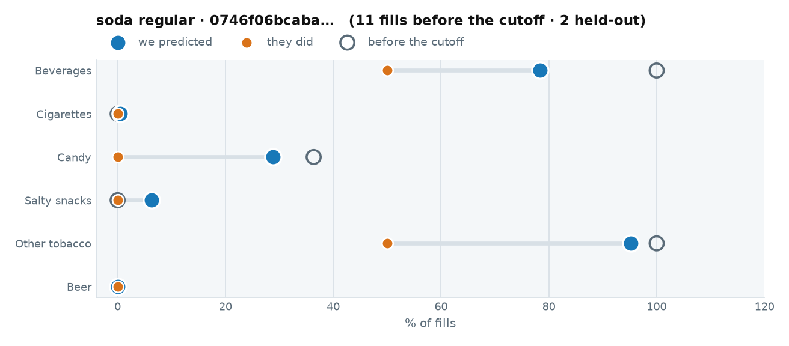

::: {.callout-note collapse="true" title="1 · The raw data we trained on"}

Every fuel visit before 2026-04-01. This is all the model was allowed to see.

::: {.scroll-table}
| when | daypart | grade | store | fuel $ | went in | categories |
|---|---|---|---|---|---|---|
| 2026-03-22 10:24 | midday | MID/PLUS | 13413 | 17.00 | **yes** | Packaged Beverages (Non-Alcoholic), Other Tobacco/Nicotine Products |
| 2026-03-17 15:31 | evening | MID/PLUS | 13413 | 20.00 | **yes** | Health & Beauty Care, Other Tobacco/Nicotine Products, Candy, Packaged Beverages (Non-Alcoholic) |
| 2024-10-28 13:08 | midday | MID/PLUS | 13413 | 20.00 | **yes** | Other Tobacco/Nicotine Products, Candy, Packaged Beverages (Non-Alcoholic), MERCHANDISE, LOTTERY |
| 2024-10-20 17:34 | evening | MID/PLUS | 13413 | 10.00 | **yes** | Other Tobacco/Nicotine Products, Health & Beauty Care, Packaged Beverages (Non-Alcoholic), LOTTERY, Lottery/Gaming |
| 2024-10-18 16:03 | evening | MID/PLUS | 13413 | 20.00 | **yes** | Other Tobacco/Nicotine Products, Lottery/Gaming, Packaged Beverages (Non-Alcoholic) |
| 2024-10-17 16:09 | evening | MID/PLUS | 13413 | 20.00 | **yes** | Other Tobacco/Nicotine Products, Packaged Beverages (Non-Alcoholic), Lottery/Gaming, LOTTERY, Candy |
| 2024-10-13 13:36 | midday | MID/PLUS | 13413 | 25.00 | **yes** | Other Tobacco/Nicotine Products, Packaged Beverages (Non-Alcoholic), Lottery/Gaming |
| 2024-10-12 10:53 | midday | MID/PLUS | 13413 | 20.00 | **yes** | Other Tobacco/Nicotine Products, Lottery/Gaming, MERCHANDISE, Packaged Beverages (Non-Alcoholic) |
| 2024-10-11 15:51 | evening | MID/PLUS | 13413 | 35.00 | **yes** | Other Tobacco/Nicotine Products, Packaged Beverages (Non-Alcoholic), Lottery/Gaming, Candy |
| 2024-10-06 17:43 | evening | MID/PLUS | 13413 | 32.00 | **yes** | Other Tobacco/Nicotine Products, Lottery/Gaming, Packaged Beverages (Non-Alcoholic) |
| 2024-10-01 09:48 | morning | MID/PLUS | 13413 | 13.00 | **yes** | Other Tobacco/Nicotine Products, Health & Beauty Care, Packaged Beverages (Non-Alcoholic), LOTTERY |
:::

[All 11 fills, newest first — scroll the box. Their category rates are the left-hand chart above.]{.muted style="font-size:0.8em"}

The actual items behind those baskets — **8** distinct SKUs:

::: {.scroll-table}
| category | brand | units | spend $ |
|---|---|---|---|
| Other Tobacco/Nicotine Products | On! | 17 | 183.99 |
| Packaged Beverages (Non-Alcoholic) | Monster | 9 | 21.69 |
| Packaged Beverages (Non-Alcoholic) | Reign | 8 | 20.76 |
| Packaged Beverages (Non-Alcoholic) | San Pellegrino | 5 | 15.45 |
| Packaged Beverages (Non-Alcoholic) | Gatorade | 4 | 9.96 |
| Candy | Ice Breakers | 3 | 17.57 |
| Candy | Sour Punch | 2 | 3.78 |
| Packaged Beverages (Non-Alcoholic) | Brisk | 1 | 1.99 |
:::

:::

::: {.callout-note collapse="true" title="2 · What we predicted"}

At one fixed moment — **2026-06-15 07:12, REGULAR** — so the only thing that varies across these tabs is who they are:

| category | P(buys on this fill) |
|---|---|
| Other tobacco | 0.9516 |
| Beverages | 0.9245 |
| Candy | 0.2082 |
| Salty snacks | 0.0207 |
| Cigarettes | 0.0028 |
| Beer | 0.0000 |

**Stage one picks Packaged Beverages (Non-Alcoholic).** Stage two offers **Monster** (EV $0.01664).

And the rows actually written to `customer_scores.parquet` for their held-out fills:

::: {.scroll-table}
| when | daypart | P(enters) | offer category | Beverages | Cigarettes | Candy | Salty snacks | Other tobacco | Beer |
|---|---|---|---|---|---|---|---|---|---|
| 04-09 18:26 | evening | 0.9922 | Packaged Beverages (Non-Alcoholic) | 0.7751 | 0.0041 | 0.2425 | 0.0556 | 0.9516 | 0.0000 |
| 06-04 17:16 | evening | 0.9938 | Packaged Beverages (Non-Alcoholic) | 0.7924 | 0.0047 | 0.3333 | 0.0713 | 0.9516 | 0.0000 |
:::

Ranked SKUs inside that category:

| rank | brand | affinity | p_sku | p_category | p_buys |
|---|---|---|---|---|---|
| 1 | Monster | 0.73 | 0.0090 | 0.7751 | 0.0070 |
| 2 | Coca-Cola | 0.72 | 0.0089 | 0.7751 | 0.0069 |
| 3 | Reign | 0.65 | 0.0081 | 0.7751 | 0.0063 |

Second item: **Cheetos** (Salty Snacks), cohort index 1.30, headroom 100%

:::

::: {.callout-note collapse="true" title="4 · What ALS believes, against what they bought"}

Scored over the **685** SKUs ALS carries for *Beverages* in the morning.

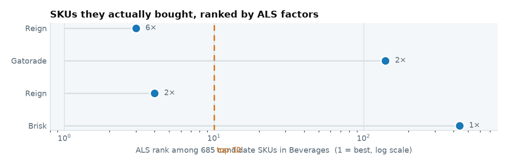

The SKUs they bought, and where ALS puts them:

::: {.scroll-table}
| brand | they bought | ALS score | rank | percentile |
|---|---|---|---|---|
| Reign | 6 | 0.64 | 3 | 99.70 |
| Gatorade | 2 | 0.157 | 140 | 79.70 |
| Reign | 2 | 0.629 | 4 | 99.60 |
| Brisk | 1 | 0.003 | 437 | 36.40 |
:::

**2 of 4** of their own SKUs land in the top 10 of 685.

And what ALS ranks highest for them:

| brand | ALS score | times they bought it |
|---|---|---|
| Monster | 0.743 | 0 |
| Reign | 0.651 | 0 |
| Reign | 0.64 | 6 |
| Reign | 0.629 | 2 |
| Reign | 0.589 | 0 |

[The raw score is a dot product on the ALS path and a unit count on the fallback path, so it is not one scale — the percentile is the comparable column.]{.muted style="font-size:0.8em"}

:::

::: {.callout-note collapse="true" title="3 · What actually happened"}

Their own held-out fills — **1 of 2** ended inside:

::: {.scroll-table}
| when | daypart | went in | what they bought |
|---|---|---|---|
| 04-09 18:26 | evening | no | — |
| 06-04 17:16 | evening | **yes** | Other Tobacco/Nicotine Products, Packaged Beverages (Non-Alcoholic) |
:::

Their own predicted rate against their own outcome, over those 2 fills. At this sample size the gaps are noise as much as signal — which is the point of the cohort below:

| category | mean predicted | actual | gap |
|---|---|---|---|
| Beverages | 0.7838 | 0.5000 | -0.2838 |
| Cigarettes | 0.0044 | 0.0000 | -0.0044 |
| Candy | 0.2879 | 0.0000 | -0.2879 |
| Salty snacks | 0.0634 | 0.0000 | -0.0634 |
| Other tobacco | 0.9516 | 0.5000 | -0.4516 |
| Beer | 0.0000 | 0.0000 | -0.0000 |

And across **2,372 shoppers** matching this archetype, over **8,587** held-out fills — enough rows for the rate to mean something:

| category | mean predicted | actual | gap |
|---|---|---|---|
| Beverages | 0.5434 | 0.5146 | -0.0288 |
| Cigarettes | 0.0886 | 0.0893 | 0.0007 |
| Candy | 0.0724 | 0.0694 | -0.0030 |
| Salty snacks | 0.0771 | 0.0784 | 0.0012 |
| Other tobacco | 0.1079 | 0.1055 | -0.0024 |
| Beer | 0.0406 | 0.0369 | -0.0037 |

:::

## cigs · 0

**cigarette regular** — `0190d937d65a…`. **8** fills before the cutoff, **0** after it — typical of the archetype, but never seen again.

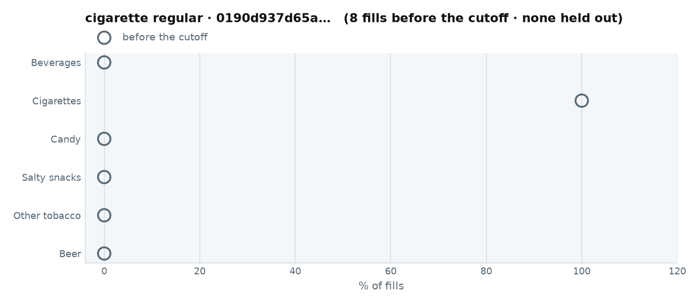

::: {.callout-note collapse="true" title="1 · The raw data we trained on"}

Every fuel visit before 2026-04-01. This is all the model was allowed to see.

::: {.scroll-table}
| when | daypart | grade | store | fuel $ | went in | categories |
|---|---|---|---|---|---|---|
| 2025-11-26 09:08 | morning | REGULAR | 11794 | 80.32 | **yes** | Cigarettes |
| 2025-10-28 09:52 | morning | REGULAR | 11794 | 80.84 | **yes** | Cigarettes |
| 2025-10-23 09:53 | morning | REGULAR | 11794 | 34.26 | **yes** | Cigarettes |
| 2025-10-21 10:04 | midday | REGULAR | 11794 | 78.54 | **yes** | Cigarettes |
| 2025-09-23 08:37 | morning | REGULAR | 11794 | 84.09 | **yes** | Cigarettes |
| 2025-09-03 10:13 | midday | REGULAR | 11794 | 81.07 | **yes** | Cigarettes |
| 2025-01-08 12:00 | midday | REGULAR | 11794 | 67.60 | **yes** | Cigarettes |
| 2024-11-07 10:31 | midday | REGULAR | 11794 | 63.78 | **yes** | Cigarettes |
:::

[All 8 fills, newest first — scroll the box. Their category rates are the left-hand chart above.]{.muted style="font-size:0.8em"}

The actual items behind those baskets — **4** distinct SKUs:

::: {.scroll-table}
| category | brand | units | spend $ |
|---|---|---|---|
| Cigarettes | Camel | 141 | 3,340.45 |
| Other Tobacco/Nicotine Products | ZYN | 5 | 43.68 |
| Packaged Beverages (Non-Alcoholic) | Pure Leaf | 1 | 2.49 |
| Packaged Beverages (Non-Alcoholic) | Mountain Dew | 1 | 3.39 |
:::

:::

::: {.callout-note collapse="true" title="2 · What we predicted"}

At one fixed moment — **2026-06-15 07:12, REGULAR** — so the only thing that varies across these tabs is who they are:

| category | P(buys on this fill) |
|---|---|
| Cigarettes | 0.9016 |
| Beverages | 0.0526 |
| Candy | 0.0248 |
| Salty snacks | 0.0069 |
| Other tobacco | 0.0058 |
| Beer | 0.0030 |

**Stage one picks Packaged Beverages (Non-Alcoholic).** Stage two offers **Aquafina** (EV $0.00033).

_No scored rows: this shopper has no held-out fills._

:::

::: {.callout-note collapse="true" title="4 · What ALS believes, against what they bought"}

Scored over the **106** SKUs ALS carries for *Cigarettes* in the morning.

The SKUs they bought, and where ALS puts them:

::: {.scroll-table}
| brand | they bought | ALS score | rank | percentile |
|---|---|---|---|---|
| Camel | 141 | 0.951 | 1 | 100.00 |
:::

**1 of 1** of their own SKUs land in the top 10 of 106.

And what ALS ranks highest for them:

| brand | ALS score | times they bought it |
|---|---|---|
| Camel | 0.951 | 141 |
| Marlboro | 0.601 | 0 |
| Camel | 0.547 | 0 |
| Camel | 0.44 | 0 |
| Camel | 0.351 | 0 |

[The raw score is a dot product on the ALS path and a unit count on the fallback path, so it is not one scale — the percentile is the comparable column.]{.muted style="font-size:0.8em"}

:::

::: {.callout-note collapse="true" title="3 · What actually happened"}

This shopper **never fuelled again** after the cutoff, so there is nothing to score them against. That is the ordinary case for a customer who fuels 8 times in eighteen months, and it is why the cohort below carries the check.

And across **766 shoppers** matching this archetype, over **3,209** held-out fills — enough rows for the rate to mean something:

| category | mean predicted | actual | gap |
|---|---|---|---|
| Beverages | 0.2881 | 0.2611 | -0.0270 |
| Cigarettes | 0.5218 | 0.5282 | 0.0064 |
| Candy | 0.0451 | 0.0443 | -0.0009 |
| Salty snacks | 0.0347 | 0.0293 | -0.0054 |
| Other tobacco | 0.0387 | 0.0483 | 0.0096 |
| Beer | 0.0516 | 0.0514 | -0.0001 |

:::

## salty · 0

**salty snack regular** — `5387eef22b7f…`. **13** fills before the cutoff, **0** after it — typical of the archetype, but never seen again.

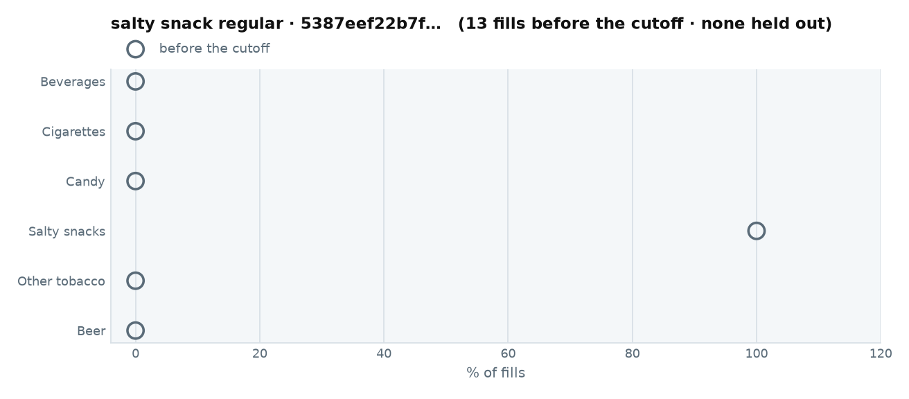

::: {.callout-note collapse="true" title="1 · The raw data we trained on"}

Every fuel visit before 2026-04-01. This is all the model was allowed to see.

::: {.scroll-table}
| when | daypart | grade | store | fuel $ | went in | categories |
|---|---|---|---|---|---|---|
| 2025-06-14 20:30 | evening | REGULAR | 8230 | 31.91 | **yes** | FOODSERVICE, Salty Snacks |
| 2025-06-03 20:34 | evening | REGULAR | 8230 | 32.81 | **yes** | Salty Snacks, FOODSERVICE |
| 2025-05-27 20:31 | evening | REGULAR | 8230 | 25.82 | **yes** | MERCHANDISE, Salty Snacks, FOODSERVICE |
| 2025-05-18 20:29 | evening | REGULAR | 8230 | 28.34 | **yes** | FOODSERVICE, Salty Snacks |
| 2025-05-07 20:40 | evening | REGULAR | 8230 | 31.42 | **yes** | FOODSERVICE, Salty Snacks |
| 2025-04-28 20:25 | evening | REGULAR | 8230 | 23.86 | **yes** | Alternative Snacks, Salty Snacks |
| 2025-04-01 19:46 | evening | REGULAR | 8230 | 28.73 | **yes** | FOODSERVICE, Salty Snacks |
| 2025-03-12 19:25 | evening | REGULAR | 8230 | 32.26 | **yes** | MERCHANDISE, Salty Snacks |
| 2025-03-04 19:33 | evening | REGULAR | 8230 | 33.56 | **yes** | Salty Snacks, FOODSERVICE |
| 2025-01-29 20:39 | evening | REGULAR | 8230 | 30.66 | **yes** | Salty Snacks, MERCHANDISE |
| 2025-01-10 19:21 | evening | REGULAR | 8230 | 27.01 | **yes** | Salty Snacks, MERCHANDISE |
| 2025-01-06 19:56 | evening | REGULAR | 8230 | 29.08 | **yes** | Salty Snacks, FOODSERVICE |
| 2024-10-25 20:44 | evening | REGULAR | 8230 | 26.24 | **yes** | Alternative Snacks, Salty Snacks, FOODSERVICE |
:::

[All 13 fills, newest first — scroll the box. Their category rates are the left-hand chart above.]{.muted style="font-size:0.8em"}

The actual items behind those baskets — **4** distinct SKUs:

::: {.scroll-table}
| category | brand | units | spend $ |
|---|---|---|---|
| Salty Snacks | Nut Harvest | 47 | 179.22 |
| Salty Snacks | Blue Diamond | 7 | 13.93 |
| Salty Snacks | Planters | 2 | 5.08 |
| Salty Snacks | Fritos | 2 | 11.78 |
:::

:::

::: {.callout-note collapse="true" title="2 · What we predicted"}

At one fixed moment — **2026-06-15 07:12, REGULAR** — so the only thing that varies across these tabs is who they are:

| category | P(buys on this fill) |
|---|---|
| Salty snacks | 0.4231 |
| Beverages | 0.0557 |
| Candy | 0.0191 |
| Other tobacco | 0.0088 |
| Cigarettes | 0.0041 |
| Beer | 0.0000 |

**Stage one picks Salty Snacks.** Stage two shows **nothing** — every candidate prices below the threshold.

_No scored rows: this shopper has no held-out fills._

:::

::: {.callout-note collapse="true" title="4 · What ALS believes, against what they bought"}

Scored over the **211** SKUs ALS carries for *Salty snacks* in the morning.

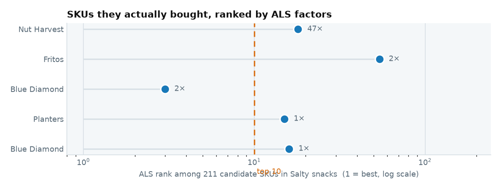

The SKUs they bought, and where ALS puts them:

::: {.scroll-table}
| brand | they bought | ALS score | rank | percentile |
|---|---|---|---|---|
| Nut Harvest | 47 | 0.193 | 18 | 91.90 |
| Fritos | 2 | 0.113 | 54 | 74.90 |
| Blue Diamond | 2 | 0.348 | 3 | 99.10 |
| Planters | 1 | 0.203 | 15 | 93.40 |
| Blue Diamond | 1 | 0.201 | 16 | 92.90 |
:::

**1 of 5** of their own SKUs land in the top 10 of 211.

And what ALS ranks highest for them:

| brand | ALS score | times they bought it |
|---|---|---|
| Planters | 0.407 | 0 |
| Planters | 0.386 | 0 |
| Blue Diamond | 0.348 | 2 |
| Spitz | 0.31 | 0 |
| Spitz | 0.308 | 0 |

[The raw score is a dot product on the ALS path and a unit count on the fallback path, so it is not one scale — the percentile is the comparable column.]{.muted style="font-size:0.8em"}

:::

::: {.callout-note collapse="true" title="3 · What actually happened"}

This shopper **never fuelled again** after the cutoff, so there is nothing to score them against. That is the ordinary case for a customer who fuels 13 times in eighteen months, and it is why the cohort below carries the check.

And across **125 shoppers** matching this archetype, over **433** held-out fills — enough rows for the rate to mean something:

| category | mean predicted | actual | gap |
|---|---|---|---|
| Beverages | 0.4763 | 0.4804 | 0.0041 |
| Cigarettes | 0.0699 | 0.0739 | 0.0040 |
| Candy | 0.1231 | 0.1178 | -0.0054 |
| Salty snacks | 0.3122 | 0.3857 | 0.0735 |
| Other tobacco | 0.0353 | 0.0323 | -0.0030 |
| Beer | 0.0227 | 0.0277 | 0.0050 |

:::

## beer · 0

**beer regular** — `8c84ded12ecb…`. **17** fills before the cutoff, **0** after it — typical of the archetype, but never seen again.

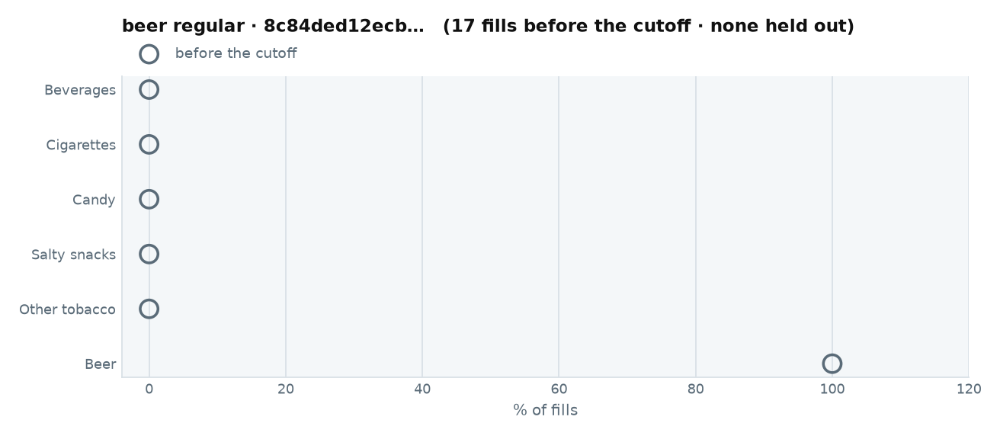

::: {.callout-note collapse="true" title="1 · The raw data we trained on"}

Every fuel visit before 2026-04-01. This is all the model was allowed to see.

::: {.scroll-table}
| when | daypart | grade | store | fuel $ | went in | categories |
|---|---|---|---|---|---|---|
| 2025-02-23 20:51 | evening | PREMIUM | 1882 | 50.00 | **yes** | Beer |
| 2025-02-18 20:49 | evening | PREMIUM | 1882 | 50.00 | **yes** | Beer |
| 2025-02-07 11:45 | midday | PREMIUM | 1882 | 50.00 | **yes** | Beer |
| 2025-02-03 20:43 | evening | PREMIUM | 1882 | 50.02 | **yes** | Beer |
| 2025-01-28 20:48 | evening | PREMIUM | 1882 | 30.00 | **yes** | Beer |
| 2025-01-20 08:07 | morning | PREMIUM | 1882 | 50.00 | **yes** | Beer |
| 2025-01-14 20:46 | evening | PREMIUM | 1882 | 60.00 | **yes** | Beer |
| 2025-01-06 20:47 | evening | PREMIUM | 1882 | 50.00 | **yes** | Beer |
| 2024-12-15 20:36 | evening | PREMIUM | 1882 | 50.03 | **yes** | Beer |
| 2024-12-10 20:51 | evening | PREMIUM | 1882 | 50.00 | **yes** | Beer |
| 2024-12-02 20:53 | evening | PREMIUM | 1882 | 50.07 | **yes** | Beer |
| 2024-11-19 20:49 | evening | PREMIUM | 1882 | 25.00 | **yes** | Beer |
| 2024-11-12 20:54 | evening | PREMIUM | 1882 | 50.00 | **yes** | Beer |
| 2024-11-09 20:52 | evening | PREMIUM | 1882 | 50.02 | **yes** | Beer |
| 2024-11-02 20:42 | evening | PREMIUM | 1882 | 50.00 | **yes** | Beer |
| 2024-10-22 20:49 | evening | PREMIUM | 1882 | 50.00 | **yes** | Beer |
| 2024-10-19 20:46 | evening | PREMIUM | 1882 | 50.00 | **yes** | Beer |
:::

[All 17 fills, newest first — scroll the box. Their category rates are the left-hand chart above.]{.muted style="font-size:0.8em"}

The actual items behind those baskets — **5** distinct SKUs:

::: {.scroll-table}
| category | brand | units | spend $ |
|---|---|---|---|
| Beer | Blue Moon | 21 | 345.42 |
| Beer | Bud Light Lime | 5 | 25.90 |
| Beer | Modelo Especial | 4 | 35.96 |
| Candy | Wrigley's | 1 | 4.99 |
| Packaged Beverages (Non-Alcoholic) | Dunkin' Donuts | 1 | 3.69 |
:::

:::

::: {.callout-note collapse="true" title="2 · What we predicted"}

At one fixed moment — **2026-06-15 07:12, REGULAR** — so the only thing that varies across these tabs is who they are:

| category | P(buys on this fill) |
|---|---|
| Beer | 0.8092 |
| Beverages | 0.0443 |
| Other tobacco | 0.0092 |
| Candy | 0.0091 |
| Salty snacks | 0.0038 |
| Cigarettes | 0.0037 |

**Stage one picks Beer.** Stage two offers **Modelo Especial** (EV $0.04966).

_No scored rows: this shopper has no held-out fills._

:::

::: {.callout-note collapse="true" title="4 · What ALS believes, against what they bought"}

Scored over the **208** SKUs ALS carries for *Beer* in the morning.

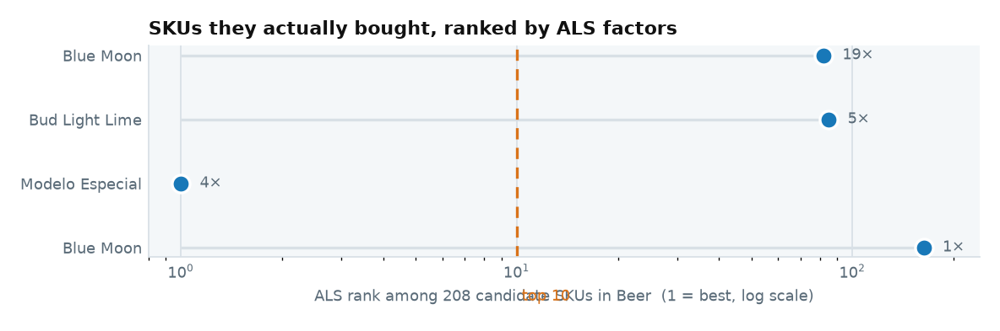

The SKUs they bought, and where ALS puts them:

::: {.scroll-table}
| brand | they bought | ALS score | rank | percentile |
|---|---|---|---|---|
| Blue Moon | 19 | 0.089 | 82 | 61.10 |
| Bud Light Lime | 5 | 0.088 | 85 | 59.60 |
| Modelo Especial | 4 | 0.428 | 1 | 100.00 |
| Blue Moon | 1 | 0.026 | 163 | 22.10 |
:::

**1 of 4** of their own SKUs land in the top 10 of 208.

And what ALS ranks highest for them:

| brand | ALS score | times they bought it |
|---|---|---|
| Modelo Especial | 0.428 | 4 |
| Modelo | 0.403 | 0 |
| Coors Light | 0.394 | 0 |
| Budweiser | 0.352 | 0 |
| Bud Light | 0.346 | 0 |

[The raw score is a dot product on the ALS path and a unit count on the fallback path, so it is not one scale — the percentile is the comparable column.]{.muted style="font-size:0.8em"}

:::

::: {.callout-note collapse="true" title="3 · What actually happened"}

This shopper **never fuelled again** after the cutoff, so there is nothing to score them against. That is the ordinary case for a customer who fuels 17 times in eighteen months, and it is why the cohort below carries the check.

And across **431 shoppers** matching this archetype, over **1,780** held-out fills — enough rows for the rate to mean something:

| category | mean predicted | actual | gap |
|---|---|---|---|
| Beverages | 0.1646 | 0.1612 | -0.0034 |
| Cigarettes | 0.0813 | 0.0848 | 0.0036 |
| Candy | 0.0332 | 0.0354 | 0.0022 |
| Salty snacks | 0.0448 | 0.0388 | -0.0060 |
| Other tobacco | 0.0815 | 0.0860 | 0.0044 |
| Beer | 0.5106 | 0.4989 | -0.0117 |

:::

## never in · 156

**never bought** — `da1e4037d48a…`. **910** fills before the cutoff, **156** after it, so this one can be checked against its own outcome.

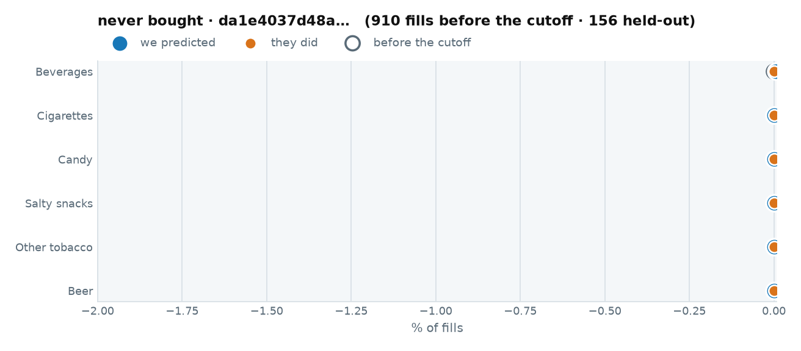

::: {.callout-note collapse="true" title="1 · The raw data we trained on"}

Every fuel visit before 2026-04-01. This is all the model was allowed to see.

::: {.scroll-table}
| when | daypart | grade | store | fuel $ | went in | categories |
|---|---|---|---|---|---|---|
| 2026-03-31 19:52 | evening | REGULAR | 8230 | 48.02 | no | — |
| 2026-03-31 18:31 | evening | REGULAR | 8230 | 88.48 | no | — |
| 2026-03-31 05:43 | morning | REGULAR | 8230 | 46.99 | no | — |
| 2026-03-30 17:55 | evening | REGULAR | 8230 | 66.50 | no | — |
| 2026-03-30 05:45 | morning | REGULAR | 8230 | 41.63 | no | — |
| 2026-03-28 17:41 | evening | REGULAR | 8230 | 81.52 | no | — |
| 2026-03-27 05:42 | morning | REGULAR | 8230 | 51.05 | no | — |
| 2026-03-26 05:49 | morning | REGULAR | 8230 | 43.35 | no | — |
| 2026-03-25 05:43 | morning | REGULAR | 8230 | 44.50 | no | — |
| 2026-03-25 04:14 | evening | REGULAR | 8230 | 56.40 | no | — |
| 2026-03-24 05:43 | morning | REGULAR | 8230 | 46.97 | no | — |
| 2026-03-24 04:21 | evening | REGULAR | 8230 | 50.91 | no | — |
| 2026-03-23 05:50 | morning | REGULAR | 8230 | 67.07 | no | — |
| 2026-03-23 04:22 | evening | REGULAR | 8230 | 52.86 | no | — |
| 2026-03-22 04:24 | evening | REGULAR | 8230 | 55.98 | no | — |
| 2026-03-21 04:19 | evening | REGULAR | 8230 | 56.30 | no | — |
| 2026-03-20 04:21 | evening | REGULAR | 8230 | 53.98 | no | — |
| 2026-03-18 18:21 | evening | REGULAR | 8230 | 59.56 | no | — |
| 2026-03-18 04:45 | evening | REGULAR | 8230 | 53.15 | no | — |
| 2026-03-16 10:48 | midday | REGULAR | 8230 | 44.87 | no | — |
| 2026-03-15 17:57 | evening | REGULAR | 8230 | 79.64 | no | — |
| 2026-03-14 18:08 | evening | REGULAR | 8230 | 80.82 | no | — |
| 2026-03-13 20:25 | evening | REGULAR | 8230 | 70.00 | no | — |
| 2026-03-13 05:42 | morning | REGULAR | 8230 | 44.50 | no | — |
| 2026-03-12 18:08 | evening | REGULAR | 8230 | 84.82 | no | — |
| 2026-03-12 05:44 | morning | REGULAR | 8230 | 36.11 | no | — |
| 2026-03-11 16:25 | evening | REGULAR | 8230 | 62.35 | no | — |
| 2026-03-11 05:44 | morning | REGULAR | 8230 | 34.82 | no | — |
| 2026-03-10 05:54 | morning | REGULAR | 8230 | 38.74 | no | — |
| 2026-03-09 05:52 | morning | REGULAR | 8230 | 34.04 | no | — |
| 2026-03-05 17:57 | evening | REGULAR | 8230 | 58.17 | no | — |
| 2026-03-05 05:53 | morning | REGULAR | 8230 | 33.97 | no | — |
| 2026-03-04 17:13 | evening | REGULAR | 8230 | 48.55 | no | — |
| 2026-03-04 04:49 | evening | REGULAR | 8230 | 34.22 | no | — |
| 2026-03-03 18:34 | evening | REGULAR | 8230 | 47.99 | no | — |
| 2026-03-03 06:01 | morning | REGULAR | 8230 | 28.92 | no | — |
| 2026-03-02 18:17 | evening | REGULAR | 8230 | 47.58 | no | — |
| 2026-03-02 05:41 | morning | REGULAR | 8230 | 30.61 | no | — |
| 2026-03-01 17:55 | evening | REGULAR | 8230 | 49.34 | no | — |
| 2026-02-28 18:31 | evening | REGULAR | 8230 | 53.75 | no | — |
| 2026-02-27 05:40 | morning | REGULAR | 8230 | 28.61 | no | — |
| 2026-02-26 18:17 | evening | REGULAR | 8230 | 49.14 | no | — |
| 2026-02-26 05:43 | morning | REGULAR | 8230 | 27.48 | no | — |
| 2026-02-25 17:44 | evening | REGULAR | 8230 | 59.19 | no | — |
| 2026-02-25 05:40 | morning | REGULAR | 8230 | 26.25 | no | — |
| 2026-02-24 05:38 | morning | REGULAR | 8230 | 29.51 | no | — |
| 2026-02-24 03:38 | evening | REGULAR | 8230 | 40.61 | no | — |
| 2026-02-23 05:45 | morning | REGULAR | 8230 | 28.09 | no | — |
| 2026-02-19 18:25 | evening | REGULAR | 8230 | 54.91 | no | — |
| 2026-02-19 06:01 | morning | REGULAR | 8230 | 29.87 | no | — |
| 2026-02-18 17:59 | evening | REGULAR | 8230 | 52.74 | no | — |
| 2026-02-18 05:42 | morning | REGULAR | 8230 | 32.22 | no | — |
| 2026-02-17 17:40 | evening | REGULAR | 8230 | 55.91 | no | — |
| 2026-02-17 08:12 | morning | REGULAR | 8230 | 26.11 | no | — |
| 2026-02-17 05:41 | morning | REGULAR | 8230 | 27.10 | no | — |
| 2026-02-16 18:14 | evening | REGULAR | 8230 | 52.81 | no | — |
| 2026-02-16 05:50 | morning | REGULAR | 8230 | 13.99 | no | — |
| 2026-02-15 17:42 | evening | REGULAR | 8230 | 48.51 | no | — |
| 2026-02-14 08:39 | morning | REGULAR | 8230 | 30.96 | no | — |
| 2026-02-13 17:58 | evening | REGULAR | 8230 | 55.84 | no | — |
| 2026-02-13 05:40 | morning | REGULAR | 8230 | 42.40 | no | — |
| 2026-02-11 12:44 | midday | REGULAR | 15279 | 55.85 | no | — |
| 2026-02-11 10:03 | midday | REGULAR | 8230 | 36.69 | no | — |
| 2026-02-10 06:23 | morning | REGULAR | 8230 | 32.35 | no | — |
| 2026-02-09 06:03 | morning | REGULAR | 8230 | 28.21 | no | — |
| 2026-02-06 05:43 | morning | REGULAR | 8230 | 26.90 | no | — |
| 2026-02-06 04:09 | evening | REGULAR | 8230 | 41.18 | no | — |
| 2026-02-03 05:39 | morning | REGULAR | 8230 | 31.44 | no | — |
| 2026-02-02 17:48 | evening | REGULAR | 8230 | 58.34 | no | — |
| 2026-02-02 05:44 | morning | REGULAR | 8230 | 28.65 | no | — |
| 2026-02-01 17:49 | evening | REGULAR | 8230 | 50.98 | no | — |
| 2026-01-31 18:36 | evening | REGULAR | 8230 | 52.18 | no | — |
| 2026-01-30 05:48 | morning | REGULAR | 8230 | 37.65 | no | — |
| 2026-01-29 17:50 | evening | REGULAR | 8230 | 55.14 | no | — |
| 2026-01-29 05:54 | morning | REGULAR | 8230 | 32.10 | no | — |
| 2026-01-28 17:48 | evening | REGULAR | 8230 | 47.06 | no | — |
| 2026-01-28 05:41 | morning | REGULAR | 8230 | 29.30 | no | — |
| 2026-01-27 05:40 | morning | REGULAR | 8230 | 28.56 | no | — |
| 2026-01-26 05:40 | morning | REGULAR | 8230 | 28.36 | no | — |
| 2026-01-23 05:40 | morning | REGULAR | 8230 | 28.61 | no | — |
| 2026-01-22 05:48 | morning | REGULAR | 8230 | 32.29 | no | — |
| 2026-01-21 05:46 | morning | REGULAR | 8230 | 35.75 | no | — |
| 2026-01-20 17:53 | evening | REGULAR | 8230 | 58.37 | no | — |
| 2026-01-20 05:40 | morning | REGULAR | 8230 | 36.48 | no | — |
| 2026-01-19 18:48 | evening | REGULAR | 8230 | 61.54 | no | — |
| 2026-01-19 05:39 | morning | REGULAR | 8230 | 19.54 | no | — |
| 2026-01-18 18:36 | evening | REGULAR | 8230 | 62.73 | no | — |
| 2026-01-17 18:03 | evening | REGULAR | 8230 | 57.36 | no | — |
| 2026-01-16 18:25 | evening | REGULAR | 8230 | 57.68 | no | — |
| 2026-01-14 18:01 | evening | REGULAR | 8230 | 52.46 | no | — |
| 2026-01-14 05:40 | morning | REGULAR | 8230 | 33.31 | no | — |
| 2026-01-13 05:36 | morning | REGULAR | 8230 | 32.99 | no | — |
| 2026-01-12 05:50 | morning | REGULAR | 8230 | 39.06 | no | — |
| 2026-01-09 17:08 | evening | REGULAR | 8230 | 30.92 | no | — |
| 2026-01-09 04:14 | evening | REGULAR | 8230 | 39.46 | no | — |
| 2026-01-08 05:44 | morning | REGULAR | 8230 | 28.62 | no | — |
| 2026-01-07 17:37 | evening | REGULAR | 8230 | 51.71 | no | — |
| 2026-01-07 05:40 | morning | REGULAR | 8230 | 30.96 | no | — |
| 2026-01-06 17:49 | evening | REGULAR | 8230 | 52.18 | no | — |
| 2026-01-06 05:42 | morning | REGULAR | 8230 | 30.93 | no | — |
| 2026-01-05 17:57 | evening | REGULAR | 8230 | 57.68 | no | — |
| 2026-01-05 05:44 | morning | REGULAR | 8230 | 44.14 | no | — |
| 2026-01-04 17:40 | evening | REGULAR | 8230 | 48.57 | no | — |
| 2026-01-03 18:18 | evening | REGULAR | 8230 | 54.39 | no | — |
| 2026-01-02 17:56 | evening | REGULAR | 8230 | 54.12 | no | — |
| 2026-01-02 05:45 | morning | REGULAR | 8230 | 28.01 | no | — |
| 2026-01-01 17:46 | evening | REGULAR | 8230 | 56.00 | no | — |
| 2026-01-01 05:41 | morning | REGULAR | 8230 | 30.77 | no | — |
| 2025-12-31 17:46 | evening | REGULAR | 8230 | 51.19 | no | — |
| 2025-12-31 05:50 | morning | REGULAR | 8230 | 28.47 | no | — |
| 2025-12-30 17:53 | evening | REGULAR | 8230 | 38.46 | no | — |
| 2025-12-30 05:47 | morning | REGULAR | 8230 | 32.71 | no | — |
| 2025-12-29 17:21 | evening | REGULAR | 8230 | 36.35 | no | — |
| 2025-12-29 05:39 | morning | REGULAR | 8230 | 22.80 | no | — |
| 2025-12-28 17:19 | evening | REGULAR | 8230 | 41.76 | no | — |
| 2025-12-27 17:31 | evening | REGULAR | 8230 | 36.28 | no | — |
| 2025-12-26 17:12 | evening | REGULAR | 8230 | 37.53 | no | — |
| 2025-12-26 05:37 | morning | REGULAR | 8230 | 43.11 | no | — |
| 2025-12-25 16:33 | evening | REGULAR | 8230 | 34.71 | no | — |
| 2025-12-24 17:14 | evening | REGULAR | 8230 | 50.25 | no | — |
| 2025-12-24 05:38 | morning | REGULAR | 8230 | 27.95 | no | — |
| 2025-12-24 04:31 | evening | REGULAR | 8230 | 36.07 | no | — |
| 2025-12-23 18:08 | evening | REGULAR | 8230 | 50.56 | no | — |
| 2025-12-23 05:40 | morning | REGULAR | 8230 | 30.36 | no | — |
| 2025-12-22 18:02 | evening | REGULAR | 8230 | 59.76 | no | — |
| 2025-12-22 06:26 | morning | REGULAR | 8230 | 41.73 | no | — |
| 2025-12-21 15:23 | evening | REGULAR | 8230 | 50.76 | no | — |
| 2025-12-20 19:18 | evening | REGULAR | 8230 | 51.40 | no | — |
| 2025-12-19 18:04 | evening | REGULAR | 8230 | 57.30 | no | — |
| 2025-12-19 05:38 | morning | REGULAR | 8230 | 40.16 | no | — |
| 2025-12-18 18:21 | evening | REGULAR | 8230 | 61.49 | no | — |
| 2025-12-18 05:38 | morning | REGULAR | 8230 | 28.05 | no | — |
| 2025-12-17 19:54 | evening | REGULAR | 8230 | 46.50 | no | — |
| 2025-12-17 05:36 | morning | REGULAR | 8230 | 28.40 | no | — |
| 2025-12-16 05:51 | morning | REGULAR | 8230 | 32.35 | no | — |
| 2025-12-15 05:41 | morning | REGULAR | 8230 | 30.99 | no | — |
| 2025-12-12 05:53 | morning | REGULAR | 8230 | 33.64 | no | — |
| 2025-12-11 05:39 | morning | REGULAR | 8230 | 27.40 | no | — |
| 2025-12-10 17:23 | evening | REGULAR | 8230 | 41.89 | no | — |
| 2025-12-10 05:36 | morning | REGULAR | 8230 | 26.97 | no | — |
| 2025-12-09 18:18 | evening | REGULAR | 8230 | 49.31 | no | — |
| 2025-12-09 05:40 | morning | REGULAR | 8230 | 27.00 | no | — |
| 2025-12-08 18:09 | evening | REGULAR | 8230 | 60.06 | no | — |
| 2025-12-08 05:40 | morning | REGULAR | 8230 | 26.25 | no | — |
| 2025-12-07 17:54 | evening | REGULAR | 8230 | 49.50 | no | — |
| 2025-12-06 18:24 | evening | REGULAR | 8230 | 51.82 | no | — |
| 2025-12-05 17:29 | evening | REGULAR | 8230 | 53.44 | no | — |
| 2025-12-05 05:39 | morning | REGULAR | 8230 | 30.79 | no | — |
| 2025-12-04 18:52 | evening | REGULAR | 8230 | 60.92 | no | — |
| 2025-12-04 05:43 | morning | REGULAR | 8230 | 52.94 | no | — |
| 2025-12-03 18:26 | evening | REGULAR | 8230 | 51.22 | no | — |
| 2025-12-02 05:44 | morning | REGULAR | 8230 | 32.01 | no | — |
| 2025-12-01 05:46 | morning | REGULAR | 8230 | 17.52 | no | — |
| 2025-11-27 06:57 | morning | REGULAR | 8230 | 29.85 | no | — |
| 2025-11-26 17:27 | evening | REGULAR | 8230 | 54.13 | no | — |
| 2025-11-26 05:39 | morning | REGULAR | 8230 | 30.97 | no | — |
| 2025-11-25 18:17 | evening | REGULAR | 8230 | 63.53 | no | — |
| 2025-11-25 05:41 | morning | REGULAR | 8230 | 27.34 | no | — |
| 2025-11-24 18:18 | evening | REGULAR | 8230 | 50.76 | no | — |
| 2025-11-24 05:44 | morning | REGULAR | 8230 | 20.62 | no | — |
| 2025-11-21 18:09 | evening | REGULAR | 8230 | 51.09 | no | — |
| 2025-11-21 05:42 | morning | REGULAR | 8230 | 29.34 | no | — |
| 2025-11-20 18:17 | evening | REGULAR | 8230 | 48.04 | no | — |
| 2025-11-20 05:43 | morning | REGULAR | 8230 | 28.54 | no | — |
| 2025-11-19 18:14 | evening | REGULAR | 8230 | 48.62 | no | — |
| 2025-11-19 05:43 | morning | REGULAR | 8230 | 29.88 | no | — |
| 2025-11-18 05:42 | morning | REGULAR | 8230 | 26.35 | no | — |
| 2025-11-17 05:37 | morning | REGULAR | 8230 | 30.19 | no | — |
| 2025-11-14 05:45 | morning | REGULAR | 8230 | 28.56 | no | — |
| 2025-11-13 16:24 | evening | MID/PLUS | 15279 | 84.43 | no | — |
| 2025-11-13 05:40 | morning | REGULAR | 8230 | 25.90 | no | — |
| 2025-11-12 18:22 | evening | REGULAR | 8230 | 37.84 | no | — |
| 2025-11-12 17:42 | evening | REGULAR | 8230 | 49.18 | no | — |
| 2025-11-12 05:44 | morning | REGULAR | 8230 | 27.43 | no | — |
| 2025-11-11 18:12 | evening | REGULAR | 8230 | 49.40 | no | — |
| 2025-11-11 05:45 | morning | REGULAR | 8230 | 28.71 | no | — |
| 2025-11-10 16:55 | evening | REGULAR | 8230 | 48.54 | no | — |
| 2025-11-10 06:05 | morning | REGULAR | 8230 | 44.99 | no | — |
| 2025-11-09 17:29 | evening | REGULAR | 8230 | 48.72 | no | — |
| 2025-11-08 17:40 | evening | REGULAR | 8230 | 44.70 | no | — |
| 2025-11-07 17:44 | evening | REGULAR | 8230 | 51.53 | no | — |
| 2025-11-06 18:12 | evening | REGULAR | 8230 | 61.22 | no | — |
| 2025-11-05 17:43 | evening | REGULAR | 8230 | 52.83 | no | — |
| 2025-11-05 16:34 | evening | REGULAR | 15279 | 70.88 | no | — |
| 2025-11-04 05:36 | morning | REGULAR | 8230 | 28.80 | no | — |
| 2025-11-03 05:37 | morning | REGULAR | 8230 | 14.83 | no | — |
| 2025-11-02 19:44 | evening | REGULAR | 8230 | 44.93 | no | — |
| 2025-11-02 07:01 | morning | REGULAR | 8230 | 26.88 | no | — |
| 2025-11-02 05:15 | morning | REGULAR | 8230 | 46.49 | no | — |
| 2025-11-01 05:16 | morning | REGULAR | 8230 | 49.54 | no | — |
| 2025-11-01 04:41 | evening | REGULAR | 15279 | 68.79 | no | — |
| 2025-10-31 05:43 | morning | REGULAR | 8230 | 26.16 | no | — |
| 2025-10-31 05:13 | morning | REGULAR | 8230 | 46.74 | no | — |
| 2025-10-31 04:46 | evening | REGULAR | 8230 | 56.82 | no | — |
| 2025-10-30 05:39 | morning | REGULAR | 8230 | 30.67 | no | — |
| 2025-10-30 05:13 | morning | REGULAR | 8230 | 51.34 | no | — |
| 2025-10-30 04:44 | evening | REGULAR | 8230 | 40.67 | no | — |
| 2025-10-29 12:47 | midday | REGULAR | 8230 | 37.78 | no | — |
| 2025-10-29 05:40 | morning | REGULAR | 8230 | 34.60 | no | — |
| 2025-10-29 05:16 | morning | REGULAR | 8230 | 63.50 | no | — |
| 2025-10-29 04:47 | evening | REGULAR | 8230 | 27.79 | no | — |
| 2025-10-28 16:20 | evening | REGULAR | 8230 | 20.80 | no | — |
| 2025-10-28 05:41 | morning | REGULAR | 8230 | 28.96 | no | — |
| 2025-10-27 18:19 | evening | REGULAR | 8230 | 50.10 | no | — |
| 2025-10-27 05:40 | morning | REGULAR | 8230 | 50.47 | no | — |
| 2025-10-26 18:01 | evening | REGULAR | 8230 | 47.92 | no | — |
| 2025-10-25 17:53 | evening | REGULAR | 8230 | 53.07 | no | — |
| 2025-10-24 17:34 | evening | REGULAR | 8230 | 43.26 | no | — |
| 2025-10-24 05:45 | morning | REGULAR | 8230 | 26.90 | no | — |
| 2025-10-23 17:38 | evening | REGULAR | 8230 | 50.51 | no | — |
| 2025-10-23 05:43 | morning | REGULAR | 8230 | 34.49 | no | — |
| 2025-10-22 17:36 | evening | REGULAR | 8230 | 54.00 | no | — |
| 2025-10-22 05:48 | morning | REGULAR | 8230 | 31.53 | no | — |
| 2025-10-22 05:12 | morning | REGULAR | 8230 | 53.50 | no | — |
| 2025-10-21 05:38 | morning | REGULAR | 8230 | 31.92 | no | — |
| 2025-10-21 05:11 | morning | REGULAR | 8230 | 62.71 | no | — |
| 2025-10-20 05:54 | morning | REGULAR | 8230 | 29.17 | no | — |
| 2025-10-20 05:15 | morning | REGULAR | 8230 | 58.12 | no | — |
| 2025-10-19 05:15 | morning | REGULAR | 8230 | 56.07 | no | — |
| 2025-10-18 05:18 | morning | REGULAR | 8230 | 56.65 | no | — |
| 2025-10-17 05:49 | morning | REGULAR | 8230 | 34.13 | no | — |
| 2025-10-17 05:12 | morning | REGULAR | 8230 | 54.39 | no | — |
| 2025-10-17 04:51 | evening | REGULAR | 8230 | 43.55 | no | — |
| 2025-10-16 05:46 | morning | REGULAR | 8230 | 28.51 | no | — |
| 2025-10-16 05:15 | morning | REGULAR | 8230 | 49.95 | no | — |
| 2025-10-16 04:43 | evening | REGULAR | 8230 | 54.82 | no | — |
| 2025-10-15 17:30 | evening | REGULAR | 8230 | 55.51 | no | — |
| 2025-10-15 05:32 | morning | REGULAR | 8230 | 28.46 | no | — |
| 2025-10-15 05:16 | morning | REGULAR | 8230 | 65.94 | no | — |
| 2025-10-15 04:58 | evening | REGULAR | 8230 | 35.96 | no | — |
| 2025-10-14 17:56 | evening | REGULAR | 8230 | 40.14 | no | — |
| 2025-10-14 05:35 | morning | REGULAR | 8230 | 32.11 | no | — |
| 2025-10-13 18:01 | evening | REGULAR | 8230 | 53.29 | no | — |
| 2025-10-13 05:44 | morning | REGULAR | 8230 | 61.52 | no | — |
| 2025-10-12 18:08 | evening | REGULAR | 8230 | 49.17 | no | — |
| 2025-10-11 17:37 | evening | REGULAR | 8230 | 52.46 | no | — |
| 2025-10-10 17:56 | evening | REGULAR | 8230 | 51.94 | no | — |
| 2025-10-09 17:07 | evening | REGULAR | 8230 | 48.75 | no | — |
| 2025-10-09 05:35 | morning | REGULAR | 8230 | 30.02 | no | — |
| 2025-10-08 18:12 | evening | REGULAR | 8230 | 51.30 | no | — |
| 2025-10-08 05:45 | morning | REGULAR | 8230 | 32.72 | no | — |
| 2025-10-08 05:12 | morning | REGULAR | 8230 | 55.02 | no | — |
| 2025-10-07 18:10 | evening | REGULAR | 8230 | 58.94 | no | — |
| 2025-10-07 05:35 | morning | REGULAR | 8230 | 41.86 | no | — |
| 2025-10-07 05:11 | morning | REGULAR | 8230 | 54.37 | no | — |
| 2025-10-07 04:44 | evening | REGULAR | 8230 | 44.22 | no | — |
| 2025-10-06 05:43 | morning | REGULAR | 8230 | 31.38 | no | — |
| 2025-10-06 05:12 | morning | REGULAR | 8230 | 57.78 | no | — |
| 2025-10-06 04:35 | evening | REGULAR | 8230 | 41.35 | no | — |
| 2025-10-05 05:12 | morning | REGULAR | 8230 | 56.68 | no | — |
| 2025-10-04 05:15 | morning | REGULAR | 8230 | 54.93 | no | — |
| 2025-10-04 04:55 | evening | REGULAR | 8230 | 42.42 | no | — |
| 2025-10-03 05:48 | morning | REGULAR | 8230 | 34.28 | no | — |
| 2025-10-03 05:19 | morning | REGULAR | 8230 | 48.44 | no | — |
| 2025-10-03 05:01 | morning | REGULAR | 8230 | 51.91 | no | — |
| 2025-10-02 05:37 | morning | REGULAR | 8230 | 29.35 | no | — |
| 2025-10-02 04:47 | evening | REGULAR | 8230 | 50.83 | no | — |
| 2025-10-01 18:06 | evening | REGULAR | 8230 | 56.79 | no | — |
| 2025-10-01 05:35 | morning | REGULAR | 8230 | 30.57 | no | — |
| 2025-10-01 05:17 | morning | REGULAR | 8230 | 54.03 | no | — |
| 2025-10-01 04:59 | evening | REGULAR | 8230 | 36.96 | no | — |
| 2025-09-30 17:40 | evening | REGULAR | 8230 | 48.94 | no | — |
| 2025-09-30 05:38 | morning | REGULAR | 8230 | 32.42 | no | — |
| 2025-09-29 17:39 | evening | REGULAR | 8230 | 52.57 | no | — |
| 2025-09-29 05:36 | morning | REGULAR | 8230 | 32.69 | no | — |
| 2025-09-28 17:09 | evening | REGULAR | 8230 | 51.07 | no | — |
| 2025-09-27 16:26 | evening | REGULAR | 8230 | 56.81 | no | — |
| 2025-09-26 18:04 | evening | REGULAR | 8230 | 45.49 | no | — |
| 2025-09-26 05:35 | morning | REGULAR | 8230 | 30.39 | no | — |
| 2025-09-25 18:05 | evening | REGULAR | 8230 | 52.35 | no | — |
| 2025-09-25 05:47 | morning | REGULAR | 8230 | 33.28 | no | — |
| 2025-09-24 18:52 | evening | REGULAR | 8230 | 51.06 | no | — |
| 2025-09-24 16:14 | evening | PREMIUM | 8230 | 35.01 | no | — |
| 2025-09-24 05:59 | morning | PREMIUM | 8230 | 46.00 | no | — |
| 2025-09-24 05:41 | morning | REGULAR | 8230 | 32.85 | no | — |
| 2025-09-24 05:14 | morning | REGULAR | 8230 | 61.40 | no | — |
| 2025-09-23 05:37 | morning | REGULAR | 8230 | 29.93 | no | — |
| 2025-09-23 05:18 | morning | REGULAR | 8230 | 55.53 | no | — |
| 2025-09-22 17:57 | evening | PREMIUM | 8230 | 45.00 | no | — |
| 2025-09-22 05:49 | morning | REGULAR | 8230 | 35.00 | no | — |
| 2025-09-22 05:14 | morning | REGULAR | 8230 | 54.69 | no | — |
| 2025-09-21 16:19 | evening | PREMIUM | 8230 | 43.00 | no | — |
| 2025-09-21 05:15 | morning | REGULAR | 8230 | 52.36 | no | — |
| 2025-09-20 05:13 | morning | REGULAR | 8230 | 54.25 | no | — |
| 2025-09-19 16:20 | evening | PREMIUM | 8230 | 43.01 | no | — |
| 2025-09-19 05:34 | morning | REGULAR | 8230 | 35.63 | no | — |
| 2025-09-19 05:17 | morning | REGULAR | 8230 | 59.99 | no | — |
| 2025-09-18 16:53 | evening | PREMIUM | 8230 | 43.00 | no | — |
| 2025-09-18 05:36 | morning | REGULAR | 8230 | 35.35 | no | — |
| 2025-09-18 05:14 | morning | REGULAR | 8230 | 58.48 | no | — |
| 2025-09-18 04:57 | evening | REGULAR | 8230 | 43.56 | no | — |
| 2025-09-17 17:37 | evening | REGULAR | 8230 | 51.40 | no | — |
| 2025-09-17 17:05 | evening | PREMIUM | 8230 | 54.00 | no | — |
| 2025-09-17 05:38 | morning | REGULAR | 8230 | 31.98 | no | — |
| 2025-09-17 05:21 | morning | REGULAR | 8230 | 52.89 | no | — |
| 2025-09-17 04:58 | evening | REGULAR | 8230 | 61.55 | no | — |
| 2025-09-16 17:47 | evening | REGULAR | 8230 | 47.20 | no | — |
| 2025-09-16 05:42 | morning | REGULAR | 8230 | 30.90 | no | — |
| 2025-09-15 17:48 | evening | REGULAR | 8230 | 53.06 | no | — |
| 2025-09-15 05:36 | morning | REGULAR | 8230 | 34.49 | no | — |
| 2025-09-14 17:26 | evening | REGULAR | 8230 | 46.09 | no | — |
| 2025-09-13 17:11 | evening | REGULAR | 8230 | 51.43 | no | — |
| 2025-09-12 18:39 | evening | REGULAR | 8230 | 58.46 | no | — |
| 2025-09-12 05:41 | morning | REGULAR | 8230 | 32.77 | no | — |
| 2025-09-11 18:37 | evening | REGULAR | 8230 | 59.32 | no | — |
| 2025-09-11 05:35 | morning | REGULAR | 8230 | 32.36 | no | — |
| 2025-09-10 18:19 | evening | REGULAR | 8230 | 46.26 | no | — |
| 2025-09-10 17:29 | evening | PREMIUM | 8230 | 46.00 | no | — |
| 2025-09-10 05:34 | morning | REGULAR | 8230 | 31.38 | no | — |
| 2025-09-10 05:15 | morning | REGULAR | 8230 | 56.47 | no | — |
| 2025-09-10 04:53 | evening | REGULAR | 8230 | 41.73 | no | — |
| 2025-09-09 18:25 | evening | PREMIUM | 8230 | 46.00 | no | — |
| 2025-09-09 05:39 | morning | REGULAR | 8230 | 31.79 | no | — |
| 2025-09-09 05:12 | morning | REGULAR | 8230 | 61.25 | no | — |
| 2025-09-09 04:48 | evening | REGULAR | 8230 | 41.45 | no | — |
| 2025-09-08 16:35 | evening | PREMIUM | 8230 | 44.00 | no | — |
| 2025-09-08 05:42 | morning | REGULAR | 8230 | 33.25 | no | — |
| 2025-09-08 05:14 | morning | REGULAR | 8230 | 58.35 | no | — |
| 2025-09-08 04:46 | evening | REGULAR | 8230 | 35.41 | no | — |
| 2025-09-07 16:25 | evening | PREMIUM | 8230 | 45.00 | no | — |
| 2025-09-07 05:15 | morning | REGULAR | 8230 | 56.53 | no | — |
| 2025-09-07 04:48 | evening | REGULAR | 8230 | 39.74 | no | — |
| 2025-09-06 15:55 | evening | PREMIUM | 8230 | 42.00 | no | — |
| 2025-09-06 05:16 | morning | REGULAR | 8230 | 57.55 | no | — |
| 2025-09-05 15:56 | evening | PREMIUM | 8230 | 40.00 | no | — |
| 2025-09-05 13:23 | midday | REGULAR | 8230 | 24.50 | no | — |
| 2025-09-05 05:14 | morning | REGULAR | 8230 | 66.97 | no | — |
| 2025-09-05 04:52 | evening | REGULAR | 8230 | 70.28 | no | — |
| 2025-09-04 17:23 | evening | PREMIUM | 8230 | 45.00 | no | — |
| 2025-09-04 05:35 | morning | REGULAR | 8230 | 27.38 | no | — |
| 2025-09-04 05:13 | morning | REGULAR | 8230 | 45.81 | no | — |
| 2025-09-04 04:55 | evening | REGULAR | 8230 | 36.57 | no | — |
| 2025-09-03 17:38 | evening | REGULAR | 8230 | 47.61 | no | — |
| 2025-09-03 17:18 | evening | PREMIUM | 8230 | 38.00 | no | — |
| 2025-09-03 05:37 | morning | REGULAR | 8230 | 33.29 | no | — |
| 2025-09-03 05:11 | morning | REGULAR | 8230 | 53.92 | no | — |
| 2025-09-03 04:54 | evening | REGULAR | 8230 | 42.45 | no | — |
| 2025-09-02 19:25 | evening | REGULAR | 15279 | 50.12 | no | — |
| 2025-09-02 17:38 | evening | REGULAR | 8230 | 49.24 | no | — |
| 2025-09-02 05:33 | morning | REGULAR | 8230 | 29.85 | no | — |
| 2025-09-02 05:04 | morning | REGULAR | 8230 | 39.36 | no | — |
| 2025-09-01 05:38 | morning | REGULAR | 8230 | 31.73 | no | — |
| 2025-09-01 05:09 | morning | REGULAR | 8230 | 33.11 | no | — |
| 2025-08-31 18:17 | evening | REGULAR | 8230 | 45.38 | no | — |
| 2025-08-31 05:07 | morning | REGULAR | 8230 | 31.77 | no | — |
| 2025-08-30 18:08 | evening | REGULAR | 8230 | 51.26 | no | — |
| 2025-08-30 05:10 | morning | REGULAR | 8230 | 32.16 | no | — |
| 2025-08-29 17:50 | evening | REGULAR | 8230 | 52.33 | no | — |
| 2025-08-29 05:36 | morning | REGULAR | 8230 | 27.22 | no | — |
| 2025-08-29 05:08 | morning | REGULAR | 8230 | 59.00 | no | — |
| 2025-08-28 18:00 | evening | REGULAR | 8230 | 51.30 | no | — |
| 2025-08-28 05:35 | morning | REGULAR | 8230 | 30.70 | no | — |
| 2025-08-28 05:12 | morning | REGULAR | 8230 | 56.67 | no | — |
| 2025-08-27 18:19 | evening | REGULAR | 8230 | 39.39 | no | — |
| 2025-08-27 16:42 | evening | PREMIUM | 8230 | 42.50 | no | — |
| 2025-08-27 05:36 | morning | REGULAR | 8230 | 29.72 | no | — |
| 2025-08-27 05:12 | morning | REGULAR | 8230 | 50.17 | no | — |
| 2025-08-27 05:11 | morning | REGULAR | 8230 | 56.54 | no | — |
| 2025-08-26 16:55 | evening | PREMIUM | 8230 | 43.00 | no | — |
| 2025-08-26 05:38 | morning | REGULAR | 8230 | 29.00 | no | — |
| 2025-08-26 05:09 | morning | REGULAR | 8230 | 51.21 | no | — |
| 2025-08-25 17:41 | evening | PREMIUM | 8230 | 45.01 | no | — |
| 2025-08-25 05:33 | morning | REGULAR | 8230 | 34.20 | no | — |
| 2025-08-25 05:13 | morning | REGULAR | 8230 | 52.78 | no | — |
| 2025-08-24 16:09 | evening | PREMIUM | 8230 | 40.50 | no | — |
| 2025-08-24 05:15 | morning | REGULAR | 8230 | 50.33 | no | — |
| 2025-08-24 05:02 | morning | REGULAR | 8230 | 43.99 | no | — |
| 2025-08-23 17:04 | evening | PREMIUM | 8230 | 42.50 | no | — |
| 2025-08-23 05:14 | morning | REGULAR | 8230 | 50.12 | no | — |
| 2025-08-22 17:15 | evening | PREMIUM | 8230 | 43.51 | no | — |
| 2025-08-22 05:42 | morning | REGULAR | 8230 | 31.91 | no | — |
| 2025-08-22 05:14 | morning | REGULAR | 8230 | 52.65 | no | — |
| 2025-08-21 16:56 | evening | PREMIUM | 8230 | 46.00 | no | — |
| 2025-08-21 05:33 | morning | REGULAR | 8230 | 36.66 | no | — |
| 2025-08-21 05:14 | morning | REGULAR | 8230 | 69.78 | no | — |
| 2025-08-20 18:16 | evening | REGULAR | 8230 | 46.82 | no | — |
| 2025-08-20 17:49 | evening | PREMIUM | 8230 | 47.00 | no | — |
| 2025-08-20 05:33 | morning | REGULAR | 8230 | 34.11 | no | — |
| 2025-08-20 05:13 | morning | REGULAR | 8230 | 61.22 | no | — |
| 2025-08-20 05:08 | morning | REGULAR | 8230 | 60.99 | no | — |
| 2025-08-19 18:48 | evening | REGULAR | 8230 | 59.85 | no | — |
| 2025-08-19 16:36 | evening | PREMIUM | 8230 | 39.51 | no | — |
| 2025-08-19 05:32 | morning | REGULAR | 8230 | 33.55 | no | — |
| 2025-08-19 05:10 | morning | REGULAR | 8230 | 63.27 | no | — |
| 2025-08-19 04:51 | evening | PREMIUM | 8230 | 43.01 | no | — |
| 2025-08-18 17:48 | evening | REGULAR | 8230 | 54.66 | no | — |
| 2025-08-18 05:39 | morning | REGULAR | 8230 | 33.18 | no | — |
| 2025-08-18 05:11 | morning | REGULAR | 8230 | 59.38 | no | — |
| 2025-08-17 17:37 | evening | REGULAR | 8230 | 52.74 | no | — |
| 2025-08-17 15:17 | evening | REGULAR | 15279 | 23.11 | no | — |
| 2025-08-17 05:12 | morning | REGULAR | 8230 | 64.45 | no | — |
| 2025-08-16 16:14 | evening | REGULAR | 8230 | 47.32 | no | — |
| 2025-08-16 05:10 | morning | REGULAR | 8230 | 64.88 | no | — |
| 2025-08-15 16:44 | evening | REGULAR | 8230 | 50.86 | no | — |
| 2025-08-15 05:36 | morning | REGULAR | 8230 | 36.53 | no | — |
| 2025-08-15 05:15 | morning | REGULAR | 8230 | 65.84 | no | — |
| 2025-08-14 18:18 | evening | REGULAR | 8230 | 52.48 | no | — |
| 2025-08-14 16:28 | evening | REGULAR | 15279 | 71.47 | no | — |
| 2025-08-14 05:38 | morning | REGULAR | 8230 | 29.07 | no | — |
| 2025-08-14 05:10 | morning | REGULAR | 8230 | 61.79 | no | — |
| 2025-08-13 18:00 | evening | REGULAR | 8230 | 41.71 | no | — |
| 2025-08-13 05:33 | morning | REGULAR | 8230 | 30.18 | no | — |
| 2025-08-13 05:15 | morning | REGULAR | 8230 | 57.96 | no | — |
| 2025-08-13 05:11 | morning | REGULAR | 8230 | 56.60 | no | — |
| 2025-08-12 05:34 | morning | REGULAR | 8230 | 28.68 | no | — |
| 2025-08-12 05:12 | morning | REGULAR | 8230 | 56.46 | no | — |
| 2025-08-11 05:41 | morning | REGULAR | 8230 | 30.07 | no | — |
| 2025-08-11 05:14 | morning | REGULAR | 8230 | 48.33 | no | — |
| 2025-08-10 05:12 | morning | REGULAR | 8230 | 49.75 | no | — |
| 2025-08-09 05:14 | morning | REGULAR | 8230 | 52.75 | no | — |
| 2025-08-08 05:41 | morning | REGULAR | 8230 | 36.98 | no | — |
| 2025-08-08 05:13 | morning | REGULAR | 8230 | 60.73 | no | — |
| 2025-08-07 05:38 | morning | REGULAR | 8230 | 30.48 | no | — |
| 2025-08-07 05:12 | morning | REGULAR | 8230 | 51.03 | no | — |
| 2025-08-06 16:56 | evening | REGULAR | 8230 | 40.36 | no | — |
| 2025-08-06 05:35 | morning | REGULAR | 8230 | 32.47 | no | — |
| 2025-08-06 05:13 | morning | REGULAR | 8230 | 48.29 | no | — |
| 2025-08-06 04:17 | evening | REGULAR | 8230 | 61.24 | no | — |
| 2025-08-05 18:15 | evening | REGULAR | 8230 | 60.43 | no | — |
| 2025-08-05 05:35 | morning | REGULAR | 8230 | 31.82 | no | — |
| 2025-08-05 05:11 | morning | REGULAR | 8230 | 59.82 | no | — |
| 2025-08-04 18:01 | evening | REGULAR | 8230 | 47.36 | no | — |
| 2025-08-04 17:39 | evening | REGULAR | 15279 | 72.78 | no | — |
| 2025-08-04 05:43 | morning | REGULAR | 8230 | 33.49 | no | — |
| 2025-08-04 05:13 | morning | REGULAR | 8230 | 59.33 | no | — |
| 2025-08-03 18:03 | evening | REGULAR | 8230 | 55.02 | no | — |
| 2025-08-02 16:32 | evening | REGULAR | 8230 | 38.00 | no | — |
| 2025-08-01 16:44 | evening | REGULAR | 8230 | 45.76 | no | — |
| 2025-08-01 05:33 | morning | REGULAR | 8230 | 33.12 | no | — |
| 2025-07-31 17:50 | evening | REGULAR | 8230 | 61.18 | no | — |
| 2025-07-31 05:35 | morning | REGULAR | 8230 | 33.12 | no | — |
| 2025-07-31 05:11 | morning | REGULAR | 8230 | 56.21 | no | — |
| 2025-07-30 18:02 | evening | REGULAR | 8230 | 42.70 | no | — |
| 2025-07-30 08:28 | morning | REGULAR | 8230 | 66.07 | no | — |
| 2025-07-30 05:38 | morning | REGULAR | 8230 | 32.40 | no | — |
| 2025-07-30 05:11 | morning | REGULAR | 8230 | 59.98 | no | — |
| 2025-07-29 05:40 | morning | REGULAR | 8230 | 30.40 | no | — |
| 2025-07-29 05:11 | morning | REGULAR | 8230 | 50.71 | no | — |
| 2025-07-28 05:41 | morning | REGULAR | 8230 | 32.70 | no | — |
| 2025-07-28 05:11 | morning | REGULAR | 8230 | 50.64 | no | — |
| 2025-07-27 05:15 | morning | REGULAR | 8230 | 38.64 | no | — |
| 2025-07-27 05:13 | morning | REGULAR | 8230 | 51.93 | no | — |
| 2025-07-26 05:15 | morning | REGULAR | 8230 | 56.71 | no | — |
| 2025-07-26 05:10 | morning | REGULAR | 8230 | 40.13 | no | — |
| 2025-07-25 05:35 | morning | REGULAR | 8230 | 30.64 | no | — |
| 2025-07-25 05:16 | morning | REGULAR | 8230 | 42.63 | no | — |
| 2025-07-25 05:15 | morning | REGULAR | 8230 | 54.02 | no | — |
| 2025-07-24 05:37 | morning | REGULAR | 8230 | 33.39 | no | — |
| 2025-07-24 05:14 | morning | REGULAR | 8230 | 52.76 | no | — |
| 2025-07-24 05:14 | morning | REGULAR | 8230 | 41.73 | no | — |
| 2025-07-23 19:08 | evening | REGULAR | 8230 | 44.12 | no | — |
| 2025-07-23 13:03 | midday | REGULAR | 15279 | 70.11 | no | — |
| 2025-07-23 05:36 | morning | REGULAR | 8230 | 31.06 | no | — |
| 2025-07-23 05:15 | morning | REGULAR | 8230 | 50.52 | no | — |
| 2025-07-23 05:10 | morning | REGULAR | 8230 | 55.64 | no | — |
| 2025-07-22 17:39 | evening | REGULAR | 8230 | 51.04 | no | — |
| 2025-07-22 05:35 | morning | REGULAR | 8230 | 32.05 | no | — |
| 2025-07-21 17:31 | evening | REGULAR | 8230 | 51.05 | no | — |
| 2025-07-21 15:23 | evening | REGULAR | 8230 | 40.49 | no | — |
| 2025-07-21 05:40 | morning | REGULAR | 8230 | 33.31 | no | — |
| 2025-07-20 17:40 | evening | REGULAR | 8230 | 58.63 | no | — |
| 2025-07-19 17:45 | evening | REGULAR | 8230 | 56.45 | no | — |
| 2025-07-18 17:29 | evening | REGULAR | 8230 | 54.69 | no | — |
| 2025-07-18 05:42 | morning | REGULAR | 8230 | 31.26 | no | — |
| 2025-07-17 05:38 | morning | REGULAR | 8230 | 34.80 | no | — |
| 2025-07-16 05:44 | morning | REGULAR | 8230 | 34.22 | no | — |
| 2025-07-16 05:14 | morning | REGULAR | 8230 | 55.26 | no | — |
| 2025-07-15 05:37 | morning | REGULAR | 8230 | 34.27 | no | — |
| 2025-07-15 05:15 | morning | REGULAR | 8230 | 60.61 | no | — |
| 2025-07-14 05:39 | morning | REGULAR | 8230 | 32.09 | no | — |
| 2025-07-14 05:17 | morning | REGULAR | 8230 | 49.77 | no | — |
| 2025-07-12 05:07 | morning | REGULAR | 8230 | 48.26 | no | — |
| 2025-07-11 05:37 | morning | REGULAR | 8230 | 31.70 | no | — |
| 2025-07-11 05:15 | morning | REGULAR | 8230 | 41.24 | no | — |
| 2025-07-10 05:36 | morning | REGULAR | 8230 | 34.85 | no | — |
| 2025-07-10 05:13 | morning | REGULAR | 8230 | 41.68 | no | — |
| 2025-07-09 18:18 | evening | REGULAR | 8230 | 57.65 | no | — |
| 2025-07-09 05:42 | morning | REGULAR | 8230 | 37.63 | no | — |
| 2025-07-09 05:16 | morning | REGULAR | 8230 | 48.53 | no | — |
| 2025-07-08 18:13 | evening | REGULAR | 8230 | 58.44 | no | — |
| 2025-07-08 05:36 | morning | REGULAR | 8230 | 34.41 | no | — |
| 2025-07-07 18:19 | evening | REGULAR | 8230 | 58.23 | no | — |
| 2025-07-07 05:36 | morning | REGULAR | 8230 | 31.58 | no | — |
| 2025-07-06 17:15 | evening | REGULAR | 8230 | 47.90 | no | — |
| 2025-07-05 18:37 | evening | REGULAR | 8230 | 53.90 | no | — |
| 2025-07-04 17:53 | evening | REGULAR | 8230 | 48.85 | no | — |
| 2025-07-04 05:40 | morning | REGULAR | 8230 | 32.44 | no | — |
| 2025-07-03 18:17 | evening | REGULAR | 8230 | 57.71 | no | — |
| 2025-07-03 05:34 | morning | REGULAR | 8230 | 28.64 | no | — |
| 2025-07-02 05:31 | morning | REGULAR | 8230 | 32.64 | no | — |
| 2025-07-01 05:43 | morning | REGULAR | 8230 | 32.72 | no | — |
| 2025-07-01 05:17 | morning | REGULAR | 8230 | 55.43 | no | — |
| 2025-06-30 05:41 | morning | REGULAR | 8230 | 35.65 | no | — |
| 2025-06-30 05:16 | morning | REGULAR | 8230 | 69.20 | no | — |
| 2025-06-29 05:19 | morning | REGULAR | 8230 | 62.05 | no | — |
| 2025-06-28 05:16 | morning | REGULAR | 8230 | 64.46 | no | — |
| 2025-06-27 05:25 | morning | REGULAR | 8230 | 64.77 | no | — |
| 2025-06-26 05:38 | morning | REGULAR | 8230 | 33.53 | no | — |
| 2025-06-26 05:18 | morning | REGULAR | 8230 | 58.94 | no | — |
| 2025-06-25 18:08 | evening | REGULAR | 8230 | 62.05 | no | — |
| 2025-06-25 16:29 | evening | REGULAR | 8230 | 36.36 | no | — |
| 2025-06-25 05:37 | morning | REGULAR | 8230 | 33.63 | no | — |
| 2025-06-25 05:24 | morning | REGULAR | 8230 | 44.80 | no | — |
| 2025-06-24 18:42 | evening | REGULAR | 8230 | 56.56 | no | — |
| 2025-06-24 16:24 | evening | REGULAR | 15279 | 80.50 | no | — |
| 2025-06-24 05:35 | morning | REGULAR | 8230 | 33.65 | no | — |
| 2025-06-23 17:43 | evening | REGULAR | 8230 | 59.92 | no | — |
| 2025-06-23 05:42 | morning | REGULAR | 8230 | 38.84 | no | — |
| 2025-06-22 14:14 | midday | REGULAR | 8230 | 48.52 | no | — |
| 2025-06-21 17:29 | evening | REGULAR | 8230 | 56.69 | no | — |
| 2025-06-20 18:07 | evening | REGULAR | 8230 | 61.02 | no | — |
| 2025-06-20 05:34 | morning | REGULAR | 8230 | 33.61 | no | — |
| 2025-06-19 18:16 | evening | REGULAR | 8230 | 64.57 | no | — |
| 2025-06-19 05:37 | morning | REGULAR | 8230 | 32.24 | no | — |
| 2025-06-19 05:11 | morning | REGULAR | 8230 | 57.57 | no | — |
| 2025-06-18 18:21 | evening | REGULAR | 8230 | 59.90 | no | — |
| 2025-06-18 05:40 | morning | REGULAR | 8230 | 32.99 | no | — |
| 2025-06-18 05:33 | morning | REGULAR | 8230 | 70.11 | no | — |
| 2025-06-17 05:39 | morning | REGULAR | 8230 | 34.23 | no | — |
| 2025-06-17 04:59 | evening | REGULAR | 8230 | 67.80 | no | — |
| 2025-06-16 05:40 | morning | REGULAR | 8230 | 31.64 | no | — |
| 2025-06-16 05:17 | morning | REGULAR | 8230 | 33.16 | no | — |
| 2025-06-13 05:47 | morning | REGULAR | 8230 | 30.46 | no | — |
| 2025-06-12 05:49 | morning | REGULAR | 8230 | 32.37 | no | — |
| 2025-06-11 18:38 | evening | REGULAR | 8230 | 50.92 | no | — |
| 2025-06-11 05:43 | morning | REGULAR | 8230 | 31.32 | no | — |
| 2025-06-10 18:42 | evening | REGULAR | 8230 | 62.01 | no | — |
| 2025-06-10 05:42 | morning | REGULAR | 8230 | 33.89 | no | — |
| 2025-06-09 18:42 | evening | REGULAR | 8230 | 59.05 | no | — |
| 2025-06-09 05:41 | morning | REGULAR | 8230 | 60.57 | no | — |
| 2025-06-08 15:35 | evening | REGULAR | 8230 | 56.56 | no | — |
| 2025-06-07 14:47 | midday | REGULAR | 8230 | 50.51 | no | — |
| 2025-06-06 18:09 | evening | REGULAR | 8230 | 48.38 | no | — |
| 2025-06-05 17:47 | evening | REGULAR | 8230 | 53.60 | no | — |
| 2025-06-04 17:49 | evening | REGULAR | 8230 | 45.39 | no | — |
| 2025-06-04 05:22 | morning | REGULAR | 8230 | 69.35 | no | — |
| 2025-06-03 14:06 | midday | REGULAR | 8230 | 24.84 | no | — |
| 2025-06-03 05:21 | morning | REGULAR | 8230 | 55.46 | no | — |
| 2025-06-02 05:35 | morning | REGULAR | 8230 | 32.97 | no | — |
| 2025-06-02 05:23 | morning | REGULAR | 8230 | 60.33 | no | — |
| 2025-06-01 05:18 | morning | REGULAR | 8230 | 54.58 | no | — |
| 2025-05-31 05:07 | morning | REGULAR | 8230 | 55.83 | no | — |
| 2025-05-30 05:29 | morning | REGULAR | 8230 | 33.78 | no | — |
| 2025-05-30 05:24 | morning | REGULAR | 8230 | 48.76 | no | — |
| 2025-05-29 05:36 | morning | REGULAR | 8230 | 35.57 | no | — |
| 2025-05-29 05:27 | morning | REGULAR | 8230 | 44.98 | no | — |
| 2025-05-28 17:45 | evening | REGULAR | 8230 | 54.45 | no | — |
| 2025-05-28 05:40 | morning | REGULAR | 8230 | 46.92 | no | — |
| 2025-05-28 05:29 | morning | REGULAR | 8230 | 47.15 | no | — |
| 2025-05-27 18:50 | evening | REGULAR | 8230 | 54.93 | no | — |
| 2025-05-27 05:39 | morning | REGULAR | 8230 | 47.44 | no | — |
| 2025-05-26 16:58 | evening | REGULAR | 8230 | 59.33 | no | — |
| 2025-05-26 05:38 | morning | REGULAR | 8230 | 31.52 | no | — |
| 2025-05-25 17:27 | evening | REGULAR | 8230 | 56.76 | no | — |
| 2025-05-24 17:14 | evening | REGULAR | 8230 | 52.08 | no | — |
| 2025-05-23 18:24 | evening | REGULAR | 8230 | 42.69 | no | — |
| 2025-05-23 05:36 | morning | REGULAR | 8230 | 34.36 | no | — |
| 2025-05-22 18:43 | evening | REGULAR | 8230 | 48.24 | no | — |
| 2025-05-22 05:35 | morning | REGULAR | 8230 | 31.08 | no | — |
| 2025-05-21 17:50 | evening | REGULAR | 8230 | 44.46 | no | — |
| 2025-05-21 05:38 | morning | REGULAR | 8230 | 32.40 | no | — |
| 2025-05-20 12:45 | midday | REGULAR | 8230 | 53.01 | no | — |
| 2025-05-20 05:36 | morning | REGULAR | 8230 | 34.26 | no | — |
| 2025-05-20 05:33 | morning | REGULAR | 8230 | 76.11 | no | — |
| 2025-05-19 05:41 | morning | REGULAR | 8230 | 37.51 | no | — |
| 2025-05-19 05:27 | morning | REGULAR | 8230 | 55.33 | no | — |
| 2025-05-18 05:37 | morning | REGULAR | 8230 | 39.32 | no | — |
| 2025-05-17 05:27 | morning | REGULAR | 8230 | 42.49 | no | — |
| 2025-05-16 05:48 | morning | REGULAR | 8230 | 31.79 | no | — |
| 2025-05-16 05:31 | morning | REGULAR | 8230 | 47.92 | no | — |
| 2025-05-15 05:39 | morning | REGULAR | 8230 | 41.40 | no | — |
| 2025-05-15 05:21 | morning | REGULAR | 8230 | 38.20 | no | — |
| 2025-05-14 17:34 | evening | REGULAR | 8230 | 52.90 | no | — |
| 2025-05-14 05:39 | morning | REGULAR | 8230 | 32.35 | no | — |
| 2025-05-14 05:29 | morning | REGULAR | 8230 | 32.98 | no | — |
| 2025-05-13 05:41 | morning | REGULAR | 8230 | 30.07 | no | — |
| 2025-05-12 18:34 | evening | REGULAR | 8230 | 56.64 | no | — |
| 2025-05-12 05:37 | morning | REGULAR | 8230 | 29.08 | no | — |
| 2025-05-11 17:02 | evening | REGULAR | 8230 | 54.80 | no | — |
| 2025-05-10 17:50 | evening | REGULAR | 8230 | 48.83 | no | — |
| 2025-05-09 18:13 | evening | REGULAR | 8230 | 50.12 | no | — |
| 2025-05-09 05:36 | morning | REGULAR | 8230 | 32.63 | no | — |
| 2025-05-08 17:46 | evening | REGULAR | 8230 | 55.92 | no | — |
| 2025-05-08 05:36 | morning | REGULAR | 8230 | 26.88 | no | — |
| 2025-05-07 16:48 | evening | REGULAR | 8230 | 55.61 | no | — |
| 2025-05-07 05:37 | morning | REGULAR | 8230 | 14.72 | no | — |
| 2025-05-07 05:35 | morning | REGULAR | 8230 | 49.86 | no | — |
| 2025-05-07 05:30 | morning | REGULAR | 8230 | 31.70 | no | — |
| 2025-05-06 05:35 | morning | REGULAR | 8230 | 30.76 | no | — |
| 2025-05-06 05:25 | morning | REGULAR | 8230 | 47.22 | no | — |
| 2025-05-05 05:33 | morning | REGULAR | 8230 | 34.86 | no | — |
| 2025-05-05 05:28 | morning | REGULAR | 8230 | 40.57 | no | — |
| 2025-05-04 05:29 | morning | REGULAR | 8230 | 43.69 | no | — |
| 2025-05-03 05:11 | morning | REGULAR | 8230 | 42.94 | no | — |
| 2025-05-02 05:37 | morning | REGULAR | 8230 | 33.82 | no | — |
| 2025-05-02 05:32 | morning | REGULAR | 8230 | 44.73 | no | — |
| 2025-05-01 05:36 | morning | REGULAR | 8230 | 35.23 | no | — |
| 2025-05-01 05:29 | morning | REGULAR | 8230 | 46.73 | no | — |
| 2025-04-30 17:45 | evening | REGULAR | 8230 | 57.19 | no | — |
| 2025-04-30 05:38 | morning | REGULAR | 8230 | 33.94 | no | — |
| 2025-04-30 05:34 | morning | REGULAR | 8230 | 42.39 | no | — |
| 2025-04-29 18:04 | evening | REGULAR | 8230 | 55.92 | no | — |
| 2025-04-29 05:34 | morning | REGULAR | 8230 | 28.04 | no | — |
| 2025-04-28 18:03 | evening | REGULAR | 8230 | 51.47 | no | — |
| 2025-04-28 05:37 | morning | REGULAR | 8230 | 35.58 | no | — |
| 2025-04-27 17:32 | evening | REGULAR | 8230 | 46.54 | no | — |
| 2025-04-26 17:29 | evening | REGULAR | 8230 | 62.74 | no | — |
| 2025-04-25 18:32 | evening | REGULAR | 8230 | 69.83 | no | — |
| 2025-04-25 05:37 | morning | REGULAR | 8230 | 33.47 | no | — |
| 2025-04-24 17:56 | evening | REGULAR | 8230 | 56.83 | no | — |
| 2025-04-24 05:36 | morning | REGULAR | 8230 | 26.15 | no | — |
| 2025-04-23 19:03 | evening | REGULAR | 8230 | 57.90 | no | — |
| 2025-04-23 05:39 | morning | REGULAR | 8230 | 32.69 | no | — |
| 2025-04-23 05:16 | morning | REGULAR | 8230 | 45.99 | no | — |
| 2025-04-22 05:34 | morning | REGULAR | 8230 | 34.41 | no | — |
| 2025-04-22 05:09 | morning | REGULAR | 8230 | 42.78 | no | — |
| 2025-04-21 07:10 | morning | REGULAR | 8219 | 46.56 | no | — |
| 2025-04-21 05:35 | morning | REGULAR | 8230 | 33.20 | no | — |
| 2025-04-21 05:09 | morning | REGULAR | 8230 | 44.38 | no | — |
| 2025-04-20 07:36 | morning | REGULAR | 8219 | 62.11 | no | — |
| 2025-04-20 05:12 | morning | REGULAR | 8230 | 43.93 | no | — |
| 2025-04-19 05:10 | morning | REGULAR | 8230 | 46.00 | no | — |
| 2025-04-18 07:56 | morning | REGULAR | 8219 | 41.59 | no | — |
| 2025-04-18 05:34 | morning | REGULAR | 8230 | 36.58 | no | — |
| 2025-04-18 05:08 | morning | REGULAR | 8230 | 49.53 | no | — |
| 2025-04-17 05:41 | morning | REGULAR | 8230 | 33.17 | no | — |
| 2025-04-17 05:16 | morning | REGULAR | 8230 | 42.14 | no | — |
| 2025-04-16 17:38 | evening | REGULAR | 8230 | 66.60 | no | — |
| 2025-04-16 05:50 | morning | REGULAR | 8230 | 35.16 | no | — |
| 2025-04-16 05:35 | morning | REGULAR | 8230 | 38.63 | no | — |
| 2025-04-15 18:01 | evening | REGULAR | 8230 | 56.20 | no | — |
| 2025-04-15 05:37 | morning | REGULAR | 8230 | 32.91 | no | — |
| 2025-04-14 17:47 | evening | REGULAR | 8230 | 58.26 | no | — |
| 2025-04-14 05:46 | morning | REGULAR | 8230 | 31.64 | no | — |
| 2025-04-13 18:25 | evening | REGULAR | 8230 | 55.09 | no | — |
| 2025-04-12 16:09 | evening | REGULAR | 8230 | 67.70 | no | — |
| 2025-04-11 05:45 | morning | REGULAR | 8230 | 34.66 | no | — |
| 2025-04-10 18:08 | evening | REGULAR | 8230 | 57.02 | no | — |
| 2025-04-10 05:45 | morning | REGULAR | 8230 | 34.90 | no | — |
| 2025-04-09 18:48 | evening | REGULAR | 8230 | 54.55 | no | — |
| 2025-04-09 05:39 | morning | REGULAR | 8230 | 33.47 | no | — |
| 2025-04-09 05:07 | morning | REGULAR | 8230 | 45.00 | no | — |
| 2025-04-08 05:41 | morning | REGULAR | 8230 | 40.43 | no | — |
| 2025-04-08 05:04 | morning | REGULAR | 8230 | 46.89 | no | — |
| 2025-04-07 22:01 | evening | REGULAR | 8219 | 45.34 | no | — |
| 2025-04-07 06:25 | morning | REGULAR | 8219 | 52.21 | no | — |
| 2025-04-07 05:40 | morning | REGULAR | 8230 | 35.32 | no | — |
| 2025-04-07 05:02 | morning | REGULAR | 8230 | 43.17 | no | — |
| 2025-04-06 06:10 | morning | REGULAR | 8219 | 49.11 | no | — |
| 2025-04-06 05:07 | morning | REGULAR | 8230 | 46.10 | no | — |
| 2025-04-05 06:04 | morning | REGULAR | 8219 | 12.86 | no | — |
| 2025-04-05 05:03 | morning | REGULAR | 8230 | 45.21 | no | — |
| 2025-04-04 05:53 | morning | REGULAR | 8230 | 62.24 | no | — |
| 2025-04-04 05:44 | morning | REGULAR | 8230 | 32.25 | no | — |
| 2025-04-04 05:16 | morning | REGULAR | 8230 | 43.82 | no | — |
| 2025-04-03 23:49 | evening | REGULAR | 8219 | 45.01 | no | — |
| 2025-04-03 07:32 | morning | REGULAR | 8219 | 48.60 | no | — |
| 2025-04-03 06:23 | morning | REGULAR | 8230 | 36.31 | no | — |
| 2025-04-03 05:37 | morning | REGULAR | 8230 | 62.10 | no | — |
| 2025-04-03 05:11 | morning | REGULAR | 8230 | 44.72 | no | — |
| 2025-04-02 18:10 | evening | REGULAR | 8230 | 63.96 | no | — |
| 2025-04-02 05:37 | morning | REGULAR | 8230 | 61.35 | no | — |
| 2025-04-02 05:26 | morning | REGULAR | 8230 | 51.44 | no | — |
| 2025-04-02 05:21 | morning | REGULAR | 8230 | 33.64 | no | — |
| 2025-04-02 04:56 | evening | REGULAR | 8219 | 47.07 | no | — |
| 2025-04-01 18:29 | evening | REGULAR | 8230 | 59.23 | no | — |
| 2025-04-01 05:39 | morning | REGULAR | 8230 | 31.68 | no | — |
| 2025-03-31 18:33 | evening | REGULAR | 8230 | 62.84 | no | — |
| 2025-03-31 05:40 | morning | REGULAR | 8230 | 35.38 | no | — |
| 2025-03-30 17:54 | evening | REGULAR | 8230 | 59.16 | no | — |
| 2025-03-28 19:07 | evening | REGULAR | 8230 | 45.95 | no | — |
| 2025-03-28 05:48 | morning | REGULAR | 8230 | 32.63 | no | — |
| 2025-03-27 17:54 | evening | REGULAR | 8230 | 64.26 | no | — |
| 2025-03-27 05:42 | morning | REGULAR | 8230 | 32.90 | no | — |
| 2025-03-26 17:59 | evening | REGULAR | 8230 | 68.20 | no | — |
| 2025-03-26 16:05 | evening | REGULAR | 8230 | 44.99 | no | — |
| 2025-03-26 05:45 | morning | REGULAR | 8230 | 35.42 | no | — |
| 2025-03-25 05:39 | morning | REGULAR | 8230 | 37.53 | no | — |
| 2025-03-24 05:44 | morning | REGULAR | 8230 | 35.19 | no | — |
| 2025-03-22 06:35 | morning | REGULAR | 8219 | 44.52 | no | — |
| 2025-03-22 05:17 | morning | REGULAR | 8230 | 42.95 | no | — |
| 2025-03-21 06:51 | morning | REGULAR | 8219 | 44.10 | no | — |
| 2025-03-21 05:53 | morning | REGULAR | 8230 | 35.97 | no | — |
| 2025-03-21 05:15 | morning | REGULAR | 8230 | 46.30 | no | — |
| 2025-03-20 06:18 | morning | REGULAR | 8219 | 46.30 | no | — |
| 2025-03-20 05:38 | morning | REGULAR | 8230 | 35.95 | no | — |
| 2025-03-20 05:34 | morning | REGULAR | 8230 | 66.61 | no | — |
| 2025-03-20 05:11 | morning | REGULAR | 8230 | 51.17 | no | — |
| 2025-03-19 18:10 | evening | REGULAR | 8230 | 50.36 | no | — |
| 2025-03-19 05:38 | morning | REGULAR | 8230 | 34.86 | no | — |
| 2025-03-19 05:21 | morning | REGULAR | 8230 | 45.49 | no | — |
| 2025-03-18 05:44 | morning | REGULAR | 8230 | 37.23 | no | — |
| 2025-03-17 17:42 | evening | REGULAR | 8230 | 45.10 | no | — |
| 2025-03-16 18:01 | evening | REGULAR | 8230 | 58.91 | no | — |
| 2025-03-14 18:35 | evening | REGULAR | 8230 | 54.86 | no | — |
| 2025-03-14 05:44 | morning | REGULAR | 8230 | 32.12 | no | — |
| 2025-03-13 17:58 | evening | REGULAR | 8230 | 55.36 | no | — |
| 2025-03-13 05:44 | morning | REGULAR | 8230 | 31.33 | no | — |
| 2025-03-12 18:06 | evening | REGULAR | 8230 | 48.50 | no | — |
| 2025-03-12 05:39 | morning | REGULAR | 8230 | 35.00 | no | — |
| 2025-03-11 16:10 | evening | REGULAR | 8230 | 36.04 | no | — |
| 2025-03-11 06:40 | morning | REGULAR | 8219 | 32.74 | no | — |
| 2025-03-11 05:35 | morning | REGULAR | 8230 | 35.54 | no | — |
| 2025-03-10 05:16 | morning | REGULAR | 8230 | 46.31 | no | — |
| 2025-03-09 05:32 | morning | REGULAR | 8230 | 45.90 | no | — |
| 2025-03-08 05:28 | morning | REGULAR | 8230 | 46.43 | no | — |
| 2025-03-07 09:07 | morning | REGULAR | 8219 | 39.08 | no | — |
| 2025-03-07 05:44 | morning | REGULAR | 8230 | 35.72 | no | — |
| 2025-03-07 05:39 | morning | REGULAR | 8230 | 48.20 | no | — |
| 2025-03-06 06:12 | morning | REGULAR | 8219 | 34.52 | no | — |
| 2025-03-06 05:46 | morning | REGULAR | 8230 | 27.74 | no | — |
| 2025-03-06 05:34 | morning | REGULAR | 8230 | 43.49 | no | — |
| 2025-03-05 17:41 | evening | REGULAR | 8230 | 46.17 | no | — |
| 2025-03-05 05:38 | morning | REGULAR | 8230 | 32.68 | no | — |
| 2025-03-04 17:03 | evening | REGULAR | 8230 | 83.88 | no | — |
| 2025-03-03 17:57 | evening | REGULAR | 8230 | 39.00 | no | — |
| 2025-03-03 05:40 | morning | REGULAR | 8230 | 35.95 | no | — |
| 2025-03-02 17:55 | evening | REGULAR | 8230 | 60.55 | no | — |
| 2025-03-01 17:48 | evening | REGULAR | 8230 | 54.49 | no | — |
| 2025-02-28 18:06 | evening | REGULAR | 8230 | 57.33 | no | — |
| 2025-02-28 05:40 | morning | REGULAR | 8230 | 43.22 | no | — |
| 2025-02-27 21:35 | evening | REGULAR | 8230 | 61.38 | no | — |
| 2025-02-27 05:43 | morning | REGULAR | 8230 | 40.44 | no | — |
| 2025-02-27 05:14 | morning | REGULAR | 8219 | 24.62 | no | — |
| 2025-02-26 18:04 | evening | REGULAR | 8230 | 53.02 | no | — |
| 2025-02-26 05:39 | morning | REGULAR | 8230 | 32.93 | no | — |
| 2025-02-26 05:32 | morning | REGULAR | 8219 | 23.37 | no | — |
| 2025-02-26 05:30 | morning | REGULAR | 8230 | 45.54 | no | — |
| 2025-02-25 05:35 | morning | REGULAR | 8219 | 26.75 | no | — |
| 2025-02-25 05:26 | morning | REGULAR | 8230 | 43.60 | no | — |
| 2025-02-24 05:42 | morning | REGULAR | 8230 | 24.27 | no | — |
| 2025-02-23 05:29 | morning | REGULAR | 8230 | 40.76 | no | — |
| 2025-02-22 05:33 | morning | REGULAR | 8230 | 49.13 | no | — |
| 2025-02-21 05:42 | morning | REGULAR | 8230 | 32.27 | no | — |
| 2025-02-21 05:20 | morning | REGULAR | 8230 | 44.20 | no | — |
| 2025-02-20 05:46 | morning | REGULAR | 8230 | 29.31 | no | — |
| 2025-02-20 05:39 | morning | REGULAR | 8230 | 46.47 | no | — |
| 2025-02-19 17:31 | evening | REGULAR | 8230 | 50.78 | no | — |
| 2025-02-19 05:48 | morning | REGULAR | 8230 | 31.73 | no | — |
| 2025-02-19 05:42 | morning | REGULAR | 8230 | 56.96 | no | — |
| 2025-02-18 19:38 | evening | REGULAR | 8230 | 65.32 | no | — |
| 2025-02-18 12:15 | midday | REGULAR | 15279 | 68.67 | no | — |
| 2025-02-17 17:49 | evening | REGULAR | 8230 | 60.70 | no | — |
| 2025-02-16 17:37 | evening | REGULAR | 8230 | 67.49 | no | — |
| 2025-02-15 18:53 | evening | REGULAR | 8230 | 86.94 | no | — |
| 2025-02-14 18:12 | evening | REGULAR | 8230 | 61.06 | no | — |
| 2025-02-13 18:45 | evening | REGULAR | 8230 | 61.19 | no | — |
| 2025-02-13 06:16 | morning | MID/PLUS | 8219 | 39.65 | no | — |
| 2025-02-12 18:42 | evening | REGULAR | 8230 | 57.41 | no | — |
| 2025-02-12 05:45 | morning | REGULAR | 8230 | 67.78 | no | — |
| 2025-02-12 05:41 | morning | REGULAR | 8230 | 43.30 | no | — |
| 2025-02-11 06:27 | morning | REGULAR | 8219 | 38.06 | no | — |
| 2025-02-11 06:25 | morning | MID/PLUS | 8219 | 38.26 | no | — |
| 2025-02-11 05:40 | morning | REGULAR | 8230 | 42.95 | no | — |
| 2025-02-10 05:46 | morning | REGULAR | 8230 | 55.79 | no | — |
| 2025-02-09 05:35 | morning | REGULAR | 8230 | 42.59 | no | — |
| 2025-02-08 05:42 | morning | REGULAR | 8230 | 41.62 | no | — |
| 2025-02-07 07:35 | morning | REGULAR | 8219 | 36.38 | no | — |
| 2025-02-07 05:35 | morning | REGULAR | 8230 | 40.47 | no | — |
| 2025-02-06 05:49 | morning | REGULAR | 8230 | 27.03 | no | — |
| 2025-02-06 05:37 | morning | REGULAR | 8230 | 38.65 | no | — |
| 2025-02-05 17:46 | evening | REGULAR | 8230 | 42.28 | no | — |
| 2025-02-05 05:40 | morning | REGULAR | 8230 | 30.10 | no | — |
| 2025-02-05 05:26 | morning | REGULAR | 8230 | 39.01 | no | — |
| 2025-02-04 17:57 | evening | REGULAR | 8230 | 59.93 | no | — |
| 2025-02-04 05:39 | morning | REGULAR | 8230 | 33.59 | no | — |
| 2025-02-03 18:01 | evening | REGULAR | 8230 | 63.00 | no | — |
| 2025-02-03 05:41 | morning | REGULAR | 8230 | 29.39 | no | — |
| 2025-02-02 17:12 | evening | REGULAR | 8230 | 62.01 | no | — |
| 2025-02-02 05:31 | morning | REGULAR | 8230 | 44.84 | no | — |
| 2025-02-01 17:17 | evening | REGULAR | 8230 | 71.42 | no | — |
| 2025-01-31 20:04 | evening | REGULAR | 8219 | 47.45 | no | — |
| 2025-01-31 17:43 | evening | REGULAR | 8230 | 58.55 | no | — |
| 2025-01-31 07:54 | morning | REGULAR | 8219 | 41.42 | no | — |
| 2025-01-31 05:39 | morning | REGULAR | 8230 | 29.79 | no | — |
| 2025-01-30 18:44 | evening | REGULAR | 8230 | 52.31 | no | — |
| 2025-01-30 05:39 | morning | REGULAR | 8230 | 33.18 | no | — |
| 2025-01-29 18:08 | evening | REGULAR | 8230 | 53.98 | no | — |
| 2025-01-29 08:16 | morning | REGULAR | 8219 | 38.13 | no | — |
| 2025-01-29 05:42 | morning | REGULAR | 8230 | 32.84 | no | — |
| 2025-01-29 05:24 | morning | REGULAR | 8230 | 45.90 | no | — |
| 2025-01-28 07:24 | morning | REGULAR | 8219 | 33.67 | no | — |
| 2025-01-28 05:38 | morning | REGULAR | 8230 | 33.04 | no | — |
| 2025-01-28 05:29 | morning | REGULAR | 8230 | 43.69 | no | — |
| 2025-01-27 05:39 | morning | REGULAR | 8230 | 35.98 | no | — |
| 2025-01-27 05:34 | morning | REGULAR | 8230 | 42.83 | no | — |
| 2025-01-26 08:12 | morning | REGULAR | 8219 | 36.84 | no | — |
| 2025-01-26 05:34 | morning | REGULAR | 8230 | 40.95 | no | — |
| 2025-01-25 06:13 | morning | REGULAR | 8219 | 35.18 | no | — |
| 2025-01-25 05:36 | morning | REGULAR | 8230 | 48.10 | no | — |
| 2025-01-24 07:23 | morning | REGULAR | 8219 | 40.93 | no | — |
| 2025-01-24 05:39 | morning | REGULAR | 8230 | 34.35 | no | — |
| 2025-01-23 07:40 | morning | REGULAR | 8219 | 34.48 | no | — |
| 2025-01-23 05:40 | morning | REGULAR | 8230 | 31.38 | no | — |
| 2025-01-23 05:31 | morning | REGULAR | 8230 | 45.00 | no | — |
| 2025-01-22 06:57 | morning | REGULAR | 8219 | 35.09 | no | — |
| 2025-01-22 05:44 | morning | REGULAR | 8230 | 34.13 | no | — |
| 2025-01-22 05:35 | morning | REGULAR | 8230 | 39.97 | no | — |
| 2025-01-21 18:38 | evening | REGULAR | 8230 | 67.14 | no | — |
| 2025-01-21 05:59 | morning | REGULAR | 8230 | 32.68 | no | — |
| 2025-01-20 18:16 | evening | REGULAR | 8230 | 62.49 | no | — |
| 2025-01-20 06:54 | morning | REGULAR | 8230 | 29.00 | no | — |
| 2025-01-20 05:56 | morning | REGULAR | 8230 | 10.68 | no | — |
| 2025-01-19 19:38 | evening | REGULAR | 8228 | 28.17 | no | — |
| 2025-01-19 18:45 | evening | REGULAR | 8230 | 66.31 | no | — |
| 2025-01-19 06:12 | morning | REGULAR | 8230 | 39.70 | no | — |
| 2025-01-19 06:05 | morning | REGULAR | 8230 | 33.88 | no | — |
| 2025-01-18 18:15 | evening | REGULAR | 8230 | 66.50 | no | — |
| 2025-01-18 06:01 | morning | REGULAR | 8230 | 8.90 | no | — |
| 2025-01-17 18:54 | evening | REGULAR | 8228 | 23.73 | no | — |
| 2025-01-17 18:22 | evening | REGULAR | 8230 | 62.09 | no | — |
| 2025-01-17 07:55 | morning | REGULAR | 8219 | 39.35 | no | — |
| 2025-01-17 06:05 | morning | REGULAR | 8230 | 37.30 | no | — |
| 2025-01-16 17:41 | evening | REGULAR | 8230 | 65.65 | no | — |
| 2025-01-16 06:54 | morning | REGULAR | 8219 | 39.32 | no | — |
| 2025-01-16 06:01 | morning | REGULAR | 8230 | 35.56 | no | — |
| 2025-01-15 17:56 | evening | REGULAR | 8230 | 71.90 | no | — |
| 2025-01-15 07:11 | morning | REGULAR | 8219 | 36.19 | no | — |
| 2025-01-15 05:31 | morning | REGULAR | 8230 | 48.36 | no | — |
| 2025-01-14 08:12 | morning | REGULAR | 8219 | 37.90 | no | — |
| 2025-01-14 05:24 | morning | REGULAR | 8230 | 43.83 | no | — |
| 2025-01-13 05:42 | morning | REGULAR | 8230 | 27.70 | no | — |
| 2025-01-13 05:30 | morning | REGULAR | 8230 | 38.77 | no | — |
| 2025-01-13 03:43 | evening | REGULAR | 8219 | 34.69 | no | — |
| 2025-01-12 07:10 | morning | REGULAR | 8219 | 35.56 | no | — |
| 2025-01-12 05:31 | morning | REGULAR | 8230 | 41.70 | no | — |
| 2025-01-11 07:40 | morning | REGULAR | 8219 | 37.15 | no | — |
| 2025-01-11 05:28 | morning | REGULAR | 8230 | 42.06 | no | — |
| 2025-01-10 05:42 | morning | REGULAR | 8230 | 33.75 | no | — |
| 2025-01-10 05:28 | morning | REGULAR | 8230 | 44.54 | no | — |
| 2025-01-09 05:43 | morning | REGULAR | 8230 | 26.34 | no | — |
| 2025-01-09 05:28 | morning | REGULAR | 8230 | 41.82 | no | — |
| 2025-01-08 18:07 | evening | REGULAR | 8230 | 57.52 | no | — |
| 2025-01-08 05:38 | morning | REGULAR | 8230 | 32.98 | no | — |
| 2025-01-08 05:29 | morning | REGULAR | 8230 | 49.95 | no | — |
| 2025-01-07 17:52 | evening | REGULAR | 8230 | 69.25 | no | — |
| 2025-01-06 18:00 | evening | REGULAR | 8230 | 63.92 | no | — |
| 2025-01-06 05:40 | morning | REGULAR | 8230 | 34.71 | no | — |
| 2025-01-05 19:00 | evening | REGULAR | 8230 | 60.46 | no | — |
| 2025-01-04 18:17 | evening | REGULAR | 8230 | 86.28 | no | — |
| 2025-01-03 18:22 | evening | REGULAR | 8230 | 62.65 | no | — |
| 2025-01-03 05:44 | morning | REGULAR | 8230 | 31.27 | no | — |
| 2025-01-02 15:57 | evening | REGULAR | 8230 | 51.93 | no | — |
| 2025-01-02 05:37 | morning | REGULAR | 8230 | 29.88 | no | — |
| 2025-01-01 19:09 | evening | REGULAR | 8230 | 28.09 | no | — |
| 2025-01-01 17:58 | evening | REGULAR | 8230 | 63.69 | no | — |
| 2025-01-01 05:37 | morning | REGULAR | 8230 | 33.54 | no | — |
| 2024-12-31 19:11 | evening | REGULAR | 8230 | 28.95 | no | — |
| 2024-12-31 05:40 | morning | REGULAR | 8230 | 35.68 | no | — |
| 2024-12-31 05:12 | morning | REGULAR | 8230 | 56.69 | no | — |
| 2024-12-30 19:12 | evening | REGULAR | 8230 | 23.01 | no | — |
| 2024-12-30 05:38 | morning | REGULAR | 8230 | 61.77 | no | — |
| 2024-12-30 05:18 | morning | REGULAR | 8230 | 41.15 | no | — |
| 2024-12-29 19:08 | evening | REGULAR | 8230 | 28.09 | no | — |
| 2024-12-29 05:25 | morning | REGULAR | 8230 | 46.86 | no | — |
| 2024-12-28 19:32 | evening | REGULAR | 8230 | 27.45 | no | — |
| 2024-12-28 05:19 | morning | REGULAR | 8230 | 42.12 | no | — |
| 2024-12-27 18:54 | evening | REGULAR | 8230 | 24.85 | no | — |
| 2024-12-27 05:40 | morning | REGULAR | 8230 | 35.00 | no | — |
| 2024-12-27 05:18 | morning | REGULAR | 8230 | 43.26 | no | — |
| 2024-12-26 19:02 | evening | REGULAR | 8230 | 25.85 | no | — |
| 2024-12-26 05:39 | morning | REGULAR | 8230 | 28.62 | no | — |
| 2024-12-26 05:19 | morning | REGULAR | 8230 | 40.30 | no | — |
| 2024-12-25 12:56 | midday | REGULAR | 8230 | 43.07 | no | — |
| 2024-12-25 05:39 | morning | REGULAR | 8230 | 31.41 | no | — |
| 2024-12-25 05:29 | morning | REGULAR | 8230 | 45.45 | no | — |
| 2024-12-24 16:30 | evening | REGULAR | 8230 | 63.60 | no | — |
| 2024-12-24 05:40 | morning | REGULAR | 8230 | 34.07 | no | — |
| 2024-12-23 16:54 | evening | REGULAR | 8230 | 52.83 | no | — |
| 2024-12-23 05:42 | morning | REGULAR | 8230 | 35.18 | no | — |
| 2024-12-22 17:20 | evening | REGULAR | 8230 | 64.06 | no | — |
| 2024-12-21 17:27 | evening | REGULAR | 8230 | 58.75 | no | — |
| 2024-12-20 18:28 | evening | REGULAR | 8230 | 53.13 | no | — |
| 2024-12-20 06:01 | morning | REGULAR | 8230 | 14.80 | no | — |
| 2024-12-20 05:38 | morning | REGULAR | 8230 | 34.74 | no | — |
| 2024-12-19 17:39 | evening | REGULAR | 8230 | 61.30 | no | — |
| 2024-12-19 10:22 | midday | REGULAR | 8219 | 30.05 | no | — |
| 2024-12-19 06:00 | morning | REGULAR | 8230 | 26.45 | no | — |
| 2024-12-19 05:42 | morning | REGULAR | 8230 | 31.51 | no | — |
| 2024-12-18 18:15 | evening | REGULAR | 8230 | 70.37 | no | — |
| 2024-12-18 05:39 | morning | REGULAR | 8230 | 30.93 | no | — |
| 2024-12-18 05:25 | morning | REGULAR | 8230 | 43.43 | no | — |
| 2024-12-17 05:38 | morning | REGULAR | 8230 | 32.07 | no | — |
| 2024-12-17 05:30 | morning | REGULAR | 8230 | 46.95 | no | — |
| 2024-12-17 05:17 | morning | REGULAR | 8230 | 29.78 | no | — |
| 2024-12-16 09:46 | morning | REGULAR | 8230 | 27.74 | no | — |
| 2024-12-16 05:41 | morning | REGULAR | 8230 | 29.28 | no | — |
| 2024-12-16 05:26 | morning | REGULAR | 8230 | 39.20 | no | — |
| 2024-12-14 05:24 | morning | REGULAR | 8230 | 41.12 | no | — |
| 2024-12-13 05:42 | morning | REGULAR | 8230 | 33.32 | no | — |
| 2024-12-13 05:22 | morning | REGULAR | 8230 | 44.68 | no | — |
| 2024-12-12 16:54 | evening | REGULAR | 8230 | 30.00 | no | — |
| 2024-12-12 13:48 | midday | DIESEL | 15279 | 100.00 | no | — |
| 2024-12-12 06:36 | morning | REGULAR | 8230 | 27.33 | no | — |
| 2024-12-12 05:42 | morning | REGULAR | 8230 | 34.70 | no | — |
| 2024-12-12 05:24 | morning | REGULAR | 8230 | 45.30 | no | — |
| 2024-12-11 18:03 | evening | REGULAR | 8230 | 61.13 | no | — |
| 2024-12-11 13:27 | midday | REGULAR | 8228 | 40.97 | no | — |
| 2024-12-11 05:42 | morning | REGULAR | 8230 | 34.66 | no | — |
| 2024-12-11 05:26 | morning | REGULAR | 8230 | 32.23 | no | — |
| 2024-12-10 07:20 | morning | REGULAR | 8230 | 23.70 | no | — |
| 2024-12-10 05:41 | morning | REGULAR | 8230 | 35.63 | no | — |
| 2024-12-09 06:38 | morning | REGULAR | 8230 | 29.00 | no | — |
| 2024-12-09 05:35 | morning | REGULAR | 8230 | 33.18 | no | — |
| 2024-12-07 06:41 | morning | DIESEL | 8228 | 209.69 | no | — |
| 2024-12-06 08:47 | morning | DIESEL | 8228 | 350.00 | no | — |
| 2024-12-06 05:42 | morning | REGULAR | 8230 | 34.51 | no | — |
| 2024-12-05 18:33 | evening | REGULAR | 8230 | 39.01 | no | — |
| 2024-12-05 05:33 | morning | REGULAR | 8230 | 25.55 | no | — |
| 2024-12-04 07:15 | morning | REGULAR | 8230 | 29.42 | no | — |
:::

[All 910 fills, newest first — scroll the box. Their category rates are the left-hand chart above.]{.muted style="font-size:0.8em"}

:::

::: {.callout-note collapse="true" title="2 · What we predicted"}

At one fixed moment — **2026-06-15 07:12, REGULAR** — so the only thing that varies across these tabs is who they are:

| category | P(buys on this fill) |
|---|---|
| Beverages | 0.0004 |
| Cigarettes | 0.0000 |
| Candy | 0.0000 |
| Salty snacks | 0.0000 |
| Other tobacco | 0.0000 |
| Beer | 0.0000 |

**Stage one picks Packaged Beverages (Non-Alcoholic).** Stage two offers **Red Bull** (EV $0.00002).

And the rows actually written to `customer_scores.parquet` for their held-out fills:

::: {.scroll-table}
| when | daypart | P(enters) | offer category | Beverages | Cigarettes | Candy | Salty snacks | Other tobacco | Beer |
|---|---|---|---|---|---|---|---|---|---|
| 04-01 04:15 | evening | 0.0001 | Packaged Beverages (Non-Alcoholic) | 0.0000 | 0.0000 | 0.0000 | 0.0000 | 0.0000 | 0.0000 |
| 04-01 05:40 | morning | 0.0001 | Packaged Beverages (Non-Alcoholic) | 0.0000 | 0.0000 | 0.0000 | 0.0000 | 0.0000 | 0.0000 |
| 04-01 17:54 | evening | 0.0001 | Packaged Beverages (Non-Alcoholic) | 0.0000 | 0.0000 | 0.0000 | 0.0000 | 0.0000 | 0.0000 |
| 04-02 04:15 | evening | 0.0001 | Packaged Beverages (Non-Alcoholic) | 0.0000 | 0.0000 | 0.0000 | 0.0000 | 0.0000 | 0.0000 |
| 04-02 05:48 | morning | 0.0001 | Packaged Beverages (Non-Alcoholic) | 0.0000 | 0.0000 | 0.0000 | 0.0000 | 0.0000 | 0.0000 |
| 04-03 04:18 | evening | 0.0001 | Packaged Beverages (Non-Alcoholic) | 0.0000 | 0.0000 | 0.0000 | 0.0000 | 0.0000 | 0.0000 |
| 04-03 05:45 | morning | 0.0001 | Packaged Beverages (Non-Alcoholic) | 0.0000 | 0.0000 | 0.0000 | 0.0000 | 0.0000 | 0.0000 |
| 04-06 04:22 | evening | 0.0001 | Packaged Beverages (Non-Alcoholic) | 0.0000 | 0.0000 | 0.0000 | 0.0000 | 0.0000 | 0.0000 |
| 04-07 04:15 | evening | 0.0001 | Packaged Beverages (Non-Alcoholic) | 0.0000 | 0.0000 | 0.0000 | 0.0000 | 0.0000 | 0.0000 |
| 04-07 05:44 | morning | 0.0004 | Packaged Beverages (Non-Alcoholic) | 0.0004 | 0.0000 | 0.0000 | 0.0000 | 0.0000 | 0.0000 |
| 04-09 05:39 | morning | 0.0004 | Packaged Beverages (Non-Alcoholic) | 0.0004 | 0.0000 | 0.0000 | 0.0000 | 0.0000 | 0.0000 |
| 04-12 17:21 | evening | 0.0001 | Packaged Beverages (Non-Alcoholic) | 0.0000 | 0.0000 | 0.0000 | 0.0000 | 0.0000 | 0.0000 |
| 04-14 05:47 | morning | 0.0004 | Packaged Beverages (Non-Alcoholic) | 0.0004 | 0.0000 | 0.0000 | 0.0000 | 0.0000 | 0.0000 |
| 04-15 04:16 | evening | 0.0001 | Packaged Beverages (Non-Alcoholic) | 0.0000 | 0.0000 | 0.0000 | 0.0000 | 0.0000 | 0.0000 |
| 04-15 05:48 | morning | 0.0001 | Packaged Beverages (Non-Alcoholic) | 0.0000 | 0.0000 | 0.0000 | 0.0000 | 0.0000 | 0.0000 |
| 04-15 17:56 | evening | 0.0001 | Packaged Beverages (Non-Alcoholic) | 0.0000 | 0.0000 | 0.0000 | 0.0000 | 0.0000 | 0.0000 |
| 04-17 04:14 | evening | 0.0001 | Packaged Beverages (Non-Alcoholic) | 0.0000 | 0.0000 | 0.0000 | 0.0000 | 0.0000 | 0.0000 |
| 04-17 05:50 | morning | 0.0001 | Packaged Beverages (Non-Alcoholic) | 0.0000 | 0.0000 | 0.0000 | 0.0000 | 0.0000 | 0.0000 |
| 04-18 04:16 | evening | 0.0001 | Packaged Beverages (Non-Alcoholic) | 0.0000 | 0.0000 | 0.0000 | 0.0000 | 0.0000 | 0.0000 |
| 04-19 04:21 | evening | 0.0001 | Packaged Beverages (Non-Alcoholic) | 0.0000 | 0.0000 | 0.0000 | 0.0000 | 0.0000 | 0.0000 |
| 04-20 04:16 | evening | 0.0001 | Packaged Beverages (Non-Alcoholic) | 0.0000 | 0.0000 | 0.0000 | 0.0000 | 0.0000 | 0.0000 |
| 04-20 05:49 | morning | 0.0004 | Packaged Beverages (Non-Alcoholic) | 0.0004 | 0.0000 | 0.0000 | 0.0000 | 0.0000 | 0.0000 |
| 04-21 04:13 | evening | 0.0001 | Packaged Beverages (Non-Alcoholic) | 0.0000 | 0.0000 | 0.0000 | 0.0000 | 0.0000 | 0.0000 |
| 04-21 05:47 | morning | 0.0004 | Packaged Beverages (Non-Alcoholic) | 0.0004 | 0.0000 | 0.0000 | 0.0000 | 0.0000 | 0.0000 |
| 04-22 04:01 | evening | 0.0001 | Packaged Beverages (Non-Alcoholic) | 0.0000 | 0.0000 | 0.0000 | 0.0000 | 0.0000 | 0.0000 |
| 04-22 05:45 | morning | 0.0001 | Packaged Beverages (Non-Alcoholic) | 0.0000 | 0.0000 | 0.0000 | 0.0000 | 0.0000 | 0.0000 |
| 04-22 17:56 | evening | 0.0001 | Packaged Beverages (Non-Alcoholic) | 0.0000 | 0.0000 | 0.0000 | 0.0000 | 0.0000 | 0.0000 |
| 04-23 05:44 | morning | 0.0001 | Packaged Beverages (Non-Alcoholic) | 0.0000 | 0.0000 | 0.0000 | 0.0000 | 0.0000 | 0.0000 |
| 04-23 18:09 | evening | 0.0001 | Packaged Beverages (Non-Alcoholic) | 0.0000 | 0.0000 | 0.0000 | 0.0000 | 0.0000 | 0.0000 |
| 04-24 05:52 | morning | 0.0001 | Packaged Beverages (Non-Alcoholic) | 0.0000 | 0.0000 | 0.0000 | 0.0000 | 0.0000 | 0.0000 |
| 04-24 18:04 | evening | 0.0001 | Packaged Beverages (Non-Alcoholic) | 0.0000 | 0.0000 | 0.0000 | 0.0000 | 0.0000 | 0.0000 |
| 04-25 18:13 | evening | 0.0001 | Packaged Beverages (Non-Alcoholic) | 0.0000 | 0.0000 | 0.0000 | 0.0000 | 0.0000 | 0.0000 |
| 04-26 17:40 | evening | 0.0001 | Packaged Beverages (Non-Alcoholic) | 0.0000 | 0.0000 | 0.0000 | 0.0000 | 0.0000 | 0.0000 |
| 04-27 05:49 | morning | 0.0004 | Packaged Beverages (Non-Alcoholic) | 0.0004 | 0.0000 | 0.0000 | 0.0000 | 0.0000 | 0.0000 |
| 04-27 17:43 | evening | 0.0001 | Packaged Beverages (Non-Alcoholic) | 0.0000 | 0.0000 | 0.0000 | 0.0000 | 0.0000 | 0.0000 |
| 04-28 05:47 | morning | 0.0004 | Packaged Beverages (Non-Alcoholic) | 0.0004 | 0.0000 | 0.0000 | 0.0000 | 0.0000 | 0.0000 |
| 04-28 17:51 | evening | 0.0001 | Packaged Beverages (Non-Alcoholic) | 0.0000 | 0.0000 | 0.0000 | 0.0000 | 0.0000 | 0.0000 |
| 04-29 04:15 | evening | 0.0001 | Packaged Beverages (Non-Alcoholic) | 0.0000 | 0.0000 | 0.0000 | 0.0000 | 0.0000 | 0.0000 |
| 04-29 05:43 | morning | 0.0001 | Packaged Beverages (Non-Alcoholic) | 0.0000 | 0.0000 | 0.0000 | 0.0000 | 0.0000 | 0.0000 |
| 04-29 18:47 | evening | 0.0001 | Packaged Beverages (Non-Alcoholic) | 0.0000 | 0.0000 | 0.0000 | 0.0000 | 0.0000 | 0.0000 |
| 04-30 04:10 | evening | 0.0001 | Packaged Beverages (Non-Alcoholic) | 0.0000 | 0.0000 | 0.0000 | 0.0000 | 0.0000 | 0.0000 |
| 04-30 05:47 | morning | 0.0004 | Packaged Beverages (Non-Alcoholic) | 0.0004 | 0.0000 | 0.0000 | 0.0000 | 0.0000 | 0.0000 |
| 05-01 04:10 | evening | 0.0001 | Packaged Beverages (Non-Alcoholic) | 0.0000 | 0.0000 | 0.0000 | 0.0000 | 0.0000 | 0.0000 |
| 05-01 05:44 | morning | 0.0001 | Packaged Beverages (Non-Alcoholic) | 0.0000 | 0.0000 | 0.0000 | 0.0000 | 0.0000 | 0.0000 |
| 05-02 04:15 | evening | 0.0001 | Packaged Beverages (Non-Alcoholic) | 0.0000 | 0.0000 | 0.0000 | 0.0000 | 0.0000 | 0.0000 |
| 05-03 17:02 | evening | 0.0001 | Packaged Beverages (Non-Alcoholic) | 0.0000 | 0.0000 | 0.0000 | 0.0000 | 0.0000 | 0.0000 |
| 05-04 05:47 | morning | 0.0004 | Packaged Beverages (Non-Alcoholic) | 0.0004 | 0.0000 | 0.0000 | 0.0000 | 0.0000 | 0.0000 |
| 05-05 05:44 | morning | 0.0004 | Packaged Beverages (Non-Alcoholic) | 0.0004 | 0.0000 | 0.0000 | 0.0000 | 0.0000 | 0.0000 |
| 05-06 05:36 | morning | 0.0001 | Packaged Beverages (Non-Alcoholic) | 0.0000 | 0.0000 | 0.0000 | 0.0000 | 0.0000 | 0.0000 |
| 05-06 17:52 | evening | 0.0001 | Packaged Beverages (Non-Alcoholic) | 0.0000 | 0.0000 | 0.0000 | 0.0000 | 0.0000 | 0.0000 |
| 05-07 17:46 | evening | 0.0001 | Packaged Beverages (Non-Alcoholic) | 0.0000 | 0.0000 | 0.0000 | 0.0000 | 0.0000 | 0.0000 |
| 05-08 05:45 | morning | 0.0001 | Packaged Beverages (Non-Alcoholic) | 0.0000 | 0.0000 | 0.0000 | 0.0000 | 0.0000 | 0.0000 |
| 05-09 17:54 | evening | 0.0001 | Packaged Beverages (Non-Alcoholic) | 0.0000 | 0.0000 | 0.0000 | 0.0000 | 0.0000 | 0.0000 |
| 05-11 05:46 | morning | 0.0004 | Packaged Beverages (Non-Alcoholic) | 0.0004 | 0.0000 | 0.0000 | 0.0000 | 0.0000 | 0.0000 |
| 05-11 18:25 | evening | 0.0001 | Packaged Beverages (Non-Alcoholic) | 0.0000 | 0.0000 | 0.0000 | 0.0000 | 0.0000 | 0.0000 |
| 05-12 05:45 | morning | 0.0004 | Packaged Beverages (Non-Alcoholic) | 0.0004 | 0.0000 | 0.0000 | 0.0000 | 0.0000 | 0.0000 |
| 05-12 18:12 | evening | 0.0001 | Packaged Beverages (Non-Alcoholic) | 0.0000 | 0.0000 | 0.0000 | 0.0000 | 0.0000 | 0.0000 |
| 05-13 04:13 | evening | 0.0001 | Packaged Beverages (Non-Alcoholic) | 0.0000 | 0.0000 | 0.0000 | 0.0000 | 0.0000 | 0.0000 |
| 05-13 05:56 | morning | 0.0001 | Packaged Beverages (Non-Alcoholic) | 0.0000 | 0.0000 | 0.0000 | 0.0000 | 0.0000 | 0.0000 |
| 05-14 04:21 | evening | 0.0001 | Packaged Beverages (Non-Alcoholic) | 0.0000 | 0.0000 | 0.0000 | 0.0000 | 0.0000 | 0.0000 |
| 05-14 05:43 | morning | 0.0001 | Packaged Beverages (Non-Alcoholic) | 0.0000 | 0.0000 | 0.0000 | 0.0000 | 0.0000 | 0.0000 |
| 05-15 04:07 | evening | 0.0001 | Packaged Beverages (Non-Alcoholic) | 0.0000 | 0.0000 | 0.0000 | 0.0000 | 0.0000 | 0.0000 |
| 05-16 04:14 | evening | 0.0001 | Packaged Beverages (Non-Alcoholic) | 0.0000 | 0.0000 | 0.0000 | 0.0000 | 0.0000 | 0.0000 |
| 05-17 04:10 | evening | 0.0001 | Packaged Beverages (Non-Alcoholic) | 0.0000 | 0.0000 | 0.0000 | 0.0000 | 0.0000 | 0.0000 |
| 05-18 04:08 | evening | 0.0001 | Packaged Beverages (Non-Alcoholic) | 0.0000 | 0.0000 | 0.0000 | 0.0000 | 0.0000 | 0.0000 |
| 05-18 05:46 | morning | 0.0006 | Packaged Beverages (Non-Alcoholic) | 0.0006 | 0.0000 | 0.0000 | 0.0000 | 0.0000 | 0.0000 |
| 05-19 04:12 | evening | 0.0001 | Packaged Beverages (Non-Alcoholic) | 0.0000 | 0.0000 | 0.0000 | 0.0000 | 0.0000 | 0.0000 |
| 05-19 05:42 | morning | 0.0001 | Packaged Beverages (Non-Alcoholic) | 0.0000 | 0.0000 | 0.0000 | 0.0000 | 0.0000 | 0.0000 |
| 05-20 04:02 | evening | 0.0001 | Packaged Beverages (Non-Alcoholic) | 0.0000 | 0.0000 | 0.0000 | 0.0000 | 0.0000 | 0.0000 |
| 05-21 17:51 | evening | 0.0001 | Packaged Beverages (Non-Alcoholic) | 0.0000 | 0.0000 | 0.0000 | 0.0000 | 0.0000 | 0.0000 |
| 05-22 17:28 | evening | 0.0001 | Packaged Beverages (Non-Alcoholic) | 0.0000 | 0.0000 | 0.0000 | 0.0000 | 0.0000 | 0.0000 |
| 05-23 17:41 | evening | 0.0001 | Packaged Beverages (Non-Alcoholic) | 0.0000 | 0.0000 | 0.0000 | 0.0000 | 0.0000 | 0.0000 |
| 05-24 16:39 | evening | 0.0001 | Packaged Beverages (Non-Alcoholic) | 0.0000 | 0.0000 | 0.0000 | 0.0000 | 0.0000 | 0.0000 |
| 05-25 06:03 | morning | 0.0004 | Packaged Beverages (Non-Alcoholic) | 0.0004 | 0.0000 | 0.0000 | 0.0000 | 0.0000 | 0.0000 |
| 05-25 17:41 | evening | 0.0001 | Packaged Beverages (Non-Alcoholic) | 0.0000 | 0.0000 | 0.0000 | 0.0000 | 0.0000 | 0.0000 |
| 05-26 05:39 | morning | 0.0001 | Packaged Beverages (Non-Alcoholic) | 0.0000 | 0.0000 | 0.0000 | 0.0000 | 0.0000 | 0.0000 |
| 05-26 17:55 | evening | 0.0001 | Packaged Beverages (Non-Alcoholic) | 0.0000 | 0.0000 | 0.0000 | 0.0000 | 0.0000 | 0.0000 |
| 05-27 04:12 | evening | 0.0001 | Packaged Beverages (Non-Alcoholic) | 0.0000 | 0.0000 | 0.0000 | 0.0000 | 0.0000 | 0.0000 |
| 05-27 05:39 | morning | 0.0001 | Packaged Beverages (Non-Alcoholic) | 0.0000 | 0.0000 | 0.0000 | 0.0000 | 0.0000 | 0.0000 |
| 05-28 05:39 | morning | 0.0001 | Packaged Beverages (Non-Alcoholic) | 0.0000 | 0.0000 | 0.0000 | 0.0000 | 0.0000 | 0.0000 |
| 05-29 04:08 | evening | 0.0001 | Packaged Beverages (Non-Alcoholic) | 0.0000 | 0.0000 | 0.0000 | 0.0000 | 0.0000 | 0.0000 |
| 05-29 05:40 | morning | 0.0001 | Packaged Beverages (Non-Alcoholic) | 0.0000 | 0.0000 | 0.0000 | 0.0000 | 0.0000 | 0.0000 |
| 05-30 03:56 | evening | 0.0001 | Packaged Beverages (Non-Alcoholic) | 0.0000 | 0.0000 | 0.0000 | 0.0000 | 0.0000 | 0.0000 |
| 05-31 03:59 | evening | 0.0001 | Packaged Beverages (Non-Alcoholic) | 0.0000 | 0.0000 | 0.0000 | 0.0000 | 0.0000 | 0.0000 |
| 06-01 04:02 | evening | 0.0001 | Packaged Beverages (Non-Alcoholic) | 0.0000 | 0.0000 | 0.0000 | 0.0000 | 0.0000 | 0.0000 |
| 06-01 05:43 | morning | 0.0001 | Packaged Beverages (Non-Alcoholic) | 0.0000 | 0.0000 | 0.0000 | 0.0000 | 0.0000 | 0.0000 |
| 06-02 03:53 | evening | 0.0001 | Packaged Beverages (Non-Alcoholic) | 0.0000 | 0.0000 | 0.0000 | 0.0000 | 0.0000 | 0.0000 |
| 06-02 05:43 | morning | 0.0001 | Packaged Beverages (Non-Alcoholic) | 0.0000 | 0.0000 | 0.0000 | 0.0000 | 0.0000 | 0.0000 |
| 06-03 03:52 | evening | 0.0001 | Packaged Beverages (Non-Alcoholic) | 0.0000 | 0.0000 | 0.0000 | 0.0000 | 0.0000 | 0.0000 |
| 06-04 17:45 | evening | 0.0001 | Packaged Beverages (Non-Alcoholic) | 0.0000 | 0.0000 | 0.0000 | 0.0000 | 0.0000 | 0.0000 |
| 06-05 18:16 | evening | 0.0001 | Packaged Beverages (Non-Alcoholic) | 0.0000 | 0.0000 | 0.0000 | 0.0000 | 0.0000 | 0.0000 |
| 06-06 18:25 | evening | 0.0001 | Packaged Beverages (Non-Alcoholic) | 0.0000 | 0.0000 | 0.0000 | 0.0000 | 0.0000 | 0.0000 |
| 06-07 05:55 | morning | 0.0001 | Packaged Beverages (Non-Alcoholic) | 0.0000 | 0.0000 | 0.0000 | 0.0000 | 0.0000 | 0.0000 |
| 06-07 17:46 | evening | 0.0001 | Packaged Beverages (Non-Alcoholic) | 0.0000 | 0.0000 | 0.0000 | 0.0000 | 0.0000 | 0.0000 |
| 06-08 05:41 | morning | 0.0004 | Packaged Beverages (Non-Alcoholic) | 0.0004 | 0.0000 | 0.0000 | 0.0000 | 0.0000 | 0.0000 |
| 06-08 16:26 | evening | 0.0001 | Packaged Beverages (Non-Alcoholic) | 0.0000 | 0.0000 | 0.0000 | 0.0000 | 0.0000 | 0.0000 |
| 06-09 05:55 | morning | 0.0001 | Packaged Beverages (Non-Alcoholic) | 0.0000 | 0.0000 | 0.0000 | 0.0000 | 0.0000 | 0.0000 |
| 06-09 17:57 | evening | 0.0001 | Packaged Beverages (Non-Alcoholic) | 0.0000 | 0.0000 | 0.0000 | 0.0000 | 0.0000 | 0.0000 |
| 06-10 04:03 | evening | 0.0001 | Packaged Beverages (Non-Alcoholic) | 0.0000 | 0.0000 | 0.0000 | 0.0000 | 0.0000 | 0.0000 |
| 06-10 10:14 | midday | 0.0001 | Packaged Beverages (Non-Alcoholic) | 0.0000 | 0.0000 | 0.0000 | 0.0000 | 0.0000 | 0.0000 |
| 06-11 03:59 | evening | 0.0001 | Packaged Beverages (Non-Alcoholic) | 0.0000 | 0.0000 | 0.0000 | 0.0000 | 0.0000 | 0.0000 |
| 06-11 05:24 | morning | 0.0004 | Packaged Beverages (Non-Alcoholic) | 0.0004 | 0.0000 | 0.0000 | 0.0000 | 0.0000 | 0.0000 |
| 06-12 03:59 | evening | 0.0001 | Packaged Beverages (Non-Alcoholic) | 0.0000 | 0.0000 | 0.0000 | 0.0000 | 0.0000 | 0.0000 |
| 06-12 05:42 | morning | 0.0001 | Packaged Beverages (Non-Alcoholic) | 0.0000 | 0.0000 | 0.0000 | 0.0000 | 0.0000 | 0.0000 |
| 06-13 03:58 | evening | 0.0001 | Packaged Beverages (Non-Alcoholic) | 0.0000 | 0.0000 | 0.0000 | 0.0000 | 0.0000 | 0.0000 |
| 06-14 04:03 | evening | 0.0001 | Packaged Beverages (Non-Alcoholic) | 0.0000 | 0.0000 | 0.0000 | 0.0000 | 0.0000 | 0.0000 |
| 06-15 03:58 | evening | 0.0001 | Packaged Beverages (Non-Alcoholic) | 0.0000 | 0.0000 | 0.0000 | 0.0000 | 0.0000 | 0.0000 |
| 06-15 05:40 | morning | 0.0004 | Packaged Beverages (Non-Alcoholic) | 0.0004 | 0.0000 | 0.0000 | 0.0000 | 0.0000 | 0.0000 |
| 06-16 03:57 | evening | 0.0001 | Packaged Beverages (Non-Alcoholic) | 0.0000 | 0.0000 | 0.0000 | 0.0000 | 0.0000 | 0.0000 |
| 06-16 05:52 | morning | 0.0004 | Packaged Beverages (Non-Alcoholic) | 0.0004 | 0.0000 | 0.0000 | 0.0000 | 0.0000 | 0.0000 |
| 06-16 19:26 | evening | 0.0001 | Packaged Beverages (Non-Alcoholic) | 0.0000 | 0.0000 | 0.0000 | 0.0000 | 0.0000 | 0.0000 |
| 06-16 21:47 | evening | 0.0004 | Packaged Beverages (Non-Alcoholic) | 0.0004 | 0.0000 | 0.0000 | 0.0000 | 0.0000 | 0.0000 |
| 06-17 05:53 | morning | 0.0001 | Packaged Beverages (Non-Alcoholic) | 0.0000 | 0.0000 | 0.0000 | 0.0000 | 0.0000 | 0.0000 |
| 06-17 05:56 | morning | 0.0001 | Packaged Beverages (Non-Alcoholic) | 0.0000 | 0.0000 | 0.0000 | 0.0000 | 0.0000 | 0.0000 |
| 06-18 05:39 | morning | 0.0001 | Packaged Beverages (Non-Alcoholic) | 0.0000 | 0.0000 | 0.0000 | 0.0000 | 0.0000 | 0.0000 |
| 06-19 05:43 | morning | 0.0001 | Packaged Beverages (Non-Alcoholic) | 0.0000 | 0.0000 | 0.0000 | 0.0000 | 0.0000 | 0.0000 |
| 06-19 17:42 | evening | 0.0001 | Packaged Beverages (Non-Alcoholic) | 0.0000 | 0.0000 | 0.0000 | 0.0000 | 0.0000 | 0.0000 |
| 06-20 07:32 | morning | 0.0004 | Packaged Beverages (Non-Alcoholic) | 0.0004 | 0.0000 | 0.0000 | 0.0000 | 0.0000 | 0.0000 |
| 06-20 18:07 | evening | 0.0001 | Packaged Beverages (Non-Alcoholic) | 0.0000 | 0.0000 | 0.0000 | 0.0000 | 0.0000 | 0.0000 |
| 06-21 17:52 | evening | 0.0001 | Packaged Beverages (Non-Alcoholic) | 0.0000 | 0.0000 | 0.0000 | 0.0000 | 0.0000 | 0.0000 |
| 06-22 05:40 | morning | 0.0004 | Packaged Beverages (Non-Alcoholic) | 0.0004 | 0.0000 | 0.0000 | 0.0000 | 0.0000 | 0.0000 |
| 06-22 17:52 | evening | 0.0001 | Packaged Beverages (Non-Alcoholic) | 0.0000 | 0.0000 | 0.0000 | 0.0000 | 0.0000 | 0.0000 |
| 06-23 05:42 | morning | 0.0004 | Packaged Beverages (Non-Alcoholic) | 0.0004 | 0.0000 | 0.0000 | 0.0000 | 0.0000 | 0.0000 |
| 06-23 10:26 | midday | 0.0001 | Packaged Beverages (Non-Alcoholic) | 0.0000 | 0.0000 | 0.0000 | 0.0000 | 0.0000 | 0.0000 |
| 06-23 18:14 | evening | 0.0001 | Packaged Beverages (Non-Alcoholic) | 0.0000 | 0.0000 | 0.0000 | 0.0000 | 0.0000 | 0.0000 |
| 06-24 05:51 | morning | 0.0001 | Packaged Beverages (Non-Alcoholic) | 0.0000 | 0.0000 | 0.0000 | 0.0000 | 0.0000 | 0.0000 |
| 06-25 04:02 | evening | 0.0001 | Packaged Beverages (Non-Alcoholic) | 0.0000 | 0.0000 | 0.0000 | 0.0000 | 0.0000 | 0.0000 |
| 06-25 05:47 | morning | 0.0001 | Packaged Beverages (Non-Alcoholic) | 0.0000 | 0.0000 | 0.0000 | 0.0000 | 0.0000 | 0.0000 |
| 06-26 03:56 | evening | 0.0001 | Packaged Beverages (Non-Alcoholic) | 0.0000 | 0.0000 | 0.0000 | 0.0000 | 0.0000 | 0.0000 |
| 06-27 04:05 | evening | 0.0001 | Packaged Beverages (Non-Alcoholic) | 0.0000 | 0.0000 | 0.0000 | 0.0000 | 0.0000 | 0.0000 |
| 06-29 05:47 | morning | 0.0004 | Packaged Beverages (Non-Alcoholic) | 0.0004 | 0.0000 | 0.0000 | 0.0000 | 0.0000 | 0.0000 |
| 06-30 05:37 | morning | 0.0001 | Packaged Beverages (Non-Alcoholic) | 0.0000 | 0.0000 | 0.0000 | 0.0000 | 0.0000 | 0.0000 |
| 07-01 18:00 | evening | 0.0001 | Packaged Beverages (Non-Alcoholic) | 0.0000 | 0.0000 | 0.0000 | 0.0000 | 0.0000 | 0.0000 |
| 07-02 05:50 | morning | 0.0001 | Packaged Beverages (Non-Alcoholic) | 0.0000 | 0.0000 | 0.0000 | 0.0000 | 0.0000 | 0.0000 |
| 07-02 17:50 | evening | 0.0001 | Packaged Beverages (Non-Alcoholic) | 0.0000 | 0.0000 | 0.0000 | 0.0000 | 0.0000 | 0.0000 |
| 07-03 17:42 | evening | 0.0001 | Packaged Beverages (Non-Alcoholic) | 0.0000 | 0.0000 | 0.0000 | 0.0000 | 0.0000 | 0.0000 |
| 07-04 17:44 | evening | 0.0001 | Packaged Beverages (Non-Alcoholic) | 0.0000 | 0.0000 | 0.0000 | 0.0000 | 0.0000 | 0.0000 |
| 07-05 06:49 | morning | 0.0001 | Packaged Beverages (Non-Alcoholic) | 0.0000 | 0.0000 | 0.0000 | 0.0000 | 0.0000 | 0.0000 |
| 07-05 17:46 | evening | 0.0001 | Packaged Beverages (Non-Alcoholic) | 0.0000 | 0.0000 | 0.0000 | 0.0000 | 0.0000 | 0.0000 |
| 07-06 17:51 | evening | 0.0001 | Packaged Beverages (Non-Alcoholic) | 0.0000 | 0.0000 | 0.0000 | 0.0000 | 0.0000 | 0.0000 |
| 07-07 17:53 | evening | 0.0001 | Packaged Beverages (Non-Alcoholic) | 0.0000 | 0.0000 | 0.0000 | 0.0000 | 0.0000 | 0.0000 |
| 07-08 04:02 | evening | 0.0001 | Packaged Beverages (Non-Alcoholic) | 0.0000 | 0.0000 | 0.0000 | 0.0000 | 0.0000 | 0.0000 |
| 07-08 17:22 | evening | 0.0001 | Packaged Beverages (Non-Alcoholic) | 0.0000 | 0.0000 | 0.0000 | 0.0000 | 0.0000 | 0.0000 |
| 07-09 03:54 | evening | 0.0001 | Packaged Beverages (Non-Alcoholic) | 0.0000 | 0.0000 | 0.0000 | 0.0000 | 0.0000 | 0.0000 |
| 07-10 03:56 | evening | 0.0001 | Packaged Beverages (Non-Alcoholic) | 0.0000 | 0.0000 | 0.0000 | 0.0000 | 0.0000 | 0.0000 |
| 07-11 04:01 | evening | 0.0001 | Packaged Beverages (Non-Alcoholic) | 0.0000 | 0.0000 | 0.0000 | 0.0000 | 0.0000 | 0.0000 |
| 07-12 04:00 | evening | 0.0001 | Packaged Beverages (Non-Alcoholic) | 0.0000 | 0.0000 | 0.0000 | 0.0000 | 0.0000 | 0.0000 |
| 07-13 03:59 | evening | 0.0001 | Packaged Beverages (Non-Alcoholic) | 0.0000 | 0.0000 | 0.0000 | 0.0000 | 0.0000 | 0.0000 |
| 07-14 17:23 | evening | 0.0001 | Packaged Beverages (Non-Alcoholic) | 0.0000 | 0.0000 | 0.0000 | 0.0000 | 0.0000 | 0.0000 |
| 08-19 08:23 | morning | 0.0001 | Packaged Beverages (Non-Alcoholic) | 0.0000 | 0.0000 | 0.0000 | 0.0000 | 0.0000 | 0.0000 |
| 08-19 14:34 | midday | 0.0001 | Packaged Beverages (Non-Alcoholic) | 0.0000 | 0.0000 | 0.0000 | 0.0000 | 0.0000 | 0.0000 |
| 08-21 14:38 | midday | 0.0001 | Packaged Beverages (Non-Alcoholic) | 0.0000 | 0.0000 | 0.0000 | 0.0000 | 0.0000 | 0.0000 |
| 08-24 14:47 | midday | 0.0001 | Packaged Beverages (Non-Alcoholic) | 0.0000 | 0.0000 | 0.0000 | 0.0000 | 0.0000 | 0.0000 |
| 09-21 05:57 | morning | 0.0001 | Packaged Beverages (Non-Alcoholic) | 0.0000 | 0.0000 | 0.0000 | 0.0000 | 0.0000 | 0.0000 |
| 09-22 05:50 | morning | 0.0004 | Packaged Beverages (Non-Alcoholic) | 0.0004 | 0.0000 | 0.0000 | 0.0000 | 0.0000 | 0.0000 |
| 09-24 05:44 | morning | 0.0001 | Packaged Beverages (Non-Alcoholic) | 0.0000 | 0.0000 | 0.0000 | 0.0000 | 0.0000 | 0.0000 |
:::

Ranked SKUs inside that category:

| rank | brand | affinity | p_sku | p_category | p_buys |
|---|---|---|---|---|---|
| 1 | Red Bull | 9349.0 | 0.0196 | 0.0000 | 0.0000 |
| 2 | Coca-Cola | 9332.0 | 0.0196 | 0.0000 | 0.0000 |
| 3 | Monster | 8981.0 | 0.0188 | 0.0000 | 0.0000 |

Second item: **Takis** (Salty Snacks), cohort index 1.30, headroom 100%

:::

::: {.callout-note collapse="true" title="4 · What ALS believes, against what they bought"}

Scored over the **685** SKUs ALS carries for *Beverages* in the morning. This shopper is **not** in the factor matrix, so these are popularity counts, not ALS scores — the fallback path, and the honest answer for someone with no history.

They never bought anything in this category, so there is nothing to line ALS up against.

And what ALS ranks highest for them:

| brand | ALS score | times they bought it |
|---|---|---|
| Red Bull | 15047.0 | 0 |
| Monster | 12909.0 | 0 |
| Monster | 9619.0 | 0 |
| Red Bull | 5317.0 | 0 |
| Red Bull | 4910.0 | 0 |

[The raw score is a dot product on the ALS path and a unit count on the fallback path, so it is not one scale — the percentile is the comparable column.]{.muted style="font-size:0.8em"}

:::

::: {.callout-note collapse="true" title="3 · What actually happened"}

Their own held-out fills — **0 of 156** ended inside:

::: {.scroll-table}
| when | daypart | went in | what they bought |
|---|---|---|---|
| 04-01 04:15 | evening | no | — |
| 04-01 05:40 | morning | no | — |
| 04-01 17:54 | evening | no | — |
| 04-02 04:15 | evening | no | — |
| 04-02 05:48 | morning | no | — |
| 04-03 04:18 | evening | no | — |
| 04-03 05:45 | morning | no | — |
| 04-06 04:22 | evening | no | — |
| 04-07 04:15 | evening | no | — |
| 04-07 05:44 | morning | no | — |
| 04-09 05:39 | morning | no | — |
| 04-12 17:21 | evening | no | — |
| 04-14 05:47 | morning | no | — |
| 04-15 04:16 | evening | no | — |
| 04-15 05:48 | morning | no | — |
| 04-15 17:56 | evening | no | — |
| 04-17 04:14 | evening | no | — |
| 04-17 05:50 | morning | no | — |
| 04-18 04:16 | evening | no | — |
| 04-19 04:21 | evening | no | — |
| 04-20 04:16 | evening | no | — |
| 04-20 05:49 | morning | no | — |
| 04-21 04:13 | evening | no | — |
| 04-21 05:47 | morning | no | — |
| 04-22 04:01 | evening | no | — |
| 04-22 05:45 | morning | no | — |
| 04-22 17:56 | evening | no | — |
| 04-23 05:44 | morning | no | — |
| 04-23 18:09 | evening | no | — |
| 04-24 05:52 | morning | no | — |
| 04-24 18:04 | evening | no | — |
| 04-25 18:13 | evening | no | — |
| 04-26 17:40 | evening | no | — |
| 04-27 05:49 | morning | no | — |
| 04-27 17:43 | evening | no | — |
| 04-28 05:47 | morning | no | — |
| 04-28 17:51 | evening | no | — |
| 04-29 04:15 | evening | no | — |
| 04-29 05:43 | morning | no | — |
| 04-29 18:47 | evening | no | — |
| 04-30 04:10 | evening | no | — |
| 04-30 05:47 | morning | no | — |
| 05-01 04:10 | evening | no | — |
| 05-01 05:44 | morning | no | — |
| 05-02 04:15 | evening | no | — |
| 05-03 17:02 | evening | no | — |
| 05-04 05:47 | morning | no | — |
| 05-05 05:44 | morning | no | — |
| 05-06 05:36 | morning | no | — |
| 05-06 17:52 | evening | no | — |
| 05-07 17:46 | evening | no | — |
| 05-08 05:45 | morning | no | — |
| 05-09 17:54 | evening | no | — |
| 05-11 05:46 | morning | no | — |
| 05-11 18:25 | evening | no | — |
| 05-12 05:45 | morning | no | — |
| 05-12 18:12 | evening | no | — |
| 05-13 04:13 | evening | no | — |
| 05-13 05:56 | morning | no | — |
| 05-14 04:21 | evening | no | — |
| 05-14 05:43 | morning | no | — |
| 05-15 04:07 | evening | no | — |
| 05-16 04:14 | evening | no | — |
| 05-17 04:10 | evening | no | — |
| 05-18 04:08 | evening | no | — |
| 05-18 05:46 | morning | no | — |
| 05-19 04:12 | evening | no | — |
| 05-19 05:42 | morning | no | — |
| 05-20 04:02 | evening | no | — |
| 05-21 17:51 | evening | no | — |
| 05-22 17:28 | evening | no | — |
| 05-23 17:41 | evening | no | — |
| 05-24 16:39 | evening | no | — |
| 05-25 06:03 | morning | no | — |
| 05-25 17:41 | evening | no | — |
| 05-26 05:39 | morning | no | — |
| 05-26 17:55 | evening | no | — |
| 05-27 04:12 | evening | no | — |
| 05-27 05:39 | morning | no | — |
| 05-28 05:39 | morning | no | — |
| 05-29 04:08 | evening | no | — |
| 05-29 05:40 | morning | no | — |
| 05-30 03:56 | evening | no | — |
| 05-31 03:59 | evening | no | — |
| 06-01 04:02 | evening | no | — |
| 06-01 05:43 | morning | no | — |
| 06-02 03:53 | evening | no | — |
| 06-02 05:43 | morning | no | — |
| 06-03 03:52 | evening | no | — |
| 06-04 17:45 | evening | no | — |
| 06-05 18:16 | evening | no | — |
| 06-06 18:25 | evening | no | — |
| 06-07 05:55 | morning | no | — |
| 06-07 17:46 | evening | no | — |
| 06-08 05:41 | morning | no | — |
| 06-08 16:26 | evening | no | — |
| 06-09 05:55 | morning | no | — |
| 06-09 17:57 | evening | no | — |
| 06-10 04:03 | evening | no | — |
| 06-10 10:14 | midday | no | — |
| 06-11 03:59 | evening | no | — |
| 06-11 05:24 | morning | no | — |
| 06-12 03:59 | evening | no | — |
| 06-12 05:42 | morning | no | — |
| 06-13 03:58 | evening | no | — |
| 06-14 04:03 | evening | no | — |
| 06-15 03:58 | evening | no | — |
| 06-15 05:40 | morning | no | — |
| 06-16 03:57 | evening | no | — |
| 06-16 05:52 | morning | no | — |
| 06-16 19:26 | evening | no | — |
| 06-16 21:47 | evening | no | — |
| 06-17 05:53 | morning | no | — |
| 06-17 05:56 | morning | no | — |
| 06-18 05:39 | morning | no | — |
| 06-19 05:43 | morning | no | — |
| 06-19 17:42 | evening | no | — |
| 06-20 07:32 | morning | no | — |
| 06-20 18:07 | evening | no | — |
| 06-21 17:52 | evening | no | — |
| 06-22 05:40 | morning | no | — |
| 06-22 17:52 | evening | no | — |
| 06-23 05:42 | morning | no | — |
| 06-23 10:26 | midday | no | — |
| 06-23 18:14 | evening | no | — |
| 06-24 05:51 | morning | no | — |
| 06-25 04:02 | evening | no | — |
| 06-25 05:47 | morning | no | — |
| 06-26 03:56 | evening | no | — |
| 06-27 04:05 | evening | no | — |
| 06-29 05:47 | morning | no | — |
| 06-30 05:37 | morning | no | — |
| 07-01 18:00 | evening | no | — |
| 07-02 05:50 | morning | no | — |
| 07-02 17:50 | evening | no | — |
| 07-03 17:42 | evening | no | — |
| 07-04 17:44 | evening | no | — |
| 07-05 06:49 | morning | no | — |
| 07-05 17:46 | evening | no | — |
| 07-06 17:51 | evening | no | — |
| 07-07 17:53 | evening | no | — |
| 07-08 04:02 | evening | no | — |
| 07-08 17:22 | evening | no | — |
| 07-09 03:54 | evening | no | — |
| 07-10 03:56 | evening | no | — |
| 07-11 04:01 | evening | no | — |
| 07-12 04:00 | evening | no | — |
| 07-13 03:59 | evening | no | — |
| 07-14 17:23 | evening | no | — |
| 08-19 08:23 | morning | no | — |
| 08-19 14:34 | midday | no | — |
| 08-21 14:38 | midday | no | — |
| 08-24 14:47 | midday | no | — |
| 09-21 05:57 | morning | no | — |
| 09-22 05:50 | morning | no | — |
| 09-24 05:44 | morning | no | — |
:::

Their own predicted rate against their own outcome, over those 156 fills. At this sample size the gaps are noise as much as signal — which is the point of the cohort below:

| category | mean predicted | actual | gap |
|---|---|---|---|
| Beverages | 0.0001 | 0.0000 | -0.0001 |
| Cigarettes | 0.0000 | 0.0000 | -0.0000 |
| Candy | 0.0000 | 0.0000 | -0.0000 |
| Salty snacks | 0.0000 | 0.0000 | -0.0000 |
| Other tobacco | 0.0000 | 0.0000 | -0.0000 |
| Beer | 0.0000 | 0.0000 | -0.0000 |

And across **21,239 shoppers** matching this archetype, over **105,866** held-out fills — enough rows for the rate to mean something:

| category | mean predicted | actual | gap |
|---|---|---|---|
| Beverages | 0.0040 | 0.0065 | 0.0025 |
| Cigarettes | 0.0005 | 0.0009 | 0.0004 |
| Candy | 0.0014 | 0.0019 | 0.0005 |
| Salty snacks | 0.0010 | 0.0018 | 0.0009 |
| Other tobacco | 0.0006 | 0.0011 | 0.0004 |
| Beer | 0.0008 | 0.0012 | 0.0004 |

:::

## soda · 70

**soda regular** — `ec26267cae8f…`. **118** fills before the cutoff, **70** after it, so this one can be checked against its own outcome.

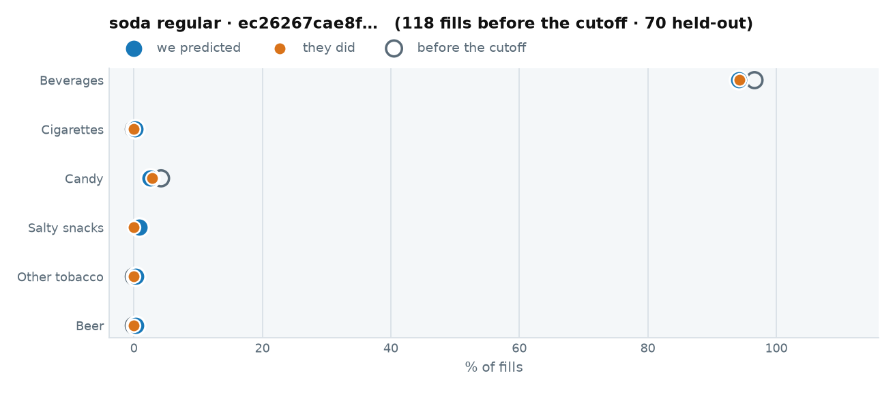

::: {.callout-note collapse="true" title="1 · The raw data we trained on"}

Every fuel visit before 2026-04-01. This is all the model was allowed to see.

::: {.scroll-table}
| when | daypart | grade | store | fuel $ | went in | categories |
|---|---|---|---|---|---|---|
| 2026-03-25 08:17 | morning | DIESEL | 1882 | 10.00 | **yes** | Packaged Beverages (Non-Alcoholic), Commissary & Other Packaged Products |
| 2026-03-24 08:01 | morning | DIESEL | 1882 | 10.00 | **yes** | Commissary & Other Packaged Products, Packaged Beverages (Non-Alcoholic) |
| 2026-03-23 08:08 | morning | DIESEL | 1882 | 10.00 | **yes** | Packaged Beverages (Non-Alcoholic) |
| 2026-03-20 08:02 | morning | DIESEL | 1882 | 10.00 | **yes** | Packaged Sweet Snacks, Packaged Beverages (Non-Alcoholic), Commissary & Other Packaged Products |
| 2026-03-19 08:12 | morning | DIESEL | 1882 | 10.00 | **yes** | Packaged Beverages (Non-Alcoholic), Packaged Sweet Snacks |
| 2026-03-12 12:12 | midday | DIESEL | 1882 | 10.00 | **yes** | Packaged Sweet Snacks, Packaged Beverages (Non-Alcoholic) |
| 2026-03-06 08:08 | morning | DIESEL | 1882 | 10.00 | **yes** | Alternative Snacks, Packaged Beverages (Non-Alcoholic) |
| 2026-03-05 08:15 | morning | DIESEL | 1882 | 10.00 | **yes** | Packaged Sweet Snacks, Packaged Beverages (Non-Alcoholic), Commissary & Other Packaged Products |
| 2026-03-04 08:07 | morning | DIESEL | 1882 | 10.00 | **yes** | Packaged Beverages (Non-Alcoholic), Packaged Sweet Snacks |
| 2026-03-03 08:45 | morning | DIESEL | 1882 | 10.00 | **yes** | Packaged Beverages (Non-Alcoholic) |
| 2026-03-02 07:46 | morning | DIESEL | 1882 | 10.00 | **yes** | Packaged Beverages (Non-Alcoholic) |
| 2026-02-25 07:22 | morning | DIESEL | 1882 | 5.00 | **yes** | Candy, Packaged Beverages (Non-Alcoholic) |
| 2026-02-24 07:43 | morning | DIESEL | 1882 | 10.00 | **yes** | Packaged Beverages (Non-Alcoholic), Commissary & Other Packaged Products |
| 2026-02-20 19:27 | evening | DIESEL | 1882 | 10.00 | **yes** | Packaged Beverages (Non-Alcoholic), Salty Snacks, Packaged Ice Cream/Novelties |
| 2026-02-20 09:21 | morning | DIESEL | 1882 | 10.00 | **yes** | Packaged Beverages (Non-Alcoholic) |
| 2026-02-19 09:13 | morning | DIESEL | 1882 | 10.00 | **yes** | Packaged Beverages (Non-Alcoholic) |
| 2026-02-13 07:15 | morning | DIESEL | 1882 | 10.00 | **yes** | Packaged Beverages (Non-Alcoholic) |
| 2026-02-12 08:04 | morning | DIESEL | 1882 | 10.00 | **yes** | Packaged Beverages (Non-Alcoholic), Commissary & Other Packaged Products |
| 2026-02-11 08:11 | morning | DIESEL | 1882 | 7.00 | **yes** | Packaged Beverages (Non-Alcoholic), Packaged Sweet Snacks |
| 2026-02-10 08:16 | morning | DIESEL | 1882 | 10.00 | **yes** | Packaged Beverages (Non-Alcoholic) |
| 2026-02-06 08:23 | morning | DIESEL | 1882 | 5.00 | **yes** | Packaged Beverages (Non-Alcoholic), Packaged Sweet Snacks |
| 2026-02-05 08:09 | morning | DIESEL | 1882 | 10.00 | **yes** | Packaged Beverages (Non-Alcoholic), Commissary & Other Packaged Products |
| 2026-02-04 08:09 | morning | DIESEL | 1882 | 10.00 | **yes** | Packaged Beverages (Non-Alcoholic) |
| 2026-02-03 08:02 | morning | DIESEL | 1882 | 10.00 | **yes** | Packaged Sweet Snacks, Packaged Beverages (Non-Alcoholic) |
| 2026-01-29 07:24 | morning | DIESEL | 1882 | 10.00 | **yes** | Commissary & Other Packaged Products, Packaged Beverages (Non-Alcoholic) |
| 2026-01-28 08:14 | morning | DIESEL | 1882 | 7.00 | **yes** | Packaged Beverages (Non-Alcoholic), Packaged Sweet Snacks |
| 2026-01-27 08:11 | morning | DIESEL | 1882 | 10.00 | **yes** | Commissary & Other Packaged Products, Packaged Beverages (Non-Alcoholic) |
| 2026-01-20 07:57 | morning | DIESEL | 1882 | 10.00 | **yes** | Commissary & Other Packaged Products, Packaged Beverages (Non-Alcoholic) |
| 2026-01-15 08:14 | morning | DIESEL | 1882 | 10.00 | **yes** | Packaged Beverages (Non-Alcoholic) |
| 2026-01-14 07:52 | morning | DIESEL | 1882 | 10.00 | no | — |
| 2026-01-13 08:16 | morning | DIESEL | 1882 | 10.50 | no | — |
| 2026-01-12 08:34 | morning | DIESEL | 1882 | 10.00 | **yes** | Packaged Sweet Snacks, Packaged Beverages (Non-Alcoholic) |
| 2026-01-09 08:03 | morning | DIESEL | 1882 | 7.00 | **yes** | Packaged Beverages (Non-Alcoholic) |
| 2026-01-08 08:27 | morning | DIESEL | 1882 | 10.00 | **yes** | Packaged Beverages (Non-Alcoholic) |
| 2026-01-07 08:16 | morning | DIESEL | 1882 | 10.00 | **yes** | Packaged Beverages (Non-Alcoholic), Alternative Snacks |
| 2025-12-31 08:03 | morning | DIESEL | 1882 | 10.00 | **yes** | Packaged Beverages (Non-Alcoholic) |
| 2025-12-30 07:55 | morning | DIESEL | 1882 | 7.00 | **yes** | Packaged Beverages (Non-Alcoholic) |
| 2025-12-29 08:40 | morning | DIESEL | 1882 | 10.00 | **yes** | Commissary & Other Packaged Products, Packaged Beverages (Non-Alcoholic) |
| 2025-12-24 09:10 | morning | DIESEL | 1882 | 5.00 | **yes** | Packaged Beverages (Non-Alcoholic) |
| 2025-12-23 08:08 | morning | DIESEL | 1882 | 6.00 | **yes** | Commissary & Other Packaged Products, Packaged Beverages (Non-Alcoholic) |
| 2025-12-22 08:26 | morning | DIESEL | 1882 | 10.00 | **yes** | Packaged Beverages (Non-Alcoholic) |
| 2025-12-19 08:07 | morning | DIESEL | 1882 | 10.00 | **yes** | Packaged Beverages (Non-Alcoholic) |
| 2025-12-17 12:26 | midday | DIESEL | 1882 | 6.00 | **yes** | Packaged Beverages (Non-Alcoholic), Packaged Sweet Snacks |
| 2025-12-16 08:05 | morning | DIESEL | 1882 | 10.00 | **yes** | Commissary & Other Packaged Products, Packaged Beverages (Non-Alcoholic) |
| 2025-12-15 08:16 | morning | DIESEL | 1882 | 7.00 | **yes** | Commissary & Other Packaged Products, Packaged Beverages (Non-Alcoholic) |
| 2025-12-12 08:12 | morning | DIESEL | 1882 | 10.00 | **yes** | Packaged Beverages (Non-Alcoholic) |
| 2025-12-11 06:38 | morning | DIESEL | 1882 | 10.00 | **yes** | Packaged Beverages (Non-Alcoholic), Commissary & Other Packaged Products |
| 2025-12-10 08:02 | morning | DIESEL | 1882 | 10.00 | **yes** | Packaged Beverages (Non-Alcoholic) |
| 2025-12-08 08:01 | morning | DIESEL | 1882 | 10.00 | **yes** | Packaged Beverages (Non-Alcoholic), Commissary & Other Packaged Products |
| 2025-12-05 08:03 | morning | DIESEL | 1882 | 10.00 | **yes** | Packaged Beverages (Non-Alcoholic), Commissary & Other Packaged Products |
| 2025-12-04 08:01 | morning | DIESEL | 1882 | 10.00 | **yes** | Packaged Beverages (Non-Alcoholic) |
| 2025-12-02 08:24 | morning | DIESEL | 1882 | 5.00 | **yes** | Commissary & Other Packaged Products, Packaged Beverages (Non-Alcoholic) |
| 2025-12-01 08:13 | morning | DIESEL | 1882 | 10.00 | **yes** | Commissary & Other Packaged Products, Packaged Beverages (Non-Alcoholic) |
| 2025-11-26 08:22 | morning | DIESEL | 1882 | 5.00 | **yes** | Packaged Beverages (Non-Alcoholic) |
| 2025-11-25 08:32 | morning | DIESEL | 1882 | 10.00 | **yes** | Packaged Beverages (Non-Alcoholic), Commissary & Other Packaged Products |
| 2025-11-22 10:21 | midday | DIESEL | 1882 | 5.00 | **yes** | Packaged Beverages (Non-Alcoholic), Commissary & Other Packaged Products |
| 2025-11-20 07:52 | morning | DIESEL | 1882 | 10.00 | **yes** | Packaged Beverages (Non-Alcoholic), Commissary & Other Packaged Products |
| 2025-11-19 08:12 | morning | DIESEL | 1882 | 10.00 | **yes** | Packaged Beverages (Non-Alcoholic) |
| 2025-11-18 07:58 | morning | DIESEL | 1882 | 5.00 | **yes** | Packaged Beverages (Non-Alcoholic) |
| 2025-11-10 08:08 | morning | DIESEL | 1882 | 10.00 | **yes** | Packaged Beverages (Non-Alcoholic) |
| 2025-11-09 16:29 | evening | DIESEL | 1882 | 5.00 | **yes** | Alternative Snacks, Candy, Packaged Beverages (Non-Alcoholic) |
| 2025-11-08 08:50 | morning | DIESEL | 1882 | 5.00 | **yes** | Packaged Beverages (Non-Alcoholic) |
| 2025-11-07 08:19 | morning | DIESEL | 1882 | 10.00 | **yes** | Packaged Beverages (Non-Alcoholic) |
| 2025-11-06 08:05 | morning | DIESEL | 1882 | 10.00 | **yes** | Packaged Beverages (Non-Alcoholic) |
| 2025-11-04 07:56 | morning | DIESEL | 1882 | 5.00 | **yes** | Packaged Beverages (Non-Alcoholic) |
| 2025-11-01 17:35 | evening | DIESEL | 1882 | 20.32 | no | — |
| 2025-10-30 08:08 | morning | DIESEL | 1882 | 10.00 | **yes** | Packaged Beverages (Non-Alcoholic) |
| 2025-10-28 07:01 | morning | DIESEL | 1882 | 5.00 | **yes** | Commissary & Other Packaged Products, Packaged Beverages (Non-Alcoholic) |
| 2025-10-27 08:35 | morning | DIESEL | 1882 | 10.00 | **yes** | Commissary & Other Packaged Products, Packaged Beverages (Non-Alcoholic) |
| 2025-10-25 10:17 | midday | DIESEL | 1882 | 5.00 | **yes** | Packaged Sweet Snacks, Packaged Beverages (Non-Alcoholic) |
| 2025-10-23 07:56 | morning | DIESEL | 1882 | 10.00 | **yes** | Packaged Beverages (Non-Alcoholic), Commissary & Other Packaged Products |
| 2025-10-22 07:43 | morning | DIESEL | 1882 | 10.00 | **yes** | Packaged Beverages (Non-Alcoholic) |
| 2025-10-21 07:34 | morning | DIESEL | 1882 | 10.00 | **yes** | Packaged Sweet Snacks, Packaged Beverages (Non-Alcoholic) |
| 2025-10-20 08:07 | morning | DIESEL | 1882 | 10.00 | **yes** | Packaged Beverages (Non-Alcoholic), Commissary & Other Packaged Products |
| 2025-10-10 07:58 | morning | DIESEL | 1882 | 10.00 | **yes** | Packaged Beverages (Non-Alcoholic) |
| 2025-10-09 08:23 | morning | DIESEL | 1882 | 10.00 | **yes** | Packaged Beverages (Non-Alcoholic) |
| 2025-10-08 08:24 | morning | DIESEL | 1882 | 10.00 | **yes** | Packaged Beverages (Non-Alcoholic) |
| 2025-10-07 07:54 | morning | DIESEL | 1882 | 10.00 | **yes** | Packaged Beverages (Non-Alcoholic) |
| 2025-10-03 07:38 | morning | DIESEL | 1882 | 10.00 | no | — |
| 2025-10-02 08:28 | morning | DIESEL | 1882 | 10.00 | **yes** | Packaged Beverages (Non-Alcoholic) |
| 2025-10-01 08:24 | morning | DIESEL | 1882 | 10.00 | **yes** | Packaged Beverages (Non-Alcoholic), Packaged Sweet Snacks |
| 2025-09-30 08:11 | morning | DIESEL | 1882 | 10.00 | **yes** | Packaged Beverages (Non-Alcoholic), Commissary & Other Packaged Products |
| 2025-09-29 07:57 | morning | DIESEL | 1882 | 10.00 | **yes** | Packaged Beverages (Non-Alcoholic) |
| 2025-09-26 08:28 | morning | DIESEL | 1882 | 10.00 | **yes** | Packaged Beverages (Non-Alcoholic) |
| 2025-09-25 08:07 | morning | DIESEL | 1882 | 10.00 | **yes** | Packaged Beverages (Non-Alcoholic) |
| 2025-09-24 08:14 | morning | DIESEL | 1882 | 10.00 | **yes** | Packaged Beverages (Non-Alcoholic), Commissary & Other Packaged Products |
| 2025-09-22 08:24 | morning | DIESEL | 1882 | 5.00 | **yes** | Packaged Beverages (Non-Alcoholic), Commissary & Other Packaged Products |
| 2025-09-20 17:24 | evening | DIESEL | 1882 | 10.00 | **yes** | Packaged Sweet Snacks, Candy, Packaged Beverages (Non-Alcoholic) |
| 2025-09-19 08:18 | morning | DIESEL | 1882 | 10.00 | **yes** | Packaged Beverages (Non-Alcoholic) |
| 2025-09-18 08:02 | morning | DIESEL | 1882 | 10.00 | **yes** | Packaged Beverages (Non-Alcoholic) |
| 2025-09-17 08:01 | morning | DIESEL | 1882 | 10.00 | **yes** | Packaged Beverages (Non-Alcoholic) |
| 2025-09-16 08:05 | morning | DIESEL | 1882 | 10.00 | **yes** | Packaged Beverages (Non-Alcoholic) |
| 2025-09-15 08:10 | morning | DIESEL | 1882 | 10.00 | **yes** | Packaged Beverages (Non-Alcoholic) |
| 2025-09-13 08:57 | morning | DIESEL | 1882 | 10.00 | **yes** | Commissary & Other Packaged Products, Packaged Beverages (Non-Alcoholic) |
| 2025-09-12 08:27 | morning | DIESEL | 1882 | 10.00 | **yes** | Packaged Beverages (Non-Alcoholic) |
| 2025-09-11 08:26 | morning | DIESEL | 1882 | 10.00 | **yes** | Packaged Beverages (Non-Alcoholic) |
| 2025-09-08 08:26 | morning | DIESEL | 1882 | 5.00 | **yes** | Packaged Beverages (Non-Alcoholic) |
| 2025-09-07 15:43 | evening | DIESEL | 1882 | 10.00 | **yes** | Packaged Beverages (Non-Alcoholic) |
| 2025-09-06 09:02 | morning | DIESEL | 1882 | 10.00 | **yes** | Packaged Beverages (Non-Alcoholic) |
| 2025-09-05 08:05 | morning | DIESEL | 1882 | 8.00 | **yes** | Commissary & Other Packaged Products, Packaged Sweet Snacks, Packaged Beverages (Non-Alcoholic) |
| 2025-09-04 08:23 | morning | DIESEL | 1882 | 10.00 | **yes** | Packaged Beverages (Non-Alcoholic) |
| 2025-09-03 08:25 | morning | DIESEL | 1882 | 10.00 | **yes** | Packaged Beverages (Non-Alcoholic) |
| 2025-08-29 08:21 | morning | DIESEL | 1882 | 10.00 | **yes** | Packaged Beverages (Non-Alcoholic) |
| 2025-08-27 08:02 | morning | DIESEL | 1882 | 10.00 | **yes** | Packaged Beverages (Non-Alcoholic) |
| 2025-08-25 08:02 | morning | DIESEL | 1882 | 10.00 | **yes** | Commissary & Other Packaged Products, Candy, Packaged Beverages (Non-Alcoholic) |
| 2025-08-24 15:01 | evening | DIESEL | 1882 | 10.00 | **yes** | Commissary & Other Packaged Products, Packaged Beverages (Non-Alcoholic) |
| 2025-08-19 07:43 | morning | DIESEL | 1882 | 5.00 | **yes** | Commissary & Other Packaged Products, Packaged Beverages (Non-Alcoholic) |
| 2025-08-18 08:33 | morning | DIESEL | 1882 | 10.00 | **yes** | Packaged Beverages (Non-Alcoholic) |
| 2025-08-13 16:36 | evening | DIESEL | 1882 | 5.00 | **yes** | Packaged Beverages (Non-Alcoholic), Alternative Snacks |
| 2025-08-11 08:04 | morning | DIESEL | 1882 | 10.00 | **yes** | Commissary & Other Packaged Products, Packaged Beverages (Non-Alcoholic) |
| 2025-08-09 21:32 | evening | DIESEL | 1882 | 5.00 | **yes** | Candy, Packaged Beverages (Non-Alcoholic), Packaged Sweet Snacks |
| 2025-08-06 08:08 | morning | DIESEL | 1882 | 5.00 | **yes** | Alternative Snacks, Packaged Beverages (Non-Alcoholic) |
| 2025-08-05 08:04 | morning | DIESEL | 1882 | 10.00 | **yes** | Commissary & Other Packaged Products, Packaged Beverages (Non-Alcoholic), Alternative Snacks |
| 2025-08-04 08:11 | morning | DIESEL | 1882 | 10.00 | **yes** | Packaged Beverages (Non-Alcoholic) |
| 2025-07-31 07:25 | morning | DIESEL | 1882 | 5.00 | **yes** | Alternative Snacks, Packaged Beverages (Non-Alcoholic) |
| 2025-07-24 07:58 | morning | DIESEL | 1882 | 10.00 | **yes** | Packaged Beverages (Non-Alcoholic), Alternative Snacks |
| 2025-07-22 08:06 | morning | DIESEL | 1882 | 10.00 | **yes** | Packaged Beverages (Non-Alcoholic), Alternative Snacks |
| 2025-07-18 08:18 | morning | DIESEL | 1882 | 5.00 | **yes** | Packaged Beverages (Non-Alcoholic), MERCHANDISE |
:::

[All 118 fills, newest first — scroll the box. Their category rates are the left-hand chart above.]{.muted style="font-size:0.8em"}

The actual items behind those baskets — **38** distinct SKUs:

::: {.scroll-table}
| category | brand | units | spend $ |
|---|---|---|---|
| Packaged Beverages (Non-Alcoholic) | Monster | 189 | 500.00 |
| Packaged Beverages (Non-Alcoholic) | Mountain Dew | 85 | 292.25 |
| Packaged Beverages (Non-Alcoholic) | Pepsi | 81 | 278.19 |
| Packaged Beverages (Non-Alcoholic) | Coca-Cola | 46 | 114.34 |
| Packaged Beverages (Non-Alcoholic) | C4 Energy | 21 | 68.79 |
| Packaged Beverages (Non-Alcoholic) | GHOST | 17 | 53.35 |
| Packaged Beverages (Non-Alcoholic) | Dr Pepper | 17 | 39.88 |
| Packaged Beverages (Non-Alcoholic) | Fresca | 15 | 39.51 |
| Packaged Beverages (Non-Alcoholic) | A&W | 8 | 17.57 |
| Packaged Beverages (Non-Alcoholic) | Venom Energy | 7 | 10.43 |
| Candy | Butterfinger | 4 | 8.59 |
| Candy | Reese's | 4 | 12.61 |
| Packaged Beverages (Non-Alcoholic) | Starbucks | 4 | 21.16 |
| Candy | M&M's | 2 | 5.49 |
| Salty Snacks | Doritos | 2 | 5.38 |
| Packaged Beverages (Non-Alcoholic) | Prime | 2 | 5.38 |
| Candy | Snickers | 2 | 5.98 |
| Candy | Hershey | 2 | 3.98 |
| Salty Snacks | Tim's Snacks | 2 | 3.58 |
| Packaged Beverages (Non-Alcoholic) | Cellucor | 2 | 6.98 |
| Packaged Beverages (Non-Alcoholic) | BodyArmor | 2 | 6.98 |
| Candy | Wrigley's | 2 | 4.08 |
| Candy | Just Born | 1 | 2.99 |
| Candy | Whatchamacallit | 1 | 2.38 |
| Candy | Twix | 1 | 2.38 |
| Salty Snacks | Lay's | 1 | 2.69 |
| Salty Snacks | Pecan Nation | 1 | 3.99 |
| Candy | PayDay | 1 | 2.50 |
| Candy | Lemonhead | 1 | 2.39 |
| Candy | Nerds | 1 | 3.99 |
| Packaged Beverages (Non-Alcoholic) | Penafiel | 1 | 1.89 |
| Packaged Beverages (Non-Alcoholic) | Sunkist | 1 | 2.39 |
| Salty Snacks | Chex Mix | 1 | 4.49 |
| Packaged Beverages (Non-Alcoholic) | Sparkling Ice | 1 | 1.99 |
| Packaged Beverages (Non-Alcoholic) | Red Bull | 1 | 5.29 |
| Candy | Baby Ruth | 1 | 2.29 |
| Packaged Beverages (Non-Alcoholic) | Squirt | 1 | 2.25 |
| Packaged Beverages (Non-Alcoholic) | Minute Maid | 1 | 2.79 |
:::

:::

::: {.callout-note collapse="true" title="2 · What we predicted"}

At one fixed moment — **2026-06-15 07:12, REGULAR** — so the only thing that varies across these tabs is who they are:

| category | P(buys on this fill) |
|---|---|
| Beverages | 0.7925 |
| Candy | 0.0371 |
| Salty snacks | 0.0111 |
| Other tobacco | 0.0025 |
| Cigarettes | 0.0013 |
| Beer | 0.0001 |

**Stage one picks Packaged Beverages (Non-Alcoholic).** Stage two offers **Monster** (EV $0.00556).

And the rows actually written to `customer_scores.parquet` for their held-out fills:

::: {.scroll-table}
| when | daypart | P(enters) | offer category | Beverages | Cigarettes | Candy | Salty snacks | Other tobacco | Beer |
|---|---|---|---|---|---|---|---|---|---|
| 04-06 08:17 | morning | 0.9612 | Packaged Beverages (Non-Alcoholic) | 0.9595 | 0.0014 | 0.0285 | 0.0084 | 0.0045 | 0.0001 |
| 04-13 08:09 | morning | 0.9612 | Packaged Beverages (Non-Alcoholic) | 0.9595 | 0.0014 | 0.0285 | 0.0084 | 0.0045 | 0.0001 |
| 04-14 08:05 | morning | 0.9611 | Packaged Beverages (Non-Alcoholic) | 0.9595 | 0.0014 | 0.0285 | 0.0084 | 0.0026 | 0.0008 |
| 04-16 08:16 | morning | 0.9621 | Packaged Beverages (Non-Alcoholic) | 0.9595 | 0.0014 | 0.0441 | 0.0155 | 0.0026 | 0.0017 |
| 04-21 08:24 | morning | 0.9611 | Packaged Beverages (Non-Alcoholic) | 0.9595 | 0.0014 | 0.0285 | 0.0079 | 0.0026 | 0.0008 |
| 04-23 07:27 | morning | 0.9617 | Packaged Beverages (Non-Alcoholic) | 0.9595 | 0.0014 | 0.0371 | 0.0133 | 0.0026 | 0.0011 |
| 05-04 07:47 | morning | 0.9607 | Packaged Beverages (Non-Alcoholic) | 0.9595 | 0.0008 | 0.0237 | 0.0025 | 0.0026 | 0.0008 |
| 05-05 08:07 | morning | 0.9609 | Packaged Beverages (Non-Alcoholic) | 0.9595 | 0.0014 | 0.0237 | 0.0079 | 0.0026 | 0.0008 |
| 05-08 08:07 | morning | 0.9613 | Packaged Beverages (Non-Alcoholic) | 0.9595 | 0.0014 | 0.0285 | 0.0102 | 0.0026 | 0.0025 |
| 05-11 08:00 | morning | 0.9609 | Packaged Beverages (Non-Alcoholic) | 0.9595 | 0.0014 | 0.0237 | 0.0079 | 0.0024 | 0.0001 |
| 05-12 08:17 | morning | 0.9609 | Packaged Beverages (Non-Alcoholic) | 0.9595 | 0.0014 | 0.0237 | 0.0079 | 0.0026 | 0.0008 |
| 05-13 08:19 | morning | 0.9616 | Packaged Beverages (Non-Alcoholic) | 0.9595 | 0.0014 | 0.0371 | 0.0111 | 0.0026 | 0.0017 |
| 05-14 08:03 | morning | 0.9613 | Packaged Beverages (Non-Alcoholic) | 0.9595 | 0.0014 | 0.0285 | 0.0124 | 0.0026 | 0.0017 |
| 05-15 08:00 | morning | 0.9610 | Packaged Beverages (Non-Alcoholic) | 0.9595 | 0.0013 | 0.0285 | 0.0028 | 0.0026 | 0.0038 |
| 05-19 08:11 | morning | 0.9609 | Packaged Beverages (Non-Alcoholic) | 0.9595 | 0.0014 | 0.0237 | 0.0079 | 0.0026 | 0.0008 |
| 05-20 08:04 | morning | 0.9616 | Packaged Beverages (Non-Alcoholic) | 0.9595 | 0.0014 | 0.0371 | 0.0111 | 0.0026 | 0.0017 |
| 05-28 08:18 | morning | 0.9274 | Packaged Beverages (Non-Alcoholic) | 0.9245 | 0.0008 | 0.0285 | 0.0038 | 0.0026 | 0.0025 |
| 05-29 08:15 | morning | 0.9613 | Packaged Beverages (Non-Alcoholic) | 0.9595 | 0.0014 | 0.0285 | 0.0111 | 0.0026 | 0.0025 |
| 06-08 07:54 | morning | 0.9608 | Packaged Beverages (Non-Alcoholic) | 0.9595 | 0.0028 | 0.0170 | 0.0080 | 0.0049 | 0.0001 |
| 06-09 07:46 | morning | 0.9608 | Packaged Beverages (Non-Alcoholic) | 0.9595 | 0.0028 | 0.0170 | 0.0080 | 0.0045 | 0.0008 |
| 06-10 07:49 | morning | 0.9612 | Packaged Beverages (Non-Alcoholic) | 0.9595 | 0.0014 | 0.0248 | 0.0133 | 0.0026 | 0.0011 |
| 06-11 08:11 | morning | 0.9614 | Packaged Beverages (Non-Alcoholic) | 0.9595 | 0.0014 | 0.0283 | 0.0153 | 0.0026 | 0.0017 |
| 06-15 07:55 | morning | 0.9608 | Packaged Beverages (Non-Alcoholic) | 0.9595 | 0.0014 | 0.0191 | 0.0079 | 0.0024 | 0.0017 |
| 06-16 08:18 | morning | 0.9609 | Packaged Beverages (Non-Alcoholic) | 0.9595 | 0.0014 | 0.0206 | 0.0079 | 0.0026 | 0.0030 |
| 06-19 08:17 | morning | 0.9614 | Packaged Beverages (Non-Alcoholic) | 0.9595 | 0.0014 | 0.0283 | 0.0102 | 0.0026 | 0.0052 |
| 06-20 17:23 | evening | 0.8197 | Packaged Beverages (Non-Alcoholic) | 0.7924 | 0.0014 | 0.0723 | 0.0343 | 0.0026 | 0.0265 |
| 06-22 11:04 | midday | 0.9086 | Packaged Beverages (Non-Alcoholic) | 0.9032 | 0.0014 | 0.0371 | 0.0133 | 0.0024 | 0.0025 |
| 06-25 07:26 | morning | 0.9611 | Packaged Beverages (Non-Alcoholic) | 0.9595 | 0.0014 | 0.0248 | 0.0111 | 0.0026 | 0.0025 |
| 07-02 08:06 | morning | 0.9611 | Packaged Beverages (Non-Alcoholic) | 0.9595 | 0.0014 | 0.0237 | 0.0111 | 0.0026 | 0.0025 |
| 07-03 12:19 | midday | 0.6977 | Packaged Beverages (Non-Alcoholic) | 0.6796 | 0.0004 | 0.0371 | 0.0155 | 0.0026 | 0.0017 |
| 07-06 08:18 | morning | 0.9607 | Packaged Beverages (Non-Alcoholic) | 0.9595 | 0.0014 | 0.0170 | 0.0069 | 0.0045 | 0.0011 |
| 07-07 08:22 | morning | 0.9606 | Packaged Beverages (Non-Alcoholic) | 0.9595 | 0.0014 | 0.0170 | 0.0069 | 0.0026 | 0.0017 |
| 07-08 08:01 | morning | 0.9612 | Packaged Beverages (Non-Alcoholic) | 0.9595 | 0.0014 | 0.0248 | 0.0102 | 0.0026 | 0.0042 |
| 07-12 10:09 | midday | 0.9290 | Packaged Beverages (Non-Alcoholic) | 0.9245 | 0.0013 | 0.0371 | 0.0038 | 0.0026 | 0.0151 |
| 07-14 08:03 | morning | 0.9608 | Packaged Beverages (Non-Alcoholic) | 0.9595 | 0.0014 | 0.0191 | 0.0069 | 0.0026 | 0.0030 |
| 07-17 08:03 | morning | 0.9611 | Packaged Beverages (Non-Alcoholic) | 0.9595 | 0.0014 | 0.0237 | 0.0080 | 0.0026 | 0.0052 |
| 07-20 08:26 | morning | 0.9608 | Packaged Beverages (Non-Alcoholic) | 0.9595 | 0.0028 | 0.0170 | 0.0079 | 0.0049 | 0.0001 |
| 07-21 07:59 | morning | 0.9607 | Packaged Beverages (Non-Alcoholic) | 0.9595 | 0.0014 | 0.0170 | 0.0069 | 0.0026 | 0.0025 |
| 07-27 08:10 | morning | 0.9608 | Packaged Beverages (Non-Alcoholic) | 0.9595 | 0.0014 | 0.0191 | 0.0069 | 0.0026 | 0.0025 |
| 07-29 08:19 | morning | 0.9612 | Packaged Beverages (Non-Alcoholic) | 0.9595 | 0.0014 | 0.0248 | 0.0102 | 0.0026 | 0.0042 |
| 07-30 08:11 | morning | 0.9612 | Packaged Beverages (Non-Alcoholic) | 0.9595 | 0.0014 | 0.0237 | 0.0111 | 0.0026 | 0.0047 |
| 07-31 08:16 | morning | 0.9611 | Packaged Beverages (Non-Alcoholic) | 0.9595 | 0.0014 | 0.0237 | 0.0080 | 0.0026 | 0.0052 |
| 08-01 10:21 | midday | 0.9283 | Packaged Beverages (Non-Alcoholic) | 0.9245 | 0.0013 | 0.0285 | 0.0025 | 0.0026 | 0.0151 |
| 08-03 08:18 | morning | 0.9607 | Packaged Beverages (Non-Alcoholic) | 0.9595 | 0.0028 | 0.0170 | 0.0060 | 0.0049 | 0.0001 |
| 08-06 07:50 | morning | 0.9609 | Packaged Beverages (Non-Alcoholic) | 0.9595 | 0.0014 | 0.0211 | 0.0069 | 0.0026 | 0.0038 |
| 08-11 08:19 | morning | 0.9607 | Packaged Beverages (Non-Alcoholic) | 0.9595 | 0.0028 | 0.0170 | 0.0060 | 0.0045 | 0.0001 |
| 08-12 08:13 | morning | 0.9610 | Packaged Beverages (Non-Alcoholic) | 0.9595 | 0.0014 | 0.0237 | 0.0069 | 0.0026 | 0.0038 |
| 08-14 08:18 | morning | 0.9610 | Packaged Beverages (Non-Alcoholic) | 0.9595 | 0.0014 | 0.0237 | 0.0069 | 0.0026 | 0.0052 |
| 08-18 08:19 | morning | 0.7957 | Packaged Beverages (Non-Alcoholic) | 0.7924 | 0.0013 | 0.0091 | 0.0028 | 0.0019 | 0.0008 |
| 08-26 08:12 | morning | 0.9608 | Packaged Beverages (Non-Alcoholic) | 0.9595 | 0.0028 | 0.0191 | 0.0069 | 0.0047 | 0.0011 |
| 08-27 08:14 | morning | 0.9609 | Packaged Beverages (Non-Alcoholic) | 0.9595 | 0.0014 | 0.0237 | 0.0069 | 0.0026 | 0.0025 |
| 08-28 08:10 | morning | 0.9610 | Packaged Beverages (Non-Alcoholic) | 0.9595 | 0.0014 | 0.0237 | 0.0069 | 0.0026 | 0.0030 |
| 08-29 10:08 | midday | 0.9288 | Packaged Beverages (Non-Alcoholic) | 0.9245 | 0.0014 | 0.0371 | 0.0111 | 0.0026 | 0.0052 |
| 08-31 07:26 | morning | 0.9267 | Packaged Beverages (Non-Alcoholic) | 0.9245 | 0.0014 | 0.0170 | 0.0060 | 0.0045 | 0.0008 |
| 09-01 07:14 | morning | 0.9606 | Packaged Beverages (Non-Alcoholic) | 0.9595 | 0.0014 | 0.0170 | 0.0060 | 0.0026 | 0.0011 |
| 09-03 07:04 | morning | 0.9611 | Packaged Beverages (Non-Alcoholic) | 0.9595 | 0.0014 | 0.0283 | 0.0069 | 0.0026 | 0.0017 |
| 09-07 08:06 | morning | 0.9606 | Packaged Beverages (Non-Alcoholic) | 0.9595 | 0.0014 | 0.0170 | 0.0060 | 0.0026 | 0.0008 |
| 09-08 07:03 | morning | 0.9606 | Packaged Beverages (Non-Alcoholic) | 0.9595 | 0.0014 | 0.0170 | 0.0060 | 0.0026 | 0.0011 |
| 09-10 07:03 | morning | 0.9611 | Packaged Beverages (Non-Alcoholic) | 0.9595 | 0.0014 | 0.0283 | 0.0069 | 0.0026 | 0.0017 |
| 09-11 07:31 | morning | 0.9611 | Packaged Beverages (Non-Alcoholic) | 0.9595 | 0.0014 | 0.0285 | 0.0061 | 0.0026 | 0.0025 |
| 09-14 07:33 | morning | 0.9606 | Packaged Beverages (Non-Alcoholic) | 0.9595 | 0.0014 | 0.0170 | 0.0060 | 0.0026 | 0.0008 |
| 09-16 07:35 | morning | 0.9608 | Packaged Beverages (Non-Alcoholic) | 0.9595 | 0.0014 | 0.0211 | 0.0069 | 0.0026 | 0.0017 |
| 09-17 07:06 | morning | 0.9611 | Packaged Beverages (Non-Alcoholic) | 0.9595 | 0.0014 | 0.0283 | 0.0069 | 0.0026 | 0.0017 |
| 09-19 08:44 | morning | 0.9612 | Packaged Beverages (Non-Alcoholic) | 0.9595 | 0.0014 | 0.0285 | 0.0069 | 0.0026 | 0.0052 |
| 09-21 07:31 | morning | 0.9606 | Packaged Beverages (Non-Alcoholic) | 0.9595 | 0.0014 | 0.0170 | 0.0060 | 0.0024 | 0.0008 |
| 09-22 07:06 | morning | 0.9265 | Packaged Beverages (Non-Alcoholic) | 0.9245 | 0.0008 | 0.0170 | 0.0060 | 0.0019 | 0.0008 |
| 09-25 07:19 | morning | 0.7976 | Packaged Beverages (Non-Alcoholic) | 0.7924 | 0.0004 | 0.0170 | 0.0056 | 0.0019 | 0.0001 |
| 09-27 08:20 | morning | 0.9611 | Packaged Beverages (Non-Alcoholic) | 0.9595 | 0.0013 | 0.0285 | 0.0022 | 0.0026 | 0.0063 |
| 09-29 07:28 | morning | 0.7765 | Packaged Beverages (Non-Alcoholic) | 0.7727 | 0.0014 | 0.0091 | 0.0028 | 0.0026 | 0.0008 |
| 09-30 07:07 | morning | 0.9603 | Packaged Beverages (Non-Alcoholic) | 0.9595 | 0.0008 | 0.0127 | 0.0025 | 0.0026 | 0.0017 |
:::

Ranked SKUs inside that category:

| rank | brand | affinity | p_sku | p_category | p_buys |
|---|---|---|---|---|---|
| 1 | Monster | 1.19 | 0.0053 | 0.9595 | 0.0051 |
| 2 | Monster | 1.12 | 0.0050 | 0.9595 | 0.0048 |
| 3 | Monster | 1.11 | 0.0049 | 0.9595 | 0.0047 |

Second item: **Ruffles** (Salty Snacks), cohort index 1.30, headroom 99%

:::

::: {.callout-note collapse="true" title="4 · What ALS believes, against what they bought"}

Scored over the **685** SKUs ALS carries for *Beverages* in the morning.

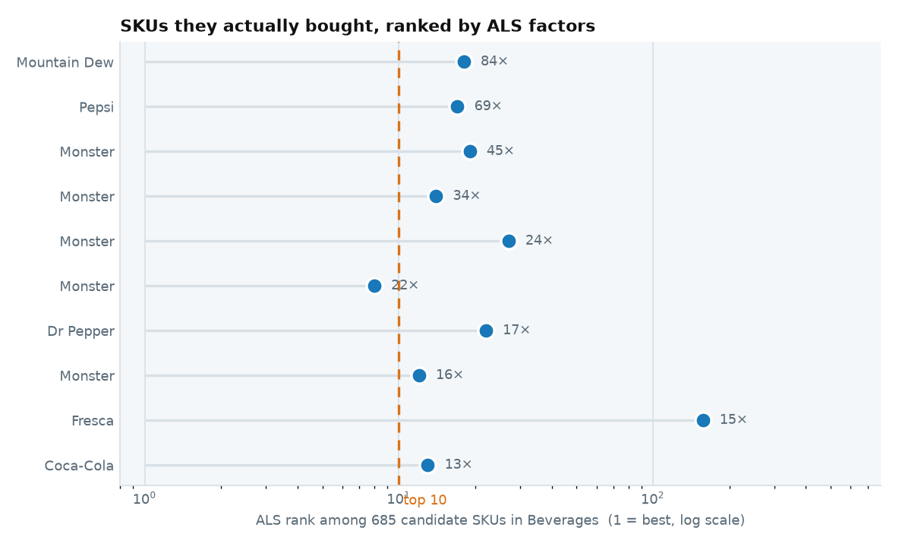

The SKUs they bought, and where ALS puts them:

::: {.scroll-table}
| brand | they bought | ALS score | rank | percentile |
|---|---|---|---|---|
| Mountain Dew | 84 | 0.99 | 18 | 97.50 |
| Pepsi | 69 | 0.992 | 17 | 97.70 |
| Monster | 45 | 0.988 | 19 | 97.40 |
| Monster | 34 | 1.016 | 14 | 98.10 |
| Monster | 24 | 0.962 | 27 | 96.20 |
| Monster | 22 | 1.076 | 8 | 99.00 |
| Dr Pepper | 17 | 0.982 | 22 | 96.90 |
| Monster | 16 | 1.04 | 12 | 98.40 |
| Fresca | 15 | 0.535 | 157 | 77.20 |
| Coca-Cola | 13 | 1.029 | 13 | 98.20 |
| Coca-Cola | 12 | 0.731 | 69 | 90.10 |
| Pepsi | 11 | 1.104 | 4 | 99.60 |
| Monster | 10 | 1.106 | 3 | 99.70 |
| Coca-Cola | 9 | 0.826 | 46 | 93.40 |
| Monster | 9 | 0.948 | 30 | 95.80 |
| Monster | 9 | 0.647 | 100 | 85.50 |
| A&W | 8 | 0.778 | 56 | 92.00 |
| Coca-Cola | 6 | 1.062 | 10 | 98.70 |
| Monster | 6 | 1.096 | 5 | 99.40 |
| GHOST | 6 | 0.907 | 32 | 95.50 |
| Starbucks | 4 | 0.756 | 66 | 90.50 |
| Monster | 4 | 1.059 | 11 | 98.50 |
| Monster | 4 | 1.089 | 7 | 99.10 |
| Venom Energy | 4 | 0.781 | 55 | 92.10 |
| Coca-Cola | 3 | 0.514 | 174 | 74.70 |
| Monster | 3 | 0.905 | 34 | 95.20 |
| GHOST | 3 | 0.711 | 71 | 89.80 |
| GHOST | 3 | 0.53 | 160 | 76.80 |
| Coca-Cola | 2 | 0.467 | 206 | 70.10 |
| Venom Energy | 2 | 0.707 | 72 | 89.60 |
| GHOST | 2 | 0.823 | 47 | 93.30 |
| GHOST | 2 | 0.683 | 85 | 87.70 |
| C4 Energy | 2 | 0.9 | 35 | 95.00 |
| Mountain Dew | 1 | 0.645 | 102 | 85.30 |
| Pepsi | 1 | 0.979 | 25 | 96.50 |
| Minute Maid | 1 | 0.69 | 81 | 88.30 |
| Monster | 1 | 0.734 | 68 | 90.20 |
| Monster | 1 | 0.814 | 48 | 93.10 |
| Monster | 1 | 0.575 | 138 | 80.00 |
| Squirt | 1 | 0.637 | 105 | 84.80 |
| Venom Energy | 1 | 0.613 | 118 | 82.90 |
| Penafiel | 1 | 0.147 | 450 | 34.50 |
| Red Bull | 1 | 0.556 | 146 | 78.80 |
| GHOST | 1 | 0.703 | 75 | 89.20 |
| C4 Energy | 1 | 0.994 | 16 | 97.80 |
| C4 Energy | 1 | 0.898 | 36 | 94.90 |
| C4 Energy | 1 | 0.839 | 44 | 93.70 |
| C4 Energy | 1 | 0.996 | 15 | 98.00 |
| BodyArmor | 1 | 0.404 | 253 | 63.20 |
| BodyArmor | 1 | 0.303 | 320 | 53.40 |
:::

**6 of 50** of their own SKUs land in the top 10 of 685.

And what ALS ranks highest for them:

| brand | ALS score | times they bought it |
|---|---|---|
| Monster | 1.192 | 0 |
| Monster | 1.125 | 0 |
| Monster | 1.106 | 10 |
| Pepsi | 1.104 | 11 |
| Monster | 1.096 | 6 |

[The raw score is a dot product on the ALS path and a unit count on the fallback path, so it is not one scale — the percentile is the comparable column.]{.muted style="font-size:0.8em"}

:::

::: {.callout-note collapse="true" title="3 · What actually happened"}

Their own held-out fills — **66 of 70** ended inside:

::: {.scroll-table}
| when | daypart | went in | what they bought |
|---|---|---|---|
| 04-06 08:17 | morning | **yes** | Commissary & Other Packaged Products, Packaged Beverages (Non-Alcoholic) |
| 04-13 08:09 | morning | **yes** | Packaged Beverages (Non-Alcoholic), Commissary & Other Packaged Products |
| 04-14 08:05 | morning | **yes** | Commissary & Other Packaged Products, Packaged Beverages (Non-Alcoholic) |
| 04-16 08:16 | morning | **yes** | Packaged Beverages (Non-Alcoholic) |
| 04-21 08:24 | morning | **yes** | Packaged Beverages (Non-Alcoholic), Packaged Sweet Snacks |
| 04-23 07:27 | morning | **yes** | Commissary & Other Packaged Products, Packaged Beverages (Non-Alcoholic), Candy |
| 05-04 07:47 | morning | **yes** | Packaged Beverages (Non-Alcoholic) |
| 05-05 08:07 | morning | **yes** | Commissary & Other Packaged Products, Packaged Beverages (Non-Alcoholic) |
| 05-08 08:07 | morning | **yes** | Packaged Beverages (Non-Alcoholic) |
| 05-11 08:00 | morning | **yes** | Packaged Beverages (Non-Alcoholic), Commissary & Other Packaged Products |
| 05-12 08:17 | morning | **yes** | Packaged Beverages (Non-Alcoholic) |
| 05-13 08:19 | morning | **yes** | Packaged Beverages (Non-Alcoholic), Commissary & Other Packaged Products |
| 05-14 08:03 | morning | **yes** | Packaged Beverages (Non-Alcoholic) |
| 05-15 08:00 | morning | **yes** | Packaged Beverages (Non-Alcoholic) |
| 05-19 08:11 | morning | **yes** | Packaged Beverages (Non-Alcoholic), Commissary & Other Packaged Products |
| 05-20 08:04 | morning | **yes** | Commissary & Other Packaged Products, Packaged Beverages (Non-Alcoholic) |
| 05-28 08:18 | morning | **yes** | Packaged Beverages (Non-Alcoholic), Commissary & Other Packaged Products |
| 05-29 08:15 | morning | **yes** | Packaged Beverages (Non-Alcoholic), Commissary & Other Packaged Products |
| 06-08 07:54 | morning | **yes** | Packaged Beverages (Non-Alcoholic), Packaged Sweet Snacks |
| 06-09 07:46 | morning | **yes** | Packaged Beverages (Non-Alcoholic), Commissary & Other Packaged Products |
| 06-10 07:49 | morning | **yes** | Packaged Beverages (Non-Alcoholic) |
| 06-11 08:11 | morning | **yes** | Packaged Beverages (Non-Alcoholic), Commissary & Other Packaged Products |
| 06-15 07:55 | morning | **yes** | Commissary & Other Packaged Products, Packaged Beverages (Non-Alcoholic) |
| 06-16 08:18 | morning | **yes** | Packaged Beverages (Non-Alcoholic) |
| 06-19 08:17 | morning | **yes** | Packaged Beverages (Non-Alcoholic) |
| 06-20 17:23 | evening | **yes** | Packaged Beverages (Non-Alcoholic) |
| 06-22 11:04 | midday | **yes** | Packaged Beverages (Non-Alcoholic) |
| 06-25 07:26 | morning | **yes** | Packaged Beverages (Non-Alcoholic) |
| 07-02 08:06 | morning | **yes** | Commissary & Other Packaged Products, Packaged Beverages (Non-Alcoholic) |
| 07-03 12:19 | midday | no | — |
| 07-06 08:18 | morning | **yes** | Packaged Beverages (Non-Alcoholic) |
| 07-07 08:22 | morning | **yes** | Candy, Packaged Beverages (Non-Alcoholic) |
| 07-08 08:01 | morning | **yes** | Packaged Beverages (Non-Alcoholic) |
| 07-12 10:09 | midday | **yes** | Packaged Beverages (Non-Alcoholic), Alternative Snacks |
| 07-14 08:03 | morning | **yes** | Packaged Beverages (Non-Alcoholic), Alternative Snacks |
| 07-17 08:03 | morning | **yes** | Packaged Beverages (Non-Alcoholic), Alternative Snacks |
| 07-20 08:26 | morning | **yes** | Packaged Beverages (Non-Alcoholic), Alternative Snacks |
| 07-21 07:59 | morning | **yes** | Alternative Snacks, Packaged Beverages (Non-Alcoholic) |
| 07-27 08:10 | morning | **yes** | Packaged Beverages (Non-Alcoholic) |
| 07-29 08:19 | morning | **yes** | Packaged Beverages (Non-Alcoholic) |
| 07-30 08:11 | morning | **yes** | Packaged Beverages (Non-Alcoholic), Alternative Snacks |
| 07-31 08:16 | morning | **yes** | Packaged Beverages (Non-Alcoholic) |
| 08-01 10:21 | midday | **yes** | Packaged Beverages (Non-Alcoholic) |
| 08-03 08:18 | morning | **yes** | Packaged Beverages (Non-Alcoholic) |
| 08-06 07:50 | morning | **yes** | Packaged Beverages (Non-Alcoholic) |
| 08-11 08:19 | morning | **yes** | Packaged Beverages (Non-Alcoholic) |
| 08-12 08:13 | morning | **yes** | Packaged Beverages (Non-Alcoholic), Alternative Snacks |
| 08-14 08:18 | morning | **yes** | Packaged Beverages (Non-Alcoholic) |
| 08-18 08:19 | morning | no | — |
| 08-26 08:12 | morning | **yes** | Commissary & Other Packaged Products, Packaged Beverages (Non-Alcoholic) |
| 08-27 08:14 | morning | **yes** | Packaged Beverages (Non-Alcoholic) |
| 08-28 08:10 | morning | **yes** | Commissary & Other Packaged Products, Packaged Beverages (Non-Alcoholic) |
| 08-29 10:08 | midday | **yes** | Packaged Beverages (Non-Alcoholic) |
| 08-31 07:26 | morning | **yes** | Packaged Beverages (Non-Alcoholic) |
| 09-01 07:14 | morning | **yes** | Commissary & Other Packaged Products, Packaged Beverages (Non-Alcoholic) |
| 09-03 07:04 | morning | **yes** | Commissary & Other Packaged Products, Packaged Beverages (Non-Alcoholic) |
| 09-07 08:06 | morning | **yes** | Packaged Beverages (Non-Alcoholic), Commissary & Other Packaged Products |
| 09-08 07:03 | morning | **yes** | Packaged Beverages (Non-Alcoholic), Commissary & Other Packaged Products |
| 09-10 07:03 | morning | **yes** | Packaged Beverages (Non-Alcoholic) |
| 09-11 07:31 | morning | **yes** | Commissary & Other Packaged Products, Packaged Beverages (Non-Alcoholic) |
| 09-14 07:33 | morning | **yes** | Commissary & Other Packaged Products, Packaged Beverages (Non-Alcoholic) |
| 09-16 07:35 | morning | **yes** | Commissary & Other Packaged Products, Packaged Beverages (Non-Alcoholic) |
| 09-17 07:06 | morning | **yes** | Commissary & Other Packaged Products, Packaged Beverages (Non-Alcoholic) |
| 09-19 08:44 | morning | **yes** | Packaged Beverages (Non-Alcoholic) |
| 09-21 07:31 | morning | **yes** | Commissary & Other Packaged Products, Packaged Beverages (Non-Alcoholic) |
| 09-22 07:06 | morning | **yes** | Commissary & Other Packaged Products, Packaged Beverages (Non-Alcoholic) |
| 09-25 07:19 | morning | no | — |
| 09-27 08:20 | morning | **yes** | Packaged Beverages (Non-Alcoholic) |
| 09-29 07:28 | morning | no | — |
| 09-30 07:07 | morning | **yes** | Commissary & Other Packaged Products, Packaged Beverages (Non-Alcoholic) |
:::

Their own predicted rate against their own outcome, over those 70 fills. At this sample size the gaps are noise as much as signal — which is the point of the cohort below:

| category | mean predicted | actual | gap |
|---|---|---|---|
| Beverages | 0.9418 | 0.9429 | 0.0010 |
| Cigarettes | 0.0014 | 0.0000 | -0.0014 |
| Candy | 0.0248 | 0.0286 | 0.0038 |
| Salty snacks | 0.0082 | 0.0000 | -0.0082 |
| Other tobacco | 0.0028 | 0.0000 | -0.0028 |
| Beer | 0.0028 | 0.0000 | -0.0028 |

And across **2,372 shoppers** matching this archetype, over **8,587** held-out fills — enough rows for the rate to mean something:

| category | mean predicted | actual | gap |
|---|---|---|---|
| Beverages | 0.5434 | 0.5146 | -0.0288 |
| Cigarettes | 0.0886 | 0.0893 | 0.0007 |
| Candy | 0.0724 | 0.0694 | -0.0030 |
| Salty snacks | 0.0771 | 0.0784 | 0.0012 |
| Other tobacco | 0.1079 | 0.1055 | -0.0024 |
| Beer | 0.0406 | 0.0369 | -0.0037 |

:::

## cigs · 8

**cigarette regular** — `e05e6632906b…`. **12** fills before the cutoff, **8** after it, so this one can be checked against its own outcome.

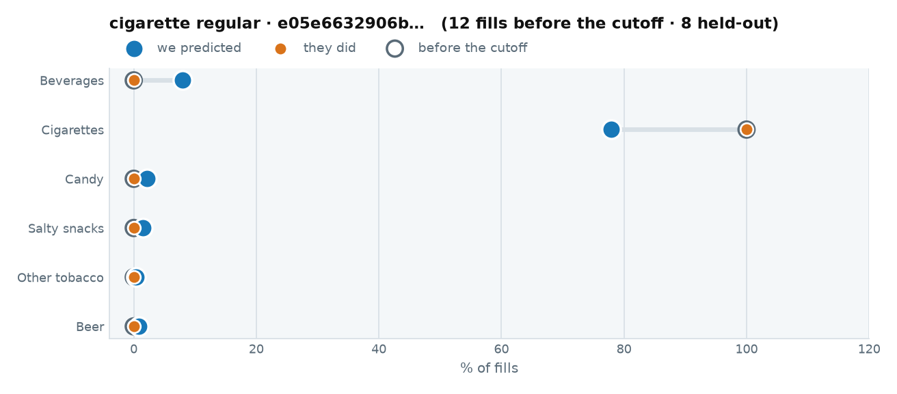

::: {.callout-note collapse="true" title="1 · The raw data we trained on"}

Every fuel visit before 2026-04-01. This is all the model was allowed to see.

::: {.scroll-table}
| when | daypart | grade | store | fuel $ | went in | categories |
|---|---|---|---|---|---|---|
| 2026-03-27 10:21 | midday | MID/PLUS | 11934 | 10.00 | **yes** | Cigarettes |
| 2026-02-26 13:11 | midday | MID/PLUS | 11934 | 25.00 | **yes** | Cigarettes |
| 2025-12-15 10:33 | midday | MID/PLUS | 11934 | 10.00 | **yes** | Cigarettes |
| 2025-12-10 11:59 | midday | MID/PLUS | 11934 | 20.00 | **yes** | Cigarettes |
| 2025-09-18 10:10 | midday | MID/PLUS | 11934 | 30.00 | **yes** | Cigarettes |
| 2025-08-28 11:06 | midday | MID/PLUS | 11934 | 10.00 | **yes** | Cigarettes |
| 2025-06-10 10:19 | midday | MID/PLUS | 11934 | 25.00 | **yes** | Cigarettes |
| 2025-05-29 10:53 | midday | MID/PLUS | 11794 | 30.00 | **yes** | Cigarettes |
| 2025-05-21 11:36 | midday | MID/PLUS | 11934 | 25.00 | **yes** | Cigarettes |
| 2025-05-08 10:33 | midday | MID/PLUS | 11934 | 25.00 | **yes** | Cigarettes |
| 2025-01-23 10:58 | midday | REGULAR | 11934 | 10.00 | **yes** | Cigarettes |
| 2024-12-13 09:46 | morning | REGULAR | 11934 | 20.00 | **yes** | Cigarettes |
:::

[All 12 fills, newest first — scroll the box. Their category rates are the left-hand chart above.]{.muted style="font-size:0.8em"}

The actual items behind those baskets — **1** distinct SKUs:

::: {.scroll-table}
| category | brand | units | spend $ |
|---|---|---|---|
| Cigarettes | Camel | 34 | 425.16 |
:::

:::

::: {.callout-note collapse="true" title="2 · What we predicted"}

At one fixed moment — **2026-06-15 07:12, REGULAR** — so the only thing that varies across these tabs is who they are:

| category | P(buys on this fill) |
|---|---|
| Cigarettes | 0.7477 |
| Beverages | 0.0526 |
| Candy | 0.0127 |
| Salty snacks | 0.0079 |
| Other tobacco | 0.0025 |
| Beer | 0.0017 |

**Stage one picks Packaged Beverages (Non-Alcoholic).** Stage two offers **Red Bull** (EV $0.00166).

And the rows actually written to `customer_scores.parquet` for their held-out fills:

::: {.scroll-table}
| when | daypart | P(enters) | offer category | Beverages | Cigarettes | Candy | Salty snacks | Other tobacco | Beer |
|---|---|---|---|---|---|---|---|---|---|
| 04-08 09:56 | morning | 0.7802 | Packaged Beverages (Non-Alcoholic) | 0.0797 | 0.7500 | 0.0285 | 0.0060 | 0.0058 | 0.0052 |
| 05-02 11:24 | midday | 0.8400 | Packaged Beverages (Non-Alcoholic) | 0.1044 | 0.8090 | 0.0248 | 0.0220 | 0.0045 | 0.0151 |
| 05-14 09:49 | morning | 0.8300 | Packaged Beverages (Non-Alcoholic) | 0.0797 | 0.8090 | 0.0170 | 0.0069 | 0.0045 | 0.0052 |
| 05-20 12:54 | midday | 0.7791 | Packaged Beverages (Non-Alcoholic) | 0.0750 | 0.7478 | 0.0170 | 0.0212 | 0.0045 | 0.0113 |
| 05-28 11:40 | midday | 0.7786 | Packaged Beverages (Non-Alcoholic) | 0.0750 | 0.7478 | 0.0191 | 0.0220 | 0.0049 | 0.0063 |
| 07-10 11:35 | midday | 0.8313 | Packaged Beverages (Non-Alcoholic) | 0.0797 | 0.8090 | 0.0191 | 0.0084 | 0.0045 | 0.0088 |
| 09-17 11:43 | midday | 0.7762 | Packaged Beverages (Non-Alcoholic) | 0.0707 | 0.7478 | 0.0206 | 0.0153 | 0.0026 | 0.0076 |
| 09-28 12:19 | midday | 0.8309 | Packaged Beverages (Non-Alcoholic) | 0.0684 | 0.8090 | 0.0248 | 0.0185 | 0.0021 | 0.0052 |
:::

Ranked SKUs inside that category:

| rank | brand | affinity | p_sku | p_category | p_buys |
|---|---|---|---|---|---|
| 1 | Red Bull | 0.37 | 0.0195 | 0.0797 | 0.0016 |
| 2 | Aquavista | 0.35 | 0.0183 | 0.0797 | 0.0015 |
| 3 | Mountain Dew | 0.34 | 0.0179 | 0.0797 | 0.0014 |

Second item: **David** (Salty Snacks), cohort index 1.30, headroom 100%

:::

::: {.callout-note collapse="true" title="4 · What ALS believes, against what they bought"}

Scored over the **106** SKUs ALS carries for *Cigarettes* in the morning.

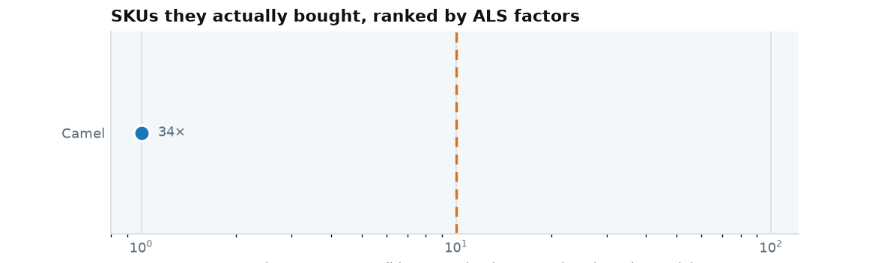

The SKUs they bought, and where ALS puts them:

::: {.scroll-table}
| brand | they bought | ALS score | rank | percentile |
|---|---|---|---|---|
| Camel | 34 | 0.878 | 1 | 100.00 |
:::

**1 of 1** of their own SKUs land in the top 10 of 106.

And what ALS ranks highest for them:

| brand | ALS score | times they bought it |
|---|---|---|
| Camel | 0.878 | 34 |
| Marlboro | 0.564 | 0 |
| Camel | 0.395 | 0 |
| Camel | 0.352 | 0 |
| Camel | 0.281 | 0 |

[The raw score is a dot product on the ALS path and a unit count on the fallback path, so it is not one scale — the percentile is the comparable column.]{.muted style="font-size:0.8em"}

:::

::: {.callout-note collapse="true" title="3 · What actually happened"}

Their own held-out fills — **8 of 8** ended inside:

::: {.scroll-table}
| when | daypart | went in | what they bought |
|---|---|---|---|
| 04-08 09:56 | morning | **yes** | Cigarettes |
| 05-02 11:24 | midday | **yes** | Cigarettes |
| 05-14 09:49 | morning | **yes** | Cigarettes |
| 05-20 12:54 | midday | **yes** | Cigarettes |
| 05-28 11:40 | midday | **yes** | Cigarettes |
| 07-10 11:35 | midday | **yes** | Cold Dispensed Beverages, Cigarettes |
| 09-17 11:43 | midday | **yes** | Cigarettes |
| 09-28 12:19 | midday | **yes** | Cigarettes |
:::

Their own predicted rate against their own outcome, over those 8 fills. At this sample size the gaps are noise as much as signal — which is the point of the cohort below:

| category | mean predicted | actual | gap |
|---|---|---|---|
| Beverages | 0.0791 | 0.0000 | -0.0791 |
| Cigarettes | 0.7787 | 1.00 | 0.2213 |
| Candy | 0.0214 | 0.0000 | -0.0214 |
| Salty snacks | 0.0150 | 0.0000 | -0.0150 |
| Other tobacco | 0.0042 | 0.0000 | -0.0042 |
| Beer | 0.0081 | 0.0000 | -0.0081 |

And across **766 shoppers** matching this archetype, over **3,209** held-out fills — enough rows for the rate to mean something:

| category | mean predicted | actual | gap |
|---|---|---|---|
| Beverages | 0.2881 | 0.2611 | -0.0270 |
| Cigarettes | 0.5218 | 0.5282 | 0.0064 |
| Candy | 0.0451 | 0.0443 | -0.0009 |
| Salty snacks | 0.0347 | 0.0293 | -0.0054 |
| Other tobacco | 0.0387 | 0.0483 | 0.0096 |
| Beer | 0.0516 | 0.0514 | -0.0001 |

:::

## salty · 9

**salty snack regular** — `e06070866d72…`. **21** fills before the cutoff, **9** after it, so this one can be checked against its own outcome.

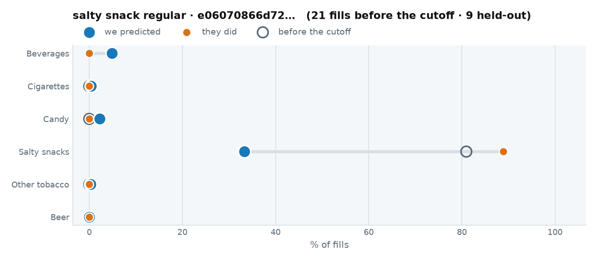

::: {.callout-note collapse="true" title="1 · The raw data we trained on"}

Every fuel visit before 2026-04-01. This is all the model was allowed to see.

::: {.scroll-table}
| when | daypart | grade | store | fuel $ | went in | categories |
|---|---|---|---|---|---|---|
| 2026-03-31 20:29 | evening | REGULAR | 8230 | 32.09 | **yes** | Salty Snacks, MERCHANDISE, Shelf Stable Products |
| 2026-03-22 20:12 | evening | REGULAR | 8230 | 36.42 | **yes** | Salty Snacks, MERCHANDISE |
| 2026-03-19 13:13 | midday | REGULAR | 8230 | 46.61 | no | — |
| 2026-03-10 19:29 | evening | REGULAR | 8230 | 35.66 | **yes** | Salty Snacks, Shelf Stable Products |
| 2026-03-02 20:32 | evening | REGULAR | 8230 | 23.02 | **yes** | Salty Snacks, MERCHANDISE, Shelf Stable Products |
| 2026-02-23 20:17 | evening | REGULAR | 8230 | 22.81 | **yes** | Salty Snacks, MERCHANDISE |
| 2026-02-21 20:29 | evening | REGULAR | 8230 | 16.33 | **yes** | MERCHANDISE, Salty Snacks |
| 2026-02-12 19:33 | evening | REGULAR | 8230 | 20.21 | **yes** | Salty Snacks, Other Dairy & Deli Products |
| 2026-01-15 20:26 | evening | REGULAR | 8230 | 16.77 | **yes** | Salty Snacks, Shelf Stable Products |
| 2026-01-05 20:26 | evening | REGULAR | 8230 | 12.85 | **yes** | Shelf Stable Products |
| 2025-12-28 19:35 | evening | REGULAR | 8230 | 19.17 | **yes** | Salty Snacks, Shelf Stable Products |
| 2025-12-18 20:25 | evening | REGULAR | 8230 | 7.59 | **yes** | Packaged Beverages (Non-Alcoholic), MERCHANDISE, Salty Snacks, Shelf Stable Products |
| 2025-11-11 19:29 | evening | REGULAR | 8230 | 21.62 | **yes** | Commissary & Other Packaged Products, Salty Snacks |
| 2025-10-13 20:07 | evening | REGULAR | 8230 | 23.38 | **yes** | Salty Snacks, Shelf Stable Products |
| 2025-10-11 19:33 | evening | REGULAR | 8230 | 16.13 | **yes** | Alternative Snacks, Salty Snacks |
| 2025-10-04 19:42 | evening | REGULAR | 8230 | 22.36 | no | — |
| 2025-09-05 04:17 | evening | REGULAR | 8230 | 34.11 | no | — |
| 2025-08-26 20:25 | evening | REGULAR | 8230 | 26.36 | **yes** | Salty Snacks |
| 2025-08-18 20:26 | evening | REGULAR | 8230 | 32.34 | **yes** | Salty Snacks, FOODSERVICE |
| 2025-08-10 19:58 | evening | REGULAR | 8230 | 18.82 | **yes** | FOODSERVICE, Salty Snacks |
| 2025-07-31 20:26 | evening | REGULAR | 8230 | 21.46 | **yes** | Salty Snacks, Shelf Stable Products |
:::

[All 21 fills, newest first — scroll the box. Their category rates are the left-hand chart above.]{.muted style="font-size:0.8em"}

The actual items behind those baskets — **7** distinct SKUs:

::: {.scroll-table}
| category | brand | units | spend $ |
|---|---|---|---|
| Salty Snacks | Nut Harvest | 35 | 142.14 |
| Salty Snacks | Blue Diamond | 15 | 36.53 |
| Salty Snacks | Valued Naturals | 3 | 11.97 |
| Salty Snacks | Fritos | 3 | 17.67 |
| Packaged Beverages (Non-Alcoholic) | Crystal Geyser | 1 | 1.79 |
| Packaged Beverages (Non-Alcoholic) | Dasani | 1 | 3.19 |
| Salty Snacks | Planters | 1 | 3.89 |
:::

:::

::: {.callout-note collapse="true" title="2 · What we predicted"}

At one fixed moment — **2026-06-15 07:12, REGULAR** — so the only thing that varies across these tabs is who they are:

| category | P(buys on this fill) |
|---|---|
| Salty snacks | 0.4233 |
| Beverages | 0.0707 |
| Candy | 0.0170 |
| Cigarettes | 0.0028 |
| Other tobacco | 0.0025 |
| Beer | 0.0000 |

**Stage one picks Salty Snacks.** Stage two shows **nothing** — every candidate prices below the threshold.

And the rows actually written to `customer_scores.parquet` for their held-out fills:

::: {.scroll-table}
| when | daypart | P(enters) | offer category | Beverages | Cigarettes | Candy | Salty snacks | Other tobacco | Beer |
|---|---|---|---|---|---|---|---|---|---|
| 04-19 20:27 | evening | 0.3935 | Salty Snacks | 0.0527 | 0.0034 | 0.0211 | 0.3421 | 0.0026 | 0.0000 |
| 04-28 20:27 | evening | 0.4048 | Salty Snacks | 0.0613 | 0.0034 | 0.0285 | 0.3421 | 0.0045 | 0.0000 |
| 05-08 17:54 | evening | 0.3971 | Salty Snacks | 0.0573 | 0.0028 | 0.0206 | 0.3421 | 0.0045 | 0.0000 |
| 07-20 20:26 | evening | 0.3906 | Salty Snacks | 0.0443 | 0.0047 | 0.0237 | 0.3421 | 0.0026 | 0.0000 |
| 08-08 20:50 | evening | 0.3909 | Salty Snacks | 0.0443 | 0.0041 | 0.0248 | 0.3421 | 0.0026 | 0.0000 |
| 08-17 20:54 | evening | 0.3165 | Salty Snacks | 0.0443 | 0.0028 | 0.0237 | 0.2636 | 0.0026 | 0.0000 |
| 09-06 19:53 | evening | 0.3868 | Salty Snacks | 0.0423 | 0.0034 | 0.0191 | 0.3421 | 0.0045 | 0.0001 |
| 09-15 20:22 | evening | 0.3883 | Salty Snacks | 0.0443 | 0.0041 | 0.0206 | 0.3421 | 0.0026 | 0.0000 |
| 09-24 20:28 | evening | 0.3856 | Salty Snacks | 0.0443 | 0.0034 | 0.0170 | 0.3421 | 0.0024 | 0.0000 |
:::

Ranked SKUs inside that category:

| rank | brand | affinity | p_sku | p_category | p_buys |
|---|---|---|---|---|---|
| 1 | Baken-ets | 1.0 | 0.0185 | 0.3421 | 0.0063 |
| 2 | Planters | 0.99 | 0.0184 | 0.3421 | 0.0063 |
| 3 | Planters | 0.92 | 0.0170 | 0.3421 | 0.0058 |

Second item: **Snickers** (Candy), cohort index 1.56, headroom 100%

:::

::: {.callout-note collapse="true" title="4 · What ALS believes, against what they bought"}

Scored over the **211** SKUs ALS carries for *Salty snacks* in the morning.

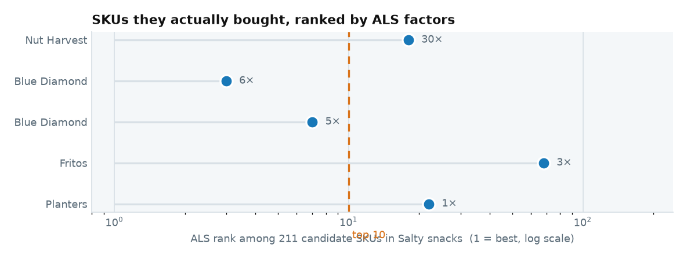

The SKUs they bought, and where ALS puts them:

::: {.scroll-table}
| brand | they bought | ALS score | rank | percentile |
|---|---|---|---|---|
| Nut Harvest | 30 | 0.217 | 18 | 91.90 |
| Blue Diamond | 6 | 0.41 | 3 | 99.10 |
| Blue Diamond | 5 | 0.266 | 7 | 97.20 |
| Fritos | 3 | 0.105 | 68 | 68.20 |
| Planters | 1 | 0.188 | 22 | 90.00 |
:::

**2 of 5** of their own SKUs land in the top 10 of 211.

And what ALS ranks highest for them:

| brand | ALS score | times they bought it |
|---|---|---|
| Planters | 0.468 | 0 |
| Planters | 0.433 | 0 |
| Blue Diamond | 0.41 | 6 |
| Spitz | 0.322 | 0 |
| Keebler | 0.316 | 0 |

[The raw score is a dot product on the ALS path and a unit count on the fallback path, so it is not one scale — the percentile is the comparable column.]{.muted style="font-size:0.8em"}

:::

::: {.callout-note collapse="true" title="3 · What actually happened"}

Their own held-out fills — **8 of 9** ended inside:

::: {.scroll-table}
| when | daypart | went in | what they bought |
|---|---|---|---|
| 04-19 20:27 | evening | **yes** | Salty Snacks, MERCHANDISE, Shelf Stable Products |
| 04-28 20:27 | evening | **yes** | Other Dairy & Deli Products, Salty Snacks, MERCHANDISE, Shelf Stable Products |
| 05-08 17:54 | evening | **yes** | Salty Snacks |
| 07-20 20:26 | evening | **yes** | Salty Snacks, Shelf Stable Products |
| 08-08 20:50 | evening | **yes** | Alternative Snacks, Salty Snacks, Shelf Stable Products |
| 08-17 20:54 | evening | **yes** | MERCHANDISE, Salty Snacks, Shelf Stable Products |
| 09-06 19:53 | evening | **yes** | Salty Snacks, Shelf Stable Products |
| 09-15 20:22 | evening | **yes** | Salty Snacks, Shelf Stable Products |
| 09-24 20:28 | evening | no | — |
:::

Their own predicted rate against their own outcome, over those 9 fills. At this sample size the gaps are noise as much as signal — which is the point of the cohort below:

| category | mean predicted | actual | gap |
|---|---|---|---|
| Beverages | 0.0483 | 0.0000 | -0.0483 |
| Cigarettes | 0.0036 | 0.0000 | -0.0036 |
| Candy | 0.0221 | 0.0000 | -0.0221 |
| Salty snacks | 0.3334 | 0.8889 | 0.5555 |
| Other tobacco | 0.0032 | 0.0000 | -0.0032 |
| Beer | 0.0000 | 0.0000 | -0.0000 |

And across **125 shoppers** matching this archetype, over **433** held-out fills — enough rows for the rate to mean something:

| category | mean predicted | actual | gap |
|---|---|---|---|
| Beverages | 0.4763 | 0.4804 | 0.0041 |
| Cigarettes | 0.0699 | 0.0739 | 0.0040 |
| Candy | 0.1231 | 0.1178 | -0.0054 |
| Salty snacks | 0.3122 | 0.3857 | 0.0735 |
| Other tobacco | 0.0353 | 0.0323 | -0.0030 |
| Beer | 0.0227 | 0.0277 | 0.0050 |

:::

## beer · 19

**beer regular** — `e0af7d43fd98…`. **61** fills before the cutoff, **19** after it, so this one can be checked against its own outcome.

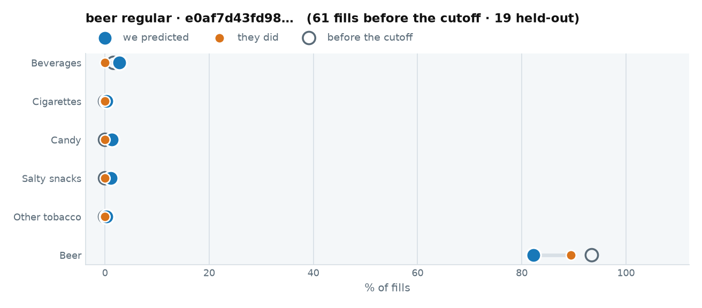

::: {.callout-note collapse="true" title="1 · The raw data we trained on"}

Every fuel visit before 2026-04-01. This is all the model was allowed to see.

::: {.scroll-table}
| when | daypart | grade | store | fuel $ | went in | categories |
|---|---|---|---|---|---|---|
| 2026-03-29 16:06 | evening | REGULAR | 11794 | 37.29 | **yes** | Beer |
| 2026-03-21 15:40 | evening | REGULAR | 11794 | 39.60 | **yes** | Beer |
| 2026-03-05 12:19 | midday | REGULAR | 11794 | 40.11 | **yes** | Beer |
| 2026-02-15 16:54 | evening | REGULAR | 11794 | 33.68 | **yes** | Beer |
| 2025-12-20 12:58 | midday | REGULAR | 11794 | 33.35 | **yes** | Beer |
| 2025-12-13 15:34 | evening | REGULAR | 11794 | 22.21 | **yes** | Beer |
| 2025-12-08 14:46 | midday | REGULAR | 11794 | 27.90 | **yes** | Beer |
| 2025-11-19 13:52 | midday | REGULAR | 11794 | 19.29 | **yes** | Beer |
| 2025-11-02 13:19 | midday | REGULAR | 11794 | 24.65 | **yes** | Beer |
| 2025-10-22 15:43 | evening | REGULAR | 11794 | 24.68 | **yes** | Beer |
| 2025-10-17 14:19 | midday | REGULAR | 11794 | 24.80 | **yes** | Beer |
| 2025-09-13 16:05 | evening | REGULAR | 11794 | 25.99 | **yes** | Beer |
| 2025-09-07 17:04 | evening | REGULAR | 11794 | 25.86 | **yes** | Beer |
| 2025-08-31 13:57 | midday | REGULAR | 11794 | 25.20 | **yes** | Beer |
| 2025-08-17 14:14 | midday | REGULAR | 11794 | 25.56 | **yes** | Beer |
| 2025-07-31 17:21 | evening | REGULAR | 11794 | 25.06 | **yes** | Beer |
| 2025-07-26 17:47 | evening | REGULAR | 11794 | 30.14 | **yes** | Packaged Beverages (Non-Alcoholic), Beer |
| 2025-07-14 17:04 | evening | REGULAR | 11794 | 27.81 | **yes** | Beer |
| 2025-07-10 16:51 | evening | REGULAR | 11794 | 39.33 | **yes** | Beer |
| 2025-06-30 15:25 | evening | REGULAR | 11794 | 26.45 | **yes** | Beer |
| 2025-06-16 14:48 | midday | REGULAR | 11794 | 25.48 | **yes** | Beer |
| 2025-06-11 15:53 | evening | REGULAR | 11794 | 24.77 | **yes** | Beer |
| 2025-06-02 17:11 | evening | REGULAR | 11794 | 27.05 | **yes** | Beer |
| 2025-04-15 17:09 | evening | REGULAR | 11934 | 25.51 | **yes** | Beer |
| 2025-04-07 11:59 | midday | REGULAR | 11794 | 32.51 | **yes** | Beer |
| 2025-03-29 14:40 | midday | REGULAR | 11794 | 32.15 | **yes** | Beer |
| 2025-03-26 16:37 | evening | REGULAR | 11934 | 30.78 | no | — |
| 2025-03-24 15:27 | evening | REGULAR | 11934 | 32.02 | no | — |
| 2025-03-22 14:21 | midday | REGULAR | 11934 | 31.47 | **yes** | Beer |
| 2025-03-19 16:07 | evening | REGULAR | 11934 | 32.26 | no | — |
| 2025-03-16 14:46 | midday | REGULAR | 11934 | 21.04 | **yes** | Beer |
| 2025-03-14 16:24 | evening | REGULAR | 11934 | 25.86 | **yes** | Beer |
| 2025-03-11 15:51 | evening | REGULAR | 11934 | 22.82 | **yes** | Beer |
| 2025-03-10 16:21 | evening | REGULAR | 11934 | 35.45 | **yes** | Beer |
| 2025-03-05 15:42 | evening | REGULAR | 11934 | 16.58 | **yes** | Beer |
| 2025-03-04 17:18 | evening | REGULAR | 11934 | 30.38 | **yes** | Beer |
| 2025-03-01 16:35 | evening | REGULAR | 11934 | 30.35 | **yes** | Beer |
| 2025-02-26 15:48 | evening | REGULAR | 11934 | 30.92 | **yes** | Beer |
| 2025-02-24 14:38 | midday | REGULAR | 11934 | 30.32 | no | — |
| 2025-02-21 16:36 | evening | REGULAR | 11934 | 25.79 | **yes** | Beer |
| 2025-02-15 16:48 | evening | REGULAR | 11794 | 29.73 | **yes** | Beer |
| 2025-02-13 17:13 | evening | REGULAR | 11794 | 27.83 | **yes** | Beer |
| 2025-02-11 15:07 | evening | REGULAR | 11934 | 35.20 | **yes** | Beer |
| 2025-02-08 17:44 | evening | REGULAR | 11794 | 36.93 | **yes** | Beer |
| 2025-02-04 17:08 | evening | REGULAR | 11794 | 33.89 | **yes** | Beer |
| 2025-02-01 13:22 | midday | REGULAR | 11934 | 29.63 | **yes** | Beer |
| 2025-01-28 12:43 | midday | REGULAR | 11794 | 18.68 | **yes** | Beer |
| 2025-01-25 16:55 | evening | REGULAR | 11794 | 32.17 | **yes** | Beer |
| 2025-01-22 13:18 | midday | REGULAR | 11794 | 26.15 | **yes** | Beer |
| 2025-01-18 15:13 | evening | REGULAR | 11934 | 28.50 | **yes** | Beer |
| 2025-01-15 15:33 | evening | REGULAR | 11794 | 33.73 | **yes** | Beer |
| 2025-01-12 13:38 | midday | REGULAR | 11794 | 30.18 | **yes** | Beer |
| 2025-01-06 12:36 | midday | REGULAR | 11934 | 39.75 | **yes** | Beer |
| 2025-01-02 17:08 | evening | REGULAR | 11794 | 46.31 | **yes** | Beer |
| 2024-12-12 16:05 | evening | REGULAR | 11934 | 31.61 | **yes** | Beer |
| 2024-11-30 16:38 | evening | REGULAR | 11794 | 19.79 | **yes** | Beer |
| 2024-11-15 18:30 | evening | REGULAR | 11794 | 32.17 | **yes** | Beer |
| 2024-11-07 15:22 | evening | REGULAR | 11934 | 30.09 | **yes** | Beer |
| 2024-10-21 14:23 | midday | REGULAR | 11794 | 34.21 | **yes** | Beer |
| 2024-10-14 14:41 | midday | REGULAR | 11794 | 37.46 | **yes** | Beer |
| 2024-10-04 13:18 | midday | REGULAR | 11794 | 25.29 | **yes** | Beer |
:::

[All 61 fills, newest first — scroll the box. Their category rates are the left-hand chart above.]{.muted style="font-size:0.8em"}

The actual items behind those baskets — **14** distinct SKUs:

::: {.scroll-table}
| category | brand | units | spend $ |
|---|---|---|---|
| Beer | Stella Artois | 252 | 1,574.22 |
| Beer | 10 Barrel Brewing Co. | 46 | 358.34 |
| Beer | Famosa | 16 | 44.64 |
| Beer | Modelo | 1 | 9.49 |
| Packaged Beverages (Non-Alcoholic) | Lipton | 1 | 2.49 |
| Beer | Happy Dad Hard Seltzer | 1 | 3.29 |
| Beer | Rolling Rock | 1 | 8.29 |
| Beer | Kona | 1 | 3.49 |
| Beer | Modelo Negra | 1 | 11.99 |
| Beer | Coors Banquet | 1 | 10.67 |
| Beer | Fat Tire | 1 | 10.29 |
| Packaged Beverages (Non-Alcoholic) | Pure Leaf | 1 | 2.49 |
| Beer | Estrella Jalisco | 1 | 3.29 |
| Packaged Beverages (Non-Alcoholic) | Gold Peak | 1 | 2.29 |
:::

:::

::: {.callout-note collapse="true" title="2 · What we predicted"}

At one fixed moment — **2026-06-15 07:12, REGULAR** — so the only thing that varies across these tabs is who they are:

| category | P(buys on this fill) |
|---|---|
| Beer | 0.8092 |
| Beverages | 0.0363 |
| Candy | 0.0170 |
| Salty snacks | 0.0060 |
| Cigarettes | 0.0028 |
| Other tobacco | 0.0020 |

**Stage one picks Beer.** Stage two offers **Pabst Blue Ribbon** (EV $0.01517).

And the rows actually written to `customer_scores.parquet` for their held-out fills:

::: {.scroll-table}
| when | daypart | P(enters) | offer category | Beverages | Cigarettes | Candy | Salty snacks | Other tobacco | Beer |
|---|---|---|---|---|---|---|---|---|---|
| 04-05 16:38 | evening | 0.8224 | Beer | 0.0228 | 0.0028 | 0.0285 | 0.0124 | 0.0045 | 0.8092 |
| 04-13 15:55 | evening | 0.8212 | Beer | 0.0215 | 0.0028 | 0.0248 | 0.0111 | 0.0045 | 0.8092 |
| 04-17 14:42 | midday | 0.8702 | Beer | 0.0328 | 0.0028 | 0.0248 | 0.0155 | 0.0045 | 0.8591 |
| 04-25 15:06 | evening | 0.8696 | Beer | 0.0328 | 0.0028 | 0.0248 | 0.0133 | 0.0026 | 0.8591 |
| 04-28 15:58 | evening | 0.8182 | Beer | 0.0228 | 0.0028 | 0.0091 | 0.0111 | 0.0026 | 0.8092 |
| 05-19 17:29 | evening | 0.8649 | Beer | 0.0161 | 0.0028 | 0.0091 | 0.0111 | 0.0026 | 0.8591 |
| 06-07 10:54 | midday | 0.8696 | Beer | 0.0527 | 0.0028 | 0.0091 | 0.0084 | 0.0026 | 0.8591 |
| 06-11 15:11 | evening | 0.8199 | Beer | 0.0328 | 0.0028 | 0.0080 | 0.0111 | 0.0026 | 0.8092 |
| 06-26 14:38 | midday | 0.8209 | Beer | 0.0328 | 0.0028 | 0.0091 | 0.0155 | 0.0026 | 0.8092 |
| 07-01 15:44 | evening | 0.8166 | Beer | 0.0228 | 0.0028 | 0.0054 | 0.0060 | 0.0024 | 0.8092 |
| 07-03 12:42 | midday | 0.8195 | Beer | 0.0297 | 0.0028 | 0.0091 | 0.0111 | 0.0024 | 0.8092 |
| 07-06 15:29 | evening | 0.8206 | Beer | 0.0228 | 0.0014 | 0.0237 | 0.0111 | 0.0024 | 0.8092 |
| 07-17 17:05 | evening | 0.8674 | Beer | 0.0297 | 0.0028 | 0.0091 | 0.0153 | 0.0026 | 0.8591 |
| 07-24 13:54 | midday | 0.8198 | Beer | 0.0328 | 0.0014 | 0.0091 | 0.0111 | 0.0024 | 0.8092 |
| 09-16 16:43 | evening | 0.8168 | Beer | 0.0178 | 0.0028 | 0.0065 | 0.0111 | 0.0026 | 0.8092 |
| 09-22 15:13 | evening | 0.8175 | Beer | 0.0228 | 0.0028 | 0.0080 | 0.0080 | 0.0026 | 0.8092 |
| 09-26 15:14 | evening | 0.8202 | Beer | 0.0328 | 0.0014 | 0.0091 | 0.0133 | 0.0024 | 0.8092 |
| 09-27 12:56 | midday | 0.8186 | Beer | 0.0297 | 0.0014 | 0.0091 | 0.0079 | 0.0019 | 0.8092 |
| 09-30 17:52 | evening | 0.8174 | Beer | 0.0228 | 0.0028 | 0.0054 | 0.0102 | 0.0026 | 0.8092 |
:::

Ranked SKUs inside that category:

| rank | brand | affinity | p_sku | p_category | p_buys |
|---|---|---|---|---|---|
| 1 | Happy Dad Hard Seltzer | 1.29 | 0.0166 | 0.8092 | 0.0135 |
| 2 | Modelo Especial | 1.26 | 0.0162 | 0.8092 | 0.0131 |
| 3 | Coors Light | 1.19 | 0.0154 | 0.8092 | 0.0124 |

Second item: **none** (nothing clears the gate)

:::

::: {.callout-note collapse="true" title="4 · What ALS believes, against what they bought"}

Scored over the **208** SKUs ALS carries for *Beer* in the morning.

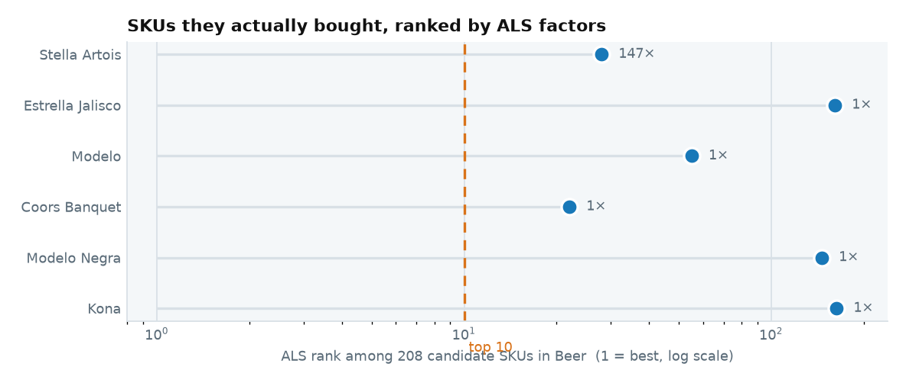

The SKUs they bought, and where ALS puts them:

::: {.scroll-table}
| brand | they bought | ALS score | rank | percentile |
|---|---|---|---|---|
| Stella Artois | 147 | 0.349 | 28 | 87.00 |
| Estrella Jalisco | 1 | 0.032 | 161 | 23.10 |
| Modelo | 1 | 0.213 | 55 | 74.00 |
| Coors Banquet | 1 | 0.428 | 22 | 89.90 |
| Modelo Negra | 1 | 0.043 | 146 | 30.30 |
| Kona | 1 | 0.029 | 163 | 22.10 |
:::

**0 of 6** of their own SKUs land in the top 10 of 208.

And what ALS ranks highest for them:

| brand | ALS score | times they bought it |
|---|---|---|
| Pabst Blue Ribbon | 0.818 | 0 |
| Arnold Palmer Spiked | 0.624 | 0 |
| Pabst Blue Ribbon | 0.597 | 0 |
| Coors Banquet | 0.593 | 0 |
| Pabst Blue Ribbon | 0.586 | 0 |

[The raw score is a dot product on the ALS path and a unit count on the fallback path, so it is not one scale — the percentile is the comparable column.]{.muted style="font-size:0.8em"}

:::

::: {.callout-note collapse="true" title="3 · What actually happened"}

Their own held-out fills — **17 of 19** ended inside:

::: {.scroll-table}
| when | daypart | went in | what they bought |
|---|---|---|---|
| 04-05 16:38 | evening | **yes** | Beer |
| 04-13 15:55 | evening | **yes** | Beer |
| 04-17 14:42 | midday | **yes** | Beer |
| 04-25 15:06 | evening | **yes** | Beer |
| 04-28 15:58 | evening | **yes** | Beer |
| 05-19 17:29 | evening | **yes** | Beer |
| 06-07 10:54 | midday | **yes** | Beer |
| 06-11 15:11 | evening | **yes** | Beer |
| 06-26 14:38 | midday | **yes** | Beer |
| 07-01 15:44 | evening | **yes** | Beer |
| 07-03 12:42 | midday | no | — |
| 07-06 15:29 | evening | **yes** | Beer |
| 07-17 17:05 | evening | no | — |
| 07-24 13:54 | midday | **yes** | Beer |
| 09-16 16:43 | evening | **yes** | Beer |
| 09-22 15:13 | evening | **yes** | Beer |
| 09-26 15:14 | evening | **yes** | Beer |
| 09-27 12:56 | midday | **yes** | Beer |
| 09-30 17:52 | evening | **yes** | Beer |
:::

Their own predicted rate against their own outcome, over those 19 fills. At this sample size the gaps are noise as much as signal — which is the point of the cohort below:

| category | mean predicted | actual | gap |
|---|---|---|---|
| Beverages | 0.0280 | 0.0000 | -0.0280 |
| Cigarettes | 0.0025 | 0.0000 | -0.0025 |
| Candy | 0.0127 | 0.0000 | -0.0127 |
| Salty snacks | 0.0113 | 0.0000 | -0.0113 |
| Other tobacco | 0.0028 | 0.0000 | -0.0028 |
| Beer | 0.8223 | 0.8947 | 0.0724 |

And across **431 shoppers** matching this archetype, over **1,780** held-out fills — enough rows for the rate to mean something:

| category | mean predicted | actual | gap |
|---|---|---|---|
| Beverages | 0.1646 | 0.1612 | -0.0034 |
| Cigarettes | 0.0813 | 0.0848 | 0.0036 |
| Candy | 0.0332 | 0.0354 | 0.0022 |
| Salty snacks | 0.0448 | 0.0388 | -0.0060 |
| Other tobacco | 0.0815 | 0.0860 | 0.0044 |
| Beer | 0.5106 | 0.4989 | -0.0117 |

:::

:::
