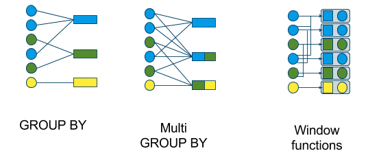

## Today

1. Your questions
2. Teams pick what they want to **teach**
3. Plan the rest of the semester
4. Aggregated calculations: **GROUP BY vs. windows**

## Questions {.dark background-color="#022F4A"}

**What's unresolved?**

<br>

[The take-home challenge · the easy feature challenge · your unit of analysis · Databricks]{.orange}

## Pick your teaching topic

**Every team teaches the class once.** 15 to 120 minutes, with a **hands-on coding activity**, self-contained in our GitHub organization.

::: {.columns}
::: {.column width="55%"}
**Pick today:** a topic and a date.

Choose something **your project needs**. You'll learn it properly by teaching it, and the class gets it when it's useful.
:::
::: {.column width="45%"}
::: {.card}
[Topics past teams took]{.card-title}

UDFs and pandas UDFs · regex · Streamlit in Docker · jobs and pipelines · GraphQL APIs · complex schemas · NLP in Spark · Spark ML
:::
:::
:::

## What's left this semester

| Still ahead | What it is |
|---|---|
| **PySpark verbal 1, 2, 3** | One-on-one, out loud, about code you wrote |
| Docker and Google Cloud | Containerize and publish |
| Feature challenge 2 | Complex features at our unit of analysis |
| **Take-home 2** | Second key PySpark challenge |
| ML challenge | A model on our features |
| Coding devotionals | **You** teach |
| **App challenge** | The final product |

Let's put dates on these together. [Class repository]()

# Aggregated calculations

## Two ways to summarize

{fig-align="center" width="78%"}

**GROUP BY** gives you fewer rows. **Windows** keep every row and add a column.

[From the book: [Aggregated calculations]()]{.muted style="font-size:0.6em"}

## GROUP BY changes the grain

```python
df.groupBy("Section").agg(
    F.mean("Score").alias("average"),
    F.stddev_samp("Score").alias("sd"))
```

| Section | average | sd |
|---|---|---|
| 1 | 90 | — |
| 2 | 80 | 7.07 |
| 3 | 86 | 18.25 |

**Six rows became three.** The new observational unit is the section.

## Windows keep the grain

```python
window = Window.partitionBy("Section")
window_order = Window.partitionBy("Section").orderBy(F.col("Score").desc())

df.withColumn("rank", F.rank().over(window_order)) \
  .withColumn("min", F.min("Score").over(window))
```

| Section | Student | Score | rank | min |
|---|---|---|---|---|
| 2 | b | 85 | 1 | 75 |
| 2 | c | 75 | 2 | 75 |
| 3 | d | 95 | 2 | 65 |

**Still six rows**, with the group's summary attached to each one.

## Why this is the feature-engineering skill

- Your **unit of analysis** decides which one you need.
- `groupBy` builds the table: one row per shopper, store, or week.
- `over(Window)` adds context without collapsing: *this basket vs. that shopper's average*.
- `partitionBy` + `orderBy` gives you **lags, ranks and running totals** — the temporal features.

::: {.takeaway}
**If you can't say whether a calculation changes the row count, you don't know what you're building yet.**
:::

## Work time {.dark background-color="#022F4A"}

**Pick your teaching topic. Then back to the feature challenge.**

<br>

[Tell me your topic and date before you leave.]{.orange}
