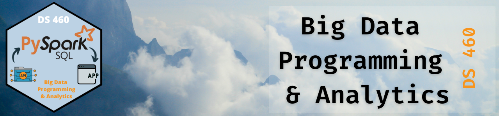

{fig-alt="DS 460 Big Data Programming and Analytics banner"}

## Class days

One deck per class meeting, in order.

::: {#decks}
:::

## Topics

Reusable decks on one tool or idea. Pull them into a class day when the class needs them.

::: {#topics}
:::

Press `s` in a deck for speaker view, `f` for full screen, and `Esc` for a slide overview.

## Reference

- [Course book](https://byuibigdata.github.io/bdbook/)
- [Course guide and syllabus](https://github.com/byuibigdata/course_guide)
