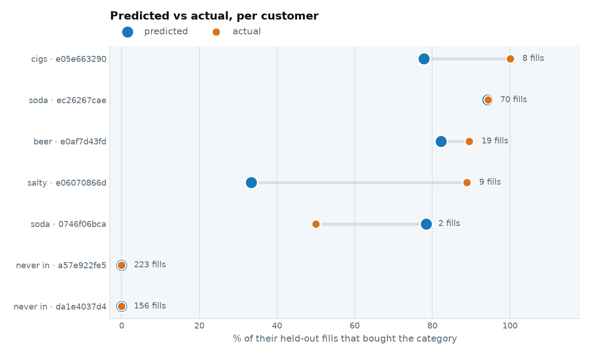
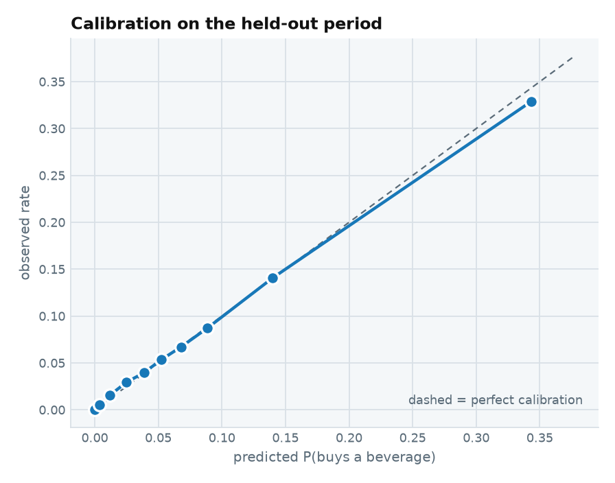

[pipeline v1](pipeline.html) draws the reasoning. [pipeline v2](pipeline2.html)
draws the tables. **This page is the evidence** — ten real customers carried
from the raw rows we trained on, through the prediction we wrote down, to
what they actually did afterwards.

It is written to be audited, not admired. Every number is reproducible from
the repo, and the places where the evidence is thin say so.

::: {.callout-note appearance="simple"}
**How to read this page**

1. **The headline** — one chart, every customer, predicted against actual.
2. **The ten customers** — a tab each, with the raw data, the prediction and
   the outcome collapsed inside. Open what you want to interrogate.
3. **The mechanism** — how a single fill becomes an offer, step by step.
4. **The check that carries weight** — 583,583 scored fills, not ten.
5. **What this cannot show** — the gap no amount of data here closes.

*Figures come from the 24-store pilot build (`config.PILOT_STORES`). The
columns and the code are real; margins are assumed, because the extract has
no cost column.*
:::

## 1 · The headline

Seven of the ten customers came back after the cutoff. For each one, what we
predicted for their category against what they actually did:



::: {.callout-tip appearance="simple"}
**Read the gap, not the dots.** A short bar is a good prediction. The soda
regular at 70 fills is a ring — predicted and actual land on the same point,
**94.2% against 94.3%**. The cigarette regular's 22-point gap is on **8
fills**, which is noise, and the chart says so by printing the count.
:::

## 2 · The ten customers, end to end

Each tab is one real shopper: the **raw rows** we trained on, the
**prediction** in `customer_scores.parquet`, **what actually happened**, and
**what ALS believed** against what they bought. Sections start collapsed.

Tabs read *archetype · held-out fills*. Two shoppers per archetype — the one
`personas.py` picks for being **most typical** before the cutoff, and one
that **also came back**.

::: {.callout-warning appearance="simple"}
**One customer cannot validate a probability.** `personas.py` selects for
being typical and never asks whether the shopper reappears — so four of its
five have *no* held-out record, and a fifth has two fills. That is why every
tab also carries the whole **cohort** matching that archetype, from 433 to
105,866 held-out fills.
:::



## 3 · The check that carries weight

Sections 1 and 2 are illustrations. **This is the section that decides
whether any of it can be used**, and it is worth saying why.

An offer is chosen by multiplying a probability by dollars. That makes
*ranking* accuracy almost irrelevant and *scale* accuracy everything: a model
that sorts customers perfectly but reports 0.34 where the truth is 0.20 will
rank the right person first and then price the offer 70% too high. **AUC
cannot see that error at all** — it is invariant to any monotone rescaling of
the scores. Calibration is the only check that looks at it.

Ten customers cannot answer that. Every scored row can. Taking all
**583,583** held-out fills, sorting them by predicted `P(buys a beverage)` and
cutting into ten equal buckets:

{width=62%}

| Decile | Predicted | Actual | Gap |
|---|---|---|---|
| 1 (lowest) | 0.0001 | 0.0005 | +0.0004 |
| 3 | 0.0119 | 0.0157 | +0.0038 |
| 5 | 0.0385 | 0.0395 | +0.0009 |
| 7 | 0.0678 | 0.0671 | −0.0007 |
| 9 | 0.1400 | 0.1407 | +0.0008 |
| **10 (highest)** | **0.3430** | **0.3287** | **−0.0144** |

The middle of the distribution is calibrated to within a tenth of a point.
**The top decile is the one to watch**: at a predicted 34.3% the observed rate
is 32.9%, so the model is mildly *over*-confident exactly where it is most
willing to spend money. That is the right direction to be wrong in for a
sceptic and the wrong direction for a budget — an offer priced off the top
decile is buying about 4% less attach than the arithmetic assumes.

The bottom three deciles run slightly *under*-confident, which is the
signature of isotonic calibration flattening at the floor.

### What we can conclude from this

**The probabilities can be used as probabilities.** Through the middle of the
distribution predicted and observed agree to within a tenth of a point, so
multiplying them by a margin is legitimate arithmetic rather than a
rescaling of a score. That is the permission this whole pipeline needs.

**Discount any budget built off the top decile by about 4%.** Predicted 34.3%
against an observed 32.9% is a 1.4-point gap — small absolutely, but it sits
precisely where we are most willing to spend, so it is the error that costs
money. It is also the safe direction to be wrong in: we overestimate the
value of the offers we are keenest on, rather than missing good ones.

**The under-confidence at the bottom is harmless.** Those are customers we
would not offer to anyway; being slightly pessimistic about someone we were
going to show nothing to changes no decision.

### What it does *not* let us conclude

Calibration says our prediction of **what they do anyway** is accurate. It
says nothing about what an offer *changes* — `p₁` appears nowhere in it. A
perfectly calibrated model of the status quo is still no evidence that a
discount moves anybody, which is why the holdout remains the ask.

### And stage two: did it name the item they bought?

Calibration says nothing about the SKU. The direct test, on the 25,894
held-out fills where ALS ran and the customer bought inside the offered
category:

| k | SKU Affinity | Store best seller | Lift |
|---|---|---|---|
| **1** | **9.1%** | 3.2% | 2.8× |
| 5 | 24.2% | 11.4% | 2.1× |
| 10 | 34.3% | 16.9% | 2.0× |

**`k = 1` is the row that matters, because the screen shows one offer.**
Across *all* evaluable fills — personalised and fallback together — we name
the exact item at **6.2%** against the best seller's 2.9%. Quoting hit@10 and
stopping there would overstate what the product does: ten guesses is not the
product, one is.

Both rankings scored on the **same rows**. Scoring ALS rows against fallback
rows would compare two different populations — the ALS path only exists for
shoppers with history, who buy more anyway — and would flatter the model for
reasons that have nothing to do with it.

**The conclusion is narrower than it looks.** ALS doubles hit@10 *where it
runs*, and it runs on **31.6%** of fills. Weight the two paths together and
the personalised tier moves the overall hit rate from 16.9% to about 22% —
real, and smaller than the 2× headline. The practical consequence: the
quality of the **best-seller fallback** matters more to the product than the
quality of ALS, because it answers two fills in three.

[On fallback rows the two rankings agree **100.000%** of the time. They are
the same ranking by construction, so that is the control that says the
harness works. `validate_sku.py` prints the breakdown by
category.]{.muted style="font-size:0.85em"}


# How one fill becomes an offer

Sections 1–3 are the evidence. These are the mechanism: a single customer
carried through the pipeline, one step at a time, with the numbers the
models actually produced at each step.

### And the second item: the one bet we cannot settle

The pair offer had never been scored. It has now, on the 43,850 held-out
fills where the customer bought the anchor category and carried a
second-item offer:

| | Landed |
|---|---|
| Our pair offer | **10.8%** |
| Most popular second category | **14.0%** |

**We are 0.78× the naive baseline, and that is the design working.** The
mechanism is visible when you split by what we offered:

| We offered | Fills | They bought it | They bought Salty Snacks |
|---|---|---|---|
| Salty Snacks | 37,800 | 11.9% | 11.9% |
| Alternative Snacks | 5,233 | **4.5%** | **26.0%** |

On the fills where `headroom` steers us *away* from Salty Snacks — because
this shopper already buys it constantly — they go on to buy Salty Snacks
**26% of the time**, and the thing we offered instead **4.5%**.

::: {.callout-important appearance="simple"}
**That trade is the entire bet of the second-item idea, and it is unfalsifiable
with this data.** We are giving up a 26% chance of being "right" about an item
they would have bought anyway, for a 4.5% chance on one they rarely buy — on
the theory that only the second is incremental. If the theory holds, the
baseline's 14% is mostly margin given away to people already walking to the
cooler. If it does not, we are simply worse.

Nothing in a co-occurrence table can separate those two worlds. This is the
same `p₁` gap as everywhere else, and it is the sharpest argument for the
holdout on this page: the pairing idea is the one place where we are
*deliberately* choosing the lower-probability offer, so it is the place where
being unable to measure uplift costs the most.
:::

## 4 · A car pulls up

A card is dipped at the pump. It is read **before the fuel flows**, so
identity arrives at the *start* of the fill, not the end. Everything here is
known without touching a database:

| | |
|---|---|
| shopper | `a37306b69b70…` — hash of card BIN + last 4 + store state |
| clock | 2026-06-15 07:12 → daypart **morning** |
| grade | REGULAR |
| dollars pumped | $38.82, live off the meter |
| store | 8228 |

**These are the gas features.** Seven columns, no history — enough on their
own to score a customer we have never seen.

## 5 · One lookup

A single read against a shopper-keyed table — precomputed nightly, not
scanned live:

| | |
|---|---|
| prior fuel visits | **57** |
| of those, went inside | **52 (91%)** |

| Category | Bought before | Share of prior visits |
|---|---|---|
| Packaged Beverages | yes | **86.0%** |
| Cigarettes | yes | 36.8% |
| Candy | yes | 14.0% |
| Salty Snacks | yes | 7.0% |
| Other Tobacco / Nicotine | no | 0.0% |
| Beer | no | 0.0% |

This is a regular, and a creature of habit: nine fills in ten end with a
drink. **Every figure is computed strictly from visits before this one** — the
window excludes the current row, which is the difference between a model that
works and one that reads its own answer.

## 6 · Category Relevance (classification)

Six calibrated gradient-boosted classifiers, one per category, each scoring
**this fill directly**:

| Category | P(buys it on this fill) | Offerable? |
|---|---|---|
| **Packaged Beverages** | **0.6782** | yes |
| Cigarettes | 0.3613 | **no — regulated** |
| Salty Snacks | 0.2727 | yes |
| Candy | 0.0852 | yes |
| Other Tobacco / Nicotine | 0.0020 | **no — regulated** |
| Beer | 0.0004 | yes |

**There is no separate "will they come inside" model.** These are
unconditional — coming inside is already inside them. An earlier version
multiplied an attach model in front; measured against scoring directly, the
two matched to three decimals, so the stage was deleted.

**What drives this shopper:** context, plus their own record — inside on 98%
of 55 prior fills, with their category mix in the features. The single
strongest feature is the prior attach *rate*: how many times we have seen
someone is worth +0.004 AUC, what share of those visits ended inside is worth
+0.109.

If you want `P(enters the store)` as a number, derive it:

```
P(enters) = 1 − Π(1 − pᵢ) = 0.78
```

AUC 0.822 against a dedicated attach model's 0.827. Report it — but keep it
**out** of the expected value, or the category term counts twice.

::: {.callout-warning appearance="simple"}
**Read saturated scores carefully.** Isotonic calibration is a step function,
so an emphatic history can push a category to the top or bottom step — 1.0 or
0.0 exactly. Both are clamped, but a score at either rail means "as confident
as the calibrator can express", not a certainty.
:::

## 7 · SKU Affinity (ALS)

### Stage one has already settled the category

The six probabilities above pick it: the most likely category we are
**allowed** to show. For this shopper that is Packaged Beverages at 0.6782.
Stage two may only look inside it.

That restriction is deliberate. An earlier version ranked the whole catalog
in one pass by expected value, and offered **candy** to a customer the model
was 90.6% sure wanted a beverage. Not a coding bug — a denominator. `p_sku`
is normalised within its category, so a four-SKU category concentrates its
probability into four numbers while beverages spread theirs across hundreds.
A 2% category with a short tail out-earns a 90% category with a long one, and
the two expected values were never comparable in the first place.

So: **relevance picks the category, economics picks the item inside it.**
Margin cannot overrule relevance. Ties in stage one — a brand-new customer is
at the probability floor in all six — go to the daypart's best-selling
category, because otherwise the alphabet decides and "Beer" wins.

This shopper **is** in the ALS factor matrix, so the ranking is personal
rather than a best-seller list. That puts them in the minority: **31.6%** of
scored fills have enough category history to qualify. The other **68.4%** get
the **Best-Seller Fallback**, which is the primary path, not a degraded one.

Where ALS does run it earns the slot — **hit@10 of 34.3% against the best
seller's 16.9%** on the same fills, a 2.0× lift. See `validate_sku.py`.

| Brand | P(sku) | Margin | Brand funds | Our cost |
|---|---|---|---|---|
| **Red Bull** | 0.0055 | $2.48 | 100% | $0.00 |
| Red Bull | 0.0027 | $4.44 | 100% | $0.00 |
| Dasani | 0.0041 | $3.68 | 0% | $0.90 |
| Red Bull | 0.0043 | $2.03 | 100% | $0.00 |

`P(sku)` is normalised **within the category** — "given they buy a drink,
which drink" — which is what the decision multiplies against `P(category)`.
**Ranked on `p_buys`, not on expected value.** Inside one category a fat
margin on a less likely item would otherwise beat a thin margin on a likely
one — and those margins are average price × an assumed 40%, so that ordering
would be an assumption choosing the offer. `P(category)` is constant down
this table, so it cannot change the order; it only converts `P(sku)` into a
probability you can multiply by dollars later.

## 8 · Offer Economics

### The arithmetic

```
  P(category)      0.6782
x P(sku)           0.0055
  ------------------------
  P(buys this)     0.003708
x effective margin $2.48 - $0.00 = $2.48
  ------------------------
  expected value   $0.00920 per fill
```

> **Show: Red Bull.**

Dasani carries a bigger margin at $3.68 and still loses: it is self-funded, so
$0.90 of that is ours to give away, while Red Bull's discount is covered in
full by the brand.

A tenth of a cent sounds like nothing. Across 36.1M fuel visits it is not —
and more to the point, it is **positive**, which a self-funded version of the
same offer would not be.

::: {.callout-note appearance="simple"}
**These dollars do not leave this page.** `unit_margin` is average price times
an assumed 40% — the PDI extract has no cost column — so the arithmetic above
is a worked demonstration of the *rule*, not a measurement. The scored table
(`customer_scores.parquet`) carries probabilities only: `affinity`, `p_sku`,
`p_category`, `p_buys`. The margin terms live in `negotiate.py`, where the
assumption is the subject rather than a hidden input.
:::

## 9 · The pairing offer — the second item

Everything above answers *what will they buy*. That makes it the wrong thing
to discount. A promotion on the item they had already decided to buy gives
away margin and changes no behaviour; it is the one offer guaranteed to lose.

So the useful question is the second one. **46.5% of drink baskets are
drink-only.** That is the addressable population: a customer who is going to
buy a drink regardless, and might be persuaded to add something.

### Three numbers, and all three are needed

| | What it is | What it is for |
|---|---|---|
| `basket_lift` | `P(B` given `A in basket)` over `P(B)` | Basket co-occurrence. Symmetric |
| `cohort_index` | B's attach rate among A-regulars ÷ the rate among **equally frequent** other shoppers | **Gating** |
| `excess` | the same comparison as a difference, in attach points | **Ranking** |
| `headroom` | `1 −` this shopper's own rate of B | Don't discount what they already buy |

::: {.callout-important appearance="simple"}
**Controlling exposure is the whole trick.** Every cohort here is defined as
"at least five purchase baskets", so every cohort is a cohort of *heavy
shoppers* and indexes high on nearly everything. The first cut of this
analysis had drink regulars over-indexing on frozen food at 6.1×, which was
pure visit frequency. Comparing against shoppers who buy *just as often* and
do not buy the anchor divides that out.
:::

### Drink regulars vs equally frequent others

| Pair category | Their rate | Others | Index | Excess |
|---|---|---|---|---|
| **Alternative Snacks** | 0.0602 | 0.0346 | **1.74** | 2.6pp |
| Commissary | 0.0316 | 0.0193 | 1.64 | 1.2pp |
| Packaged Sweet Snacks | 0.0669 | 0.0474 | 1.41 | 2.0pp |
| **Salty Snacks** | 0.1218 | 0.0938 | 1.30 | **2.8pp** |
| Candy | 0.1217 | 0.1142 | 1.07 | 0.8pp |
| Cigarettes | 0.0995 | 0.2258 | 0.44 | — |
| Beer | 0.0373 | 0.1893 | 0.20 | — |

**Gate on the index, rank on the excess.** The failure modes are opposite.
Volume alone picks the popular item — Candy is 18.2% of every second item in
a drink basket and looks obvious, but at an index of 1.07 drink regulars buy
it barely more than anyone else; it is not a complement, it is just
everywhere. The index alone picks the tiny item — Other Dairy indexes 1.32 on
a 0.55% attach rate. The excess is in attach points, so it ranks by how much
extra business the pairing is associated with, and it puts candy fifth.

### There are two missions, and they repel each other

| Anchor | Best complement | Verdict |
|---|---|---|
| Packaged Beverages | Alternative Snacks 1.74 | Pairs well |
| Salty Snacks | Alternative Snacks 1.97, Candy 1.56 | Pairs well |
| **Beer** | Liquor 1.08 — nothing else above 0.63 | **Never paired** (by rule) |
| **Cigarettes** | General Merchandise 2.46 — nothing else above 0.65 | **Do not pair** |

The snack-and-drink categories are mutually complementary. The
beer/tobacco/lottery categories are complementary with *each other* and
strongly negative against the whole first group. A beer run is not a snack
run. For a beer anchor the honest output is **no pair offer at all** — every
candidate is something beer regulars buy *less* than average.

### Alcohol is out of the pairing question entirely

Beer and cigarettes sit at the bottom of that table for the same reason, but
only one of them is a rule. `config.NOT_PAIRABLE` excludes **Beer, Wine and
Liquor on both sides**: a beer anchor returns no pair offer, and alcohol is
never offered as a second item. The measurement happens to agree — beer's
only complement above 1.0 is Liquor at 1.08 — but the rule does not depend on
that holding, and a pump screen answering "beer" with "and a bottle of
liquor" is not a merchandising idea.

This is *narrower* than `NOT_OFFERABLE`. Beer remains a legitimate **anchor**
offer; it simply neither takes nor becomes a second item.

### The catalog had to grow to answer this

The three strongest complements to a drink were not in `offer_catalog.csv` at
all, because `TARGET_CATEGORIES` was chosen for the anchor question and these
are categories almost nobody buys *anyway*. The engine could name a category
and then shrug. So `SKU_MODEL_CATEGORIES` is now
`TARGET_CATEGORIES + PAIR_CATEGORIES`:

| Added category | SKUs in catalog | Index vs a drink |
|---|---|---|
| Alternative Snacks | 468 | **1.74** |
| Packaged Sweet Snacks | 251 | 1.41 |
| Commissary & Other Packaged | 135 | 1.64 |

Safe for the anchor path **by construction**: stage one only considers
categories that have a Category Relevance model, and those are fitted over
`TARGET_CATEGORIES` alone. The new categories reach the catalog and the ALS
factors and nothing else — they can be the second item, never the first.

### It ships as a column

`customer_scores.parquet` carries `second_category` and
`second_category_skus` beside `offer_category` and `top_skus` — populated on
**560,690 of 583,583 rows**, empty where nothing clears the gate.

The struct deliberately has **no `p_category` and no `p_buys`**. The pair
category usually sits outside the six, so it has no relevance model and there
is no `P(category)` to multiply; a product built from a placeholder would
read as a measurement. It carries `cohort_index`, `excess` and `headroom`
instead — the gate, the rank, and the room left to grow.

::: {.callout-warning appearance="simple"}
**None of this is causal,** and this is the same gap as everywhere else.
Co-occurrence says these things appear together; it does not say a discount
on B *causes* a B purchase. That needs a holdout, and there is not one.
:::

## Two gaps this page cannot close

**No logged propensity.** A production version must write down what it showed
**and the probability it showed it with**. Without that, off-policy
evaluation is impossible later and the information cannot be reconstructed
after the fact — it is the cheapest thing on this list and the easiest to
forget.

**Assumed margins.** `unit_margin` is average price × 40%. The extract has no
cost column, so every dollar figure here moves the moment someone supplies
real ones. The probabilities do not.

## Run it yourself

```bash
cd data/pipeline_analysis
UV="uv run --with polars --with scikit-learn --with joblib --with implicit"

$UV python explain.py --demo
$UV python explain.py --shopper <id> --time "2026-06-15 17:45" --grade DIESEL
$UV python explain.py --demo --json          # the same trace as a dict
```

`serve.py` gives the answer; `explain.py` gives the reasoning;
`negotiate.py` gives the funding floor; `score_table.py` writes the same
answer for every fill in the held-out period. All four read the same
artifacts, and all four rank through the single function in `scoring.py` —
serving is just the one-row case. That matters more than it sounds: when the
live path and the batch path each had their own copy of the ranking, the
copies drifted twice, and both times the table on disk recommended beer to
customers whose beer propensity was 0.004. Three of the 68 checks in
`validate.py` now score the same twelve fills both ways and require the
probabilities, the expected values and the chosen SKU to match exactly.
