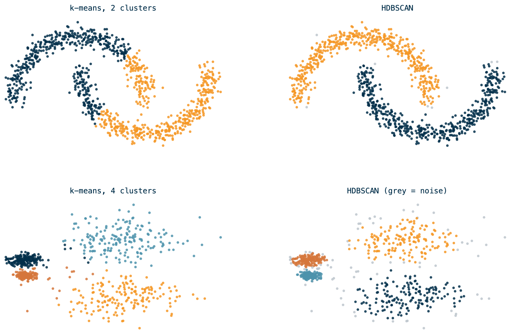
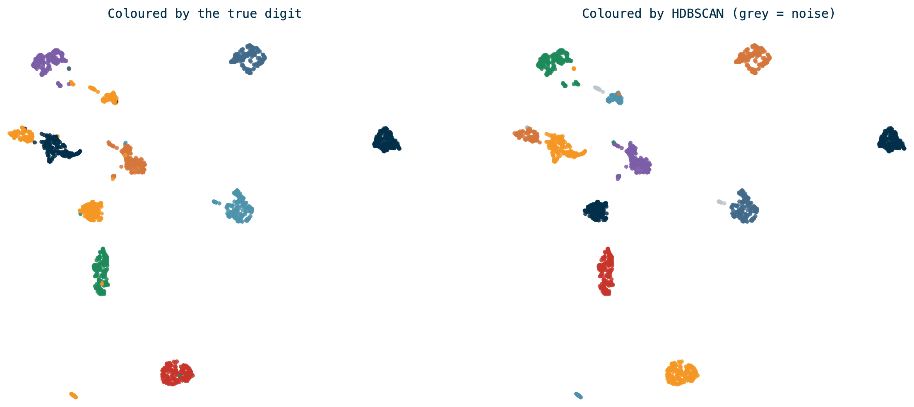

## Where we are {.dark background-color="#022F4A"}

[Rules found **what sells together**. Labels predicted **one outcome**.]{.statement}

<br>

[Segmentation asks a different question: **who are these customers, and how many kinds are there?**]{.orange}

## Unlabeled learning

**There is no Y.** No right answer to train against, so nothing to score yourself against at the end.

::: {.cards}
::: {.card}
[Supervised]{.card-title}

You know the answer for past rows. The model learns to reproduce it.

*Did this visit include fuel?*
:::
::: {.card}
[Unsupervised]{.card-title}

You have only the features. The model looks for structure.

*What kinds of shoppers are there?*
:::
:::

That freedom is the danger: **an algorithm will always return groups**, whether or not they mean anything.

## Clustering

> Partitioning a set of objects into groups so that objects in the same group are more similar to each other than to those in other groups.

The analyst defines "similar." That choice — which features, on what scale — decides the answer more than the algorithm does.

::: {.takeaway}
**Clusters are a hypothesis, not a finding.** You still have to show they're stable and that someone can act on them.
:::

# Picking an algorithm

## k-means vs. HDBSCAN

{fig-align="center" width="68%"}

[Illustrative: `make_moons` and `make_blobs` from scikit-learn, not customer data.]{.muted style="font-size:0.6em"}

## What the picture shows

::: {.columns}
::: {.column width="50%"}
::: {.card .bad}
[k-means]{.card-title}

- You must **pick k** in advance
- Cuts by distance to a centre, so it only finds round blobs
- **Every point** gets a cluster, outliers included
:::
:::
::: {.column width="50%"}
::: {.card .good}
[HDBSCAN]{.card-title}

- **Finds the number** of clusters itself
- Follows **density**, so shapes can be anything
- Points in sparse regions are labeled **noise**, not forced
:::
:::
:::

For customers, "I don't know how many segments there are" and "some shoppers fit no segment" are both honest, so HDBSCAN fits the problem.

## The two knobs

- **`min_cluster_size`** — the smallest group you'll accept as a segment. Larger values are more robust on noisy data.
- **`min_samples`** — how dense a neighborhood must be for a point to count as core. Higher means more points called noise. Defaults to `min_cluster_size`; **tune it second**.

```python
labels = HDBSCAN(min_cluster_size=100, min_samples=20).fit_predict(X)
```

[For a customer product, set `min_cluster_size` to your **privacy floor**: no segment smaller than the number of shoppers you're willing to report on.]{.orange}

# Too many dimensions

## The curse of dimensionality

With 20 behavioral features per shopper, distance stops meaning much: in high dimensions, **everything is far from everything**, and "nearest neighbor" loses its edge over the average point.

- Distances concentrate, so density looks flat
- Sparse space, so clusters have no room to be dense
- Compute cost grows with every column

**Dimension reduction** maps the data to fewer dimensions while keeping what matters: which points are near which.

## UMAP

**Uniform Manifold Approximation and Projection.**

1. Find each point's nearest neighbors in the original high-dimensional space.
2. Build a graph of those neighbor relationships.
3. Lay the graph out in 2 to 5 dimensions, nudging points until the layout preserves the neighborhoods.

::: {.cards}
::: {.card}
[`n_neighbors`]{.card-title}

Small keeps local detail. Large keeps the global shape.
:::
::: {.card}
[`min_dist`]{.card-title}

How tightly points may pack. Low for clustering, higher for a readable picture.
:::
::: {.card}
[`n_components`]{.card-title}

Output dimensions. **5 to cluster, 2 to draw.**
:::
:::

## UMAP on handwritten digits

{fig-align="center" width="92%"}

64 pixel columns, projected to 2. HDBSCAN found **12 clusters** with **1.8% noise** — close to the 10 true digits, splitting a couple of them.

[Illustrative: scikit-learn `digits`, not customer data.]{.muted style="font-size:0.6em"}

## Why digits are the honest test

We **know** the answer here: 10 digits. So we can see the failure modes you won't see on customers:

- Some digits split into **two clusters** (different handwriting styles)
- Some sit **next to** each other (4, 7 and 9 overlap)
- A few points land in **no cluster**

::: {.takeaway}
**On customer data nobody hands you the digits.** That's why stability checks replace accuracy.
:::

# Segmenting customers

## The pipeline

::: {.flow}
::: {.box}
[1]{.step} Features

[~20 per shopper]{.muted}
:::

[→]{.arrow}

::: {.box}
[2]{.step} Scale

[log, standardize]{.muted}
:::

[→]{.arrow}

::: {.box .hl}
[3]{.step} UMAP → 5-D
:::

[→]{.arrow}

::: {.box .hl}
[4]{.step} HDBSCAN
:::

[→]{.arrow}

::: {.box}
[5]{.step} Name them

[profile each group]{.muted}
:::
:::

**Scaling matters more than it looks.** Dollars run to the hundreds and trip counts to single digits, so without scaling, spend decides every cluster.

## Features for a C-Store shopper

::: {.columns}
::: {.column width="50%"}
- **Frequency and value:** trips, basket total, items per trip
- **Timing:** daypart shares, weekday vs. weekend
:::
::: {.column width="50%"}
- **Mission:** fuel, fountain and food, packaged drinks, snacks, tobacco
- **Price and payment:** discount use, credit vs. debit
:::
:::

Leave **store brand out** of the features. Otherwise you cluster by where people shop, then "discover" that each brand has its own shoppers.

## Pick the unit of analysis first

**One row per what?** For segments, it's one row per **shopper**, not per basket — but over what span?

::: {.cards}
::: {.card .bad}
[One week]{.card-title}

A trial run split the segments almost entirely by **daypart**, because most shoppers made a single trip.
:::
::: {.card .good}
[A quarter or more]{.card-title}

Enough trips per shopper that frequency, mission and timing can vary within a row.
:::
:::

[**Example conclusions** — from a one-store, one-week sample, not a finished analysis.]{.muted style="font-size:0.65em"}

## Naming the segments

The model returns `0, 1, 2, -1`. **You** turn those into something a client can use:

1. Profile each cluster against the features that built it.
2. Find what makes it **different from the average**, not what's biggest in it.
3. Name it for the behavior: *Morning commuters*, *Fill-up only*.
4. Check the name survives a new quarter of data.

::: {.takeaway}
**`-1` is a real answer.** "Unsegmented" shoppers are a group too, and often a big one.
:::

# At scale: Databricks and PySpark

## Spark builds the table, not the clusters

**UMAP and HDBSCAN are single-machine libraries.** Spark ML has k-means, bisecting k-means and Gaussian mixtures — **no HDBSCAN**.

::: {.flow}
::: {.box .hl}
**PySpark**

[millions of lines → one row per shopper]{.muted}
:::

[→]{.arrow}

::: {.box}
**One machine**

[UMAP + HDBSCAN on the shopper table]{.muted}
:::

[→]{.arrow}

::: {.box .hl}
**PySpark**

[join labels back, profile, write Delta]{.muted}
:::
:::

The heavy lifting is the **feature build**, and that's the part Spark is for.

## Why the handoff is fine

The transaction data is big. **The shopper table isn't.**

::: {.cards}
::: {.card}
[Millions]{.card-title}

of transaction lines, across stores and quarters. Spark territory.
:::
::: {.card}
[~100k rows]{.card-title}

one per shopper, with ~20 columns. A few MB in memory.
:::
:::

A table that fits in a driver's memory doesn't need a cluster to cluster it. **Use Spark to get there, then stop.**

## In a Databricks notebook

```python
%pip install umap-learn hdbscan

features = spark.table("workspace.cstore.shopper_features")   # built with Spark
pdf = features.toPandas()                                     # Arrow handles the move

labels = hdbscan.HDBSCAN(min_cluster_size=50).fit_predict(
    umap.UMAP(n_components=5, min_dist=0.0).fit_transform(X))
```

- `%pip install` is **notebook-scoped**: it installs on the driver for this session.
- `toPandas()` moves everything to the driver. **Check the row count first.**
- Serverless compute gives you a modest driver. If it won't fit, sample.

# Making conclusions

What you can claim from a segmentation, and what you can't

## How you know it worked

Without a Y, you check **stability and usefulness**:

- **Noise share.** If 60% is noise, your features or knobs are wrong.
- **Across random seeds.** Do the same shoppers land together each run?
- **Across time.** Does last quarter's segment still describe the same people?
- **Against a simple baseline.** Does it beat RFM (recency, frequency, monetary) buckets?
- **The client test.** Can someone name an action per segment? If not, it's decoration.

## What segmentation can't do

- It **won't tell you why** anyone belongs to a group.
- It **won't predict** what a shopper does next. That's a labeled model.
- It will give you groups **even from noise**, so a result alone proves nothing.
- Segments **drift**: refit on a schedule and expect the boundaries to move.

## Your turn {.dark background-color="#022F4A"}

**Name three segments you expect in your C-Store data.**

<br>

[What features would separate them? What would a store do differently for each? If the model can't find them, what does that tell you?]{.orange}
